# Awesome 3D Printers <!-- omit from toc -->

A curated catalog of open-design and community-documented FDM printers to build, modify, or study. Each design has **one catalog row**. The [gallery](GALLERY.md) shows every printer as a picture. The [gallery](GALLERY.md) shows every printer as a picture. The [gallery](GALLERY.md) shows every printer as a picture. [Column notes](#column-notes) explain the columns and marks. The printer name links to its project repository when available, otherwise to the creator's project page or a useful community reference. [Maker and family labels](#browse-by-maker-or-family) help you find related designs without repeating rows. Within each kinematics section or size group, rows are sorted by GitHub stars. Designs without a repository are sorted by their highest like count.

## Contents <!-- omit from toc -->

- [Start here](#start-here)
- [Printers by motion system](#printers-by-motion-system)
  - [CoreXY](#corexy)
    - [Large (≥300 × 300 mm)](#large-300--300-mm)
    - [Medium (181–299 mm representative X/Y size)](#medium-181299-mm-representative-xy-size)
    - [Small (≤180 mm representative X/Y size)](#small-180-mm-representative-xy-size)
  - [Cross-gantry](#cross-gantry)
  - [Cartesian](#cartesian)
    - [Medium (\>180 mm on either X/Y axis)](#medium-180-mm-on-either-xy-axis)
    - [Small (≤180 mm on both X/Y axes)](#small-180-mm-on-both-xy-axes)
  - [Delta](#delta)
  - [Other motion systems](#other-motion-systems)
- [Conversions](#conversions)
- [Concepts and prototypes](#concepts-and-prototypes)
- [Legacy designs](#legacy-designs)
- [Historical designs](#historical-designs)
- [Column notes](#column-notes)
- [Mini footprint comparison](#mini-footprint-comparison)
- [Browse by maker or family](#browse-by-maker-or-family)
- [How to contribute](#how-to-contribute)

## Start here

A few different reasons to choose a first project; these point to the full catalogue rows below.

- **[Voron 2.4](#voron-2-4) - Flying-gantry CoreXY**  
combines an enclosed design with detailed documentation, a large community, and kit options.
- **[VzBot Vz330](#vzbot) - Speed-focused build**  
is a platform for speed benchmarking, with AWD variants.
- **[Voron Trident](#voron-trident) - Classic full-size CoreXY**  
has a great manual, a fixed gantry and independently driven Z bed, a large community, and many kit options.
- **[Annex K3 / Gasherbrum](#annex-k3) - Cross-gantry build**  
is a compact, rigid, speed-oriented design with a builder community.
- **[Rook MK1](#rook-mk1) - Mostly printed CoreXY**  
is a compact introduction to CoreXY.
- **[SimpleCore](#simplecore) - Budget-friendly CoreXY**  
offers triple-Z bed motion and an expandable frame for a first build.
- **[Duender](#duender) - Reuse existing printers**  
converts parts from two Ender-3 machines into a CoreXY.
- **[Lemontron](#lemontron) - Explore a different layout**  
is a portable inverted printer; check the revision notes before building.
- **[Delta Flyer](#delta-flyer) - Try a delta**  
pairs a small delta with a build manual.
- **[Kappy](#kappy) - Small, approachable build**  
is a beginner-oriented bedslinger with a creator-supplied manual and BOM.
- **[Rat Rig V-Core 4.1](#ratrig-v-core-4-1) - Large format with IDEX**  
offers 300–500 mm sizes, with Hybrid and IDEX upgrades; the kit is also available.
- **[Jubilee](#jubilee) - Modular tool changer**  
is an extensible multi-tool platform with source CAD and a project wiki.
- **[LH Stinger](#lh-stinger) - Fast Cartesian build**  
offers a performance-focused moving-bed layout with published CAD and a wiki.
- **[Micron](#micron) - Miniature enclosed CoreXY**  
brings a Voron-inspired build to a small footprint; its manual is still in progress.
- **[T250](#t250) - Advanced high-speed CoreXY**  
uses a four-motor gantry and has published build files and documentation.

## Printers by motion system

The primary sections group related XY motion layouts; the **CoreXY** section also includes VOSTOK’s Markforged-derived XY/2 belt-drive layout. Designs that also sell as kits are included.

### CoreXY

Groups use a **representative printable X/Y size**: Large starts at 300×300 mm. Small is 180×180 mm or less. Medium is everything between. A scalable design can offer variants in other groups; its full range remains in the build-volume cell. Designs without a fixed or confirmed volume are placed by their intended format, with the uncertainty kept in that cell. CORE One and CORE One L have separate rows because they are distinct published models.

#### Large (≥300 × 300 mm)

| Photo | Printer and why it’s interesting | Build volume (X×Y×Z) | Exterior (W×D×H) | Latest version | Stars Likes Views | Links | Groups |
| --- | --- | --- | --- | --- | --- | --- | --- |
| <a href="printers/vostok/README.md">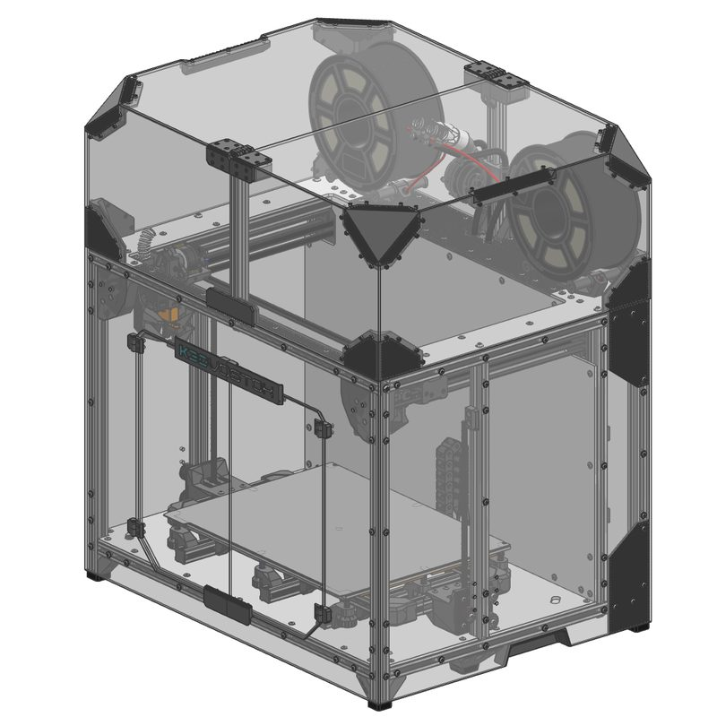</a> | [**K3D VOSTOK v9.5**](https://k3d.tech/vostok/) *Dmitry Sorkin / K3D* Large, open-design Markforged-derived XY/2 IDEX with dual printheads. Russian-language HTML documentation; use your browser’s page translation to read it in English. | M: 400×250×250 L: 400×400×400 XL: 500×500×500 | — | v9.5 [2026-09](https://github.com/dmitry-sorkin/k3d-site/commit/216940b018256db9034c302572943339170f926e) | [⏯️⁠107K](https://www.youtube.com/watch?v=upwTgwNi1PQ) [❤️⁠3.9K](https://www.youtube.com/watch?v=upwTgwNi1PQ) | [STEP](https://k3d.tech/vostok/releases/9.5/assets/vostok_v9.5_assembly.stp.7z) [BOM](https://k3d.tech/vostok/releases/9.5/assets/vostok_v9.5_bom.xlsx) [Manual](https://k3d.tech/vostok/manual/prepare/start/) [Config](https://github.com/dmitry-sorkin/vostok_configuration/blob/main/README.en.md) | [Telegram](https://t.me/vostok3dp) RU 4.2K [Telegram](https://t.me/k3d_vostok) RU 3.4K [Telegram](https://t.me/K_3_D) RU 36.2K |
|  | [**Prusa CORE One L**](https://www.printables.com/model/1520379-prusa-core-one-l-full-cad-assembly) *Prusa family* Larger enclosed CORE One variant with a released STEP/Fusion assembly; CAD uses the Open Community License, and full manufacturing data is not published. | 300×300×330 | 469×521×635 | CAD [2025-12](https://www.printables.com/model/1520379-prusa-core-one-l-full-cad-assembly) | [🧡⁠1.8K](https://www.printables.com/model/1520379-prusa-core-one-l-full-cad-assembly) [⏯️⁠5M](https://www.youtube.com/watch?v=guS0BpeI0aQ) [❤️⁠917](https://www.youtube.com/watch?v=guS0BpeI0aQ) | [CAD](https://www.printables.com/model/1520379-prusa-core-one-l-full-cad-assembly) [Files](https://www.prusa3d.com/page/open-source-at-prusa-research_236812/) | [Forum](https://forum.prusa3d.com/forum/prusa-core-one-l/) EN 78.7K [Reddit](https://www.reddit.com/r/prusa3d/) EN 112K [Forum](https://forum.prusa3d.com/es/) ES 78.7K [Forum](https://forum.prusa3d.com/cs/) CS 78.7K [Facebook](https://www.facebook.com/groups/Prusai3users/) EN 47.5K [Discord](https://discord.gg/prusa3d) EN 13.6K |
| <a href="printers/vzbot/README.md">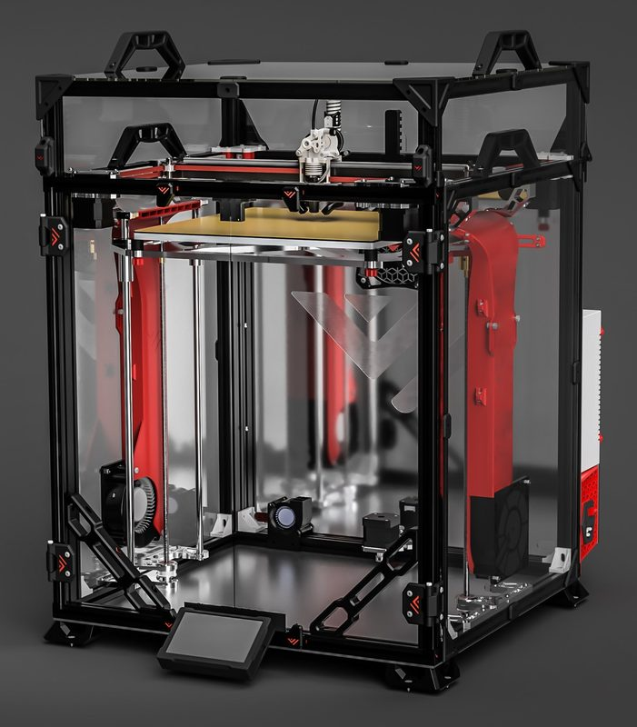</a> | [**VzBot Vz330**](https://github.com/VzBoT3D/VzBoT-Vz330) *VzBot family* High-speed design with AWD variants. | 330×330×400 | 530×500×570 | Vz-330 1.2 [2023-03](https://github.com/VzBoT3D/VzBoT-Vz330/releases/tag/v1.2) |  [⏯️⁠139K](https://www.youtube.com/watch?v=A3jx4bZE3AU) [❤️⁠2.5K](https://www.youtube.com/watch?v=A3jx4bZE3AU) | [CAD](https://github.com/VzBoT3D/VzBoT-Vz330/tree/HEAD/CAD) [Manual](https://github.com/VzBoT3D/VzBoT-Vz330/tree/HEAD/Build%20guide-manual) | [Facebook](https://www.facebook.com/groups/vzbot/) EN 10.1K [Discord](https://discord.gg/KWZWvCMxCq) EN 9.3K [Reddit](https://www.reddit.com/r/vzbot/) EN 463 |
| <a href="printers/ratrig-v-core-4-1/README.md">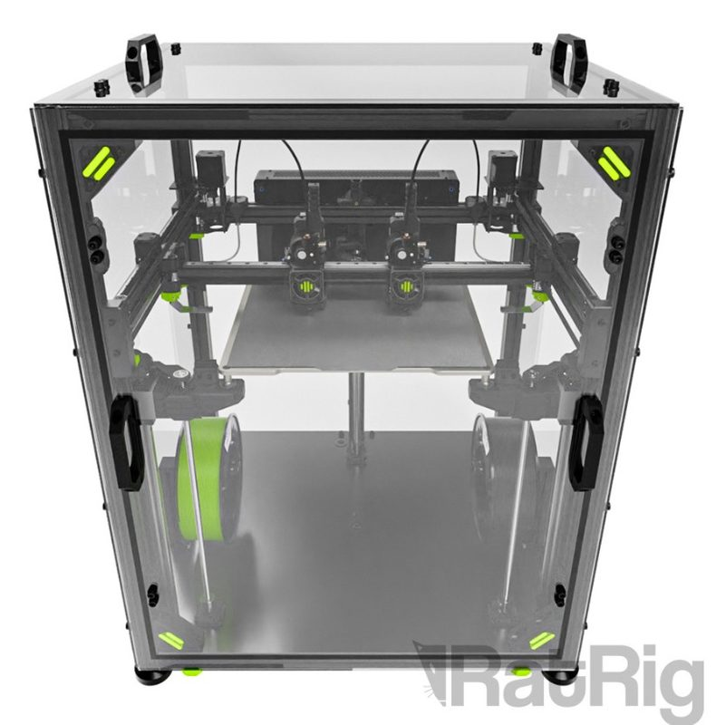</a> | [**Rat Rig V-Core 4.1**](https://ratrig.com/products/rat-rig-v-core-4-1) *Rat Rig family* Current large-format platform with optional Hybrid and IDEX upgrades. | 300: 300×300×300 400: 400×400×400 500: 500×500×500 | 300: 623×583×785 400: 723×683×885 500: 823×783×985 | 4.1 [2026-01](https://www.youtube.com/watch?v=R555xlsRq3E) | [🧡⁠50](https://www.printables.com/model/1142398) [⏯️⁠29.7K](https://www.youtube.com/watch?v=qzcF4g1z9MI) [❤️⁠794](https://www.youtube.com/watch?v=qzcF4g1z9MI) | [CAD](https://a360.co/49FDeXb) [Files](https://wiki.ratrig.com/products/v-core-4-1/files) [Manual](https://wiki.ratrig.com/products/v-core-4-1/build-guide) [BOM](https://docs.google.com/spreadsheets/d/1lGxKfwd0G22HPD6DDV5jK_a0T9UC1q8YWn3PXyn1YvQ/edit) | [Facebook](https://www.facebook.com/groups/ratrig3dprintercommunity) EN 19.9K [Discord](https://discord.gg/ratrig) EN 13.8K [Reddit](https://www.reddit.com/r/RatRig/) EN 3K |
|  | [**Jubilee**](https://github.com/machineagency/jubilee) *Machine Agency* Open tool-changing platform. | 300×300×300 | 476×604×558 | v2.2.2 [2021-10](https://github.com/machineagency/jubilee/releases/tag/v2.2.2) |  [💙⁠994](https://www.thingiverse.com/thing:3843001) [⏯️⁠779](https://www.youtube.com/watch?v=TfB29j_LmQw) [❤️⁠16](https://www.youtube.com/watch?v=TfB29j_LmQw) | [STEP](https://github.com/machineagency/jubilee/blob/HEAD/frame/cads/STEP/jubilee.STEP) [Wiki](https://jubilee3d.com/) | [Discord](https://discord.gg/XkphRqb) EN 2K [Reddit](https://www.reddit.com/r/Jubilee3D/) EN 88 |
| <a href="printers/railcore-ii/README.md">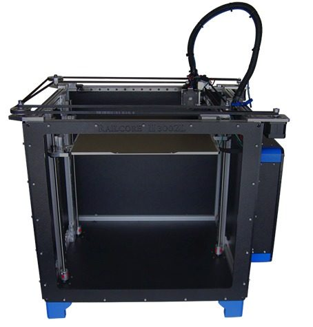</a> | [**RailCore II**](https://github.com/railcore/parts) *RailCore family* Rail-guided, rigid CoreXY. | 300ZL: 300×300×330 300ZLT: 300×300×600 | 300ZL: 572×495×546 300ZLT: 572×495×830 | CAD [2020-10](https://github.com/railcore/parts/commit/45a68a4f941d5f8e2e07596e1877a5b1ad6989ae) |  [💙⁠568](https://www.thingiverse.com/thing:2407174) [🧡⁠19](https://www.printables.com/model/160936) [⏯️⁠6.4K](https://www.youtube.com/watch?v=7e-cUZTqmMM) [❤️⁠47](https://www.youtube.com/watch?v=7e-cUZTqmMM) | [STEP](https://github.com/railcore/parts/tree/HEAD/STEP) | [Facebook](https://www.facebook.com/groups/RailCore/) EN 2.6K [Discord](https://discord.gg/Sy569Hq) EN 742 [Reddit](https://www.reddit.com/r/railcore/) EN 206 |

#### Medium (181–299 mm representative X/Y size)

| Photo | Printer and why it’s interesting | Build volume (X×Y×Z) | Exterior (W×D×H) | Latest version | Stars Likes Views | Links | Groups |
| --- | --- | --- | --- | --- | --- | --- | --- |
|  | [**Voron 2.4**](https://github.com/VoronDesign/Voron-2) *Voron family* Large enclosed design with a moving gantry. | 250: 250×250×230 300: 300×300×280 350: 350×350×330 | 250: 410×410×430 300: 460×460×480 350: 510×510×530 | V2.4r2 [2022-02](https://github.com/VoronDesign/Voron-2/releases/tag/V2.4r2) |  [⏯️⁠21.5K](https://www.youtube.com/watch?v=HqeTA0CJd3c) [❤️⁠226](https://www.youtube.com/watch?v=HqeTA0CJd3c) | [CAD](https://github.com/VoronDesign/Voron-2/tree/HEAD/CAD) [Manual](https://github.com/VoronDesign/Voron-2/blob/HEAD/Manual/Assembly_Manual_2.4r2.pdf) | [Discord](https://discord.gg/voron) EN 40.8K [Reddit](https://www.reddit.com/r/VORONDesign/) EN 39.7K [Forum](https://forum.vorondesign.com/) EN 12.8K [Facebook](https://www.facebook.com/groups/voroncorexy/) EN 54.2K [Facebook](https://www.facebook.com/groups/479932403103163/) DE 2.6K [Telegram](https://t.me/aboutvoron) RU 551 [Telegram](https://t.me/voron_siboor_es) ES 212 [Forum](https://www.lesimprimantes3d.fr/forum/154-voron/) FR |
|  | [**Prusa CORE One**](https://www.printables.com/model/1520471-prusa-core-one-full-cad-assembly) *Prusa family* Enclosed commercial CoreXY with a released STEP/Fusion assembly; CAD uses the Open Community License, and full manufacturing data is not published. | 250×220×270 | 415×444×555 | CAD [2025-12](https://www.printables.com/model/1520471-prusa-core-one-full-cad-assembly) | [🧡⁠2.5K](https://www.printables.com/model/1520471-prusa-core-one-full-cad-assembly) [⏯️⁠3.5M](https://www.youtube.com/watch?v=rddfSdsEDnw) [❤️⁠2.3K](https://www.youtube.com/watch?v=rddfSdsEDnw) | [CAD](https://www.printables.com/model/1520471-prusa-core-one-full-cad-assembly) [Files](https://www.prusa3d.com/page/open-source-at-prusa-research_236812/) [Manual](https://help.prusa3d.com/manual/prusa-core-one-kit-assembly_2321) | [Forum](https://forum.prusa3d.com/forum/prusa-core-one/) EN 78.7K [Reddit](https://www.reddit.com/r/prusa3d/) EN 112K [Forum](https://forum.prusa3d.com/es/) ES 78.7K [Forum](https://forum.prusa3d.com/cs/) CS 78.7K [Facebook](https://www.facebook.com/groups/Prusai3users/) EN 47.5K [Discord](https://discord.gg/prusa3d) EN 13.6K |
| <a href="printers/tela-corexy/README.md">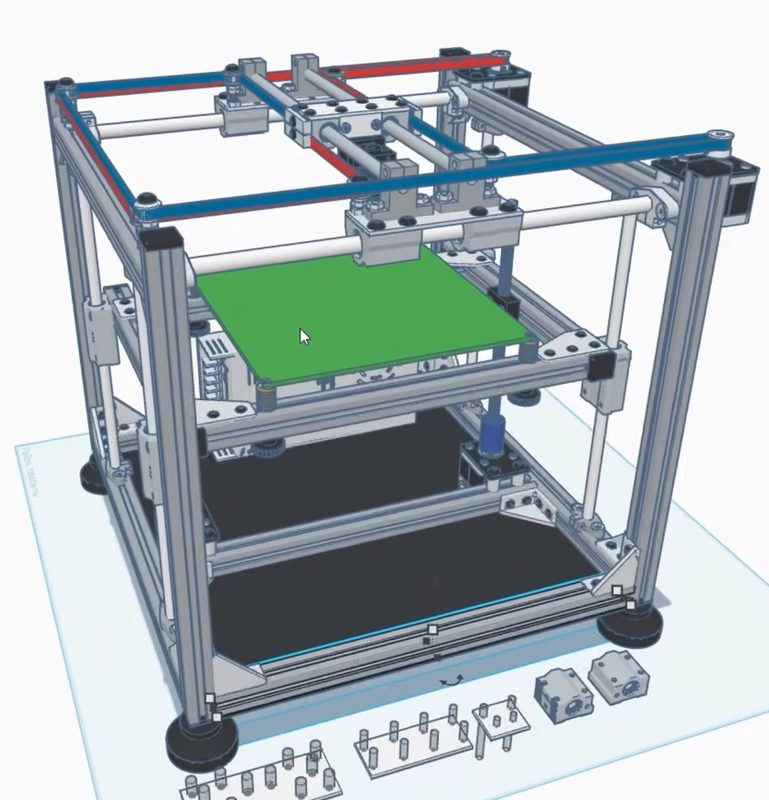</a> | [**TeLa**](https://www.youtube.com/playlist?list=PLRrkC8b4XLig8odCiBDuxA58ZgszBqeMb) *Техно Лаборатория* "3D printer without a 3D printer": a Russian-language CoreXY tutorial series with an English audio track available; assembled from stock parts and metal blanks with simple tools, without preprinted parts. | — | — | Part 3.2 [2025-08](https://www.youtube.com/watch?v=yq7GaFnIq_o) | [⏯️⁠53.5K](https://www.youtube.com/watch?v=g6D4_WkEhJ4) [❤️⁠1.8K](https://www.youtube.com/watch?v=g6D4_WkEhJ4) | [CAD](https://www.tinkercad.com/things/5MnFstEdMgc-3d-printer-corexy-tela-part-two) [BOM](https://docs.google.com/spreadsheets/d/10DQ8teJVQdOapGwjsQAr7z3AT7WktHvg3ojpcD-1PAI/edit) [Video](https://www.youtube.com/playlist?list=PLRrkC8b4XLig8odCiBDuxA58ZgszBqeMb) | — |
| <a href="printers/simplecore/README.md">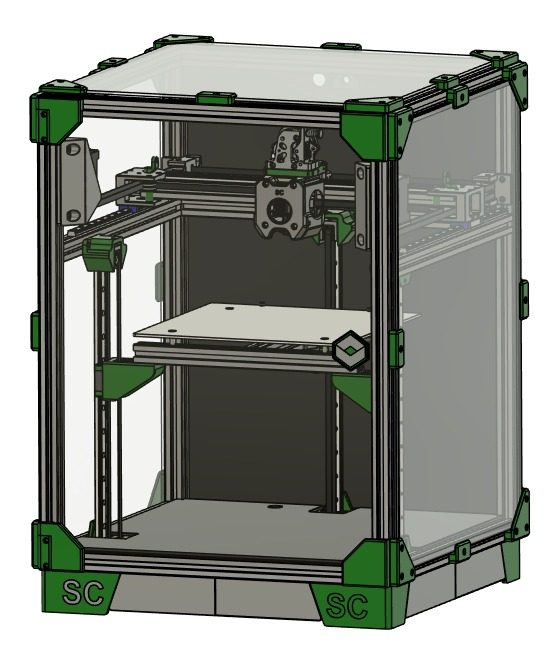</a> | [**SimpleCore**](https://www.printables.com/model/1473500-simplecore) *Rolohaun* Budget-friendly CoreXY with triple-Z bed and an expandable frame. | 215×220×220 | — | Update [2026-06](https://www.printables.com/model/1473500-simplecore) | [🧡⁠298](https://www.printables.com/model/1473500-simplecore) [⏯️⁠89.7K](https://www.youtube.com/watch?v=HWfT2JbMOvM) [❤️⁠1.8K](https://www.youtube.com/watch?v=HWfT2JbMOvM) | [Files](https://www.printables.com/model/1473500-simplecore/files) [STEP](https://github.com/rolohaun/SimpleCore/blob/HEAD/CAD/SimpleCore%20MK1.step) | [Discord](https://discord.gg/rolohaun-3d-946191040682008666) EN 7.8K |
| <a href="printers/voron-trident/README.md">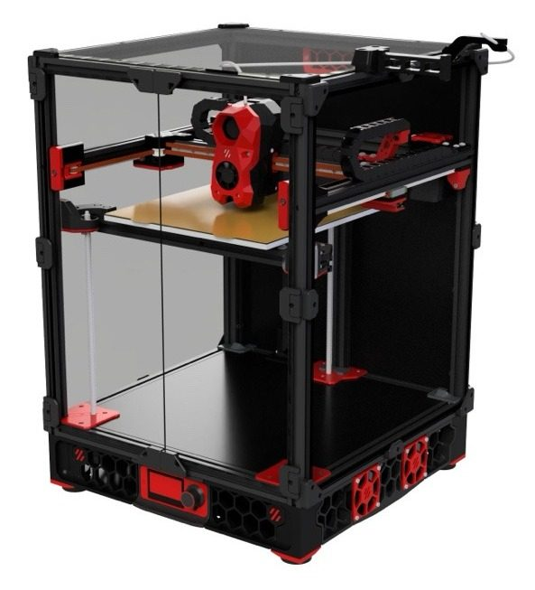</a> | [**Voron Trident**](https://github.com/VoronDesign/Voron-Trident) *Voron family* Fixed gantry and independently driven Z bed; current R2 release revises XY and Z motion. | 250: 250×250×250 300: 300×300×250 350: 350×350×250 | 250: 410×410×500 300: 460×460×500 350: 510×510×500 | R2 [2026-06](https://github.com/VoronDesign/Voron-Trident/releases/tag/VTr2) |  | [CAD](https://github.com/VoronDesign/Voron-Trident/tree/HEAD/CAD) [Manual](https://github.com/VoronDesign/Voron-Trident/blob/HEAD/Manual/Assembly_Manual_Trident.pdf) | [Discord](https://discord.gg/voron) EN 40.8K [Reddit](https://www.reddit.com/r/VORONDesign/) EN 39.7K [Forum](https://forum.vorondesign.com/) EN 12.8K [Facebook](https://www.facebook.com/groups/voron.trident/) EN 1.4K [Facebook](https://www.facebook.com/groups/voroncorexy/) EN 54.2K [Facebook](https://www.facebook.com/groups/479932403103163/) DE 2.6K [Telegram](https://t.me/aboutvoron) RU 551 [Telegram](https://t.me/voron_siboor_es) ES 212 [Forum](https://www.lesimprimantes3d.fr/forum/154-voron/) FR |
|  | [**T250**](https://github.com/mszturc/T250) *Matt the Printing Nerd* Larger high-speed successor to THE100. | 192×212×175 | — | v1.0 [2025-06](https://github.com/mszturc/T250/commit/a4122fcc8357f2c880618e81e76a03eee02da1f5) |  [🧡⁠851](https://www.printables.com/model/1341051-t250-the-worlds-fastest-3d-printer) [⏯️⁠169K](https://www.youtube.com/watch?v=qVF_iwO3d04) [❤️⁠6K](https://www.youtube.com/watch?v=qVF_iwO3d04) | [STEP](https://github.com/mszturc/T250/blob/HEAD/CAD/T250-v1.0-final.step) [Manual](https://github.com/mszturc/T250/tree/HEAD/Docs) | [Discord](https://discord.gg/fW7BcUErgZ) EN 4.4K [Facebook](https://www.facebook.com/groups/181335024786568) EN 456 |
| <a href="printers/snakeoil-xy/README.md">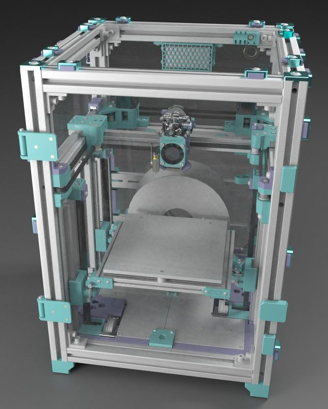</a> | [**SnakeOil XY**](https://github.com/SnakeOilXY/SnakeOil-XY) *SnakeOilXY* Configurable CoreXY with standard, IDEX, and four-motor options; its latest documented release is Beta 3. | 180: 180×180×180 250: 250×240×230 | 180: 400×390×520 250: 490×450×570 | Beta 3 [2023-01](https://github.com/SnakeOilXY/SnakeOil-XY#beta-3-release-2023-01-28) |  [🧡⁠119](https://www.printables.com/model/115487-snakeoilxy-3d-printer-design) [⏯️⁠44K](https://www.youtube.com/watch?v=pQPhEykthEg) [❤️⁠420](https://www.youtube.com/watch?v=pQPhEykthEg) | [CAD](https://github.com/SnakeOilXY/SnakeOil-XY/tree/master/CAD) [Manual](https://github.com/SnakeOilXY/SnakeOil-XY/tree/master/Doc) | [Discord](https://discord.gg/WZVP2HuAag) EN 1.3K |
| <a href="printers/vzbot-vz235/README.md">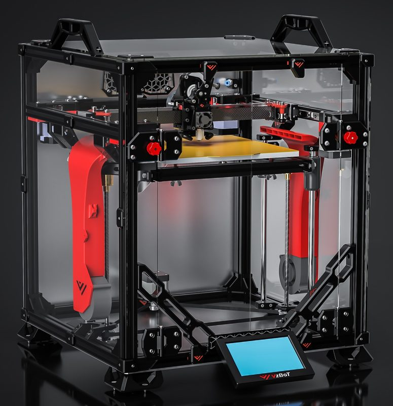</a> | [**VzBot Vz235**](https://github.com/VzBoT3D/VzBoT-Vz235) *VzBot family* Smaller 235 mm platform with an optional four-motor AWD setup. | 235×235×225 | — | V2.4 [2023-09](https://github.com/VzBoT3D/VzBoT-Vz235/commit/064705fd7de60a7ddd4127b69d9f973fae7efe71) |  [⏯️⁠184K](https://www.youtube.com/watch?v=hcMxEkVvIdE) [❤️⁠3.5K](https://www.youtube.com/watch?v=hcMxEkVvIdE) | [CAD](https://github.com/VzBoT3D/VzBoT-Vz235/tree/main/CAD) [BOM](https://github.com/VzBoT3D/VzBoT-Vz235/tree/main/BOM) [Manual](https://github.com/VzBoT3D/VzBoT-Vz235/blob/main/VZ235%20Manual_V1.pdf) | [Facebook](https://www.facebook.com/groups/vzbot/) EN 10.1K [Discord](https://discord.gg/KWZWvCMxCq) EN 9.3K [Reddit](https://www.reddit.com/r/vzbot/) EN 463 |
| <a href="printers/voron-legacy/README.md">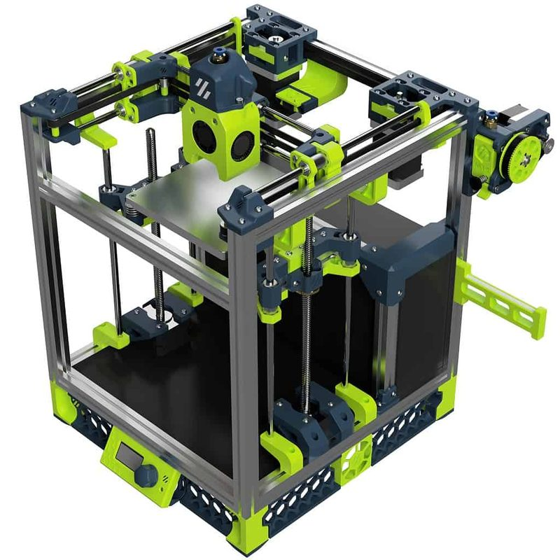</a> | [**Voron Legacy**](https://github.com/VoronDesign/Voron-Legacy) *Voron family* A released CoreXY throwback honoring Voron 1.0. | 230×230×260 | — | V1.0 [2020-12](https://github.com/VoronDesign/Voron-Legacy/releases/tag/V1.0) |  [⏯️⁠70.6K](https://www.youtube.com/watch?v=NZqvRLa8ShE) [❤️⁠1.5K](https://www.youtube.com/watch?v=NZqvRLa8ShE) | [CAD](https://github.com/VoronDesign/Voron-Legacy/tree/main/CAD) [STL](https://github.com/VoronDesign/Voron-Legacy/tree/main/STLs) [BOM](https://vorondesign.com/voron_legacy) | [Discord](https://discord.gg/voron) EN 40.8K [Reddit](https://www.reddit.com/r/VORONDesign/) EN 39.7K [Forum](https://forum.vorondesign.com/) EN 12.8K [Facebook](https://www.facebook.com/groups/voroncorexy/) EN 54.2K [Facebook](https://www.facebook.com/groups/479932403103163/) DE 2.6K [Telegram](https://t.me/aboutvoron) RU 551 [Telegram](https://t.me/voron_siboor_es) ES 212 [Forum](https://www.lesimprimantes3d.fr/forum/154-voron/) FR |

#### Small (≤180 mm representative X/Y size)

| Photo | Printer and why it’s interesting | Build volume (X×Y×Z) | Exterior (W×D×H) | Latest version | Stars Likes Views | Links | Groups |
| --- | --- | --- | --- | --- | --- | --- | --- |
| <a href="printers/rook-mk1/README.md">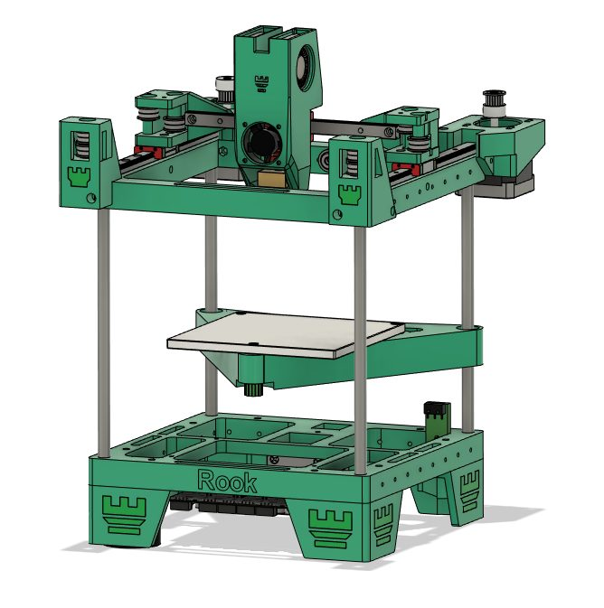</a> | [**Rook MK1**](https://www.printables.com/model/387431-rook-mk1-3d-printer) *Rolohaun / Rook family* Mostly printed, inexpensive 120 mm CoreXY. | 120×120×100 | 220×250×280 | MK1.1 [2024-12](https://www.printables.com/model/387431-rook-mk1-3d-printer) | [🧡⁠955](https://www.printables.com/model/387431-rook-mk1-3d-printer) [⏯️⁠46.6K](https://www.youtube.com/watch?v=JbOr9a6ECg8) [❤️⁠1.9K](https://www.youtube.com/watch?v=JbOr9a6ECg8) | [Manual](https://drive.google.com/file/d/1Nc4iz1Pq0eWxs1gyqM3IEtTrQ-v9zu7r/view) [STEP](https://github.com/rolohaun/Rook/blob/HEAD/CAD/Rook_MK1.step) | [Discord](https://discord.gg/rolohaun-3d-946191040682008666) EN 7.8K |
| <a href="printers/voron-v0/README.md">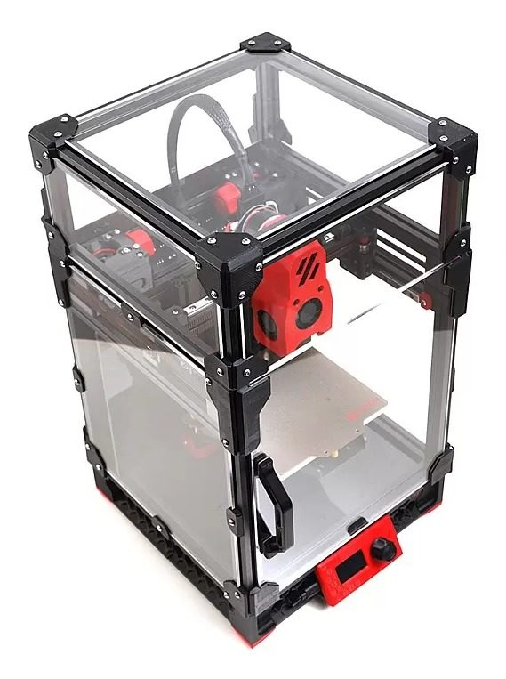</a> | [**Voron V0**](https://github.com/VoronDesign/Voron-0) *Voron family* Compact enclosed CoreXY platform. | 120×120×120 | 230×230×280 | V0.2r1 [2023-06](https://github.com/VoronDesign/Voron-0/commit/77acde9b0de405490823519b78f6056098420dee) |  | [CAD](https://github.com/VoronDesign/Voron-0/tree/HEAD/CAD) [Manual](https://github.com/VoronDesign/Voron-0/blob/HEAD/Manuals/VORON_V0.2r1_Assembly_Manual.pdf) | [Discord](https://discord.gg/voron) EN 40.8K [Reddit](https://www.reddit.com/r/VORONDesign/) EN 39.7K [Forum](https://forum.vorondesign.com/) EN 12.8K [Facebook](https://www.facebook.com/groups/voroncorexy/) EN 54.2K [Facebook](https://www.facebook.com/groups/479932403103163/) DE 2.6K [Telegram](https://t.me/aboutvoron) RU 551 [Telegram](https://t.me/voron_siboor_es) ES 212 [Forum](https://www.lesimprimantes3d.fr/forum/154-voron/) FR |
|  | [**THE100**](https://github.com/mszturc/THE100) *Matt the Printing Nerd* Fast design with a printed frame. | 165×165×165 | — | v1.1 [2023-09](https://github.com/mszturc/THE100/commit/b0c2179cfe90322dce2d3ecbb7fae008f41882d8) |  [🧡⁠2.1K](https://www.printables.com/model/572689-the-100-the-fastest-3d-printer-based-on-a-printed-) [⏯️⁠255K](https://www.youtube.com/watch?v=0K9NM08S0IA) [❤️⁠6.7K](https://www.youtube.com/watch?v=0K9NM08S0IA) | [STEP](https://github.com/mszturc/THE100/blob/HEAD/STEP/The%20100%20v1.1.step) [Manual](https://github.com/mszturc/THE100/tree/HEAD/Docs) | [Discord](https://discord.gg/fW7BcUErgZ) EN 4.4K [Facebook](https://www.facebook.com/groups/181335024786568) EN 456 |
|  | [**Micron**](https://github.com/PrintersForAnts/Micron) *Printers for Ants* Miniature Voron-inspired enclosed build. | 120: 120×120×? 180: 180×180×? | — | R1 RC8 [2026-04](https://github.com/PrintersForAnts/Micron/commit/b140083e5cd8b294d7c8492e5ee0d005b5efd67f) |  | [CAD](https://github.com/PrintersForAnts/Micron/tree/HEAD/CAD) [Manual](https://github.com/PrintersForAnts/Micron/blob/HEAD/Documentation/Micron_R1_Manual_WIP.pdf) | [Discord](https://discord.gg/doomcube) EN 6.9K |
|  | [**Bastion**](https://www.printables.com/model/748800-bastion-3d-printer) *Rolohaun* Triple independent Z and a Prusa Mini bed. | 180×180×? | — | Files [2024-02](https://www.printables.com/model/748800-bastion-3d-printer) | [🧡⁠345](https://www.printables.com/model/748800-bastion-3d-printer) [⏯️⁠17.9K](https://www.youtube.com/watch?v=EyQOKyWl3fM) [❤️⁠539](https://www.youtube.com/watch?v=EyQOKyWl3fM) | [BOM](https://docs.google.com/spreadsheets/d/1l0jujA7NeqoZIqLFWoQa9GS_q04f8Wfkya9Il5d2ubA/edit) [CAD](https://cad.onshape.com/documents/256743a99b7cb9b4ae8f45f9/w/29df722021bf3c0e59d7c8ae/e/ff9493cea103644b334a3c7a) | [Discord](https://discord.gg/rolohaun-3d-946191040682008666) EN 7.8K |
| <a href="printers/panda-mini/README.md">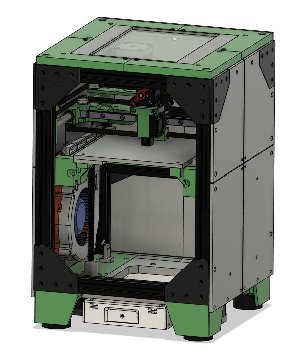</a> | [**Panda Mini**](https://www.printables.com/model/571947-panda-mini-corexy-3d-printer) *Rolohaun* Small-format CoreXY. | 140×140×? | — | beta [2024-02](https://www.printables.com/model/571947-panda-mini-corexy-3d-printer) | [🧡⁠443](https://www.printables.com/model/571947-panda-mini-corexy-3d-printer) [⏯️⁠18.5K](https://www.youtube.com/watch?v=EpYWnqYGDhA) [❤️⁠484](https://www.youtube.com/watch?v=EpYWnqYGDhA) | [Files](https://www.printables.com/model/571947-panda-mini-corexy-3d-printer/files) | [Discord](https://discord.gg/rolohaun-3d-946191040682008666) EN 7.8K |
| <a href="printers/rook-2020/README.md">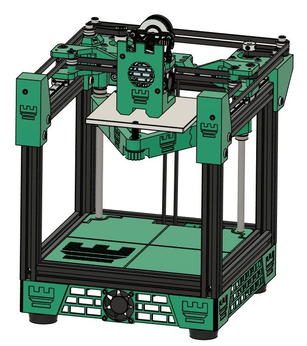</a> | [**Rook 2020**](https://www.printables.com/model/798733-rook-2020-mk2) *Rolohaun / Rook family* Rook layout on 2020 extrusion. The current release is MK2. It replaced the [MK1](https://www.printables.com/model/447255-rook-2020-mk1). | 120×120×? | — | 2020 MK2 [2025-04](https://www.printables.com/model/798733-rook-2020-mk2) | [🧡⁠398](https://www.printables.com/model/798733-rook-2020-mk2) [⏯️⁠17.6K](https://www.youtube.com/watch?v=Ufy0borF0ts) [❤️⁠442](https://www.youtube.com/watch?v=Ufy0borF0ts) | [BOM](https://docs.google.com/spreadsheets/d/1k5knQOW3YX01BzTAEe6YCPVp2iNppOEKYJrqB6Ln_Wk/edit) [CAD](https://cad.onshape.com/documents/ccf745a3232adcedee163729/w/32082f8119c17ae81d2ba337/e/7da9f0f6822236e671d3e7e1) [Files](https://www.printables.com/model/447255-rook-2020-mk1/files) MK1 | [Discord](https://discord.gg/rolohaun-3d-946191040682008666) EN 7.8K |
| <a href="printers/salad-fork/README.md">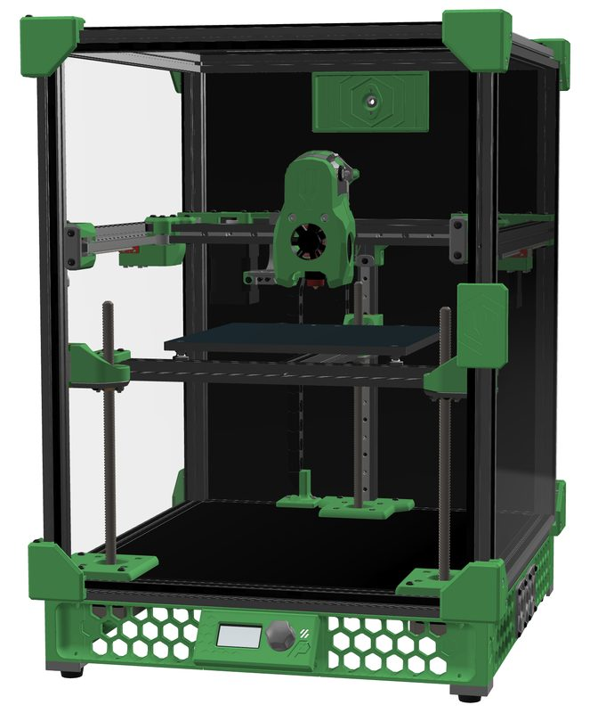</a> | [**Salad Fork**](https://github.com/PrintersForAnts/Salad_Fork) *Printers for Ants* Small Trident-inspired build. | 120: 120×120×? 160: 160×160×? 180: 180×180×? | — | 1.1 [2025-01](https://github.com/PrintersForAnts/Salad_Fork/commit/63d7afab36f604f96c7becb0a0139c5da4c124f5) |  | [CAD](https://github.com/PrintersForAnts/Salad_Fork/tree/HEAD/CAD) [Manual](https://github.com/PrintersForAnts/Salad_Fork/blob/HEAD/Salad%20Fork%20Manual.pdf) | [Discord](https://discord.gg/doomcube) EN 6.9K |
| <a href="printers/encore/README.md">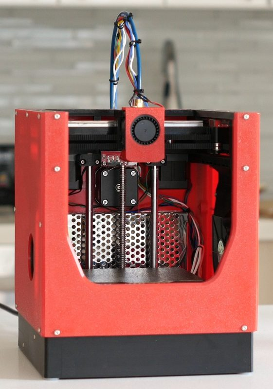</a> | [**Encore**](https://github.com/alexyu132/encore) *Alex Yu* 120 mm printed-frame CoreXY with a filament-box-sized footprint. | 120×120×120 | 219×221×262 | CAD [2026-06](https://github.com/alexyu132/encore/commit/7d7dd0397e26942a915dca2213147e9594a3a777) |  [💙⁠456](https://www.thingiverse.com/thing:7363835) [🧡⁠1.1K](https://www.printables.com/model/1743331-encore-mini-corexy-3d-printer-with-a-fully-printed) [💚⁠73](https://makerworld.com/en/models/2882748-encore-mini-corexy-3d-printer) [⏯️⁠59.8K](https://www.youtube.com/watch?v=9xukniyO6fI) [❤️⁠2.7K](https://www.youtube.com/watch?v=9xukniyO6fI) | [STEP](https://github.com/alexyu132/encore/blob/main/encore.step) [BOM](https://github.com/alexyu132/encore/blob/main/documentation/BOM.md) [Manual](https://github.com/alexyu132/encore/blob/main/documentation/build%20guide/build%20guide.md) [Video](https://www.youtube.com/watch?v=9xukniyO6fI) | — |
| <a href="printers/tiny-t/README.md">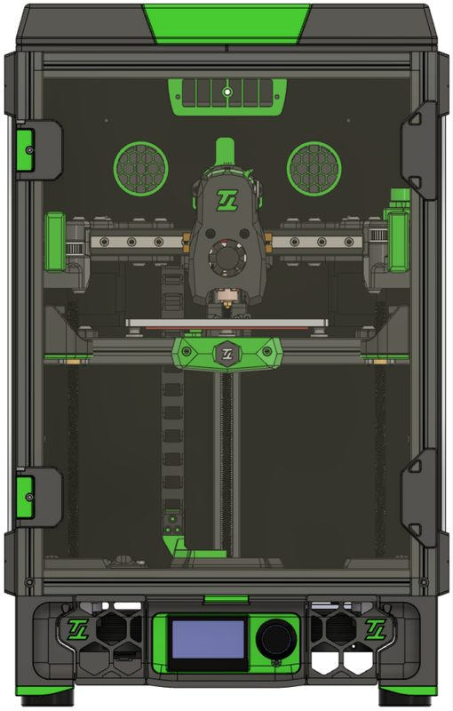</a> | [**Tiny-T**](https://github.com/PrintersForAnts/Tiny-T) *Printers for Ants* Revision 2.0 scales the Voron Trident layout down to a 150 mm cube. | 150×150×150 | — | R2 [2023-01](https://github.com/PrintersForAnts/Tiny-T/releases/tag/TinyT-r2) |  | [CAD](https://github.com/PrintersForAnts/Tiny-T/tree/main/CAD) [STL](https://github.com/PrintersForAnts/Tiny-T/tree/main/STLs) [BOM](https://github.com/PrintersForAnts/Tiny-T#components) | [Discord](https://discord.gg/doomcube) EN 6.9K |
|  | [**Cubiron**](https://github.com/ThatGuyHes/CUBIRON) *RobertGcode* Very small, documented CoreXY that runs on USB-C power; the current design has an unheated bed. | 70×70×65 | 144×145×148 | First release [2025-09](https://github.com/ThatGuyHes/CUBIRON/blob/main/README.md#L9) |  [⏯️⁠6.8K](https://www.youtube.com/watch?v=8Y_-ZeDuDzk) [❤️⁠328](https://www.youtube.com/watch?v=8Y_-ZeDuDzk) | [STEP](https://github.com/ThatGuyHes/CUBIRON/tree/main/CAD) [Manual](https://github.com/ThatGuyHes/CUBIRON/tree/main/docs) [Firmware](https://github.com/ThatGuyHes/CUBIRON/tree/main/firmware) | — |
| <a href="printers/babycube/README.md">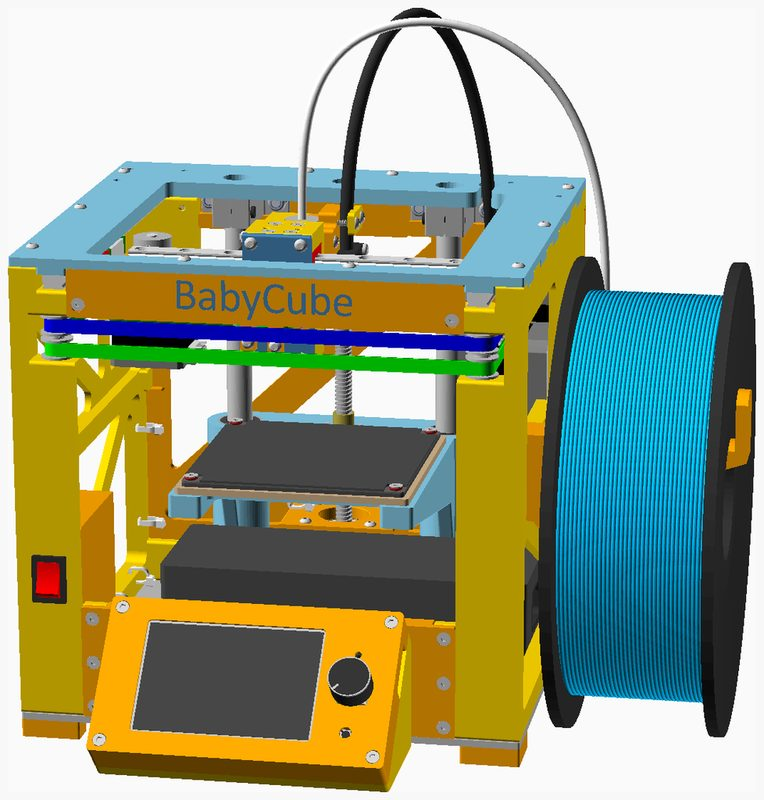</a> | [**BabyCube**](https://github.com/martinbudden/BabyCube) *Martin Budden* Printed-frame mini CoreXY with linear rails and a roughly 90 × 80 × 60 mm build volume. | 90×80×60 | 248×272×211 | CAD [2024-11](https://github.com/martinbudden/BabyCube/commit/423e054dc83208dce2bd1ad6f3b843f601238b6d) |  [💙⁠107](https://www.thingiverse.com/thing:4911835) [🧡⁠62](https://www.printables.com/model/218876-babycube-small-corexy-3d-printer) [⏯️⁠6.4K](https://www.youtube.com/watch?v=HpjnHnVyvj4) [❤️⁠125](https://www.youtube.com/watch?v=HpjnHnVyvj4) | [Manual](https://github.com/martinbudden/BabyCube/blob/main/BC200/readme.md) [CAD](https://github.com/martinbudden/BabyCube/tree/main/scad) [Video](https://www.youtube.com/watch?list=PLbNI1Rcik-oIJZLZGHtmtgYNiHBKnzX2O&v=Hourt_4GOHs) | — |
|  | [**Rat Rig V-Chonk**](https://github.com/Rat-Rig/V-Chonk) *Rat Rig family* Beta, mostly printed 180 mm CoreXY. | 180×180×180 | — | v0.4 [2024-07](https://github.com/Rat-Rig/V-Chonk/commit/85fa06be71054b5c0d7e513cc762dbd7d893b6a0) |  [⏯️⁠18.2K](https://www.youtube.com/watch?v=TIkY9gv_bjg) [❤️⁠308](https://www.youtube.com/watch?v=TIkY9gv_bjg) | [STEP](https://github.com/Rat-Rig/V-Chonk#step-files) [BOM](https://github.com/Rat-Rig/V-Chonk/tree/main/bom) [STL](https://github.com/Rat-Rig/V-Chonk/tree/main/stl) | [Facebook](https://www.facebook.com/groups/ratrig3dprintercommunity) EN 19.9K [Discord](https://discord.gg/ratrig) EN 13.8K [Reddit](https://www.reddit.com/r/RatRig/) EN 3K |
|  | [**VzBot Vz150**](https://github.com/VzBoT3D/VzBoT-Vz150) *VzBot family* Miniature VzBot; its optional AWD setup is described as experimental. | 150×150×125 | — | V1.1 [2023-05](https://github.com/VzBoT3D/VzBoT-Vz150/commit/060e8cab89e4524243e828d4c5bea0fbefdd10b6) |  | [CAD](https://github.com/VzBoT3D/VzBoT-Vz150/tree/main/CAD) [BOM](https://github.com/VzBoT3D/VzBoT-Vz150/tree/main/BOM) | [Facebook](https://www.facebook.com/groups/vzbot/) EN 10.1K [Discord](https://discord.gg/KWZWvCMxCq) EN 9.3K [Reddit](https://www.reddit.com/r/vzbot/) EN 463 |
| <a href="printers/railcore-mini/README.md">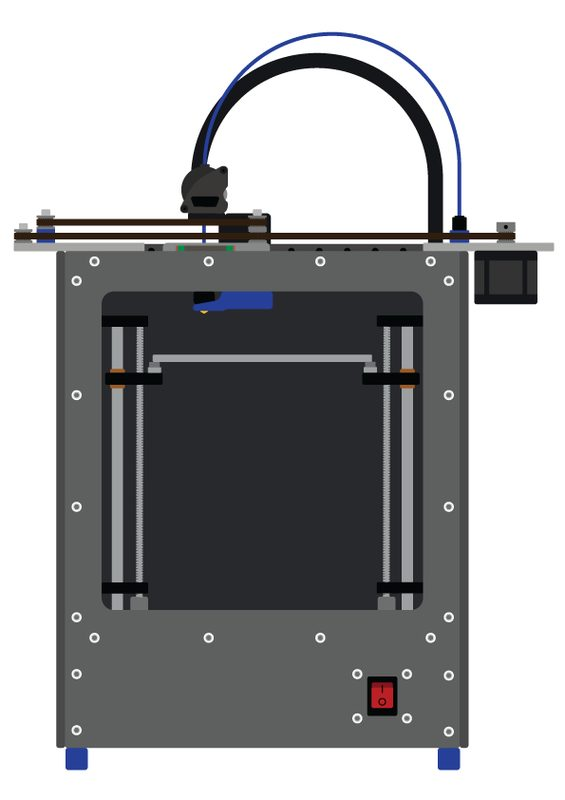</a> | [**RailCore Mini**](https://github.com/railcore/railcore-mini) *RailCore family* 1515-extrusion compact CoreXY with three leadscrews for Z. | 150×150×150 | 400×312×470 | CAD [2022-04](https://github.com/railcore/railcore-mini/commit/7126633b332f44c494e80ee9b0425f59cfda134c) |  [🧡⁠17](https://www.printables.com/model/160583-railcore-mini) [⏯️⁠4.4K](https://www.youtube.com/watch?v=IbsZTz1a8SA) [❤️⁠42](https://www.youtube.com/watch?v=IbsZTz1a8SA) | [BOM](https://docs.google.com/spreadsheets/d/1TM1vca-hA29apzcBjQ2FyvvZ5D19cWTZl7NxzBflSlU) [Manual](https://railcore.dozuki.com/c/RailCore%C2%AE_Mini_Kit) [Files](https://github.com/railcore/railcore-mini/tree/main/parts) | [Facebook](https://www.facebook.com/groups/RailCore/) EN 2.6K [Discord](https://discord.gg/Sy569Hq) EN 742 [Reddit](https://www.reddit.com/r/railcore/) EN 206 |

### Cross-gantry

Annex K3 and Defiant are cross-gantry builds in the Medium size group.

| Photo | Printer and why it’s interesting | Build volume (X×Y×Z) | Exterior (W×D×H) | Latest version | Stars Likes Views | Links | Groups |
| --- | --- | --- | --- | --- | --- | --- | --- |
|  | [**Annex K3 / Gasherbrum**](https://github.com/Annex-Engineering/Gasherbrum-K3) *Annex Engineering* Small enclosed cross-gantry machine with separate X and Y drives; its latest published release is R1.2 beta 1. | 180×180×180 | — | R1.2 beta 1 [2023-07](https://github.com/Annex-Engineering/Gasherbrum-K3/releases/tag/R1.2B1) |  [⏯️⁠28.6K](https://www.youtube.com/watch?v=kHAcm8c9pTk) [❤️⁠359](https://www.youtube.com/watch?v=kHAcm8c9pTk) | [Files](https://github.com/Annex-Engineering/Gasherbrum-K3/tree/HEAD/Release_1_2) | [Discord](https://discord.gg/MzTR3zE) EN 11.4K |
| <a href="printers/defiant/README.md">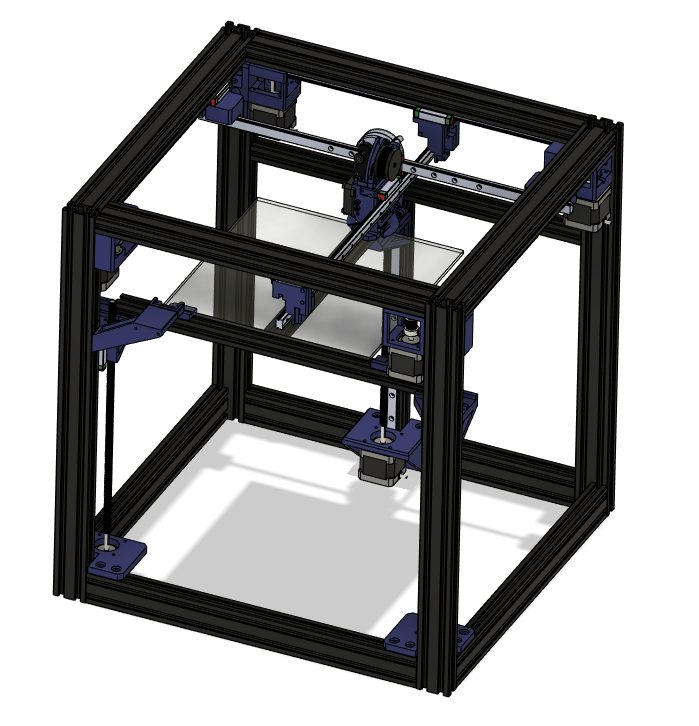</a> | [**Defiant**](https://github.com/rolohaun/Defiant) *Rolohaun* Beta CroXY build with three independently driven Z motors; currently unenclosable. | 250×250×250 | — | beta [2022-09](https://github.com/rolohaun/Defiant/commit/4cea7b3250be7a90a23c36082751491ba7b20445) |  [⏯️⁠13.6K](https://www.youtube.com/watch?v=SV5Sgm0m-QY) [❤️⁠275](https://www.youtube.com/watch?v=SV5Sgm0m-QY) | [CAD](https://github.com/rolohaun/Defiant/tree/main/CAD) [BOM](https://docs.google.com/spreadsheets/d/1MMBtSAIVklJtp9cDsU00cnw-aWT4j8f6p9V2ZHv14fQ/edit) | [Discord](https://discord.gg/rolohaun-3d-946191040682008666) EN 7.8K |

### Cartesian

Includes moving-bed Cartesian layouts. The size groups use the same 180 mm threshold as CoreXY.

#### Medium (>180 mm on either X/Y axis)

| Photo | Printer and why it’s interesting | Build volume (X×Y×Z) | Exterior (W×D×H) | Latest version | Stars Likes Views | Links | Groups |
| --- | --- | --- | --- | --- | --- | --- | --- |
|  | [**LH Stinger**](https://github.com/lhndo/LH-Stinger) *LHndo* Performance-focused moving-bed design. | 235×235×200 | — | R1.0 [2024-08](https://github.com/lhndo/LH-Stinger/releases/tag/LHS-R1.0) |  [🧡⁠104](https://www.printables.com/model/703110-lh-stinger) [⏯️⁠65.8K](https://www.youtube.com/watch?v=X41eK9_PCbA) [❤️⁠1.8K](https://www.youtube.com/watch?v=X41eK9_PCbA) | [CAD](https://github.com/lhndo/LH-Stinger/tree/HEAD/CAD) [Wiki](https://github.com/lhndo/LH-Stinger/wiki) | [Discord](https://discord.gg/EzssCfnEDS) EN 2.7K |

#### Small (≤180 mm on both X/Y axes)

| Photo | Printer and why it’s interesting | Build volume (X×Y×Z) | Exterior (W×D×H) | Latest version | Stars Likes Views | Links | Groups |
| --- | --- | --- | --- | --- | --- | --- | --- |
| <a href="printers/kappy/README.md">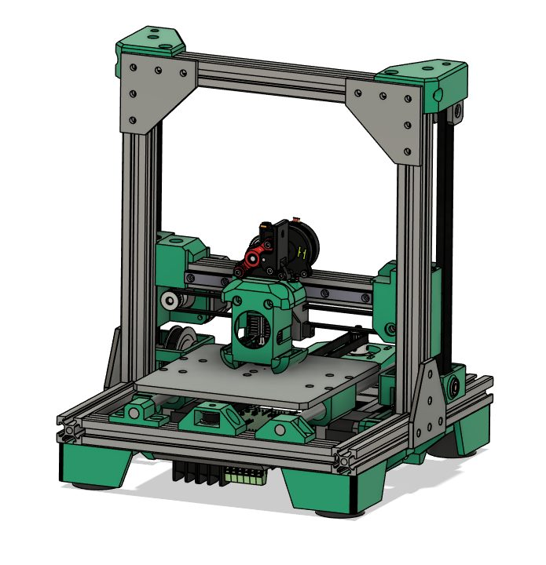</a> | [**Kappy**](https://www.printables.com/model/625544-kappy-3d-printer) *Rolohaun* Small, beginner-oriented DIY printer. | 120×120×100 | — | Update [2025-12](https://www.printables.com/model/625544-kappy-3d-printer) | [🧡⁠365](https://www.printables.com/model/625544-kappy-3d-printer) [⏯️⁠30.1K](https://www.youtube.com/watch?v=QxLlxpHNbtQ) [❤️⁠1.2K](https://www.youtube.com/watch?v=QxLlxpHNbtQ) | [Manual](https://drive.google.com/file/d/1iMX36I9zHaRenk27AsYJOz9wUkhZm12h/view) [BOM](https://docs.google.com/spreadsheets/d/10yJ0s7zZR3LtqlApnVSDP2MTe3I9gViXxYyVxZ6Vb1I/edit) [CAD](https://cad.onshape.com/documents/e3d1e390ee25e4cecb91b755/w/71cf613e30e4a447f8845523/e/ca80937f1c3e35dd2362d739) | [Discord](https://discord.gg/rolohaun-3d-946191040682008666) EN 7.8K |
| <a href="printers/prusa-mini/README.md">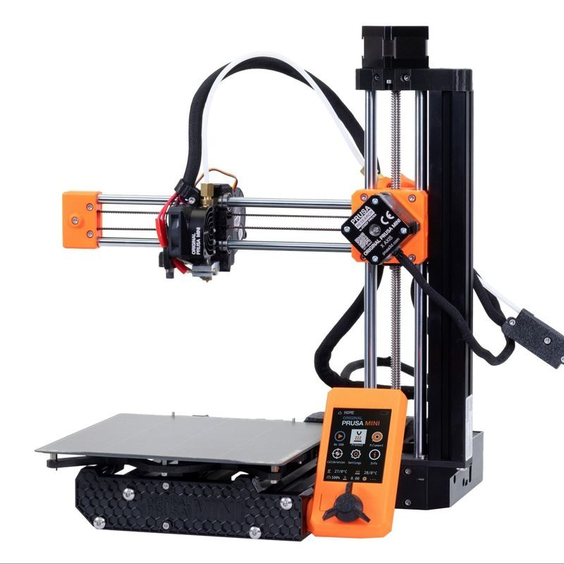</a> | [**Original Prusa MINI / MINI+**](https://github.com/prusa3d/Original-Prusa-MINI) *Prusa family* Cantilevered 180 mm machine with released STEP, printed parts, BOM, and assembly guide. | 180×180×180 | 380×330×380 | R8 [2021-02](https://github.com/prusa3d/Original-Prusa-MINI/releases/tag/R8) |  [🧡⁠2.7K](https://www.printables.com/model/57214) [⏯️⁠1.8M](https://www.youtube.com/watch?v=ipulB4_Xdm8) [❤️⁠5.6K](https://www.youtube.com/watch?v=ipulB4_Xdm8) | [STEP](https://github.com/prusa3d/Original-Prusa-MINI/tree/master/STEP) [BOM](https://github.com/prusa3d/Original-Prusa-MINI/tree/master/BOM) [Manual](https://help.prusa3d.com/en/tag/mini-2/) | [Forum](https://forum.prusa3d.com/forum/original-prusa-mini/) EN 78.7K [Reddit](https://www.reddit.com/r/prusa3d/) EN 112K [Forum](https://forum.prusa3d.com/es/) ES 78.7K [Forum](https://forum.prusa3d.com/cs/) CS 78.7K [Facebook](https://www.facebook.com/groups/Prusai3users/) EN 47.5K [Discord](https://discord.gg/prusa3d) EN 13.6K |
| <a href="printers/tictac-2-1/README.md">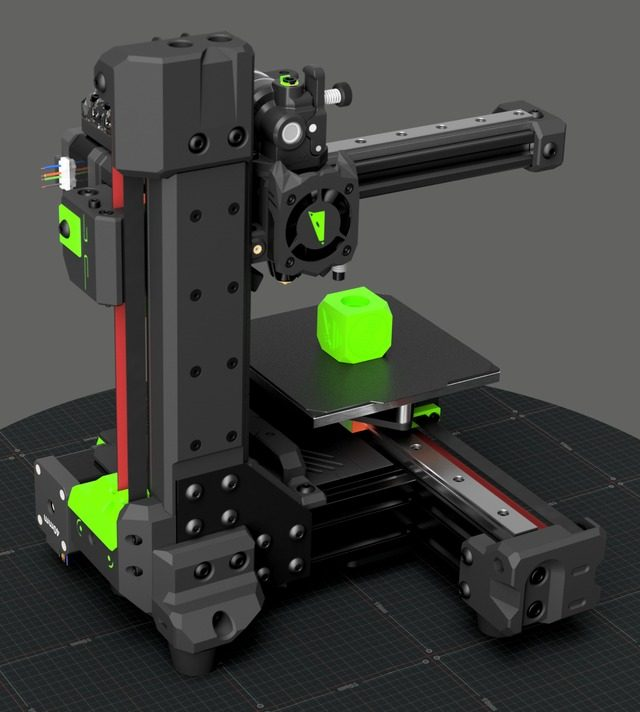</a> | [**TicTac 2.1**](https://www.printables.com/model/416884-tictac-21) *Squirrelbrain* A miniaturized V-Minion-derived Cartesian printer. | 120×120×120 | — | 2.1 [2024-01](https://www.printables.com/model/416884-tictac-21/files) | [🧡⁠465](https://www.printables.com/model/416884-tictac-21) [💚⁠35](https://makerworld.com/en/models/144161-tic-tac-miniaturised-v-minion) | [Files](https://www.printables.com/model/416884-tictac-21/files) | [Facebook](https://www.facebook.com/groups/ratrig3dprintercommunity) EN 19.9K [Discord](https://discord.gg/ratrig) EN 13.8K |
| <a href="printers/rook-mk2/README.md">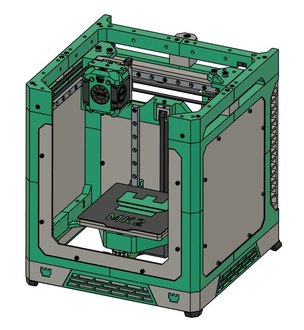</a> | [**Rook MK2**](https://www.printables.com/model/1644597-rook-mk2) *Rolohaun / Rook family* Fully printed frame; creator labels this a beta release. | 120×120×? | — | MK2 beta [2026-03](https://www.printables.com/model/1644597-rook-mk2) | [🧡⁠429](https://www.printables.com/model/1644597-rook-mk2) [⏯️⁠8.3K](https://www.youtube.com/watch?v=Rsd_QlY3pGE) [❤️⁠398](https://www.youtube.com/watch?v=Rsd_QlY3pGE) | [BOM](https://docs.google.com/spreadsheets/d/18EqrtU4kwdb6v4gPMTdCcCdBVbxlF5-EhFE0hZtxHoA/edit) [CAD](https://cad.onshape.com/documents/5010167e95003ed32232fd0e/w/756fbf38edf59fb734f7365c/e/e647ceb1e4681ba492e8722b) | [Discord](https://discord.gg/rolohaun-3d-946191040682008666) EN 7.8K |
|  | [**Rat Rig V-Minion**](https://github.com/Rat-Rig/V-Minion) *Rat Rig family* Compact 180 mm cantilevered Cartesian with linear rails. | 180×180×180 | — | CAD [2022-10](https://github.com/Rat-Rig/V-Minion/commit/0d6aa315f221d786c41d46ef504606d659443221) |  [💙⁠320](https://www.thingiverse.com/thing:5259421) [🧡⁠126](https://www.printables.com/model/240711) [⏯️⁠46.8K](https://www.youtube.com/watch?v=XnDXDmX2tS0) [❤️⁠428](https://www.youtube.com/watch?v=XnDXDmX2tS0) | [Files](https://github.com/Rat-Rig/V-Minion/tree/main/cad) [Manual](https://rat-rig.github.io/V-Minion/) | [Facebook](https://www.facebook.com/groups/ratrig3dprintercommunity) EN 19.9K [Discord](https://discord.gg/ratrig) EN 13.8K [Reddit](https://www.reddit.com/r/RatRig/) EN 3K |

### Delta

| Photo | Printer and why it’s interesting | Build volume (X×Y×Z) | Exterior (W×D×H) | Latest version | Stars Likes Views | Links | Groups |
| --- | --- | --- | --- | --- | --- | --- | --- |
|  | [**MIN Micro Delta**](https://www.printables.com/model/857334-min-micro-delta-3d-printer) *Rolohaun* A very small delta project. | Ø70×95 | — | Update [2024-12](https://www.printables.com/model/857334-min-micro-delta-3d-printer) | [🧡⁠382](https://www.printables.com/model/857334-min-micro-delta-3d-printer) [⏯️⁠16.9K](https://www.youtube.com/watch?v=kZSuBLWJxl0) [❤️⁠670](https://www.youtube.com/watch?v=kZSuBLWJxl0) | [Files](https://www.printables.com/model/857334-min-micro-delta-3d-printer/files) | [Discord](https://discord.gg/rolohaun-3d-946191040682008666) EN 7.8K |
| <a href="printers/delta-flyer/README.md">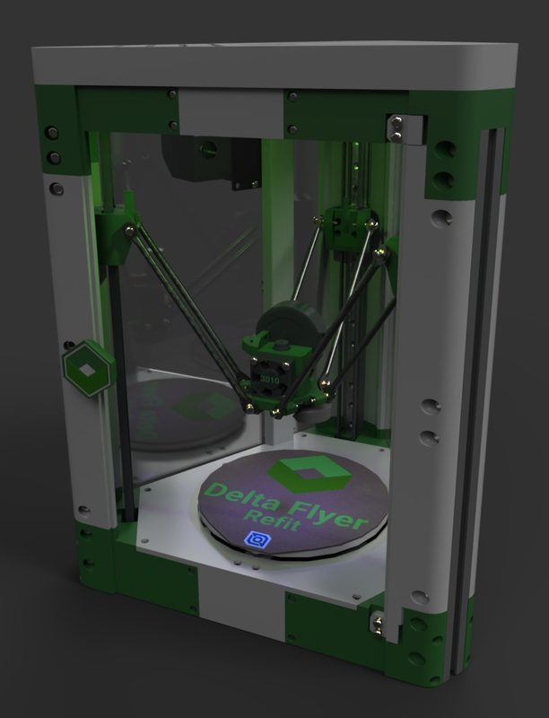</a> | [**Delta Flyer**](https://www.printables.com/model/1327596-delta-flyer-3d-printer) *Rolohaun / Kanrog* Compact delta with linear rails and a published manual. | Ø115×115 | — | Files [2026-04](https://www.printables.com/model/1327596-delta-flyer-3d-printer) | [🧡⁠213](https://www.printables.com/model/1327596-delta-flyer-3d-printer) [⏯️⁠9.7K](https://www.youtube.com/watch?v=LaAyrJOo7wg) [❤️⁠368](https://www.youtube.com/watch?v=LaAyrJOo7wg) | [Manual](https://kanrog.github.io/Delta-Flyer/) [BOM](https://docs.google.com/spreadsheets/d/1400rbdxxYbIA15yIi4UiYHQk1Ul_DCyP7nSTH7CUpFE/edit) [CAD](https://cad.onshape.com/documents/de9bc61850e74a1717307838/w/2a32f2b0d6edf7beeb9fcbf7/e/392043168b1092bab001d0df) | [Discord](https://discord.gg/rolohaun-3d-946191040682008666) EN 7.8K |
|  | [**Doron Velta**](https://github.com/rogerlz/Doron-Velta) *rogerlz / DoubleT* Enclosed delta in the Voron style. It began as an April Fools joke and is not an official Voron. FYSETC sells a kit. | Ø200×165 | — | R2 [2024-07](https://github.com/rogerlz/Doron-Velta#changelog) |  [⏯️⁠4.7K](https://www.youtube.com/watch?v=DuFxvsZ5HEU) [❤️⁠90](https://www.youtube.com/watch?v=DuFxvsZ5HEU) | [CAD](https://github.com/rogerlz/Doron-Velta/tree/main/CAD) [STL](https://github.com/rogerlz/Doron-Velta/tree/main/STLs) [BOM](https://github.com/rogerlz/Doron-Velta/blob/main/BOM.md) | [Discord](https://discord.gg/doomcube) EN 6.9K [Discord](https://discord.gg/voron) EN 40.8K |
| <a href="printers/phoenix-delta/README.md">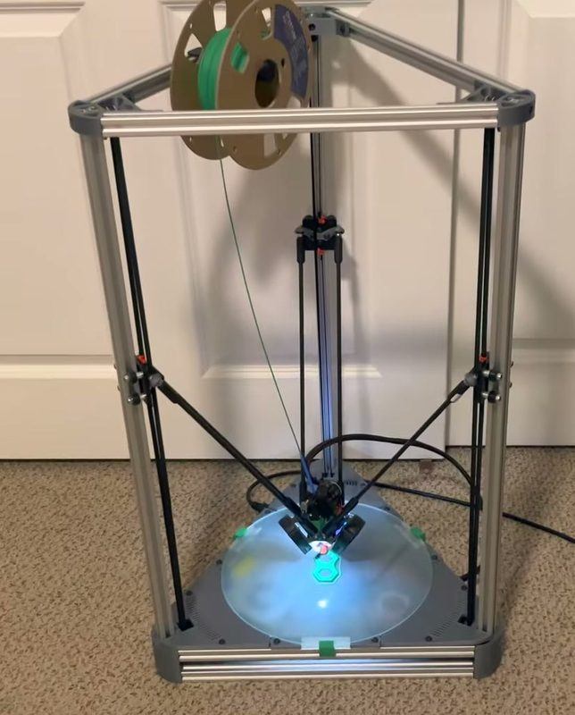</a> | [**PhoenixDelta**](https://github.com/rolohaun/PhoenixDelta) *Rolohaun* Large experimental delta built around a 350 mm bed; work in progress. | — | — | v136 [2022-06](https://github.com/rolohaun/PhoenixDelta/commit/db586e7d112afa5ce4109a48907ebc12a832534a) |  [⏯️⁠16K](https://www.youtube.com/watch?v=zeQo-jdcAlM) [❤️⁠260](https://www.youtube.com/watch?v=zeQo-jdcAlM) | [STEP](https://github.com/rolohaun/PhoenixDelta/blob/main/Phoenix%20v136.step) [BOM](https://github.com/rolohaun/PhoenixDelta#phoenix-delta) | [Discord](https://discord.gg/rolohaun-3d-946191040682008666) EN 7.8K |

### Other motion systems

| Photo | Printer and why it’s interesting | Build type | Build volume (X×Y×Z) | Exterior (W×D×H) | Latest version | Stars Likes Views | Links | Groups |
| --- | --- | --- | --- | --- | --- | --- | --- | --- |
| <a href="printers/lemontron/README.md">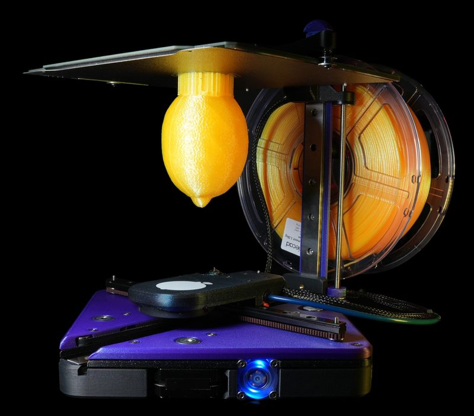</a> | [**Lemontron**](https://lemontron.com/lemontron-rev-e/) *Lemontron* Portable inverted design; Rev E files are released, with the earlier guide used for assembly. | Inverted folding portable | 180×180×165 | — | Rev E [2025-11](https://lemontron.com/news/lemontron-endgame-revision-announcement/) | [🧡⁠167](https://www.printables.com/model/1155525) [⏯️⁠120K](https://www.youtube.com/watch?v=n6l3GvkE4QU) [❤️⁠4.9K](https://www.youtube.com/watch?v=n6l3GvkE4QU) | [Files](https://lemontron.com/lemontron-rev-e/printed-parts/) [Manual](https://lemontron.com/lemontron-rev-a/build-guide/) [BOM](https://lemontron.com/lemontron-rev-e/bom/) [Video](https://www.youtube.com/watch?v=n6l3GvkE4QU) | [Discord](https://discord.com/invite/gSjfn4rnrm) EN 1.2K |
| <a href="printers/hangprinter/README.md">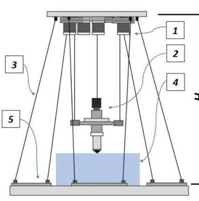</a> | [**Hangprinter**](https://github.com/tobbelobb/hangprinter) *Torbjørn Ludvigsen* Cable-suspended, frameless printer. | Cable-driven | configurable | — | v4 [2022-12](https://github.com/tobbelobb/hangprinter/commit/ae5995e225849e45482bc4905f75f88890565d47) |  [⏯️⁠88.5K](https://www.youtube.com/watch?v=ULJqLSTriRY) [❤️⁠615](https://www.youtube.com/watch?v=ULJqLSTriRY) | [Files](https://github.com/tobbelobb/hangprinter) | [Facebook](https://www.facebook.com/groups/hangprinter) EN 1.1K [Discord](https://discord.gg/KAV7x3hgRX) EN 289 |
|  | [**Positron V3.2**](https://github.com/Positron3D/Positron) *Positron Team / Kralyn* Compact inverted printer that folds for transport. | Inverted folding portable | 180×180×165 | open: 200×200×270 folded: 200×200×80 | V3.2.2 [2026-03](https://github.com/Positron3D/Positron/commit/84d9d0719a93b2cce2376f9aa11a1218c0fb71a8) |  [🧡⁠70](https://www.printables.com/model/932474) [⏯️⁠785K](https://www.youtube.com/watch?v=X_QLxTVtyng) [❤️⁠32.2K](https://www.youtube.com/watch?v=X_QLxTVtyng) | [Files](https://github.com/Positron3D/Positron/tree/main/Printed%20Parts%20%26%20CAD%20Models) [Original](https://github.com/KRALYN/PositronV3) | [Discord](https://discord.gg/positron) EN 2.9K |
| <a href="printers/babybelt-pro/README.md">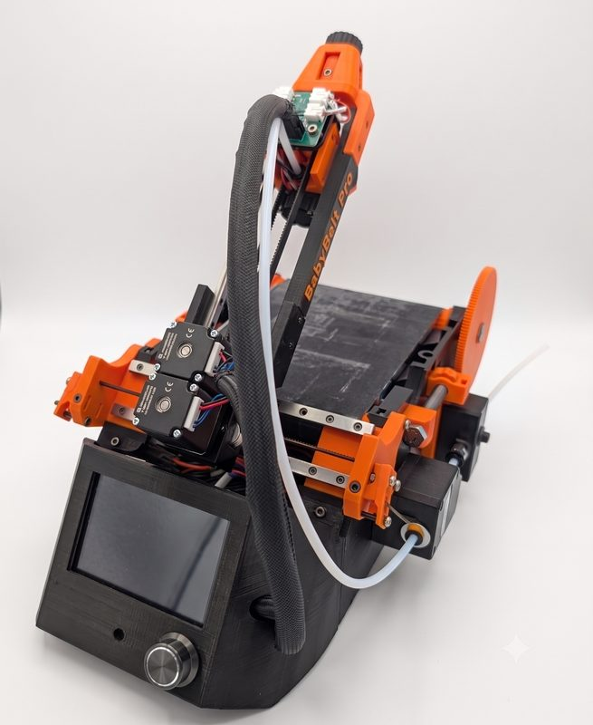</a> | [**BabyBelt Pro**](https://github.com/RobMink/BabyBeltPro) *Rob Mink* Compact belt printer. | Belt printer | 100×100×∞ | — | v2.6 [2026-06](https://github.com/RobMink/BabyBeltPro/blob/HEAD/documentation/CHANGE-LOG.md#2026-06-20) |  [⏯️⁠2.1K](https://www.youtube.com/watch?v=joXvj6Lqx88) [❤️⁠72](https://www.youtube.com/watch?v=joXvj6Lqx88) | [STEP](https://github.com/RobMink/BabyBeltPro/blob/HEAD/CAD/BBProV2POINT6.stp) [Manual](https://github.com/RobMink/BabyBeltPro/blob/HEAD/documentation/bbpv2_build_guide.md) | [Discord](https://discord.gg/NTDZMsCwXh) EN 886 |

## Conversions

These are commonly built by reusing a donor printer or modifying an existing family; some also support a fresh build. Check the exact donor model and revision before ordering parts.

| Photo | Printer and why it’s interesting | Build volume (X×Y×Z) | Exterior (W×D×H) | Latest version | Stars Likes Views | Links | Groups |
| --- | --- | --- | --- | --- | --- | --- | --- |
|  | [**Ender-3 NG**](https://www.printables.com/model/922401-ender-3-ng-v12-corexy-conversion) *RH3D* Ender-3 CoreXY conversion with a dedicated guide; the listed volume is from a creator beta build. | 235×235×245 | — | v1.2 [2024-08](https://www.printables.com/model/922401-ender-3-ng-v12-corexy-conversion) | [🧡⁠2.7K](https://www.printables.com/model/922401-ender-3-ng-v12-corexy-conversion) [⏯️⁠107K](https://www.youtube.com/watch?v=u4b6Ni18ap4) [❤️⁠3.3K](https://www.youtube.com/watch?v=u4b6Ni18ap4) | [Files](https://rh3d.xyz/E3NG_v1_2/standard/files) [Manual](https://rh3d.xyz/E3NG_v1_2/standard/build_guide) | [Discord](https://discord.com/invite/Zkvu6uu2AR) EN 4.8K |
| <a href="printers/ender-sw/README.md">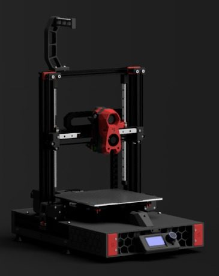</a> | [**Ender_SW**](https://github.com/boubounokefalos/Ender_SW) *DaRk_dOg / boubounokefalos* Unofficial Ender-3 Pro/V2 to CoreXZ conversion, redesigned from Triano’s original community Switchwire mod. | 220×220×220 | — | v2.0 [2023-02](https://github.com/boubounokefalos/Ender_SW/releases/tag/v.2.0) |  | [Original](https://github.com/VoronDesign/VoronUsers/tree/main/printer_mods/Triano/Ender_3Pro_Switchwire) [CAD](https://github.com/boubounokefalos/Ender_SW/tree/main/CAD) [Wiki](https://github.com/boubounokefalos/Ender_SW/wiki) | [Discord](https://discord.gg/voron) EN 40.8K |
| <a href="printers/voron-switchwire/README.md">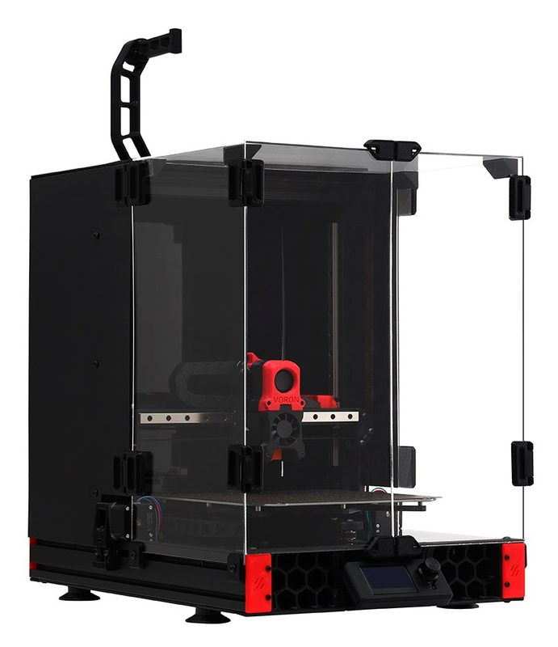</a> | [**Voron Switchwire**](https://github.com/VoronDesign/Voron-Switchwire) *Voron family* Official CoreXZ bedslinger with a custom 3030/3060 frame and Prusa MK52 bed; builders can reuse Prusa parts or source a fresh build. | — | — | V1.0 [2020-08](https://github.com/VoronDesign/Voron-Switchwire/releases/tag/V1.0) |  [⏯️⁠88.8K](https://www.youtube.com/watch?v=jwPLl1v5ae4) [❤️⁠1K](https://www.youtube.com/watch?v=jwPLl1v5ae4) | [Manual](https://github.com/VoronDesign/Voron-Switchwire/blob/HEAD/Manuals/Assembly_Manual_SW.pdf) [CAD](https://github.com/VoronDesign/Voron-Switchwire/tree/HEAD/CAD) | [Discord](https://discord.gg/voron) EN 40.8K [Reddit](https://www.reddit.com/r/VORONDesign/) EN 39.7K [Forum](https://forum.vorondesign.com/) EN 12.8K [Facebook](https://www.facebook.com/groups/voroncorexy/) EN 54.2K [Facebook](https://www.facebook.com/groups/479932403103163/) DE 2.6K [Telegram](https://t.me/aboutvoron) RU 551 [Telegram](https://t.me/voron_siboor_es) ES 212 [Forum](https://www.lesimprimantes3d.fr/forum/154-voron/) FR |
| <a href="printers/tridex/README.md">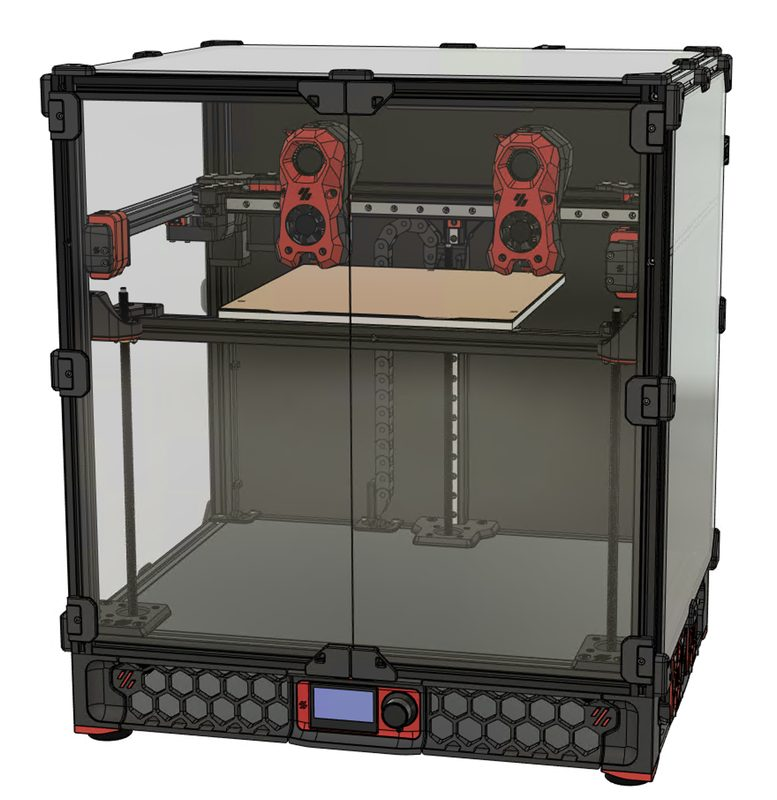</a> | [**Tridex**](https://github.com/FrankenVoron/Tridex) *FrankenVoron* Advanced Trident-derived IDEX for dual-material printing; the creator says it may eventually become release-worthy, and documentation is still in progress. | single toolhead: 225×250×250 dual toolhead: 205×250×250 | — | CAD [2022-10](https://github.com/FrankenVoron/Tridex/commit/573d3ced37) |  [⏯️⁠62.6K](https://www.youtube.com/watch?v=31fqpKYj7v4) [❤️⁠1.1K](https://www.youtube.com/watch?v=31fqpKYj7v4) | [CAD](https://github.com/FrankenVoron/Tridex/tree/main/CAD) [BOM](https://github.com/FrankenVoron/Tridex/blob/main/Documentation/0_bill_of_materials.md) [Manual](https://github.com/FrankenVoron/Tridex/blob/main/Documentation/1_assembly_instructions.md) [STL](https://github.com/FrankenVoron/Tridex/tree/main/STLs) | [Discord](https://discord.gg/voron) EN 40.8K [Discord](https://discord.gg/doomcube) EN 6.9K [Reddit](https://www.reddit.com/r/voroncorexy/) EN 30.3K |
| <a href="printers/tri-zero/README.md">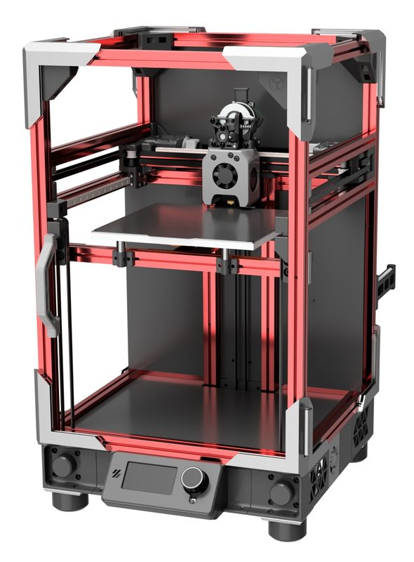</a> | [**Tri-Zero**](https://github.com/zruncho3d/tri-zero) *zruncho3d* Voron V0-derived CoreXY mod adding triple belted Z and automatic bed leveling; also supports a fresh build. Its latest documented release is Alpha 6. | standard: 120×120×120 Plus50: 170×170×170 | — | alpha 6 [2022-10](https://github.com/zruncho3d/tri-zero/blob/main/CHANGES.md#2022-10-16-update) |  [⏯️⁠17.6K](https://www.youtube.com/watch?v=XPtowYdHhJ8) [❤️⁠129](https://www.youtube.com/watch?v=XPtowYdHhJ8) | [CAD](https://github.com/zruncho3d/tri-zero/tree/main/CAD) [Manual](https://github.com/zruncho3d/tri-zero/blob/main/INSTRUCTIONS.md) [Plus50](https://github.com/zruncho3d/tri-zero/blob/main/PLUS50.md) | [Discord](https://discord.gg/voron) EN 40.8K [Discord](https://discord.gg/doomcube) EN 6.9K [Reddit](https://www.reddit.com/r/voroncorexy/) EN 30.3K |
| <a href="printers/dueling-zero/README.md">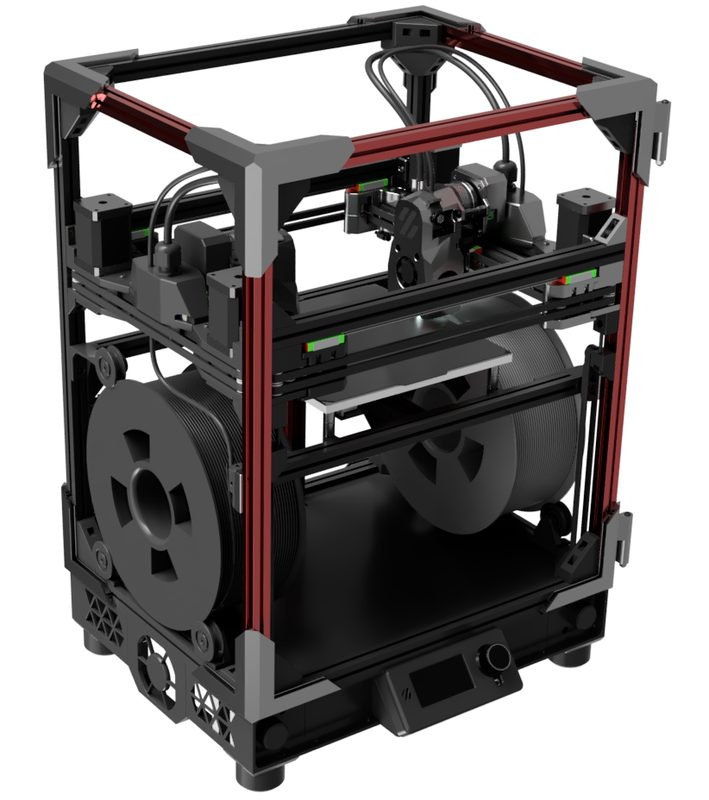</a> | [**Dueling Zero**](https://github.com/zruncho3d/DuelingZero) *zruncho3d* Voron V0-derived dual-gantry project. | configurable | — | v3 gantry [2023-09](https://github.com/zruncho3d/DuelingZero#releases) |  [⏯️⁠53.5K](https://www.youtube.com/watch?v=2YI3_g30EwA) [❤️⁠541](https://www.youtube.com/watch?v=2YI3_g30EwA) | [CAD](https://github.com/zruncho3d/DuelingZero/tree/HEAD/CAD) [Manual](https://github.com/zruncho3d/DuelingZero/blob/HEAD/INSTRUCTIONS.md) | [Discord](https://discord.gg/voron) EN 40.8K [Discord](https://discord.gg/doomcube) EN 6.9K [Reddit](https://www.reddit.com/r/voroncorexy/) EN 30.3K |
| <a href="printers/proosaxy/README.md">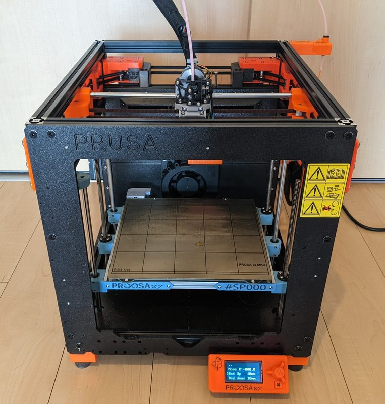</a> | [**ProosaXY**](https://github.com/SnakeOilXY/ProosaXY) *SnakeOilXY* Prusa MK3/S CoreXY conversion that reuses donor parts; requires irreversible drilling and cutting. | — | — | CAD [2026-07](https://github.com/SnakeOilXY/ProosaXY/commit/2044ed8e015997882eb6bf1c48cddba3956e670f) |  [🧡⁠583](https://www.printables.com/model/518614-proosaxy-mk3s-to-corexy-conversion) [⏯️⁠9.2K](https://www.youtube.com/watch?v=Dink3JQ-bNY) [❤️⁠91](https://www.youtube.com/watch?v=Dink3JQ-bNY) | [CAD](https://github.com/SnakeOilXY/ProosaXY/tree/master/src) [STL](https://github.com/SnakeOilXY/ProosaXY/tree/master/STLs) [BOM](https://github.com/SnakeOilXY/ProosaXY#bom) | [Discord](https://discord.gg/WZVP2HuAag) EN 1.3K |
| <a href="printers/double-dragon/README.md">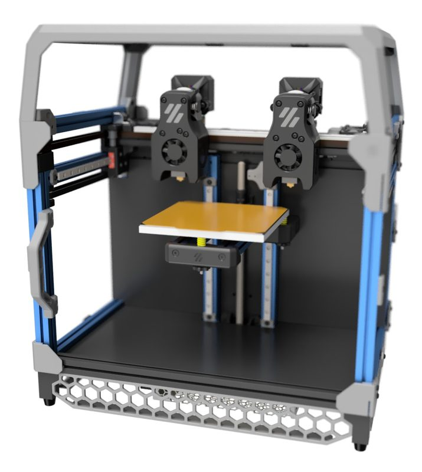</a> | [**Double Dragon**](https://github.com/zruncho3d/double-dragon) *zruncho3d* Alpha-stage Voron V0-derived IDEX experiment for dual extrusion. | 114×120×? | — | alpha 1 [2021-12](https://github.com/zruncho3d/double-dragon#alpha-1-release-2021-12-31) |  [⏯️⁠9.6K](https://www.youtube.com/watch?v=GY29F2O1unw) [❤️⁠116](https://www.youtube.com/watch?v=GY29F2O1unw) | [CAD](https://github.com/zruncho3d/double-dragon/tree/HEAD/CAD) | [Discord](https://discord.gg/voron) EN 40.8K [Discord](https://discord.gg/doomcube) EN 6.9K [Reddit](https://www.reddit.com/r/VORONDesign/) EN 39.7K |
| <a href="printers/f-zero/README.md">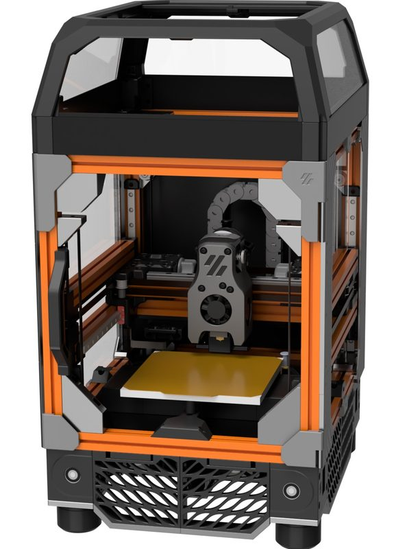</a> | [**F-Zero**](https://github.com/zruncho3d/f-zero) *zruncho3d* V0-component flying-gantry CoreXY that can be built fresh or as an upgrade. | 120×120×120 | — | Update [2021-11](https://github.com/zruncho3d/f-zero#status-updates) |  [⏯️⁠29.3K](https://www.youtube.com/watch?v=jLSPeJ7L9R4) [❤️⁠429](https://www.youtube.com/watch?v=jLSPeJ7L9R4) | [CAD](https://github.com/zruncho3d/f-zero/tree/main/CAD) [Manual](https://github.com/zruncho3d/f-zero#buildlog-and-design-doc) | [Discord](https://discord.gg/voron) EN 40.8K [Discord](https://discord.gg/doomcube) EN 6.9K [Reddit](https://www.reddit.com/r/voroncorexy/) EN 30.3K |
|  | [**Duender**](https://github.com/Irbis3D/Duender) *Irbis3D* Turns parts from two Ender-3 printers into one CoreXY. | — | — | STEP [2026-02](https://github.com/Irbis3D/Duender/commit/bfcfaa326620ba41ce1e14cf685c5fdfafbaf192) |  [🧡⁠742](https://www.printables.com/model/1174545) [⏯️⁠72.7K](https://www.youtube.com/watch?v=zOplNhr5SfA) [❤️⁠3.3K](https://www.youtube.com/watch?v=zOplNhr5SfA) | [STEP](https://github.com/Irbis3D/Duender/tree/HEAD/STEP%20KITS) [Manual](https://github.com/Irbis3D/Duender/tree/HEAD/Manual) | [Discord](https://discord.gg/ae44FHv786) EN 2.9K |
| <a href="printers/mercury-one/README.md">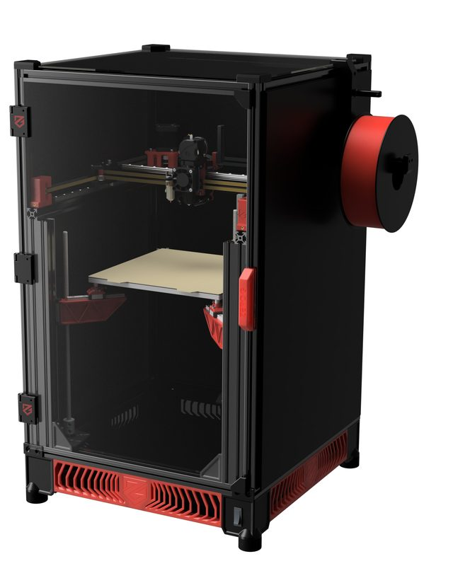</a> | [**Mercury One**](https://github.com/ZeroGDesign/MercuryOne) *ZeroG* CoreXY conversion for Ender-5 family machines. | — | — | One.1 [2022-08](https://github.com/ZeroGDesign/Mercury-OUTDATED/commit/d916c4ad6a) |  [⏯️⁠15.2K](https://www.youtube.com/watch?v=nUwLjH3-oIc) [❤️⁠164](https://www.youtube.com/watch?v=nUwLjH3-oIc) | [CAD](https://github.com/ZeroGDesign/MercuryOne/tree/HEAD/CAD) [Manual](https://docs.zerog.one/manual/build/mercury_eva) | [Discord](https://discord.gg/zerog) EN 9.7K |

## Concepts and prototypes

Experimental designs and one-off ideas. Most have no public CAD or complete build package. Use them to study an idea, not as a build plan.

| Photo | Printer and why it’s interesting | Build type | Build volume (X×Y×Z) | Exterior (W×D×H) | Latest version | Stars Likes Views | Links | Groups |
| --- | --- | --- | --- | --- | --- | --- | --- | --- |
| <a href="printers/infini-z/README.md">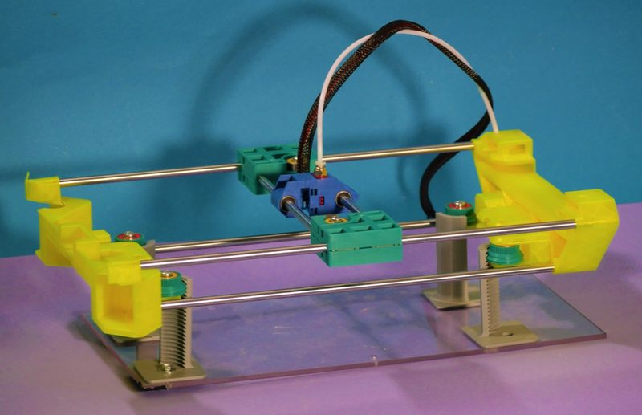</a> | [**Infini-Z**](https://projectquine.substack.com/p/the-first-infini-z) *SunShine / Andras* Experimental self-climbing Z axis. | Climbing Z | — | — | Files [2023-12](https://www.printables.com/model/581766-infini-z-3d-printer) | [💙⁠240](https://www.thingiverse.com/thing:6217366) [🧡⁠844](https://www.printables.com/model/581766) [💛⁠33](https://cults3d.com/en/3d-model/tool/infini-z-3d-printer) [⏯️⁠1.5M](https://www.youtube.com/watch?v=Ek_7tBOCcAI) [❤️⁠46K](https://www.youtube.com/watch?v=Ek_7tBOCcAI) | [Files](https://cults3d.com/en/3d-model/tool/infini-z-3d-printer) | — |
| <a href="printers/minuteman/README.md">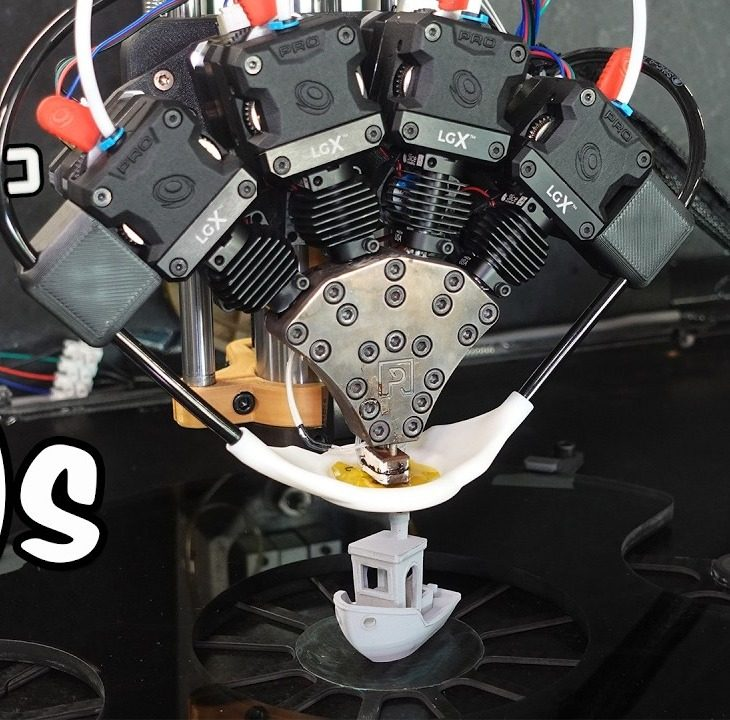</a> | [**Minuteman**](https://www.youtube.com/watch?v=iMAWa9vfxcE) *Roetz 4.0* One-off, Benchy-sized speed printer with a four-cable winch XY, air-bearing moving bed, and independent Z toolhead. Its CAD, BOM, and build guide are not public, but the build series is fun to watch. | Cable winch XY moving bed | 60×60×73 | — | Video [2026-05](https://www.youtube.com/watch?v=iMAWa9vfxcE) | [⏯️⁠4.3M](https://www.youtube.com/watch?v=AJhCPCpLYcE) [❤️⁠18.1K](https://www.youtube.com/watch?v=AJhCPCpLYcE) | [Video](https://www.youtube.com/playlist?list=PLT7wyh27LmscPT1EZpoS3BTWUJjAOQ5Gf) [Hotend](https://github.com/Roetz4point0/Roetz-End) | [Discord](https://discord.gg/nr6QrWE9Dd) EN 819 |
| <a href="printers/quark/README.md">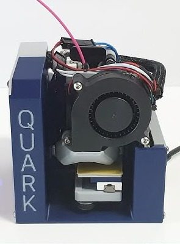</a> | [**Quark**](https://www.youtube.com/watch?v=JCcKdnAFfds) *RobertGcode* Palm-sized Cartesian bedslinger and functional design exercise with a 24 mm print cube; no public build package was located. | Cartesian bedslinger | 24×24×24 | 100×100×100 | First release [2025-10](https://www.youtube.com/watch?v=JCcKdnAFfds) | [⏯️⁠55.4K](https://www.youtube.com/watch?v=JCcKdnAFfds) [❤️⁠2.3K](https://www.youtube.com/watch?v=JCcKdnAFfds) | [Video](https://www.youtube.com/watch?v=JCcKdnAFfds) | — |
| <a href="printers/fenrir/README.md">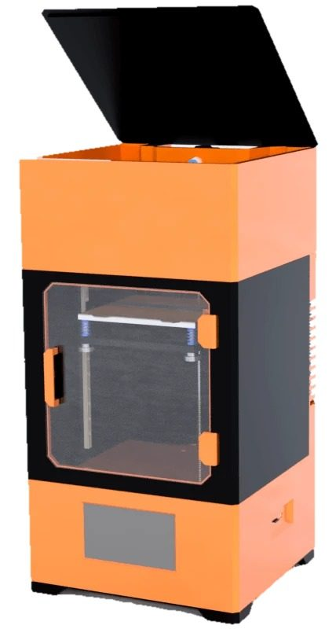</a> | [**Fenrir**](https://www.makerviking.com/wiki/fenrir-corexy-3d-printer) *MakerViking* Mostly printed CoreXY prototype; confirm file release before planning a build. | CoreXY | 120×120×120 | — | First video [2021-11](https://www.youtube.com/watch?v=qJi_0GzD9xU) | [⏯️⁠1.7K](https://www.youtube.com/watch?v=qJi_0GzD9xU) [❤️⁠58](https://www.youtube.com/watch?v=qJi_0GzD9xU) | [Video](https://www.youtube.com/watch?v=qJi_0GzD9xU) | — |

## Legacy designs

The files still work, but the design is no longer developed. A design is legacy if it has no update in two years and no active group, if its repository is archived, or if a newer version replaced it. Archived status was checked on 2026-10-20.

| Photo | Printer and why it’s interesting | Build volume (X×Y×Z) | Exterior (W×D×H) | Latest version | Stars Likes Views | Links | Groups |
| --- | --- | --- | --- | --- | --- | --- | --- |
|  | [**GBot Tiny**](https://www.thingiverse.com/thing:3935734) *Gotchau* Small H-bot on V-slot extrusion with MGN12 rails and a 120 mm bed. The page is marked work in progress, and the build is shown in a Russian video series. No update since 2021. | 120×120×? | — | Files [2021-12](https://www.thingiverse.com/thing:3935734/files) | [💙⁠83](https://www.thingiverse.com/thing:3935734) [⏯️⁠30.2K](https://www.youtube.com/watch?v=o_cQP9J8bRU) [❤️⁠1.2K](https://www.youtube.com/watch?v=o_cQP9J8bRU) | [Files](https://www.thingiverse.com/thing:3935734/files) [Video](https://www.youtube.com/watch?v=o_cQP9J8bRU) | — |
|  | [**Ender EZ Belt**](https://www.printables.com/model/255684-ender-ez-belt-3d-printer-conversion) *Powerbelt3D* Documented Ender-3 conveyor conversion; the creator calls the project open source, but its Formula32 belt is no longer sold by the closed shop. No update since 2022 and no active group. | — | — | Update [2022-12](https://www.printables.com/model/255684-ender-ez-belt-3d-printer-conversion) | [🧡⁠293](https://www.printables.com/model/255684-ender-ez-belt-3d-printer-conversion) [⏯️⁠25.1K](https://www.youtube.com/watch?v=ViQGZFbM22M) [❤️⁠554](https://www.youtube.com/watch?v=ViQGZFbM22M) | [Files](https://www.printables.com/model/255684-ender-ez-belt-3d-printer-conversion) | — |
|  | [**Cherry Pi III**](https://www.thingiverse.com/thing:344408) *AndyCart* Third version of the delta, after the [Cherry Pi](https://www.thingiverse.com/thing:210028) (2013) and the [Cherry Pi II](https://www.thingiverse.com/thing:298168) (2014). No update since 2014. | — | — | III [2014-08](https://www.thingiverse.com/thing:344408) | [💙⁠503](https://www.thingiverse.com/thing:344408) [⏯️⁠2.3K](https://www.youtube.com/watch?v=9hL9AQpA93Y) [❤️⁠4](https://www.youtube.com/watch?v=9hL9AQpA93Y) | [Files](https://www.thingiverse.com/thing:344408/files) | [Forum](https://reprap.org/forum/list.php?178) EN [Facebook](https://www.facebook.com/groups/delta3dp/) EN 2.7K inactive |
| <a href="printers/tiny-m/README.md">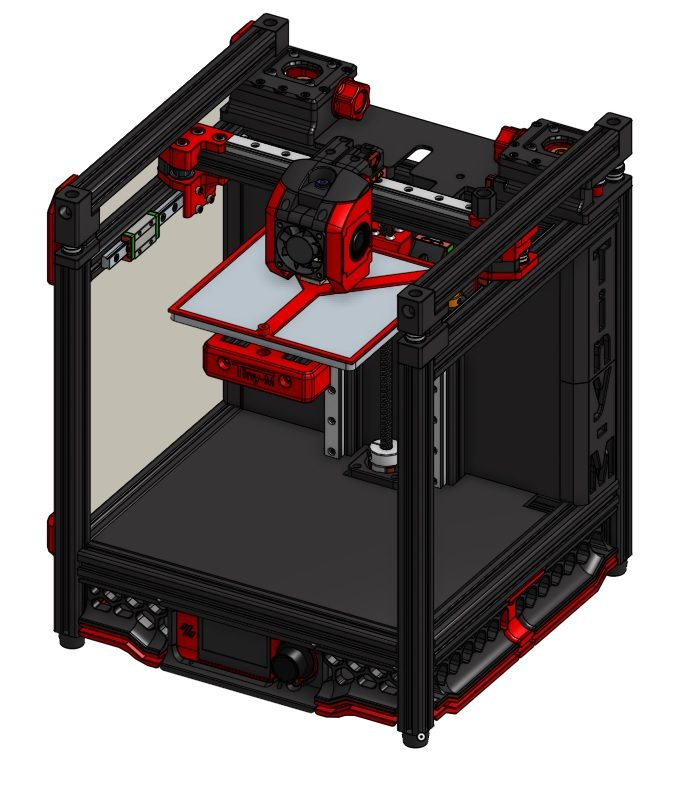</a> | [**Tiny-M**](https://github.com/gsl12/Tiny-M) *gsl12* Archived 150 mm Voron V0-inspired CoreXY; creator lists V4 as current and V5 as beta. | 150×150×150 | — | V4 [2021-12](https://github.com/gsl12/Tiny-M/commit/8a72279f867deccffb45758eab8780779cddbe2a) |  | [CAD](https://cad.onshape.com/documents/f842588d372acab22a4ce687/w/3332acdd7c7bf7fc53ddefb6/e/ce1bfb58b96a9bb3b38b0502) [BOM](https://github.com/gsl12/Tiny-M/tree/master/BOM) | [Discord](https://discord.gg/tmZkjWs) EN 2.8K |
|  | [**Rat Rig V-Core 3**](https://github.com/Rat-Rig/V-core-3) *Rat Rig family* Earlier scalable extrusion-frame generation with its own published files. Replaced by the Rat Rig V-Core 4.1. | 300: 300×300×300 400: 400×400×400 500: 500×500×500 | 300: 518×583×560 400: 618×683×660 500: 718×783×760 | 3.1 [2022-06](https://www.youtube.com/watch?v=bPxlbfAeEq0) |  [💙⁠340](https://www.thingiverse.com/thing:5430377) [🧡⁠227](https://www.printables.com/model/240707) [⏯️⁠131K](https://www.youtube.com/watch?v=bZ3ZrTCEBIw) [❤️⁠1.5K](https://www.youtube.com/watch?v=bZ3ZrTCEBIw) | [CAD](https://github.com/Rat-Rig/V-core-3/tree/HEAD/cad) [Manual](https://github.com/Rat-Rig/V-core-3/tree/HEAD/docs) | [Facebook](https://www.facebook.com/groups/ratrig3dprintercommunity) EN 19.9K [Discord](https://discord.gg/ratrig) EN 13.8K [Reddit](https://www.reddit.com/r/RatRig/) EN 3K |
|  | [**White Knight Belt**](https://github.com/NAK3DDesigns/White-Knight) *NAK3D Designs* DIY continuous-print belt printer with a published full assembly. No update since 2020 and no active group. | 400×430×∞ | — | CAD [2020-09](https://github.com/NAK3DDesigns/White-Knight/commit/05e96714ead2d2dbf9c9fbdaf514f701a812a8ed) |  [💙⁠672](https://www.thingiverse.com/thing:3324280) [⏯️⁠49.2K](https://www.youtube.com/watch?v=PQ-h-ErqrEg) [❤️⁠741](https://www.youtube.com/watch?v=PQ-h-ErqrEg) | [STEP](https://github.com/NAK3DDesigns/White-Knight/blob/master/Assembly/White%20Knight%20Full%20Assembly%20v126.step) [BOM](https://github.com/NAK3DDesigns/White-Knight/tree/master/BOM) [STL](https://github.com/NAK3DDesigns/White-Knight/tree/master/Printer%20STL%27s) | — |
|  | [**Voron 1.8**](https://github.com/VoronDesign/Voron-1) *Voron family* Predecessor of the Voron Trident, which replaced it. | 250: 250×250×230 300: 300×300×230 | — | V1.8r1 [2020-09](https://github.com/VoronDesign/Voron-1/releases/tag/V1.8r1) |  | [CAD](https://github.com/VoronDesign/Voron-1/tree/Voron1.8/CAD) [STL](https://github.com/VoronDesign/Voron-1/tree/Voron1.8/STLs) [Manual](https://github.com/VoronDesign/Voron-1/tree/Voron1.8/Docs) | [Discord](https://discord.gg/voron) EN 40.8K [Reddit](https://www.reddit.com/r/VORONDesign/) EN 39.7K [Forum](https://forum.vorondesign.com/) EN 12.8K [Facebook](https://www.facebook.com/groups/voroncorexy/) EN 54.2K [Facebook](https://www.facebook.com/groups/479932403103163/) DE 2.6K [Telegram](https://t.me/aboutvoron) RU 551 [Telegram](https://t.me/voron_siboor_es) ES 212 [Forum](https://www.lesimprimantes3d.fr/forum/154-voron/) FR |
| <a href="printers/mini-cube-ichalix/README.md">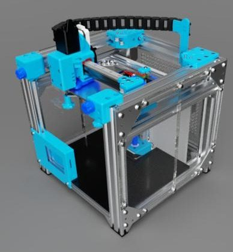</a> | [**3d Mini Cube (iChalix)**](https://www.thingiverse.com/thing:3910543) 120 mm BLV MGN Cube derivative with a single Z axis; documentation remains work in progress. No update since 2019. | 120×120×110 | 325×355×338 | Log [2019-12](https://www.thingiverse.com/thing:3910543) | [💙⁠165](https://www.thingiverse.com/thing:3910543) | [Files](https://www.thingiverse.com/thing:3910543/files) | [Facebook](https://www.facebook.com/groups/BenLevi) EN 7K |
| <a href="printers/annex-k2/README.md">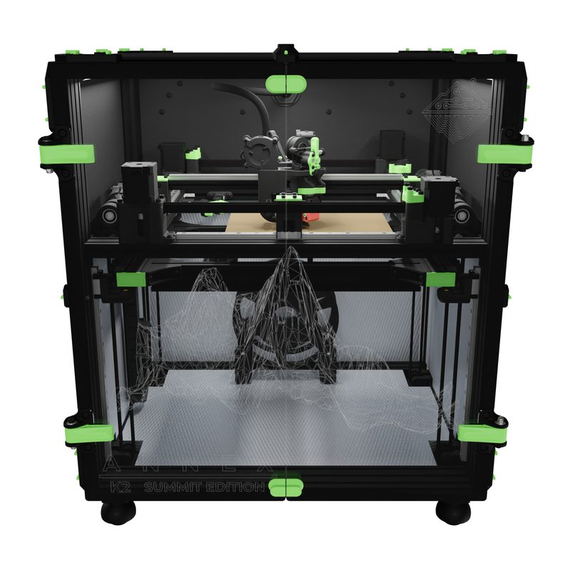</a> | [**Annex K2 / Chhogori**](https://github.com/Annex-Engineering/Chhogori-K2) *Annex Engineering* Archived moving-bed, enclosed cross-gantry design; the final XY and Z files are labelled beta and alpha. Replaced by the Annex K3. | 250×250×250 | — | CAD [2024-04](https://github.com/Annex-Engineering/Chhogori-K2/commit/9a151664698ac46f051df6135afb2e2e730ac703) |  [⏯️⁠35.3K](https://www.youtube.com/watch?v=MTtGYOv85oY) [❤️⁠225](https://www.youtube.com/watch?v=MTtGYOv85oY) | [CAD](https://github.com/Annex-Engineering/Chhogori-K2/tree/master/Release_4.0) [BOM](https://docs.google.com/spreadsheets/d/1O3eyVuQ6M4F03MJSDs4Z71_XyNjXL5HFTZr1jsaAtRc/edit) | [Discord](https://discord.gg/MzTR3zE) EN 11.4K |
| <a href="printers/annex-k1/README.md">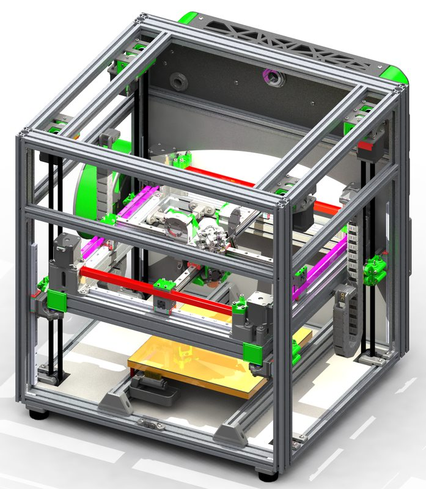</a> | [**Annex K1 / Masherbrum**](https://github.com/Annex-Engineering/Masherbrum-K1) *Annex Engineering* Archived moving-gantry, enclosed cross-gantry design with a documented 250 mm build and scalable frame. Replaced by the Annex K3. | 250×250×250 | — | CAD [2024-04](https://github.com/Annex-Engineering/Masherbrum-K1/commit/b85286efd96cf836858ddcb3c3916108828c910e) |  | [XY CAD](https://github.com/Annex-Engineering/Masherbrum-K1/tree/master/Release_3_0) [Z CAD](https://github.com/Annex-Engineering/Masherbrum-K1/tree/master/Release_2_2) [BOM](https://docs.google.com/spreadsheets/d/1O3eyVuQ6M4F03MJSDs4Z71_XyNjXL5HFTZr1jsaAtRc/edit) | [Discord](https://discord.gg/MzTR3zE) EN 11.4K |
| <a href="printers/little-cube/README.md">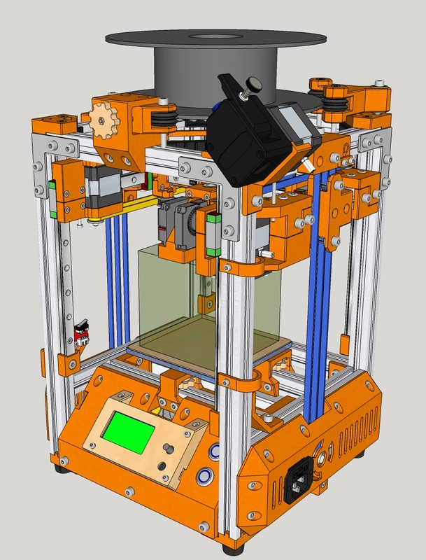</a> | [**Little Cube**](https://www.thingiverse.com/thing:4487878) *longlh / looong-made* CoreXY with a 100 × 100 × 100 mm print volume, fixed bed, and belt-driven Z; an involved self-sourced build. No update since 2020 and no active group. | 100×100×100 | — | First release [2020-06](https://www.thingiverse.com/thing:4487878) | [💙⁠105](https://www.thingiverse.com/thing:4487878) | [Files](https://www.thingiverse.com/thing:4487878/files) | — |
|  | [**EnderLoop**](https://github.com/mcsgroi/EnderLoop) *mcsgroi* Ender-3 conveyor conversion still marked work in progress; it has build instructions, printable models, firmware source, a DIY belt option, and stable release snapshots. Files use a noncommercial license. No update since 2021 and no active group. | 110×200×∞ | — | CAD [2021-02](https://github.com/mcsgroi/EnderLoop/commit/3a32565ad173ba2ad83c9e6f58818ab53eeddd8f) |  [💙⁠545](https://www.thingiverse.com/thing:4658201) [🧡⁠42](https://www.printables.com/model/77171-enderloop) | [STL](https://github.com/mcsgroi/EnderLoop/tree/main/Models) [Manual](https://github.com/mcsgroi/EnderLoop#readme) [Firmware](https://github.com/mcsgroi/EnderLoop/tree/main/Firmware) | — |
| <a href="printers/fusebox2/README.md">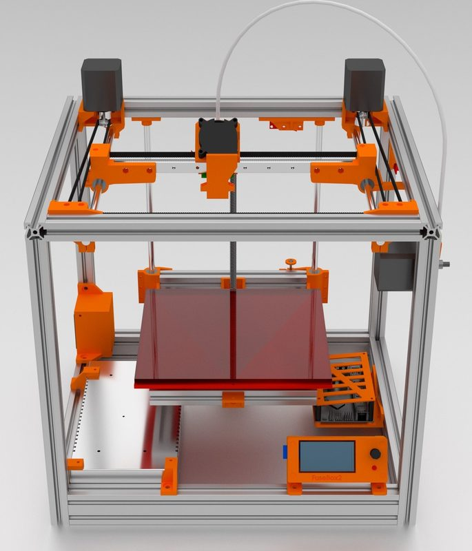</a> | [**FuseBox2 / 2R**](https://github.com/alexyu132/fusebox2) *Alex Yu* Earlier compact CoreXY; the creator recommends the 2R rail-gantry variant for a fresh build. Replaced by the FuseBox3. | 2: 210×200×210 2R: 210×205×210 | 390×340×412 | 2R CAD [2019-12](https://github.com/alexyu132/fusebox2/commit/67b5c9bdce200988ecd771d23534e7a76fff9275) |  [💙⁠545](https://www.thingiverse.com/thing:2422839) [💚⁠16](https://makerworld.com/en/models/27001) [⏯️⁠6.3K](https://www.youtube.com/watch?v=aUQ9sjp_YzY) [❤️⁠24](https://www.youtube.com/watch?v=aUQ9sjp_YzY) | [CAD](https://github.com/alexyu132/fusebox2/blob/master/FuseBox2R.skp) [Manual](https://github.com/alexyu132/fusebox2/blob/master/Build%20Tips.md) [BOM](https://github.com/alexyu132/fusebox2#bom) | — |
|  | [**ITopie**](https://github.com/skarab42/RepRap-iTopie) *skarab42* Older framed Cartesian RepRap with released files and a build manual. No update since 2015. | 200×200×230 | 390×440×440 | v2 [2015-11](https://github.com/skarab42/RepRap-iTopie/commit/520b5ebc5bcf347bb984b34748413ea4d1357ede) |  [💙⁠228](https://www.thingiverse.com/thing:888609) | [Manual](https://reprap.org/wiki/ITopie_Build_Manual) [Wiki](https://reprap.org/wiki/ITopie) | [Forum](https://reprap.org/forum/list.php?406) EN |
| <a href="printers/cerberus/README.md">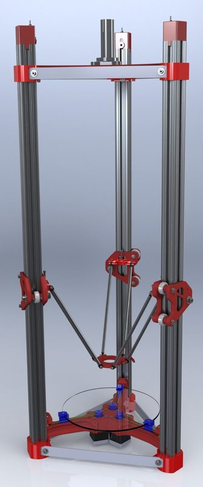</a> | [**Cerberus**](https://github.com/grabercars/Cerberus) *Steve Graber* Tall experimental delta derived from Rostock. No followers, and no update since 2013. | Ø245×560 | — | CAD [2013-07](https://github.com/grabercars/Cerberus/commit/f44c189698d5743c76fa486338614f112379a17b) |  [⏯️⁠78.4K](https://www.youtube.com/watch?v=32bxll7pv9U) [❤️⁠303](https://www.youtube.com/watch?v=32bxll7pv9U) | [Files](https://github.com/grabercars/Cerberus) [Wiki](https://reprap.org/wiki/Cerberus) | [Google Groups](https://groups.google.com/g/deltabot) EN [Forum](https://reprap.org/forum/list.php?178) EN |
| <a href="printers/maybecube/README.md">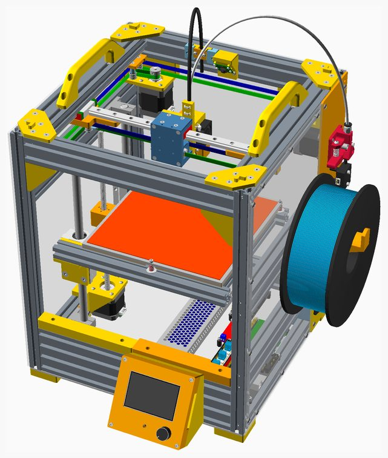</a> | [**MaybeCube**](https://github.com/martinbudden/MaybeCube) *Martin Budden* BabyCube's larger, configurable extrusion-frame sibling. No update since 2024-09 and no active group. | MC300: 185×185×200 MC350: 225×225×235 MC400: 275×275×285 | MC300: 340×340×420 MC350: 390×390×470 MC400: 440×440×520 | CAD [2024-09](https://github.com/martinbudden/MaybeCube/commit/83aeec32c94f3e004cd1ca78ecbb9fdc711e7357) |  [💙⁠51](https://www.thingiverse.com/thing:4912095) | [MC300RB](https://github.com/martinbudden/MaybeCube/blob/main/MC300RB/readme.md) [MC350](https://github.com/martinbudden/MaybeCube/blob/main/MC350/readme.md) [CAD](https://github.com/martinbudden/MaybeCube/tree/main/scad) | — |
|  | [**Denali**](https://github.com/Annex-Engineering/Denali) *Annex Engineering* Scalable enclosed CoreXY with a three-motor moving bed; repository is archived. | 200: 200×200×200 250: 250×250×200 350: 350×350×300 | 200: 380×380×620 250: 430×430×620 350: 530×530×720 | R1.1 [2021-01](https://github.com/Annex-Engineering/Denali/releases/tag/R1.1) |  | [CAD](https://github.com/Annex-Engineering/Denali/tree/master/CAD) [STL](https://github.com/Annex-Engineering/Denali/tree/master/STLs) [BOM](https://docs.google.com/spreadsheets/d/1O3eyVuQ6M4F03MJSDs4Z71_XyNjXL5HFTZr1jsaAtRc/edit) | [Discord](https://discord.gg/MzTR3zE) EN 11.4K |
|  | [**Ultimaker 2 Go**](https://github.com/Ultimaker/Ultimaker2Go) *Ultimaker* Compact, self-contained Cartesian member of the Ultimaker 2 family with published part sources and BOM. No update since 2016. | 120×120×115 | 258×250×288 | STEP [2016-01](https://github.com/Ultimaker/Ultimaker2Go/commit/28b7e8238e56cc885ed334ac8c9dafcdb14ff8fb) |  [⏯️⁠84.8K](https://www.youtube.com/watch?v=C0PyS0v-ssc) [❤️⁠230](https://www.youtube.com/watch?v=C0PyS0v-ssc) | [Files](https://github.com/Ultimaker/Ultimaker2Go) [Manual](https://um-support-files.ultimaker.com/manuals/user-manual/UM2GO/Ultimaker%202%20Go%20-%20User%20manual%20EN%20v2.1.pdf) | [Forum](https://community.ultimaker.com/) EN [Forum](https://community.ultimaker.com/forum/124-deutsch/) DE [Forum](https://community.ultimaker.com/forum/126-fran%C3%A7ais/) FR [Forum](https://community.ultimaker.com/forum/125-espa%C3%B1ol/) ES [Forum](https://community.ultimaker.com/forum/123-nederlands/) NL [Reddit](https://www.reddit.com/r/ultimaker/) EN 4.6K |
|  | [**FuseBox3**](https://github.com/alexyu132/fusebox3) *Alex Yu* Midsize CoreXY using linear rails and a belt-driven Z; creator marks it under development. No update since 2024-02 and no active group. | 235×235×235 | 350×372×427 | CAD [2024-02](https://github.com/alexyu132/fusebox3/commit/9c494a677b439fe6ca2699f7f0f0948dd96e7325) |  [⏯️⁠5.2K](https://www.youtube.com/watch?v=BQQiwGdlbZI) [❤️⁠40](https://www.youtube.com/watch?v=BQQiwGdlbZI) | [BOM](https://github.com/alexyu132/fusebox3/blob/master/documentation/BOM.md) [CAD](https://github.com/alexyu132/fusebox3/blob/master/fusebox3.skp) | — |
|  | [**Tantillus R**](https://github.com/toolson/Tantillus_R) *Toolson and Protoprinter* A 2018 rebuild of the Tantillus with a heated bed and fishing-line drives. No update since 2019. | 100×100×100 | 220×220×300 | CAD [2019-01](https://github.com/toolson/Tantillus_R/commit/66ac49aca91cd4d73db92f3ad83a7b9df1d87bf3) |  | [Files](https://github.com/toolson/Tantillus_R) [Wiki](https://reprap.org/wiki/Tantillus_R) | — |
|  | [**Hbot Pro ST / XL**](https://github.com/campy/Hbot) *3DCampy / 3DEspana* Single-belt H-bot from a former Spanish vendor, with SolidWorks CAD, DXF panels, and Duet firmware; documents are in Spanish. No update since 2022. | 325×325×400 | 550×630×630 | CAD [2022-03](https://github.com/campy/Hbot/commit/8f550f7288705a9960774d909cd47a718f97e8a6) |  [⏯️⁠21.2K](https://www.youtube.com/watch?v=CTP1-fysIOw) [❤️⁠1.1K](https://www.youtube.com/watch?v=CTP1-fysIOw) | [Files](https://github.com/campy/Hbot) [Manual](https://github.com/campy/Hbot/tree/HEAD/Instrucciones%20Hbot%20Pro) | — |
|  | [**RepRapPro Fisher 1**](https://github.com/reprappro/Fisher) *RepRapPro* Compact panel-frame delta with released STEP, DXF, and STL files and complete archived build instructions. RepRapPro closed, and there is no update since 2015. | Ø150×150 | — | Fisher 1 [2015-10](https://github.com/reprappro/Fisher/commit/3763feae76a749156fb1b7430c6995d73042990d) |  [⏯️⁠5.1K](https://www.youtube.com/watch?v=AAedSxTJ1j8) [❤️⁠18](https://www.youtube.com/watch?v=AAedSxTJ1j8) | [STEP](https://github.com/reprappro/Fisher/tree/master/step) [Manual](https://reprapltd.com/reprappro/documentation/fisher-1/index.html) | [Forum](https://reprap.org/forum/list.php?409) EN [Forum](https://reprap.org/forum/list.php?178) EN |
|  | [**MiniCube (Kotvic)**](https://www.thingiverse.com/thing:4795475) Compact CoreXY with Fusion 360 files; marked work in progress and missing assembly instructions. No update since 2021 and no active group. | 149×140×135 | 265×265×265 | First release [2021-03](https://www.thingiverse.com/thing:4795475) | [💙⁠9](https://www.thingiverse.com/thing:4795475) | [Files](https://www.thingiverse.com/thing:4795475/files) | — |
|  | [**Clock 3**](https://github.com/jon-harper/clock-3) *Jon Harper* Enclosed, temperature-controlled prototype; development is halted and the full Fusion assembly was not released. | 300×300×350 | 640×675×875 | Log [2022-06](https://github.com/jon-harper/clock-3/blob/main/docs/status/changelog.md#2022-06-18) |  | [BOM](https://github.com/jon-harper/clock-3/tree/main/BOM) [STL](https://github.com/jon-harper/clock-3/tree/main/STL) [Manual](https://github.com/jon-harper/clock-3/tree/main/docs) | — |
|  | [**Project Valkyrie**](https://github.com/3D-Experiments/Project-Valkyrie) *3D Experiments* Experimental CoreXY whose maker describes an inverted drive arrangement intended to reduce friction, with a triple-Z bed. No update since 2022 and no active group. | 310×310×300 | — | CAD [2022-06](https://github.com/3D-Experiments/Project-Valkyrie/commit/f59081c0808398a794080d676051edb70dae6ba7) |  [🧡⁠41](https://www.printables.com/model/252348) [⏯️⁠7.3K](https://www.youtube.com/watch?v=Th9y_WY5k54) [❤️⁠224](https://www.youtube.com/watch?v=Th9y_WY5k54) | [Files](https://github.com/3D-Experiments/Project-Valkyrie/tree/HEAD/Document%20Library) | — |
|  | [**SecKit SK-Go**](https://github.com/SecKit/SK-Go_SK-Mini) *SecKit family* Extrusion-frame design with a self-sourcing path. No update since 2024-07. | 310×310×350 | 520×500×500 | Go3 [2024-07](https://github.com/SecKit/SK-Go_SK-Mini/commit/36d0f9fadb08e65ddb99c8e1aae8fd9637878261) |  [💙⁠105](https://www.thingiverse.com/thing:3881156) [⏯️⁠5.7K](https://www.youtube.com/watch?v=ZBiTbyRcIaE) [❤️⁠54](https://www.youtube.com/watch?v=ZBiTbyRcIaE) | [STEP](https://github.com/SecKit/SK-Go_SK-Mini/tree/HEAD/Go3%20%28AE2-310eu%20v3%29/STEP%20files) [Manual](https://sites.google.com/view/seckit-wiki/sk-go-310x310x350) | [Facebook](https://www.facebook.com/groups/SecKitCoreXY3DP/) EN 2.6K |
|  | [**SecKit SK-Tank**](https://github.com/SecKit/SK-Tank) *SecKit family* All-metal frame kit design. No update since 2024-03. | 350×350×400 | 560×530×710 | v2 [2024-03](https://github.com/SecKit/SK-Tank/commit/a49a40e45f2f78543e51cf1fb0d3fb20d75e841f) |  [⏯️⁠5.1K](https://www.youtube.com/watch?v=aX0A48tPdEk) [❤️⁠62](https://www.youtube.com/watch?v=aX0A48tPdEk) | [Manual](https://sites.google.com/view/seckit-wiki/sk-tank-350x350x400) | [Facebook](https://www.facebook.com/groups/SecKitCoreXY3DP/) EN 2.6K |
|  | [**SecKit SK-Cube**](https://github.com/SecKit/SK-Cube) *SecKit family* Smaller self-sourceable 200 mm CoreXY. No update since 2024-10. | 200×200×200 | — | CAD [2024-10](https://github.com/SecKit/SK-Cube/commit/511a88e391036c4d58976461c35562cc03a3d76a) |  [⏯️⁠4.4K](https://www.youtube.com/watch?v=wUzZTefc6xk) [❤️⁠42](https://www.youtube.com/watch?v=wUzZTefc6xk) | [STEP](https://github.com/SecKit/SK-Cube/tree/main/STEP%20files) [BOM](https://github.com/SecKit/SK-Cube/tree/main/self-sourcing%20components) [Manual](https://sites.google.com/view/seckit-wiki/sk-cube-200x200x200/assembly-manual/sk-cube-assembly-manual) | [Facebook](https://www.facebook.com/groups/SecKitCoreXY3DP/) EN 2.6K |
|  | [**SolidCore CoreXY**](https://www.printables.com/model/221066-solidcore-corexy-3d-printer) *3D Distributed* All-metal CoreXY with machined aluminium motion parts, linear rails on all axes, and triple Z with a kinematic bed. The frame scales to other sizes. No update since 2022-06. | 350×350×350 | — | Files [2022-06](https://www.printables.com/model/221066-solidcore-corexy-3d-printer/files) | [💙⁠258](https://www.thingiverse.com/thing:4307266) [🧡⁠54](https://www.printables.com/model/221066-solidcore-corexy-3d-printer) [⏯️⁠54K](https://www.youtube.com/watch?v=5171_TXW7M8) [❤️⁠535](https://www.youtube.com/watch?v=5171_TXW7M8) | [STEP](https://www.printables.com/model/221066-solidcore-corexy-3d-printer/files) [Files](https://drive.google.com/drive/folders/1HQyc4OiMpGds7vOD8sf6P66I1bQqIA30) [BOM](https://docs.google.com/spreadsheets/d/1cHOBTe28XIPyURp-YsmSwgqEVQjoajGRWozn8MxH7-4/edit) | [Facebook](https://www.facebook.com/groups/solidcore3dprinter/) EN [Discord](https://discord.gg/jF6c6GG4qz) EN 99 |
|  | [**CrazyCreatorCube**](https://crazycreatorcube.notion.site/CrazyCreatorCube-9c3a3c3e242b42e78920e49dc1d180df) *Andreas Fricke and team* CoreXY toolchanger for up to four tools with a magnetic kinematic coupling, based on the E3D toolchanger motion system. The files stopped at Beta 0.9.6. No update since 2020-11. | 350×330×400 | 600×600×600 | Files [2020-11](https://crazycreatorcube.notion.site/c3ee2eca588f40cfa626e6a32b98aae4) | [⏯️⁠2K](https://www.youtube.com/watch?v=ieHzbuYLtvw) [❤️⁠21](https://www.youtube.com/watch?v=ieHzbuYLtvw) | [Files](https://crazycreatorcube.notion.site/36e3e15898e84799a97ddfb9b4dca4f0) [BOM](https://crazycreatorcube.notion.site/ed57916179c4499496eb0558b678a58c) [Manual](https://crazycreatorcube.notion.site/a64bb78a88fa46268ef8e895a60c252a) [Config](https://github.com/CrazyCreatorCube/Software/tree/HEAD/Firmware) | [Discord](https://discord.gg/WKWhDyq) EN 122 [Facebook](https://www.facebook.com/groups/crazycreatorcube/) |
|  | [**V-King CoreXY**](https://github.com/RoyBerntsenDesign/V-King-CoreXY) *Roy Berntsen / PRO 3D* Hypercube-style CoreXY with no smooth rods: all axes run on V-wheels in V-slot extrusion, and a worm gear drives the belted Z. No update since 2022-01. | 340×390×330 | — | Files [2022-01](https://github.com/RoyBerntsenDesign/V-King-CoreXY/commit/59a7ad08779e54fee8d0c5510eb178a15f1034da) |  [💙⁠541](https://www.thingiverse.com/thing:2921021) [🤍⁠21](https://www.myminifactory.com/object/3d-print-v-king-corexy-v2-0-73409) [⏯️⁠43K](https://www.youtube.com/watch?v=wINF7qM0DQU) [❤️⁠458](https://www.youtube.com/watch?v=wINF7qM0DQU) | [CAD](https://a360.co/3YxhjgS) [STL](https://github.com/RoyBerntsenDesign/V-King-CoreXY/tree/master/Part%20File%20Library) [BOM](https://github.com/RoyBerntsenDesign/V-King-CoreXY/blob/master/Document%20Library/Bill%20Of%20Materials/V-King%20CoreXY%20V2%20-%20Part%20Order%20List.xlsx) [Manual](https://github.com/RoyBerntsenDesign/V-King-CoreXY/blob/master/Document%20Library/V-king%20MK2%20Assembly%20Manual%20V1.0.pdf) [Config](https://github.com/RoyBerntsenDesign/V-King-CoreXY/tree/master/Firmware%20Files/RRF-Duet) | [Facebook](https://www.facebook.com/groups/viking3d/) EN |

## Historical designs

Designs with no update since before 2020, and designs that shaped later printers. They are useful for learning and restoration. A wiki page here can describe a design without a complete build package.

| Photo | Printer and why it’s interesting | Build volume (X×Y×Z) | Exterior (W×D×H) | Latest version | Stars Likes Views | Links | Groups |
| --- | --- | --- | --- | --- | --- | --- | --- |
|  | [**HyperCube**](https://www.thingiverse.com/thing:1752766) *Tech2C* Influential extrusion-frame DIY CoreXY. Base and idea for many later cube builds. | 200×200×155 | 380×343×350 | Log [2020-01](https://www.thingiverse.com/thing:1752766) | [💙⁠15K](https://www.thingiverse.com/thing:1752766) [⏯️⁠280K](https://www.youtube.com/watch?v=xFt7vzweUiw) [❤️⁠2.2K](https://www.youtube.com/watch?v=xFt7vzweUiw) | [Files](https://www.thingiverse.com/thing:1752766/files) | [Facebook](https://www.facebook.com/groups/1871049783171141/) EN 6.9K inactive [Facebook](https://www.facebook.com/groups/139876176592778/) PT 2K inactive [Facebook](https://www.facebook.com/groups/hypercubesupport/) EN 1.8K inactive |
|  | [**HyperCube Evolution**](https://www.thingiverse.com/thing:2254103) *SCOTT_3D* Aluminum-extrusion evolution of the HyperCube, and the most built DIY CoreXY before Voron. | 300×300×300 | 480×470×500 | Log [2017-07](https://www.thingiverse.com/thing:2254103) | [💙⁠11.9K](https://www.thingiverse.com/thing:2254103) [⏯️⁠362K](https://www.youtube.com/watch?v=1rctCsUGnX8) [❤️⁠2.3K](https://www.youtube.com/watch?v=1rctCsUGnX8) | [Files](https://www.thingiverse.com/thing:2254103/files) | [Facebook](https://www.facebook.com/groups/Hypercubeevolution/) EN 14.8K inactive [Facebook](https://www.facebook.com/groups/1871049783171141/) EN 6.9K inactive [Facebook](https://www.facebook.com/groups/hevopro/) EN 3K inactive [Facebook](https://www.facebook.com/groups/HypercubeEvoDeutsch/) DE 2.1K inactive [Facebook](https://www.facebook.com/groups/139876176592778/) PT 2K inactive [Facebook](https://www.facebook.com/groups/hypercubeevolutionfr/) FR 1.6K inactive |
|  | [**BLV MGN Cube**](https://www.thingiverse.com/thing:3382718) *BLV* Cube design built around linear rails. It made linear rails common on DIY cubes. | 300×300×365 | 576×536×560 | Log [2019-09](https://www.thingiverse.com/thing:3382718) | [💙⁠8.5K](https://www.thingiverse.com/thing:3382718) [🧡⁠142](https://www.printables.com/model/46738) [⏯️⁠115K](https://www.youtube.com/watch?v=N3xaPhAPYKM) [❤️⁠417](https://www.youtube.com/watch?v=N3xaPhAPYKM) | [Files](https://www.thingiverse.com/thing:3382718/files) | [Facebook](https://www.facebook.com/groups/BenLevi) EN 7K [Facebook](https://www.facebook.com/groups/578496329454012/) TR 190 [Facebook](https://www.facebook.com/groups/419619945577500/) IT 174 [Facebook](https://www.facebook.com/groups/386234302158871/) DE 158 |
|  | [**D-Bot**](https://www.thingiverse.com/thing:1001065) Extrusion-frame DIY CoreXY derived from the C-Bot, with a large modding community. | configurable | — | Files [2017-06](https://www.thingiverse.com/thing:1001065/files) | [💙⁠7.6K](https://www.thingiverse.com/thing:1001065) | [Files](https://www.thingiverse.com/thing:1001065/files) | [Facebook](https://www.facebook.com/groups/881368788659827/) RU 258 [Facebook](https://www.facebook.com/groups/1711323699127948/) EN 5K inactive [Telegram](https://t.me/cbotdbotcorexy) ES 260 |
|  | [**Rostock**](https://reprap.org/wiki/Rostock) *RepRap* Foundational parallel-arm delta, and the first popular delta printer. | Ø200×400 | — | CAD [2012-07](https://github.com/jcrocholl/rostock/commit/bd5bcebd93ce10676dd72583e95322dceb57ef08) | [💙⁠3.1K](https://www.thingiverse.com/thing:17175) [⏯️⁠388K](https://www.youtube.com/watch?v=AYs6jASd_Ww) [❤️⁠982](https://www.youtube.com/watch?v=AYs6jASd_Ww) | — | [Forum](https://reprap.org/forum/list.php?178) EN [Facebook](https://www.facebook.com/groups/delta3dp/) EN 2.7K inactive |
|  | [**Smartrap**](https://reprap.org/wiki/Smartrap_mini) Compact, low-part-count Cartesian RepRap design with a large following. | 250×250×200 | — | CAD [2015-07](https://github.com/smartfriendz/smartrap/commit/5ff51f4ab0f82a5eb2dacf58f4ec6b549e961622) | [💙⁠2.4K](https://www.thingiverse.com/thing:177256) | — | [Forum](https://reprap.org/forum/list.php?344) EN [Facebook](https://www.facebook.com/groups/Smartrap/) EN 64 |
|  | [**Original Ender-3**](https://github.com/Creality3DPrinting/Ender-3) *Creality* The best-selling budget printer, with an open hardware release of its mechanical and electronics files. | 220×220×250 | 440×410×465 | CAD [2018-06](https://github.com/Creality3DPrinting/Ender-3/commit/c94ec770d9ebf4795b31d178da24e0c77cc77167) |  [⏯️⁠319K](https://www.youtube.com/watch?v=yxkwERZXfaQ) [❤️⁠3.5K](https://www.youtube.com/watch?v=yxkwERZXfaQ) | [CAD](https://github.com/Creality3DPrinting/Ender-3/tree/master/Ender-3%20Mechanical) [Firmware](https://github.com/Creality3DPrinting/Ender-3/tree/master/Ender-3%20Firmware%20%28Marlin%29) | [Facebook](https://www.facebook.com/groups/ender3ender3procreality) EN 113K [Discord](https://discord.com/invite/creality) EN 25K [Reddit](https://www.reddit.com/r/ender3/) EN 257K [Telegram](https://t.me/Ender3Spain) ES 5.4K [Reddit](https://www.reddit.com/r/Creality/) EN 76.4K [Telegram](https://t.me/crealitybr) PT 737 |
|  | [**Prusa i3 (early to MK3S+)**](https://github.com/prusa3d/Original-Prusa-i3) *Prusa family* The most copied desktop layout, followed by many commercial clones. It started in 2012 as the RepRap [Prusa i3](https://reprap.org/wiki/Prusa_i3) and grew into the Original Prusa i3 MK3S+. Replaced by the MK4 and the CORE One. | early: 200×200×200 MK3S+: 250×210×210 | — | R7 [2021-06](https://github.com/prusa3d/Original-Prusa-i3/commit/bc7818d10d57f30d17bde0574f4be1c39c957a27) |  [🧡⁠5.2K](https://www.printables.com/model/57217) [🤍⁠397](https://www.myminifactory.com/object/3d-print-original-prusa-i3-mk3-57403) [⏯️⁠1.4M](https://www.youtube.com/watch?v=GE-lrRbU124) [❤️⁠11.7K](https://www.youtube.com/watch?v=GE-lrRbU124) | [Files](https://github.com/prusa3d/Original-Prusa-i3) [CAD](https://github.com/josefprusa/Prusa3) early [Wiki](https://reprap.org/wiki/Prusa_i3) | [Forum](https://forum.prusa3d.com/forum/english-forum-original-prusa-i3-mk3s-mk3/) EN 78.7K [Reddit](https://www.reddit.com/r/prusa3d/) EN 112K [Forum](https://forum.prusa3d.com/es/) ES 78.7K [Forum](https://forum.prusa3d.com/cs/) CS 78.7K [Facebook](https://www.facebook.com/groups/Prusai3users/) EN 47.5K [Discord](https://discord.gg/prusa3d) EN 13.6K [Forum](https://reprap.org/forum/list.php?406) EN |
|  | [**C-Bot**](https://www.thingiverse.com/thing:500041) V-slot wheel CoreXY on extrusion, and the parent of the D-Bot. | configurable | — | Rework [2016-03](https://www.thingiverse.com/thing:500041/files) | [💙⁠859](https://www.thingiverse.com/thing:500041) | [Files](https://www.thingiverse.com/thing:500041/files) | [Facebook](https://www.facebook.com/groups/1711323699127948/) EN 5K inactive [Telegram](https://t.me/cbotdbotcorexy) ES 260 |
|  | [**HevORT**](https://github.com/MirageC79/HevORT) *MirageC79* Well-known large-format DIY CoreXY community design. The author seems inactive since 2024. | 315: 315×315×340 415: 415×415×440 | — | ZR V2.6 [2024-09](https://github.com/MirageC79/HevORT/commit/c5fda5aa6289384b712de6a05a97f9e8f1eeac27) |  [💙⁠925](https://www.thingiverse.com/thing:3532039) [⏯️⁠728K](https://www.youtube.com/watch?v=ibsBiALMMSE) [❤️⁠10.1K](https://www.youtube.com/watch?v=ibsBiALMMSE) | [Manual](https://github.com/MirageC79/HevORT/tree/HEAD/docs) [BOM](https://github.com/MirageC79/HevORT/tree/HEAD/bom) | [Facebook](https://www.facebook.com/groups/hevort) EN 6.6K [Discord](https://discord.gg/nCYRQAZPWV) EN 3.8K |
|  | [**Tripteron**](https://reprap.org/wiki/Tripteron) *RepRap* A rare working printer with three orthogonal parallel arms. | — | — | First release [2016-11](https://www.thingiverse.com/thing:1903757) | [💙⁠353](https://www.thingiverse.com/thing:1903757) [🧡⁠29](https://www.printables.com/model/157727) [⏯️⁠58.4K](https://www.youtube.com/watch?v=aRaI0pesDN0) [❤️⁠708](https://www.youtube.com/watch?v=aRaI0pesDN0) | — | [Forum](https://reprap.org/forum/read.php?166,719575) EN inactive |
|  | [**Snappy**](https://github.com/revarbat/snappy-reprap) *revarbat* Mostly printed, snap-together Cartesian RepRap. One of the first printers made almost entirely of printed parts. | 198×198×220 | — | v3.0.3 [2018-02](https://github.com/revarbat/snappy-reprap/releases/tag/snappy_3.0.3) |  [💙⁠1.1K](https://www.thingiverse.com/thing:1828359) [⏯️⁠54.6K](https://www.youtube.com/watch?v=3KJbrb0P8jQ) [❤️⁠172](https://www.youtube.com/watch?v=3KJbrb0P8jQ) | [Manual](https://github.com/revarbat/snappy-reprap/tree/HEAD/docs) | [Forum](https://reprap.org/forum/list.php?151) EN |
|  | [**Kossel**](https://reprap.org/wiki/Kossel) *RepRap* The most built delta. Many commercial deltas copy it. | Ø170×240 | — | CAD [2014-05](https://github.com/jcrocholl/kossel/commit/74e086041993af1f0ef2aae6850905a81c1b6bb2) | [⏯️⁠314K](https://www.youtube.com/watch?v=0Ag3jeObNf8) [❤️⁠462](https://www.youtube.com/watch?v=0Ag3jeObNf8) | — | [Forum](https://reprap.org/forum/list.php?178) EN [Facebook](https://www.facebook.com/groups/delta3dp/) EN 2.7K inactive |
|  | [**GUS Simpson**](https://reprap.org/wiki/GUS_Simpson) *Simpson family* Experimental grounded delta prototype with an unusual arm layout. | — | — | CAD [2014-01](https://github.com/NicholasSeward/ConceptFORGE/commit/3dcbc6ba5797609bff680bafbcaf4fe8c3eb378b) | [⏯️⁠81.7K](https://www.youtube.com/watch?v=IEGTe1G2Gqs) [❤️⁠402](https://www.youtube.com/watch?v=IEGTe1G2Gqs) | — | [Forum](https://reprap.org/forum/list.php?178) EN |
|  | [**Huxley**](https://reprap.org/wiki/Huxley) *RepRap* Compact early Cartesian RepRap, and the first small RepRap. | 140×140×110 | — | RepRapPro [2013-08](https://github.com/reprappro/Huxley/commit/543e634d5975678bfb1a53be44ad0edbc3e9efe5) | [💙⁠391](https://www.thingiverse.com/thing:16625) [⏯️⁠950](https://www.youtube.com/watch?v=qj9labKZU9g) [❤️⁠3](https://www.youtube.com/watch?v=qj9labKZU9g) | — | [Forum](https://reprap.org/forum/list.php?214) EN |
|  | [**LISA Simpson**](https://reprap.org/wiki/LISA_Simpson) *Simpson family* Experimental grounded delta variant that followed the GUS Simpson. | — | — | CAD [2013-12](https://github.com/NicholasSeward/ConceptFORGE/commit/45678f0afa2dc6453e01f95c084fde2b6fef4e30) | [⏯️⁠48.1K](https://www.youtube.com/watch?v=N7XVxtgHHhY) [❤️⁠325](https://www.youtube.com/watch?v=N7XVxtgHHhY) | — | [Forum](https://reprap.org/forum/list.php?178) EN |
|  | [**Mendel90**](https://github.com/nophead/Mendel90) *nophead* Well-documented sheet-frame Mendel variant, also sold as a kit. | configurable | — | CAD [2018-10](https://github.com/nophead/Mendel90/commit/e0060e806687ef0b93cf8d4ccdb9d789b004228f) |  [💙⁠364](https://www.thingiverse.com/thing:17826) [⏯️⁠8.2K](https://www.youtube.com/watch?v=QDsL-gZ5PHs) [❤️⁠4](https://www.youtube.com/watch?v=QDsL-gZ5PHs) | [Files](https://github.com/nophead/Mendel90) | [Forum](https://reprap.org/forum/list.php?292) EN [Forum](https://reprap.org/forum/list.php?151) EN |
|  | [**Tribotron**](https://www.thingiverse.com/thing:3013586) *VaggelisG2* Single-belt H-bot with a 2020/2040 extrusion frame and MGN12 rails on all axes; its successor KEEVO is CoreXY. One of the few H-bots with full files. | 300×300×380 | 460×460×540 | Files [2019-01](https://www.thingiverse.com/thing:3013586/files) | [💙⁠247](https://www.thingiverse.com/thing:3013586) [⏯️⁠19.7K](https://www.youtube.com/watch?v=K0pcGKAQ4eA) [❤️⁠141](https://www.youtube.com/watch?v=K0pcGKAQ4eA) | [Files](https://www.thingiverse.com/thing:3013586/files) [Manual](https://www.instructables.com/Tribotron-3D-Printer/) [Video](https://youtu.be/K0pcGKAQ4eA) | — |
|  | [**Original CR-10**](https://github.com/Creality3DPrinting/CR-10) *Creality* Large-bed moving-bed Cartesian printer with an OSHWA-certified source release. It made large, cheap bed printers common. | 300×300×400 | — | CAD [2018-12](https://github.com/Creality3DPrinting/CR-10/commit/d2973de01cb922b8a2afb646b59a6a76d5c136c5) |  [⏯️⁠4K](https://www.youtube.com/watch?v=o29NP2wDsc4) [❤️⁠45](https://www.youtube.com/watch?v=o29NP2wDsc4) | [Files](https://github.com/Creality3DPrinting/CR-10/tree/master/3D) [BOM](https://github.com/Creality3DPrinting/CR-10/tree/master/BOM) [Wiring](https://github.com/Creality3DPrinting/CR-10/tree/master/Circuit%20diagram) | [Facebook](https://www.facebook.com/groups/2209962369021560/) EN 9.9K [Discord](https://discord.com/invite/creality) EN 25K [Reddit](https://www.reddit.com/r/CR10/) EN 41.3K [Telegram](https://t.me/joinchat/ANAZJ0PRxYzfNTg0d6tF0Q) ES 359 [Reddit](https://www.reddit.com/r/Creality/) EN 76.4K [Telegram](https://t.me/crealitybr) PT 737 |
|  | [**Prusa Mendel i2**](https://reprap.org/wiki/Prusa_Mendel) *Prusa / RepRap* An early simplification of the Mendel, and the most built RepRap of its time. It led to the i3. | 200×200×100 | — | iteration 2 [2012-02](https://github.com/josefprusa/PrusaMendel/commit/c2eb45864bb3021cfa3bfd2fee7b08c1e8e2b15a) | [⏯️⁠32.5K](https://www.youtube.com/watch?v=40id30dChnU) [❤️⁠180](https://www.youtube.com/watch?v=40id30dChnU) | — | [Forum](https://reprap.org/forum/list.php?151) EN |
|  | [**R-360 Polar**](https://reprap.org/wiki/R_360) *RepRap* Radial polar motion experiment. One of the few documented open polar printers. | Ø210×200 | — | CAD [2016-12](https://github.com/kory75/R-360-3D-Printer/commit/bb1308cb728c34756b5bd67819abd588ab218c91) | [⏯️⁠33.3K](https://www.youtube.com/watch?v=lvcS7TT98mA) [❤️⁠178](https://www.youtube.com/watch?v=lvcS7TT98mA) | — | [Forum](https://reprap.org/forum/list.php?185) EN |
|  | [**Wally**](https://reprap.org/wiki/Wally) *RepRap* Compact printed SCARA, and one of the early SCARA printers. | 150×150×? Ø200×? | — | CAD [2014-03](https://github.com/NicholasSeward/ConceptFORGE/commit/ac16f74621393b2546382053cf1fa064c8461e51) | [⏯️⁠31.5K](https://www.youtube.com/watch?v=iVg7WrgHJik) [❤️⁠171](https://www.youtube.com/watch?v=iVg7WrgHJik) | — | [Forum](https://reprap.org/forum/list.php?185) EN |
|  | [**CeXY H-Bot MK2**](https://www.thingiverse.com/thing:3383389) *xDOOTx* H-bot on 2020 extrusion with 8 mm rods and standard parts. It replaced the [first CeXY](https://www.thingiverse.com/thing:3080955) and adds a BOM, a photo build guide, and Fusion files. No update since 2019. | 200×200×? | — | Files [2019-12](https://www.thingiverse.com/thing:3383389/files) | [💙⁠162](https://www.thingiverse.com/thing:3383389) | [Files](https://www.thingiverse.com/thing:3383389/files) | — |
|  | [**RepRap Morgan**](https://reprap.org/wiki/RepRap_Morgan) *RepRap* Articulated-arm SCARA printer, and the best-known SCARA RepRap. | v1: 200×200×200 Pro 2: 380×220×200 | — | Morgan [2014-04](https://github.com/qharley/Morgan/commit/1a3a870c02bc2af414fe2b5ddd31c06150a97c84) | [⏯️⁠50.9K](https://www.youtube.com/watch?v=oSmo7iZ10Bk) [❤️⁠123](https://www.youtube.com/watch?v=oSmo7iZ10Bk) | — | [Forum](https://reprap.org/forum/list.php?185) EN |
|  | [**Tantillus**](https://github.com/Intrinsically-Sublime/Tantillus) *Sublime* Small, portable printer with fishing-line drives and printed or laser-cut enclosure options. It inspired the Tantillus R. | 100×100×100 | printed: 225×225×300 laser-cut: 240×240×300 | CAD [2013-07](https://github.com/Intrinsically-Sublime/Tantillus/commit/64c1c6ecd790764a1e828ce54a4ee6f9e18b8753) |  [⏯️⁠6.2K](https://www.youtube.com/watch?v=F6E36g0zuRg) | [Files](https://github.com/Intrinsically-Sublime/Tantillus) [Wiki](https://reprap.org/wiki/Tantillus) | [Forum](https://reprap.org/forum/list.php?279) EN inactive |
|  | [**Darwin**](https://reprap.org/wiki/Darwin) *RepRap* The first RepRap, and one of the earliest self-replicating printer designs. The project started here. | 230×230×100 | — | 1.0.6 [2008-12](http://blog.reprap.org/2008/12/solid-model-files-for-darwins-cartesian.html) | [⏯️⁠81.9K](https://www.youtube.com/watch?v=Mo5Hp_6uD-E) [❤️⁠111](https://www.youtube.com/watch?v=Mo5Hp_6uD-E) | — | [Forum](https://reprap.org/forum/list.php?150) EN inactive |
|  | [**Ultimaker Original**](https://github.com/Ultimaker/UltimakerOriginal) *Ultimaker* Open-design wooden-frame printer. It made the moving-head cross gantry and the Bowden feed popular. | 205×205×200 | — | CAD [2014-09](https://github.com/Ultimaker/UltimakerOriginal/commit/d72cd54202f0661c90d9c63fb5d4a42622985606) |  [⏯️⁠40.7K](https://www.youtube.com/watch?v=OWZi_rvBJ6o) [❤️⁠48](https://www.youtube.com/watch?v=OWZi_rvBJ6o) | [BOM](https://github.com/Ultimaker/UltimakerOriginal/tree/HEAD/BOM) | [Forum](https://community.ultimaker.com/) EN [Forum](https://community.ultimaker.com/forum/124-deutsch/) DE [Forum](https://community.ultimaker.com/forum/126-fran%C3%A7ais/) FR [Forum](https://community.ultimaker.com/forum/125-espa%C3%B1ol/) ES [Reddit](https://www.reddit.com/r/ultimaker/) EN 4.6K |
|  | [**RepRapPro Ormerod 1 / 2**](https://github.com/reprappro/Ormerod) *RepRapPro* Cantilevered Cartesian kit with full assembly files and build instructions. The first printer with the Duet board, now common on DIY printers. | 200×200×200 | 500×460×410 | 528.5 [2015-05](https://github.com/reprappro/Ormerod/releases/tag/528.5) |  [⏯️⁠7K](https://www.youtube.com/watch?v=HoZ7rOVZr-Q) [❤️⁠20](https://www.youtube.com/watch?v=HoZ7rOVZr-Q) | [CAD](https://github.com/reprappro/Ormerod/tree/master/freeCAD) [Manual](https://reprap.org/wiki/Ormerod#Build_instructions) | [Forum](https://reprap.org/forum/list.php?340) EN |
|  | [**FoldaRap**](https://github.com/EmmanuelG/Foldarap) *Emmanuel Gilloz* Folding, portable Cartesian RepRap, and an early portable printer design. | 300×300×300 | — | v4.0 [2017](https://github.com/EmmanuelG/Foldarap/blob/master/README.md#L18) |  [💙⁠1.6K](https://www.thingiverse.com/thing:15877) [⏯️⁠12.7K](https://www.youtube.com/watch?v=XODWCUfyM1o) [❤️⁠48](https://www.youtube.com/watch?v=XODWCUfyM1o) | [Files](https://github.com/EmmanuelG/Foldarap) | [Forum](https://reprap.org/forum/list.php?283) EN inactive |
|  | [**Wallace**](https://github.com/whosawhatsis/RepRap-Wallace) *Whosawhatsis* Parametric, minimalist early Cartesian design. Later simple RepRaps copied its minimal frame. | 200×200×140 | — | CAD [2012-02](https://github.com/whosawhatsis/RepRap-Wallace/commit/22788bdad7114b5d66fb84c0653973bc2ed760f2) |  [💙⁠436](https://www.thingiverse.com/thing:14208) [⏯️⁠32.5K](https://www.youtube.com/watch?v=0QrEmGlZT0w) [❤️⁠22](https://www.youtube.com/watch?v=0QrEmGlZT0w) | [Manual](https://reprap.org/wiki/Wallace) | — |
|  | [**SmartCore**](https://github.com/smartfriendz/smartcore) *Smartfriendz* Simple CoreXY in a wooden box from the Smartrap maker, and an early DIY CoreXY. | 300×300×300 | — | 1.2.4 [2015-06](https://github.com/smartfriendz/smartcore/commit/7468fec6c8d8e96a0075c108afc296941ad031ac) |  [💙⁠1.9K](https://www.thingiverse.com/thing:651117) | [Files](https://github.com/smartfriendz/smartcore/tree/master/sources) [STL](https://github.com/smartfriendz/smartcore/tree/master/stl) [Wiki](https://reprap.org/wiki/SmartrapCore) | [Forum](https://reprap.org/forum/list.php?397) EN [Forum](https://reprap.org/forum/list.php?344) EN |
|  | [**MendelMax**](https://github.com/maxbots/MendelMax) *Maxbots* Aluminum-extrusion Mendel variant. It made extrusion frames common on RepRaps. | 230×250×175 | — | CAD [2011-12](https://github.com/maxbots/MendelMax/commit/955fcf5735f79297279bf20667821ff31d82bb3c) |  [💙⁠763](https://www.thingiverse.com/thing:20355) | [STEP](https://github.com/maxbots/MendelMax/blob/HEAD/MendelMax.stp) [Wiki](https://reprap.org/wiki/MendelMax) | [Forum](https://reprap.org/forum/list.php?177) EN [Forum](https://reprap.org/forum/list.php?151) EN |
|  | [**UConduit**](https://github.com/iquizzle/uconduit) *Lee Miller* Early single-belt H-bot with a frame of hardware-store steel conduit and parametric OpenSCAD source. | 265×250×240 | 485×445×380 | CAD [2013-12](https://github.com/iquizzle/uconduit/commit/3d66a1659d0b6aba79ace77930395a757839446d) |  [💙⁠367](https://www.thingiverse.com/thing:102972) [⏯️⁠22K](https://www.youtube.com/watch?v=73MlaBWCTPU) [❤️⁠50](https://www.youtube.com/watch?v=73MlaBWCTPU) | [Files](https://github.com/iquizzle/uconduit) [Manual](https://hackaday.com/2013/06/12/using-electrical-conduit-for-a-3d-printer-frame/) [BOM](https://github.com/iquizzle/uconduit/blob/HEAD/UCON_BOM.pdf) [Wiki](https://reprap.org/wiki/Uconduit) | — |
|  | [**Mendel**](https://reprap.org/wiki/Mendel) *RepRap* Influential second-generation RepRap, and the parent of the Prusa Mendel and MendelMax. | 200×200×140 | — | First release [2009-10](http://blog.reprap.org/2009/10/mendel-uploaded.html) | [⏯️⁠55.2K](https://www.youtube.com/watch?v=toZpNpHQI7w) [❤️⁠29](https://www.youtube.com/watch?v=toZpNpHQI7w) | — | [Forum](https://reprap.org/forum/list.php?151) EN |
|  | [**FoldaRapX**](https://reprap.org/wiki/FoldaRapX) *Emmanuel Gilloz* Portable printer in a flight case. A scissor lift is the Z axis, so the machine unfolds as the print grows. The prototype stopped at version 0.1, because firmware for the non-linear Z axis was never finished. | — | — | CAD [2020-05](https://github.com/EmmanuelG/FoldaRapX/commit/075d811cd35dd8bc92e509428f954cf5ef3d8455) |  | [Files](https://github.com/EmmanuelG/FoldaRapX) [BOM](https://github.com/EmmanuelG/FoldaRapX/blob/master/Bill%20Of%20Materials.ods) [Wiki](https://reprap.org/wiki/FoldaRapX) | — |
|  | **RepRap H-Bot Project** *RepRap* H-bot project from an earlier version of this list; its wiki page now redirects to CoreXY. The original project page and files are lost. If you know where they are, a short PR is welcome. | — | — | — | — | — | — |

## Column notes

**Photo:** The main picture of the printer. Click it to open the printer page with all pictures. The [gallery](GALLERY.md) shows the main pictures in one grid.

**Sizes:** All sizes are in millimetres. Build volume is the printable X×Y×Z. Exterior is the body or frame W×D×H, without the spool, cables, or bed travel. If a source gives a range, the cell shows the largest value. `?` means the axis is not confirmed, `—` means no reliable figure, and `configurable` means no fixed volume. `Ø` is the print diameter of a delta. `∞` is the open print length of a belt printer.

**Latest version:** The date of the latest public revision, linked to its source. A tagged release or a changelog comes first. Next is the last CAD commit or file upload, then the first publication. The label names the revision or the source: `CAD` or `STEP` for a CAD commit, `Files` for a file upload, `Update` for a page update, `Log` for a changelog, and `First release` or `First video`. A year alone means the source gives no month. `—` means the source is lost.

**Stars Likes Views:** The gray badge shows live GitHub stars. The other counts are likes on the author's own pages, checked 2026-10-21: 💙 Thingiverse, 🧡 Printables, 💚 MakerWorld, 💛 Cults3D, and 🤍 MyMiniFactory. ⏯️ and ❤️ are the views and likes of the author's most-viewed video about the printer. Copies and remixes by other people do not count. `—` means no count was found.

**Links:** `STEP` is a STEP model, `CAD` is native CAD such as Fusion or OpenSCAD, and `STL` is printable parts. `Files` is a mixed set of design files, `BOM` is the bill of materials, and `Manual` is the build guide. `Wiki`, `Config`, `Firmware`, and `Video` go to those pages. `—` means no direct link was found.

**Groups:** Builder communities for the printer, its family, or its creator, checked 2026-10-20. Official groups come first, then the largest. Each line shows the platform, the language, and the member count. No number means the platform hides the count. `inactive` marks a large group with no posts in the last year. General groups such as r/3Dprinting are not listed.

## Mini footprint comparison

For a desk, **extra width and depth beyond printable XY** is easier to picture than an area ratio. Each value is exterior W minus printable X, and exterior D minus printable Y; it is not a required clearance on each side. The measurements use different body, enclosing, or open configurations, so check spool placement and bed travel before planning a tight space.

| Printer | Printable XY | Reported footprint | Extra W × D |
| --- | --- | --- | --- |
| [Positron V3.2](#positron-v3) (open) | 180×180 | 200×200 | +20×20 mm |
| [Cubiron](#cubiron) | 70×70 | 144×145 | +74×75 mm |
| [Quark](#quark) | 24×24 | 100×100 | +76×76 mm |
| [Encore](#encore) (body) | 120×120 | 219×221 | +99×101 mm |
| [Rook MK1](#rook-mk1) | 120×120 | 220×250 | +100×130 mm |
| [Voron V0](#voron-v0) | 120×120 | 230×230 | +110×110 mm |
| [MiniCube (Kotvic)](#minicube-kotvic) (body) | 149×140 | 265×265 | +116×125 mm |
| [Tantillus R](#tantillus-r) | 100×100 | 220×220 | +120×120 mm |
| [Tantillus](#tantillus) (printed frame) | 100×100 | 225×225 | +125×125 mm |
| [Ultimaker 2 Go](#ultimaker-2-go) (desktop) | 120×120 | 258×250 | +138×130 mm |
| [BabyCube](#babycube) (enclosing) | 90×80 | 248×272 | +158×192 mm |
| [Prusa MINI](#prusa-mini) (no spool or PSU) | 180×180 | 380×330 | +200×150 mm |
| [3d Mini Cube (iChalix)](#mini-cube-ichalix) | 120×120 | 325×355 | +205×235 mm |
| [RailCore Mini](#railcore-mini) (no loom) | 150×150 | 400×312 | +250×162 mm |
| [BabyBelt Pro](#babybelt-pro) | 100×100 | — | — |
| [Bastion](#bastion) | 180×180 | — | — |
| [Delta Flyer](#delta-flyer) | Ø115 | — | — |
| [F-Zero](#f-zero) | 120×120 | — | — |
| [Fisher 1](#reprappro-fisher) | Ø150 | — | — |
| [GBot Tiny](#gbot-tiny) | 120×120 | — | — |
| [Kappy](#kappy) | 120×120 | — | — |
| [Lemontron](#lemontron) | 180×180 | — | — |
| [Little Cube](#little-cube) | 100×100 | — | — |
| [Micron](#micron) | 120×120 180×180 | — | — |
| [MIN Micro Delta](#min-micro-delta) | Ø70 | — | — |
| [Panda Mini](#panda-mini) | 140×140 | — | — |
| [Rat Rig V-Minion](#ratrig-v-minion) | 180×180 | — | — |
| [Rook MK2](#rook-mk2) | 120×120 | — | — |
| [Salad Fork](#salad-fork) | 120×120 160×160 180×180 | — | — |
| [TicTac 2.1](#tictac-2-1) | 120×120 | — | — |
| [Tiny-M](#tiny-m) | 150×150 | — | — |
| [Tiny-T](#tiny-t) | 150×150 | — | — |
| [Tri-Zero](#tri-zero) | 120×120 170×170 | — | — |
| [V-Chonk](#v-chonk) | 180×180 | — | — |
| [VzBot Vz150](#vzbot-vz150) | 150×150 | — | — |

Kotvic's MiniCube grows to **265×340×350 mm** with the spool, extruder, and Bowden tube included. BabyCube's enclosing figure excludes its spool, Bowden tube, and wiring. Those accessory differences matter more than a small difference in the table's overhead.

## Browse by maker or family

The same printer appears only once above. These links jump to its row; use your browser's page search for smaller maker tags.

- **Voron family**
  - **Original Voron Design**  
  [2.4](#voron-2-4) · [Trident](#voron-trident) · [V0](#voron-v0) · [Switchwire](#voron-switchwire) · [Legacy](#voron-legacy) · [1.8](#voron-1-8)
  - **Printers for Ants**  
  [Micron](#micron) · [Salad Fork](#salad-fork) · [Tiny-T](#tiny-t)
  - **zruncho3d**  
  [F-Zero](#f-zero) · [Tri-Zero](#tri-zero) · [Double Dragon](#double-dragon) · [Dueling Zero](#dueling-zero)
  - **FrankenVoron**  
  [Tridex](#tridex)
  - **gsl12**  
  [Tiny-M](#tiny-m)
  - **DaRk_dOg**  
  [Ender_SW](#ender-sw)
  - **rogerlz**  
  [Doron Velta](#doron-velta)

- **Rolohaun**  
  [Rook MK1](#rook-mk1) · [Rook MK2](#rook-mk2) · [Rook 2020](#rook-2020) · [SimpleCore](#simplecore) · [Panda Mini](#panda-mini) · [Bastion](#bastion) · [Defiant](#defiant) · [Kappy](#kappy) · [MIN Micro Delta](#min-micro-delta) · [Delta Flyer](#delta-flyer) · [PhoenixDelta](#phoenix-delta)
- **Rat Rig**  
  [V-Core 4.1](#ratrig-v-core-4-1) · [V-Core 3](#ratrig-v-core-3) · [V-Chonk](#v-chonk) · [V-Minion](#ratrig-v-minion) · [TicTac 2.1](#tictac-2-1)
- **VzBot**  
  [Vz330](#vzbot) · [Vz235](#vzbot-vz235) · [Vz150](#vzbot-vz150)
- **BLV MGN Cube**  
  [BLV MGN Cube](#blv-mgn-cube) · [3d Mini Cube (iChalix)](#mini-cube-ichalix)
- **Martin Budden**  
  [BabyCube](#babycube) · [MaybeCube](#maybecube)
- **RobertGcode**  
  [Cubiron](#cubiron) · [Quark](#quark)
- **Alex Yu**  
  [Encore](#encore) · [FuseBox3](#fusebox3) · [FuseBox2 / 2R](#fusebox2)
- **SnakeOilXY**  
  [SnakeOil XY](#snakeoil-xy) · [ProosaXY](#proosaxy)
- **SecKit**  
  [SK-Go](#seckit-sk-go) · [SK-Tank](#seckit-sk-tank) · [SK-Cube](#seckit-sk-cube)
- **Prusa / RepRap**  
  [CORE One](#prusa-core-one) · [CORE One L](#prusa-core-one-l) · [Original Prusa MINI](#prusa-mini) · [Original Prusa i3](#prusa-i3) · [Prusa Mendel i2](#prusa-mendel-i2)
- **RailCore**  
  [RailCore II](#railcore-ii) · [RailCore Mini](#railcore-mini)
- **Annex Engineering**  
  [Denali](#denali) · [K1 / Masherbrum](#annex-k1) · [K2 / Chhogori](#annex-k2) · [K3 / Gasherbrum](#annex-k3)
- **Ultimaker**  
  [Original](#ultimaker-original) · [2 Go](#ultimaker-2-go)
- **Creality**  
  [Original Ender-3](#ender-3) · [Original CR-10](#creality-cr-10)
- **Smartfriendz**  
  [Smartrap](#smartrap) · [SmartCore](#smartcore)
- **RepRapPro**  
  [Ormerod 1 / 2](#ormerod-2) · [Fisher 1](#reprappro-fisher)
- **Matt the Printing Nerd**  
  [THE100](#the100) · [T250](#t250)

## How to contribute

Pull requests are welcome. To suggest a printer, add its project page and one sentence on why it is interesting. Add direct links to the build guide, BOM, CAD, and the creator's video if they exist. Do not add homepages, dead links, duplicates, or claims such as "best" or "cheapest".

To add a full row, follow "Column notes":

1. Put the row in the table for its motion system and size. If the design has no update since 2024-10 and no active group, use Legacy. If it shaped later printers, use Historical.
2. Count only the creator's own pages and videos. For a GitHub repository, add the star badge from an existing row.
3. Sort rows by GitHub stars, highest first. If a row has no repository, use its highest like count. Rows with no counts go last.

## License

The text of this list is in the public domain under [CC0 1.0](LICENSE). The pictures in `printers/` are not covered by this license. Their authors keep all rights. Each printer page credits the authors, and [GALLERY.md](GALLERY.md#picture-credits) tells you how to ask for a fix or a removal.
