# Awesome 3D Printers <!-- omit from toc -->

A curated catalog of open-design and community-documented FDM printers to build, modify, or study. Each design has **one catalog row**. The [gallery](GALLERY.md) shows every printer as a picture. [Column notes](#column-notes) explain the columns and marks. The printer name links to its project repository when available, otherwise to the creator's project page or a useful community reference. [Maker and family labels](#browse-by-maker-or-family) help you find related designs without repeating rows. Within each kinematics section or size group, rows are sorted by GitHub stars. Designs without a repository are sorted by their highest like count.

## Contents <!-- omit from toc -->

- [Start here](#start-here)
- [Printers by motion system](#printers-by-motion-system)
  - [CoreXY](#corexy)
    - [Large (≥300 × 300 mm)](#large-300--300-mm)
    - [Medium (181–299 mm representative X/Y size)](#medium-181299-mm-representative-xy-size)
    - [Small (≤180 mm representative X/Y size)](#small-180-mm-representative-xy-size)
  - [Cross-gantry](#cross-gantry)
  - [Cartesian](#cartesian)
    - [Medium and large (\>180 mm on either X/Y axis)](#medium-and-large-180-mm-on-either-xy-axis)
    - [Small (≤180 mm on both X/Y axes)](#small-180-mm-on-both-xy-axes)
  - [Delta](#delta)
  - [Other motion systems](#other-motion-systems)
  - [Belt](#belt)
  - [5-axis](#5-axis)
- [Conversions](#conversions)
- [Concepts and prototypes](#concepts-and-prototypes)
- [Legacy designs](#legacy-designs)
- [Historical designs](#historical-designs)
- [Column notes](#column-notes)
- [Mini footprint comparison](#mini-footprint-comparison)
- [Browse by maker or family](#browse-by-maker-or-family)
- [How to contribute](#how-to-contribute)
- [License](#license)

## Start here

A few different reasons to choose a project; these point to the full catalogue rows below.

- **[Voron 2.4](#voron-2) - Flying-gantry CoreXY**  
combines an enclosed design with detailed documentation, a large community, and kit options.
- **[VzBot Vz330](#vzbot) - Speed-focused build**  
is a platform for speed benchmarking, with AWD variants.
- **[Voron Trident](#voron-trident) - Classic full-size CoreXY**  
has a great manual, a fixed gantry and independently driven Z bed, a large community, and many kit options.
- **[Annex K3 / Gasherbrum](#annex-k3) - Cross-gantry build**  
is a compact, rigid, speed-oriented design with a builder community.
- **[Rook MK1](#rook-mk1) - Mostly printed CoreXY**  
is a compact introduction to CoreXY.
- **[SimpleCore](#simplecore) - Budget and beginner-friendly CoreXY**  
offers triple-Z bed motion and an expandable frame for a first build.
- **[Duender](#duender) - Reuse existing printers**  
converts parts from two Ender-3 machines into a CoreXY. It reuses as many of the existing parts as possible, so the extra cost is small.
- **[Lemontron](#lemontron) - Explore a different layout**  
is a portable inverted printer; check the revision notes before building.
- **[Delta Flyer](#delta-flyer) - Try a delta**  
pairs a small delta with a build manual.
- **[Kappy](#kappy) - Small, approachable build**  
is a beginner-oriented bedslinger with a creator-supplied manual and BOM.
- **[Rat Rig V-Core 4.1](#ratrig-v-core-4-1) - Large format with IDEX**  
offers 300–500 mm sizes, with Hybrid and IDEX upgrades; the kit is also available.
- **[LH Stinger](#lh-stinger) - Fast Cartesian build**  
offers a performance-focused moving-bed layout with published CAD and a wiki.
- **[Micron](#micron) - Miniature enclosed CoreXY**  
brings a Voron-inspired build to a small footprint; its manual is still in progress.
- **[T250](#t250) - Advanced high-speed CoreXY**  
is mostly printed, uses a four-motor gantry, and has published build files and documentation.

## Printers by motion system

The primary sections group related XY motion layouts.

### CoreXY

Groups use a **representative printable X/Y size**: Large starts at 300×300 mm. Small is 180×180 mm or less. Medium is everything between. A scalable design can offer variants in other groups; its full range remains in the build-volume cell. Designs without a fixed or confirmed volume are placed by their intended format.

#### Large (≥300 × 300 mm)

| Photo | Printer and why it’s interesting | Build volume (X×Y×Z) | Exterior (W×D×H) | Latest version | Stars Likes Views | Links | Groups |
| --- | --- | --- | --- | --- | --- | --- | --- |
| <a href="printers/prusa-xl/README.md">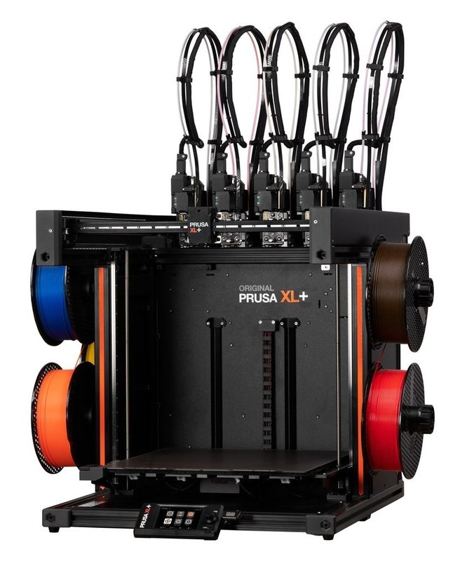</a> | [**Prusa XL / XL+**](https://www.printables.com/model/1814173-xl-printable-parts) *Prusa family* Large CoreXY tool changer with up to five independent toolheads and a modular heatbed. The row covers the Original Prusa XL (2023) and the XL+ (2026), which adds a nozzle wiper, high-flow nozzles and a 60 °C chamber rating. | 360×360×360 | 700×720×900 | XL+ [2026-08](https://www.printables.com/model/1814173-xl-printable-parts) | [🧡⁠1.2K](https://www.printables.com/model/449554-xl-printable-parts) [⏯️⁠804K](https://www.youtube.com/watch?v=6OAAnuEdXWE) [❤️⁠3K](https://www.youtube.com/watch?v=6OAAnuEdXWE) | [STEP](https://www.printables.com/model/449554-xl-printable-parts/files) XL [STL](https://www.printables.com/model/1814173-xl-printable-parts/files) XL+ [Manual](https://help.prusa3d.com/product/xl) [Firmware](https://github.com/prusa3d/Prusa-Firmware-Buddy) | [Forum](https://forum.prusa3d.com/forum/original-prusa-xl/) EN 78.7K [Reddit](https://www.reddit.com/r/prusa3d/) EN 112K [Forum](https://forum.prusa3d.com/es/) ES 78.7K [Forum](https://forum.prusa3d.com/cs/) CS 78.7K [Facebook](https://www.facebook.com/groups/Prusai3users/) EN 47.5K [Discord](https://discord.gg/prusa3d) EN 13.6K |
|  | [**SolidCore CoreXY**](https://www.printables.com/model/221066-solidcore-corexy-3d-printer) *3D Distributed* All-metal CoreXY with machined aluminium motion parts, linear rails on all axes, and triple Z with a kinematic bed. The frame scales to other sizes. | 350×350×350 | — | Files [2022-06](https://www.printables.com/model/221066-solidcore-corexy-3d-printer/files) | [💙⁠258](https://www.thingiverse.com/thing:4307266) [🧡⁠54](https://www.printables.com/model/221066-solidcore-corexy-3d-printer) [⏯️⁠54K](https://www.youtube.com/watch?v=5171_TXW7M8) [❤️⁠535](https://www.youtube.com/watch?v=5171_TXW7M8) | [STEP](https://www.printables.com/model/221066-solidcore-corexy-3d-printer/files) [Files](https://drive.google.com/drive/folders/1HQyc4OiMpGds7vOD8sf6P66I1bQqIA30) [BOM](https://docs.google.com/spreadsheets/d/1cHOBTe28XIPyURp-YsmSwgqEVQjoajGRWozn8MxH7-4/edit) | [Facebook](https://www.facebook.com/groups/solidcore3dprinter/) EN [Discord](https://discord.gg/jF6c6GG4qz) EN 99 |
|  | [**K3D VOSTOK v9.5**](https://k3d.tech/vostok/) *Dmitry Sorkin / K3D* Large, open-design Markforged-derived XY/2 IDEX with dual printheads. Russian-language HTML documentation; use your browser’s page translation to read it in English. | M: 400×250×250 L: 400×400×400 XL: 500×500×500 | — | v9.5 [2026-09](https://github.com/dmitry-sorkin/k3d-site/commit/92c4b06ff91228bfd0dde3903ce569bfc12d6043) |  [⏯️⁠107K](https://www.youtube.com/watch?v=upwTgwNi1PQ) [❤️⁠3.9K](https://www.youtube.com/watch?v=upwTgwNi1PQ) | [STEP](https://k3d.tech/vostok/releases/9.5/assets/vostok_v9.5_assembly.stp.7z) [BOM](https://k3d.tech/vostok/releases/9.5/assets/vostok_v9.5_bom.xlsx) [Manual](https://k3d.tech/vostok/manual/prepare/start/) [Config](https://github.com/dmitry-sorkin/vostok_configuration/blob/main/README.en.md) | [Telegram](https://t.me/vostok3dp) RU 4.2K [Telegram](https://t.me/k3d_vostok) RU 3.4K [Telegram](https://t.me/K_3_D) RU 36.2K |
|  | [**Project Valkyrie**](https://github.com/RoyBerntsenDesign/Project-Valkyrie) *Roy Berntsen / PRO 3D* High-temperature CoreXY with a 110 °C active chamber, a water-cooled hotend for up to 500 °C, a heated drybox and three belt-lift Z axes. V2 is a full redesign of V1, which ran from 2022 to 2024. | 330×300×280 | — | V2.0.0-rc.1 [2026-10](https://github.com/RoyBerntsenDesign/Project-Valkyrie/releases/tag/V2.0.0-rc.1) |  [🧡⁠41](https://www.printables.com/model/252348) [⏯️⁠7.3K](https://www.youtube.com/watch?v=Th9y_WY5k54) [❤️⁠224](https://www.youtube.com/watch?v=Th9y_WY5k54) | [CAD](https://a360.co/4qquDOy) V2 [Files](https://github.com/RoyBerntsenDesign/Project-Valkyrie/tree/HEAD/Part-Files) V2 [BOM](https://github.com/RoyBerntsenDesign/Project-Valkyrie/tree/HEAD/BOM) V2 [Manual](https://github.com/RoyBerntsenDesign/Project-Valkyrie/blob/HEAD/docs/Valkyrie_V2_Technical_Overview_v1.1.pdf) V2 [Files](https://github.com/RoyBerntsenDesign/Project-Valkyrie/tree/V1.2.0) V1.2.0 [Files](https://github.com/3D-Experiments/Project-Valkyrie/tree/HEAD/Document%20Library) old V1 copy | [Discord](https://discord.gg/mWARcpt7NQ) EN 630 |
|  | [**SecKit SK-Go**](https://github.com/SecKit/SK-Go_SK-Mini) *SecKit family* Extrusion-frame design with a self-sourcing path. | 310×310×350 | 520×500×500 | Go3 [2024-07](https://github.com/SecKit/SK-Go_SK-Mini/commit/36d0f9fadb08e65ddb99c8e1aae8fd9637878261) |  [💙⁠105](https://www.thingiverse.com/thing:3881156) [⏯️⁠5.7K](https://www.youtube.com/watch?v=ZBiTbyRcIaE) [❤️⁠54](https://www.youtube.com/watch?v=ZBiTbyRcIaE) | [STEP](https://github.com/SecKit/SK-Go_SK-Mini/tree/HEAD/Go3%20%28AE2-310eu%20v3%29/STEP%20files) [Manual](https://sites.google.com/view/seckit-wiki/sk-go-310x310x350) | [Facebook](https://www.facebook.com/groups/SecKitCoreXY3DP/) EN 2.6K |
|  | [**Rat Rig V-Core 4.1**](https://ratrig.com/products/rat-rig-v-core-4-1) *Rat Rig family* Current large-format platform with optional Hybrid and IDEX upgrades. | 300: 300×300×300 400: 400×400×400 500: 500×500×500 | 300: 623×583×785 400: 723×683×885 500: 823×783×985 | 4.1 [2026-01](https://www.youtube.com/watch?v=R555xlsRq3E) | [🧡⁠50](https://www.printables.com/model/1142398) [⏯️⁠29.7K](https://www.youtube.com/watch?v=qzcF4g1z9MI) [❤️⁠794](https://www.youtube.com/watch?v=qzcF4g1z9MI) | [CAD](https://a360.co/49FDeXb) [Files](https://wiki.ratrig.com/products/v-core-4-1/files) [Manual](https://wiki.ratrig.com/products/v-core-4-1/build-guide) [BOM](https://docs.google.com/spreadsheets/d/1lGxKfwd0G22HPD6DDV5jK_a0T9UC1q8YWn3PXyn1YvQ/edit) | [Facebook](https://www.facebook.com/groups/ratrig3dprintercommunity) EN 19.9K [Discord](https://discord.gg/ratrig) EN 13.8K [Reddit](https://www.reddit.com/r/RatRig/) EN 3K |
|  | [**SecKit SK-Tank**](https://github.com/SecKit/SK-Tank) *SecKit family* All-metal frame kit design in two versions, v1 with 350 mm and v2 with 400 mm XY. | v1: 350×350×400 v2: 400×400×400 | 560×530×710 | STEP [2025-03](https://github.com/SecKit/SK-Tank/commit/ae56719d14c6fef099e959b14f3daf03f4c1f8b8) |  [⏯️⁠5.1K](https://www.youtube.com/watch?v=aX0A48tPdEk) [❤️⁠62](https://www.youtube.com/watch?v=aX0A48tPdEk) | [Manual](https://sites.google.com/view/seckit-wiki/sk-tank-v2-400x400x400/assembly-manuals/sk-tank-v2-assembly-manual) v2 [Manual](https://sites.google.com/view/seckit-wiki/sk-tank-350x350x400) v1 | [Facebook](https://www.facebook.com/groups/SecKitCoreXY3DP/) EN 2.6K |

#### Medium (181–299 mm representative X/Y size)

| Photo | Printer and why it’s interesting | Build volume (X×Y×Z) | Exterior (W×D×H) | Latest version | Stars Likes Views | Links | Groups |
| --- | --- | --- | --- | --- | --- | --- | --- |
| <a href="printers/voron-2/README.md">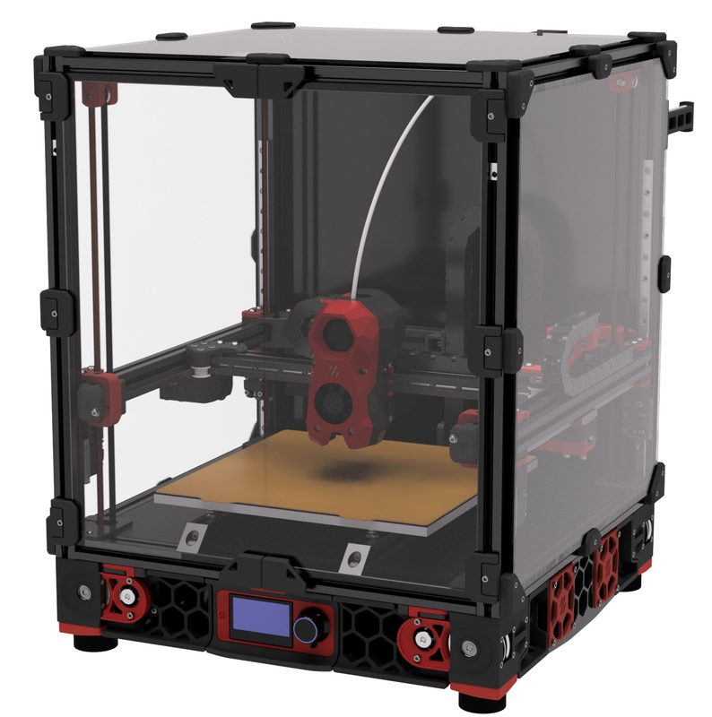</a> | [**Voron 2 (2.0 to 2.4)**](https://github.com/VoronDesign/Voron-2) *Voron family* Large enclosed design with a moving gantry. The 2.0, 2.1 and 2.2 came before the current 2.4. | 250: 250×250×230 300: 300×300×280 350: 350×350×330 | 250: 410×410×430 300: 460×460×480 350: 510×510×530 | V2.4r2 [2022-02](https://github.com/VoronDesign/Voron-2/releases/tag/V2.4r2) |  [⏯️⁠21.5K](https://www.youtube.com/watch?v=HqeTA0CJd3c) [❤️⁠226](https://www.youtube.com/watch?v=HqeTA0CJd3c) | [CAD](https://github.com/VoronDesign/Voron-2/tree/HEAD/CAD) [Manual](https://github.com/VoronDesign/Voron-2/blob/HEAD/Manual/Assembly_Manual_2.4r2.pdf) [CAD](https://github.com/VoronDesign/Voron-2/tree/Voron2.2/CAD) old 2.2 [CAD](https://github.com/VoronDesign/Voron-2/tree/Voron2.1/CAD) old 2.1 [STEP](https://github.com/VoronDesign/Voron-2/tree/Voron2.0/STEP) old 2.0 | [Discord](https://discord.gg/voron) EN 40.8K [Reddit](https://www.reddit.com/r/VORONDesign/) EN 39.7K [Forum](https://forum.vorondesign.com/) EN 12.8K [Facebook](https://www.facebook.com/groups/voroncorexy/) EN 54.2K [Facebook](https://www.facebook.com/groups/479932403103163/) DE 2.6K [Telegram](https://t.me/aboutvoron) RU 551 [Telegram](https://t.me/voron_siboor_es) ES 212 [Forum](https://www.lesimprimantes3d.fr/forum/154-voron/) FR |
|  | [**Prusa CORE One / CORE One L**](https://www.printables.com/model/1520471-prusa-core-one-full-cad-assembly) *Prusa family* Enclosed commercial CoreXY with released STEP/Fusion assemblies under the Open Community License. Full manufacturing data is not published. The row covers the CORE One and the larger [CORE One L](https://www.printables.com/model/1520379-prusa-core-one-l-full-cad-assembly), which adds a solid aluminium heatbed and active chamber heating. The printable parts cover the CORE One, CORE One+ (Gen 2), CORE One L and L+, and a separate set adds the INDX tool changer. | CORE One: 250×220×270 CORE One L: 300×300×330 | CORE One: 415×444×555 CORE One L: 469×521×635 | Files [2026-09](https://www.printables.com/model/1167816-core-onegen-2-printable-parts) | [🧡⁠2.5K](https://www.printables.com/model/1520471-prusa-core-one-full-cad-assembly) [⏯️⁠5M](https://www.youtube.com/watch?v=guS0BpeI0aQ) [❤️⁠917](https://www.youtube.com/watch?v=guS0BpeI0aQ) | [CAD](https://www.printables.com/model/1520471-prusa-core-one-full-cad-assembly) CORE One [STL](https://www.printables.com/model/1167816-core-onegen-2-printable-parts) CORE One/+ [STL](https://www.printables.com/model/1758233-core-one-indx-printed-parts) INDX [CAD](https://www.printables.com/model/1520379-prusa-core-one-l-full-cad-assembly) CORE One L [STL](https://www.printables.com/model/1460606-core-one-l-printable-parts) L/L+ [Files](https://www.prusa3d.com/page/open-source-at-prusa-research_236812/) [Manual](https://help.prusa3d.com/manual/prusa-core-one-kit-assembly_2321) | [Forum](https://forum.prusa3d.com/forum/prusa-core-one/) EN 78.7K [Forum](https://forum.prusa3d.com/forum/prusa-core-one-l/) EN 78.7K [Reddit](https://www.reddit.com/r/prusa3d/) EN 112K [Forum](https://forum.prusa3d.com/es/) ES 78.7K [Forum](https://forum.prusa3d.com/cs/) CS 78.7K [Facebook](https://www.facebook.com/groups/Prusai3users/) EN 47.5K [Discord](https://discord.gg/prusa3d) EN 13.6K |
|  | [**TeLa**](https://www.youtube.com/playlist?list=PLRrkC8b4XLig8odCiBDuxA58ZgszBqeMb) *Техно Лаборатория* "3D printer without a 3D printer": a Russian-language CoreXY tutorial series with an English audio track available; assembled from stock parts and metal blanks with simple tools, without preprinted parts. | — | — | Part 3.2 [2025-08](https://www.youtube.com/watch?v=yq7GaFnIq_o) | [⏯️⁠53.5K](https://www.youtube.com/watch?v=g6D4_WkEhJ4) [❤️⁠1.8K](https://www.youtube.com/watch?v=g6D4_WkEhJ4) | [CAD](https://www.tinkercad.com/things/5MnFstEdMgc-3d-printer-corexy-tela-part-two) [BOM](https://docs.google.com/spreadsheets/d/10DQ8teJVQdOapGwjsQAr7z3AT7WktHvg3ojpcD-1PAI/edit) [Video](https://www.youtube.com/playlist?list=PLRrkC8b4XLig8odCiBDuxA58ZgszBqeMb) | — |
|  | [**VzBot Vz330 / Vz235**](https://github.com/VzBoT3D/VzBoT-Vz330) *VzBot family* High-speed CoreXY on a 2020 frame with MGN12 rails on Y, MGN9 on X, and a 2WD or AWD belt drive; one Z motor turns two belt-synced lead screws. The row covers the Vz330 and the smaller [Vz235](https://github.com/VzBoT3D/VzBoT-Vz235), which drops the top hat and offers a four-motor AWD setup. | Vz330: 330×330×400 Vz235: 235×235×225 | Vz330: 530×500×570 Vz235: — | Vz235 V2.4 [2023-09](https://github.com/VzBoT3D/VzBoT-Vz235/commit/064705fd7de60a7ddd4127b69d9f973fae7efe71) |  [⏯️⁠184K](https://www.youtube.com/watch?v=hcMxEkVvIdE) [❤️⁠3.5K](https://www.youtube.com/watch?v=hcMxEkVvIdE) | [CAD](https://github.com/VzBoT3D/VzBoT-Vz330/tree/HEAD/CAD) Vz330 [Manual](https://github.com/VzBoT3D/VzBoT-Vz330/tree/HEAD/Build%20guide-manual) Vz330 [CAD](https://github.com/VzBoT3D/VzBoT-Vz235/tree/main/CAD) Vz235 [BOM](https://github.com/VzBoT3D/VzBoT-Vz235/tree/main/BOM) Vz235 [Manual](https://github.com/VzBoT3D/VzBoT-Vz235/blob/main/VZ235%20Manual_V1.pdf) Vz235 | [Facebook](https://www.facebook.com/groups/vzbot/) EN 10.1K [Discord](https://discord.gg/KWZWvCMxCq) EN 9.3K [Reddit](https://www.reddit.com/r/vzbot/) EN 463 |
|  | [**Voron Trident (V1 line)**](https://github.com/VoronDesign/Voron-Trident) *Voron family* Fixed gantry and independently driven Z bed; current R2 release revises XY and Z motion. It replaced the Voron 1.8, the last of the V1 line, which already had the fixed gantry and the stacked belts. The Voron 1.0 is in the [Voron Legacy](#voron-legacy) row. | 250: 250×250×250 300: 300×300×250 350: 350×350×250 | 250: 410×410×500 300: 460×460×500 350: 510×510×500 | R2 [2026-06](https://github.com/VoronDesign/Voron-Trident/releases/tag/VTr2) |  | [CAD](https://github.com/VoronDesign/Voron-Trident/tree/HEAD/CAD) [Manual](https://github.com/VoronDesign/Voron-Trident/blob/HEAD/Manual/Assembly_Manual_Trident.pdf) [CAD](https://github.com/VoronDesign/Voron-1/tree/Voron1.8/CAD) old V1.8 [Manual](https://github.com/VoronDesign/Voron-1/tree/Voron1.8/Docs) old V1.8 [CAD](https://github.com/VoronDesign/Voron-1/tree/Voron1.6/CAD) old V1.6 | [Discord](https://discord.gg/voron) EN 40.8K [Reddit](https://www.reddit.com/r/VORONDesign/) EN 39.7K [Forum](https://forum.vorondesign.com/) EN 12.8K [Facebook](https://www.facebook.com/groups/voron.trident/) EN 1.4K [Facebook](https://www.facebook.com/groups/voroncorexy/) EN 54.2K [Facebook](https://www.facebook.com/groups/479932403103163/) DE 2.6K [Telegram](https://t.me/aboutvoron) RU 551 [Telegram](https://t.me/voron_siboor_es) ES 212 [Forum](https://www.lesimprimantes3d.fr/forum/154-voron/) FR |
|  | [**T250**](https://github.com/mszturc/T250) *Matt the Printing Nerd* Larger high-speed successor to THE100. | 192×212×175 | — | v1.0 [2025-06](https://github.com/mszturc/T250/commit/a4122fcc8357f2c880618e81e76a03eee02da1f5) |  [🧡⁠851](https://www.printables.com/model/1341051-t250-the-worlds-fastest-3d-printer) [⏯️⁠169K](https://www.youtube.com/watch?v=qVF_iwO3d04) [❤️⁠6K](https://www.youtube.com/watch?v=qVF_iwO3d04) | [STEP](https://github.com/mszturc/T250/blob/HEAD/CAD/T250-v1.0-final.step) [Manual](https://github.com/mszturc/T250/tree/HEAD/Docs) | [Discord](https://discord.gg/fW7BcUErgZ) EN 4.4K [Facebook](https://www.facebook.com/groups/181335024786568) EN 456 |
|  | [**SnakeOil XY**](https://github.com/SnakeOilXY/SnakeOil-XY) *SnakeOilXY* Configurable CoreXY with standard, IDEX, and four-motor options; its latest documented release is Beta 3. | 180: 180×180×180 250: 250×240×230 | 180: 400×390×520 250: 490×450×570 | Beta 3 [2023-01](https://github.com/SnakeOilXY/SnakeOil-XY#beta-3-release-2023-01-28) |  [🧡⁠119](https://www.printables.com/model/115487-snakeoilxy-3d-printer-design) [⏯️⁠44K](https://www.youtube.com/watch?v=pQPhEykthEg) [❤️⁠420](https://www.youtube.com/watch?v=pQPhEykthEg) | [CAD](https://github.com/SnakeOilXY/SnakeOil-XY/tree/master/CAD) [Manual](https://github.com/SnakeOilXY/SnakeOil-XY/tree/master/Doc) | [Discord](https://discord.gg/WZVP2HuAag) EN 1.3K |
|  | [**SimpleCore**](https://www.printables.com/model/1473500-simplecore) *Rolohaun* Budget-friendly CoreXY with triple-Z bed and an expandable frame. The current Redux 220 Rev1.5 replaced the MK1 on GitHub. | 215×220×220 | — | Update [2026-06](https://www.printables.com/model/1473500-simplecore) | [🧡⁠298](https://www.printables.com/model/1473500-simplecore) [⏯️⁠89.7K](https://www.youtube.com/watch?v=HWfT2JbMOvM) [❤️⁠1.8K](https://www.youtube.com/watch?v=HWfT2JbMOvM) | [Files](https://www.printables.com/model/1473500-simplecore/files) Redux 220 [STEP](https://github.com/rolohaun/SimpleCore/blob/HEAD/CAD/SimpleCore%20MK1.step) old MK1 | [Discord](https://discord.gg/rolohaun-3d-946191040682008666) EN 7.8K |
|  | [**BugBu**](https://github.com/Rolls17/BugBu) *Royce Rentz* Low-cost CoreXY in the style of the Bambu Lab P1P, with linear rods on X and Y and one Z motor driving belted lead screws. It comes in 210, 260 and 310 sizes. | 210: 215×200×210 260: 260×250×300 310: 310×300×310 | 210: 300×300×? | STEP [2024-03](https://github.com/Rolls17/BugBu/commit/44cc65658ebc31723f5b3ca60e9b84ceb41b248f) |  [🧡⁠39](https://www.printables.com/model/481604-bugbu-260) [💚⁠50](https://makerworld.com/en/models/15420-bugbu-corexy-3d-printer) [⏯️⁠2.7K](https://www.youtube.com/watch?v=87gVqnMzinw) [❤️⁠55](https://www.youtube.com/watch?v=87gVqnMzinw) | [STL](https://github.com/Rolls17/BugBu/tree/main/STL%20Files) [CAD](https://github.com/Rolls17/BugBu/tree/main/CAD) [STEP](https://github.com/Rolls17/BugBu/blob/main/CAD/BugBu%20310%20Step%20Parts.zip) 310 [BOM](https://github.com/Rolls17/BugBu/blob/main/Bugbu%20210%20BOM.pdf) 210 [BOM](https://github.com/Rolls17/BugBu/blob/main/260/Bugbu%20260%20BOM.pdf) 260 [BOM](https://github.com/Rolls17/BugBu/blob/main/Bugbu_310_BOM.pdf) 310 [Manual](https://github.com/Rolls17/BugBu/blob/main/Printer%20Orientation,%20Parts,%20&%20Assembly.pdf) [Manual](https://github.com/Rolls17/BugBu/blob/main/260/Printer%20Orientation,%20Parts,%20&%20Assembly%20260%20(1).pdf) 260 [Config](https://github.com/Rolls17/BugBu/tree/main/Mainboard%20Configs) | [Discord](https://discord.gg/kHFhCXZnxb) EN 557 |
|  | [**MaybeCube**](https://github.com/martinbudden/MaybeCube) *Martin Budden* BabyCube's larger, configurable extrusion-frame sibling. | MC300: 185×185×200 MC350: 225×225×235 MC400: 275×275×285 | MC300: 340×340×420 MC350: 390×390×470 MC400: 440×440×520 | CAD [2024-09](https://github.com/martinbudden/MaybeCube/commit/83aeec32c94f3e004cd1ca78ecbb9fdc711e7357) |  [💙⁠51](https://www.thingiverse.com/thing:4912095) | [MC300RB](https://github.com/martinbudden/MaybeCube/blob/main/MC300RB/readme.md) [MC350](https://github.com/martinbudden/MaybeCube/blob/main/MC350/readme.md) [CAD](https://github.com/martinbudden/MaybeCube/tree/main/scad) | — |
|  | [**FuseBox3**](https://github.com/alexyu132/fusebox3) *Alex Yu* Midsize CoreXY using linear rails and a belt-driven Z; creator marks it under development. | 235×235×235 | 350×372×427 | CAD [2024-02](https://github.com/alexyu132/fusebox3/commit/9c494a677b439fe6ca2699f7f0f0948dd96e7325) |  [⏯️⁠5.2K](https://www.youtube.com/watch?v=BQQiwGdlbZI) [❤️⁠40](https://www.youtube.com/watch?v=BQQiwGdlbZI) | [BOM](https://github.com/alexyu132/fusebox3/blob/master/documentation/BOM.md) [CAD](https://github.com/alexyu132/fusebox3/blob/master/fusebox3.skp) | — |
|  | [**W-Mini-CoreXY**](https://github.com/whoim2/w-mini-corexy) *whoim* Low-cost CoreXY with a frame of 25 mm square aluminium tube, printed corners and 8 mm shafts with printed bearings. X and Y home without end stops. | 238×188×150 | — | STEP [2023-01](https://github.com/whoim2/w-mini-corexy/commit/36fcfebf692ae2b57cefb57a4e2d642bf240f3d8) |  [⏯️⁠2.5K](https://www.youtube.com/watch?v=Zjof3f4mJVk) [❤️⁠53](https://www.youtube.com/watch?v=Zjof3f4mJVk) | [CAD](https://github.com/whoim2/w-mini-corexy/blob/main/Assembly.SLDASM) [STL](https://github.com/whoim2/w-mini-corexy/tree/main/stl) [Config](https://github.com/whoim2/w-mini-corexy/tree/main/klipper) [Files](https://disk.yandex.ru/d/OpFREoRlxXPGTw) [STEP](https://github.com/whoim2/w-mini-corexy/blob/main/Ahiko/Assembly1.STEP.zip) Ahiko [Video](https://www.youtube.com/watch?v=Zjof3f4mJVk) | [Telegram](https://t.me/savelylive) RU 227 |
| <a href="printers/hraefn-corexy/README.md">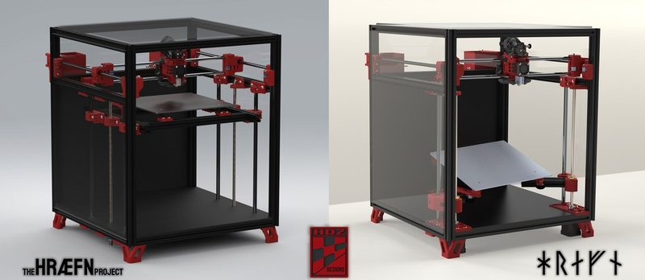</a> | [**Hræfn CoreXY**](https://github.com/hdzdesigns/Hraefn-CoreXY) *HDz Designs (Hamil Sunny)* Enclosed 2020-frame CoreXY on LM8UU and LM10UU rod bearings instead of linear rails. It takes an Ender-3 bed and offers a rigid bed or a triple-Z bed. | 235×235×? | — | Alpha v3 [2024-03](https://github.com/hdzdesigns/Hraefn-CoreXY/commit/5252007cd1e9142d507dcfd57f085475d5a7cedb) |  [🧡⁠77](https://www.printables.com/model/562263) [💚⁠37](https://makerworld.com/en/models/23983) [⏯️⁠961](https://www.youtube.com/watch?v=wAyZFrnYMr8) [❤️⁠9](https://www.youtube.com/watch?v=wAyZFrnYMr8) | [STEP](https://github.com/hdzdesigns/Hraefn-CoreXY/blob/main/CAD/STEP/Hrafn_Alpha_v3_Final.STEP) Alpha v3 [CAD](https://github.com/hdzdesigns/Hraefn-CoreXY/tree/main/CAD/SLDASM) [STL](https://github.com/hdzdesigns/Hraefn-CoreXY/tree/main/3MF,STL/STL) [Video](https://www.youtube.com/watch?v=wAyZFrnYMr8) | [Discord](https://discord.gg/G8GmBVaxGY) EN 557 |

#### Small (≤180 mm representative X/Y size)

| Photo | Printer and why it’s interesting | Build volume (X×Y×Z) | Exterior (W×D×H) | Latest version | Stars Likes Views | Links | Groups |
| --- | --- | --- | --- | --- | --- | --- | --- |
|  | [**Voron V0**](https://github.com/VoronDesign/Voron-0) *Voron family* Compact enclosed CoreXY platform. | 120×120×120 | 230×230×280 | V0.2r1 [2023-06](https://github.com/VoronDesign/Voron-0/commit/77acde9b0de405490823519b78f6056098420dee) |  | [CAD](https://github.com/VoronDesign/Voron-0/tree/HEAD/CAD) [Manual](https://github.com/VoronDesign/Voron-0/blob/HEAD/Manuals/VORON_V0.2r1_Assembly_Manual.pdf) | [Discord](https://discord.gg/voron) EN 40.8K [Reddit](https://www.reddit.com/r/VORONDesign/) EN 39.7K [Forum](https://forum.vorondesign.com/) EN 12.8K [Facebook](https://www.facebook.com/groups/voroncorexy/) EN 54.2K [Facebook](https://www.facebook.com/groups/479932403103163/) DE 2.6K [Telegram](https://t.me/aboutvoron) RU 551 [Telegram](https://t.me/voron_siboor_es) ES 212 [Forum](https://www.lesimprimantes3d.fr/forum/154-voron/) FR |
|  | [**THE100**](https://github.com/mszturc/THE100) *Matt the Printing Nerd* Fast design with a printed frame. | 165×165×165 | — | v1.1 [2023-09](https://github.com/mszturc/THE100/commit/b0c2179cfe90322dce2d3ecbb7fae008f41882d8) |  [🧡⁠2.1K](https://www.printables.com/model/572689-the-100-the-fastest-3d-printer-based-on-a-printed-) [⏯️⁠255K](https://www.youtube.com/watch?v=0K9NM08S0IA) [❤️⁠6.7K](https://www.youtube.com/watch?v=0K9NM08S0IA) | [STEP](https://github.com/mszturc/THE100/blob/HEAD/STEP/The%20100%20v1.1.step) [Manual](https://github.com/mszturc/THE100/tree/HEAD/Docs) | [Discord](https://discord.gg/fW7BcUErgZ) EN 4.4K [Facebook](https://www.facebook.com/groups/181335024786568) EN 456 |
|  | [**Rook MK1**](https://www.printables.com/model/387431-rook-mk1-3d-printer) *Rolohaun / Rook family* Mostly printed, inexpensive 120 mm CoreXY. | 120×120×100 | 220×250×280 | MK1.1 [2024-12](https://www.printables.com/model/387431-rook-mk1-3d-printer) | [🧡⁠955](https://www.printables.com/model/387431-rook-mk1-3d-printer) [⏯️⁠46.6K](https://www.youtube.com/watch?v=JbOr9a6ECg8) [❤️⁠1.9K](https://www.youtube.com/watch?v=JbOr9a6ECg8) | [Manual](https://drive.google.com/file/d/1Nc4iz1Pq0eWxs1gyqM3IEtTrQ-v9zu7r/view) [STEP](https://github.com/rolohaun/Rook/blob/HEAD/CAD/Rook_MK1.step) | [Discord](https://discord.gg/rolohaun-3d-946191040682008666) EN 7.8K |
|  | [**Micron**](https://github.com/PrintersForAnts/Micron) *Printers for Ants* Miniature Voron-inspired enclosed build. Micron2020 is an upscaled 2020 and NEMA17 version that is still in progress. | 120: 120×120×? 180: 180×180×? | — | CAD [2026-10](https://github.com/PrintersForAnts/Micron/commit/79a1b20da304932187229d75edcf49c5dd41a246) |  | [CAD](https://github.com/PrintersForAnts/Micron/tree/HEAD/CAD) R1 [Manual](https://github.com/PrintersForAnts/Micron/blob/HEAD/Documentation/Micron_R1_Manual_WIP.pdf) R1 [CAD](https://github.com/PrintersForAnts/Micron2020/tree/HEAD/CAD) Micron2020 | [Discord](https://discord.gg/doomcube) EN 6.9K |
|  | [**Panda Mini**](https://www.printables.com/model/571947-panda-mini-corexy-3d-printer) *Rolohaun* Small-format CoreXY. Rolohaun showed a redesign named RC150 in a 2024-03 [video](https://www.youtube.com/watch?v=_9OtFwTv4e4), with no public files. | 140×140×? | — | beta [2024-02](https://www.printables.com/model/571947-panda-mini-corexy-3d-printer) | [🧡⁠443](https://www.printables.com/model/571947-panda-mini-corexy-3d-printer) [⏯️⁠18.5K](https://www.youtube.com/watch?v=EpYWnqYGDhA) [❤️⁠484](https://www.youtube.com/watch?v=EpYWnqYGDhA) | [Files](https://www.printables.com/model/571947-panda-mini-corexy-3d-printer/files) | [Discord](https://discord.gg/rolohaun-3d-946191040682008666) EN 7.8K |
|  | [**Rook 2020**](https://www.printables.com/model/798733-rook-2020-mk2) *Rolohaun / Rook family* Rook layout on 2020 extrusion. The current release is MK2. It replaced the [MK1](https://www.printables.com/model/447255-rook-2020-mk1). | 120×120×? | — | 2020 MK2 [2025-04](https://www.printables.com/model/798733-rook-2020-mk2) | [🧡⁠398](https://www.printables.com/model/798733-rook-2020-mk2) [⏯️⁠17.6K](https://www.youtube.com/watch?v=Ufy0borF0ts) [❤️⁠442](https://www.youtube.com/watch?v=Ufy0borF0ts) | [BOM](https://docs.google.com/spreadsheets/d/1k5knQOW3YX01BzTAEe6YCPVp2iNppOEKYJrqB6Ln_Wk/edit) MK2 [CAD](https://cad.onshape.com/documents/ccf745a3232adcedee163729/w/32082f8119c17ae81d2ba337/e/7da9f0f6822236e671d3e7e1) MK2 [Files](https://www.printables.com/model/798733-rook-2020-mk2/files) MK2 [Files](https://www.printables.com/model/447255-rook-2020-mk1/files) MK1 | [Discord](https://discord.gg/rolohaun-3d-946191040682008666) EN 7.8K |
|  | [**Bastion**](https://www.printables.com/model/748800-bastion-3d-printer) *Rolohaun* Triple independent Z and a Prusa Mini bed. It replaced the Rook 180, which had a printed frame and triple belted Z. | 180×180×? | — | Files [2024-02](https://www.printables.com/model/748800-bastion-3d-printer) | [🧡⁠345](https://www.printables.com/model/748800-bastion-3d-printer) [⏯️⁠17.9K](https://www.youtube.com/watch?v=EyQOKyWl3fM) [❤️⁠539](https://www.youtube.com/watch?v=EyQOKyWl3fM) | [BOM](https://docs.google.com/spreadsheets/d/1l0jujA7NeqoZIqLFWoQa9GS_q04f8Wfkya9Il5d2ubA/edit) [CAD](https://cad.onshape.com/documents/256743a99b7cb9b4ae8f45f9/w/29df722021bf3c0e59d7c8ae/e/ff9493cea103644b334a3c7a) [STEP](https://github.com/rolohaun/Rook-180/tree/main/CAD) old Rook 180 | [Discord](https://discord.gg/rolohaun-3d-946191040682008666) EN 7.8K |
|  | [**Salad Fork**](https://github.com/PrintersForAnts/Salad_Fork) *Printers for Ants* Small Trident-inspired build. Salad Fork 1.1 is the release, and the Stealth Fork beta adds Micron R1 skirts and features to the same fixed gantry. | 120: 120×120×? 160: 160×160×? 180: 180×180×? | — | Stealth Fork beta [2025-10](https://github.com/PrintersForAnts/StealthFork/commit/94fe9a2766de5f320ff57bb7aa77c5003d6ddffc) |  | [CAD](https://github.com/PrintersForAnts/Salad_Fork/tree/HEAD/CAD) 1.1 [Manual](https://github.com/PrintersForAnts/Salad_Fork/blob/HEAD/Salad%20Fork%20Manual.pdf) 1.1 [STL](https://github.com/PrintersForAnts/StealthFork/tree/main/STLs) Stealth Fork beta [STEP](https://github.com/PrintersForAnts/StealthFork/tree/main/CAD) Stealth Fork skirts | [Discord](https://discord.gg/doomcube) EN 6.9K |
|  | [**Encore**](https://github.com/alexyu132/encore) *Alex Yu* 120 mm printed-frame CoreXY with a filament-box-sized footprint. | 120×120×120 | 219×221×262 | CAD [2026-06](https://github.com/alexyu132/encore/commit/7d7dd0397e26942a915dca2213147e9594a3a777) |  [💙⁠456](https://www.thingiverse.com/thing:7363835) [🧡⁠1.1K](https://www.printables.com/model/1743331-encore-mini-corexy-3d-printer-with-a-fully-printed) [💚⁠73](https://makerworld.com/en/models/2882748-encore-mini-corexy-3d-printer) [⏯️⁠59.8K](https://www.youtube.com/watch?v=9xukniyO6fI) [❤️⁠2.7K](https://www.youtube.com/watch?v=9xukniyO6fI) | [STEP](https://github.com/alexyu132/encore/blob/main/encore.step) [BOM](https://github.com/alexyu132/encore/blob/main/documentation/BOM.md) [Manual](https://github.com/alexyu132/encore/blob/main/documentation/build%20guide/build%20guide.md) [Video](https://www.youtube.com/watch?v=9xukniyO6fI) | — |
|  | [**Tiny-T**](https://github.com/PrintersForAnts/Tiny-T) *Printers for Ants* Revision 2.0 scales the Voron Trident layout down to a 150 mm cube. | 150×150×150 | — | R2 [2023-01](https://github.com/PrintersForAnts/Tiny-T/releases/tag/TinyT-r2) |  | [CAD](https://github.com/PrintersForAnts/Tiny-T/tree/main/CAD) [STL](https://github.com/PrintersForAnts/Tiny-T/tree/main/STLs) [BOM](https://github.com/PrintersForAnts/Tiny-T#components) | [Discord](https://discord.gg/doomcube) EN 6.9K |
| <a href="printers/dayu-yunque/README.md">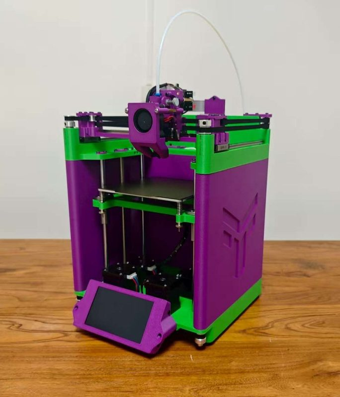</a> | [**Yunque (云雀)**](https://makerworld.com.cn/zh/models/1590124-bzhan-da-yu-diy-zi-zhi-3dda-yin-ji-_yun-que-v1-06) *大鱼DIY (Dayu DIY)* Mini printer from the Bilibili maker Dayu DIY. All custom parts are 3D printed, and the author puts the material cost near 1,000 CNY. Bilibili users show their own replica builds. | — | — | V1.06 [2025-09](https://makerworld.com/en/models/1799349-bilibili-big-fish-diy-diy-3d-printer_lark-v1-06) | [💚⁠76](https://makerworld.com/en/models/1799349-bilibili-big-fish-diy-diy-3d-printer_lark-v1-06) | [Files](https://makerworld.com/en/models/1799349-bilibili-big-fish-diy-diy-3d-printer_lark-v1-06) [Files](https://makerworld.com.cn/zh/models/1590124-bzhan-da-yu-diy-zi-zhi-3dda-yin-ji-_yun-que-v1-06) CN [Video](https://www.bilibili.com/video/BV1PVYNzREfh) | — |
|  | [**Cubiron**](https://github.com/ThatGuyHes/CUBIRON) *RobertGcode* Very small, documented CoreXY that runs on USB-C power; the current design has an unheated bed. | 70×70×65 | 144×145×148 | First release [2025-09](https://github.com/ThatGuyHes/CUBIRON/blob/main/README.md#L9) |  [⏯️⁠6.8K](https://www.youtube.com/watch?v=8Y_-ZeDuDzk) [❤️⁠328](https://www.youtube.com/watch?v=8Y_-ZeDuDzk) | [STEP](https://github.com/ThatGuyHes/CUBIRON/tree/main/CAD) [Manual](https://github.com/ThatGuyHes/CUBIRON/tree/main/docs) [Firmware](https://github.com/ThatGuyHes/CUBIRON/tree/main/firmware) | — |
|  | [**BabyCube**](https://github.com/martinbudden/BabyCube) *Martin Budden* Printed-frame mini CoreXY with linear rails and a roughly 90 × 80 × 60 mm build volume. The repo also has guides for the larger BC220 and the carbon-fiber BC220CF, which is a work in progress. | 90×80×60 | 248×272×211 | CAD [2024-11](https://github.com/martinbudden/BabyCube/commit/423e054dc83208dce2bd1ad6f3b843f601238b6d) |  [💙⁠107](https://www.thingiverse.com/thing:4911835) [🧡⁠62](https://www.printables.com/model/218876-babycube-small-corexy-3d-printer) [⏯️⁠6.4K](https://www.youtube.com/watch?v=HpjnHnVyvj4) [❤️⁠125](https://www.youtube.com/watch?v=HpjnHnVyvj4) | [Manual](https://github.com/martinbudden/BabyCube/blob/main/BC200/readme.md) BC200 [Manual](https://github.com/martinbudden/BabyCube/blob/main/BC220/readme.md) BC220 [Manual](https://github.com/martinbudden/BabyCube/blob/main/BC220CF/readme.md) BC220CF [CAD](https://github.com/martinbudden/BabyCube/tree/main/scad) [Video](https://www.youtube.com/watch?list=PLbNI1Rcik-oIJZLZGHtmtgYNiHBKnzX2O&v=Hourt_4GOHs) | — |
|  | [**Rat Rig V-Chonk**](https://github.com/Rat-Rig/V-Chonk) *Rat Rig family* Beta, mostly printed 180 mm CoreXY. | 180×180×180 | — | v0.4 [2024-07](https://github.com/Rat-Rig/V-Chonk/commit/85fa06be71054b5c0d7e513cc762dbd7d893b6a0) |  [⏯️⁠18.2K](https://www.youtube.com/watch?v=TIkY9gv_bjg) [❤️⁠308](https://www.youtube.com/watch?v=TIkY9gv_bjg) | [STEP](https://github.com/Rat-Rig/V-Chonk#step-files) [BOM](https://github.com/Rat-Rig/V-Chonk/tree/main/bom) [STL](https://github.com/Rat-Rig/V-Chonk/tree/main/stl) | [Facebook](https://www.facebook.com/groups/ratrig3dprintercommunity) EN 19.9K [Discord](https://discord.gg/ratrig) EN 13.8K [Reddit](https://www.reddit.com/r/RatRig/) EN 3K |
|  | [**VzBot Vz150**](https://github.com/VzBoT3D/VzBoT-Vz150) *VzBot family* Miniature VzBot; its optional AWD setup is described as experimental. | 150×150×125 | — | V1.1 [2023-05](https://github.com/VzBoT3D/VzBoT-Vz150/commit/060e8cab89e4524243e828d4c5bea0fbefdd10b6) |  | [CAD](https://github.com/VzBoT3D/VzBoT-Vz150/tree/main/CAD) [BOM](https://github.com/VzBoT3D/VzBoT-Vz150/tree/main/BOM) | [Facebook](https://www.facebook.com/groups/vzbot/) EN 10.1K [Discord](https://discord.gg/KWZWvCMxCq) EN 9.3K [Reddit](https://www.reddit.com/r/vzbot/) EN 463 |
|  | [**GBot Tiny**](https://github.com/gotchau/GBot-Tiny-Mark-II) *Gotchau* Small H-bot with MGN12 rails and a 120 mm bed, shown in a Russian video series. Versions are the V-slot original (2019), a square-tube frame variant (2021), and Mark II on 2040 extrusion with two electronics bays (2022). | 120×120×? | — | Mark II [2024-05](https://github.com/gotchau/GBot-Tiny-Mark-II/commit/fffea5525d98a3b0e9beeb0323bcdbb9a0f9e57d) |  [💙⁠83](https://www.thingiverse.com/thing:3935734) [⏯️⁠30.2K](https://www.youtube.com/watch?v=o_cQP9J8bRU) [❤️⁠1.2K](https://www.youtube.com/watch?v=o_cQP9J8bRU) | [STEP](https://github.com/gotchau/GBot-Tiny-Mark-II/tree/main/CAD/Tiny%20Mark%20II/STEP) Mark II [BOM](https://github.com/gotchau/GBot-Tiny-Mark-II/blob/main/docs/BOM_GBot_Tiny_Mark_II.md) Mark II [STEP](https://github.com/gotchau/GBot-Tiny/blob/main/CAD/GBot%20Tiny%20ANRA.STEP) old original [Files](https://www.thingiverse.com/thing:3935734/files) old original [STL](https://www.thingiverse.com/thing:4890542/files) old square-tube frame [Video](https://www.youtube.com/watch?v=o_cQP9J8bRU) old original | [Discord](https://discord.gg/KYU2nGtZ2r) RU 397 |
|  | [**RailCore Mini**](https://github.com/railcore/railcore-mini) *RailCore family* 1515-extrusion compact CoreXY with three leadscrews for Z. | 150×150×150 | 400×312×470 | CAD [2022-04](https://github.com/railcore/railcore-mini/commit/7126633b332f44c494e80ee9b0425f59cfda134c) |  [🧡⁠17](https://www.printables.com/model/160583-railcore-mini) [⏯️⁠4.4K](https://www.youtube.com/watch?v=IbsZTz1a8SA) [❤️⁠42](https://www.youtube.com/watch?v=IbsZTz1a8SA) | [BOM](https://docs.google.com/spreadsheets/d/1TM1vca-hA29apzcBjQ2FyvvZ5D19cWTZl7NxzBflSlU) [Files](https://github.com/railcore/railcore-mini/tree/main/parts) | [Facebook](https://www.facebook.com/groups/RailCore/) EN 2.6K [Discord](https://discord.gg/Sy569Hq) EN 742 [Reddit](https://www.reddit.com/r/railcore/) EN 206 |

### Cross-gantry

This table is not split by size. Annex K3 is a Small build, Defiant and 0xC0FFEE_ZY are Medium, and CroXY is Large.

| Photo | Printer and why it’s interesting | Build volume (X×Y×Z) | Exterior (W×D×H) | Latest version | Stars Likes Views | Links | Groups |
| --- | --- | --- | --- | --- | --- | --- | --- |
|  | [**Annex K3 / Gasherbrum**](https://github.com/Annex-Engineering/Gasherbrum-K3) *Annex Engineering* Small enclosed cross-gantry machine with separate X and Y drives; its latest published release is R1.2 beta 1. | 180×180×180 | — | R1.2 beta 1 [2023-07](https://github.com/Annex-Engineering/Gasherbrum-K3/releases/tag/R1.2B1) |  [⏯️⁠28.6K](https://www.youtube.com/watch?v=kHAcm8c9pTk) [❤️⁠359](https://www.youtube.com/watch?v=kHAcm8c9pTk) | [Files](https://github.com/Annex-Engineering/Gasherbrum-K3/tree/HEAD/Release_1_2) R1.2 beta 1 [CAD](https://github.com/Annex-Engineering/Gasherbrum-K3/tree/HEAD/Release_1_1/CAD) R1.1 | [Discord](https://discord.gg/MzTR3zE) EN 11.4K |
| <a href="printers/croxy/README.md">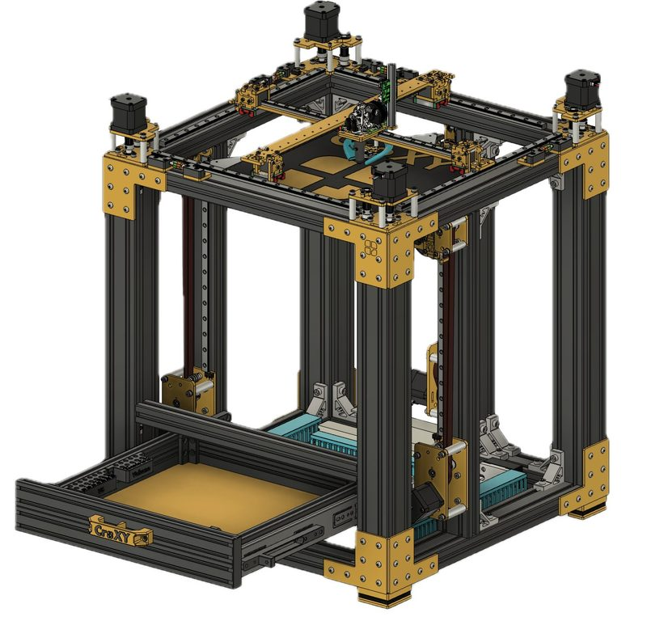</a> | [**CroXY**](https://github.com/CroXY3D/CroXY) *Wes Cherry* Cross-gantry printer built from laser-cut aluminum plates on 3060 extrusion, with four XY motors and a triple-belt Z. Only the cooling duct is printed. Version 3 is close to beta. The enclosure is still in work. [Defiant](#defiant) is a CroXY build. | 300×300×300 | — | v2.0.0 [2023-12](https://github.com/CroXY3D/CroXY/releases/tag/v2.0.0) |  [⏯️⁠146K](https://www.youtube.com/watch?v=Kx4VfzS_V6c) [❤️⁠2K](https://www.youtube.com/watch?v=Kx4VfzS_V6c) | [STEP](https://github.com/CroXY3D/CroXY/tree/HEAD/CAD) [STEP](https://github.com/CroXY3D/CroXY/tree/HEAD/STP) parts [Files](https://github.com/CroXY3D/CroXY/tree/HEAD/DXF) [STL](https://github.com/CroXY3D/CroXY/tree/HEAD/STL) [Config](https://github.com/CroXY3D/CroXY/blob/HEAD/Klipper/printer.cfg) | [Discord](https://discord.gg/ryj6wyx) EN 2.8K |
|  | [**Defiant**](https://github.com/rolohaun/Defiant) *Rolohaun* Beta CroXY build with three independently driven Z motors; currently unenclosable. | 250×250×250 | — | beta [2022-09](https://github.com/rolohaun/Defiant/commit/4cea7b3250be7a90a23c36082751491ba7b20445) |  [⏯️⁠13.6K](https://www.youtube.com/watch?v=SV5Sgm0m-QY) [❤️⁠275](https://www.youtube.com/watch?v=SV5Sgm0m-QY) | [CAD](https://github.com/rolohaun/Defiant/tree/main/CAD) [BOM](https://docs.google.com/spreadsheets/d/1MMBtSAIVklJtp9cDsU00cnw-aWT4j8f6p9V2ZHv14fQ/edit) | [Discord](https://discord.gg/rolohaun-3d-946191040682008666) EN 7.8K |
|  | [**0xC0FFEE_ZY 3D printer**](https://github.com/0xC0FFEE-ZY/3D_Printer-Hardware-and-Firmware) *0xC0FFEE_ZY* Ultimaker-style cross-gantry printer on 3030 extrusion with a self-designed STM32F407 mainboard and TMC2209 driver boards. The repo has the SolidWorks model, DWG drawings for the steel and acrylic parts, the PCB projects, and a Marlin 2.1.3 config with Chinese comments. | 250×255×200 | — | CAD [2026-09](https://github.com/0xC0FFEE-ZY/3D_Printer-Hardware-and-Firmware/commit/d14bd302b5498f1fb9ef6d917b8ac5e4c94a03f2) |  | [CAD](https://github.com/0xC0FFEE-ZY/3D_Printer-Hardware-and-Firmware/tree/main/%E4%B8%89%E7%BB%B4%E5%BB%BA%E6%A8%A1) [Files](https://github.com/0xC0FFEE-ZY/3D_Printer-Hardware-and-Firmware/tree/main/CAD%E5%9B%BE%E7%BA%B8_3D%E6%89%93%E5%8D%B0%E6%9C%BA%E7%BB%93%E6%9E%84%E4%BB%B6) [Firmware](https://github.com/0xC0FFEE-ZY/3D_Printer-Hardware-and-Firmware/tree/main/Chinese_Version_Configured_Marlin2.1.3) [Video](https://www.bilibili.com/video/BV1Lnev6LE89) | — |

### Cartesian

Includes moving-bed Cartesian layouts. The size groups use the same 180 mm threshold as CoreXY.

#### Medium and large (>180 mm on either X/Y axis)

| Photo | Printer and why it’s interesting | Build volume (X×Y×Z) | Exterior (W×D×H) | Latest version | Stars Likes Views | Links | Groups |
| --- | --- | --- | --- | --- | --- | --- | --- |
|  | [**Prusa i3 (early to MK4S)**](https://github.com/prusa3d/Original-Prusa-i3) *Prusa family* The most copied desktop layout, followed by many commercial clones. It started in 2012 as the RepRap [Prusa i3](https://reprap.org/wiki/Prusa_i3) and grew through MK2, MK3, MK3S+ and MK3.5 to the MK4 and MK4S with a new frame and Nextruder. The MK3.9 and MK3.9S upgrade an MK3S+ to MK4 parts. | early: 200×200×200 MK3S+: 250×210×210 MK4S: 250×210×220 | — | MK4S [2026-08](https://www.printables.com/model/451500-mk4smk39s-printable-parts) |  [🧡⁠5.2K](https://www.printables.com/model/57217) [🤍⁠397](https://www.myminifactory.com/object/3d-print-original-prusa-i3-mk3-57403) [⏯️⁠1.4M](https://www.youtube.com/watch?v=GE-lrRbU124) [❤️⁠11.7K](https://www.youtube.com/watch?v=GE-lrRbU124) | [STEP](https://www.printables.com/model/451500-mk4smk39s-printable-parts) MK4S [STEP](https://www.printables.com/model/451501-mk4mk39-printable-parts) MK4 [STL](https://www.printables.com/model/706515-mk35s-printable-parts) MK3.5 [Files](https://github.com/prusa3d/Original-Prusa-i3) MK3S+ [CAD](https://github.com/josefprusa/Prusa3) early [CAD](https://github.com/josefprusa/Prusa3-vanilla) vanilla [Wiki](https://reprap.org/wiki/Prusa_i3) | [Forum](https://forum.prusa3d.com/forum/english-forum-original-prusa-i3-mk3s-mk3/) EN 78.7K [Reddit](https://www.reddit.com/r/prusa3d/) EN 112K [Forum](https://forum.prusa3d.com/es/) ES 78.7K [Forum](https://forum.prusa3d.com/cs/) CS 78.7K [Facebook](https://www.facebook.com/groups/Prusai3users/) EN 47.5K [Discord](https://discord.gg/prusa3d) EN 13.6K [Forum](https://reprap.org/forum/list.php?406) EN |
|  | [**LH Stinger**](https://github.com/lhndo/LH-Stinger) *LHndo* Performance-focused moving-bed design. R1.0 is the last release, and FYSETC sells an official upgraded [Rev2 kit](https://www.fysetc.com/products/lh-stinger-3d-printer-kit). | 235×235×200 | — | R1.0 [2024-08](https://github.com/lhndo/LH-Stinger/releases/tag/LHS-R1.0) |  [🧡⁠104](https://www.printables.com/model/703110-lh-stinger) [⏯️⁠65.8K](https://www.youtube.com/watch?v=X41eK9_PCbA) [❤️⁠1.8K](https://www.youtube.com/watch?v=X41eK9_PCbA) | [CAD](https://github.com/lhndo/LH-Stinger/tree/HEAD/CAD) [Wiki](https://github.com/lhndo/LH-Stinger/wiki) | [Discord](https://discord.gg/EzssCfnEDS) EN 2.7K |
| <a href="printers/dayu-xuanwu/README.md">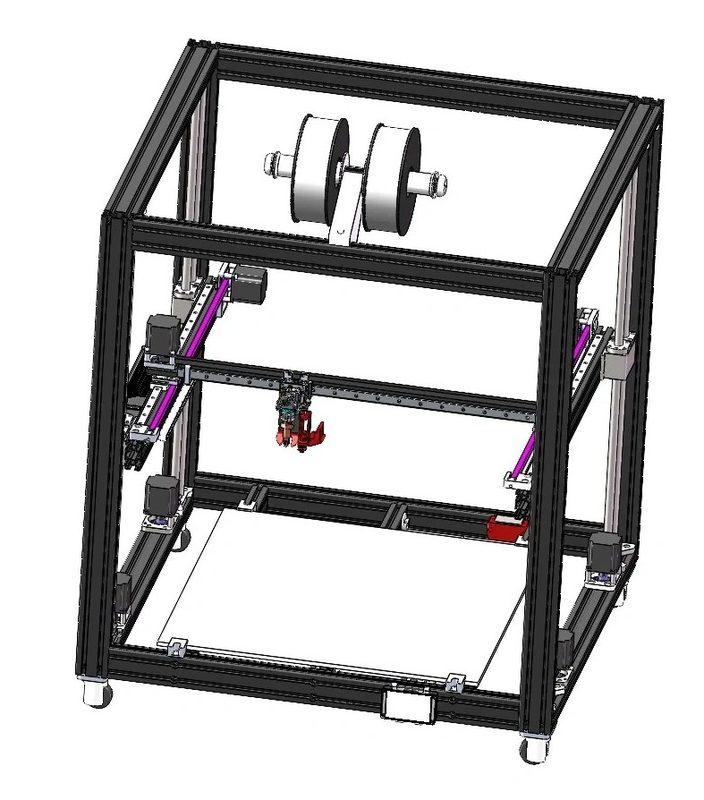</a> | [**Xuanwu (玄武)**](https://github.com/DayuDIY/Xuanwu) *大鱼DIY (Dayu DIY)* Large Cartesian printer with a 600 mm cube volume and a 0.8 mm nozzle. A dual-motor Y gantry carries X, and four independent ball screws lift the bed. | 600×600×600 | — | Files [2025-03](https://github.com/DayuDIY/Xuanwu/commit/4455e758c96614665268c62088552c66618b1763) |  [💚⁠20](https://makerworld.com/en/models/949921-bilibili-big-fish-diy-open-source-3d-printer-xuanw) | [STEP](https://github.com/DayuDIY/Xuanwu/blob/master/B%E7%AB%99%E3%80%90%E5%A4%A7%E9%B1%BCDIY%E3%80%913D%E6%89%93%E5%8D%B0%E6%9C%BA_%E7%8E%84%E6%AD%A6%20V1.0.STEP) [STL](https://github.com/DayuDIY/Xuanwu/tree/master/%E7%8E%84%E6%AD%A6_3D%E6%89%93%E5%8D%B0%E9%9B%B6%E4%BB%B6) [BOM](https://github.com/DayuDIY/Xuanwu/blob/master/B%E7%AB%99%E3%80%90%E5%A4%A7%E9%B1%BCDIY%E3%80%913D%E6%89%93%E5%8D%B0%E6%9C%BA_%E7%8E%84%E6%AD%A6%20V1.0%E9%87%87%E8%B4%AD%E6%B8%85%E5%8D%95.xlsx) [Files](https://github.com/DayuDIY/Xuanwu/tree/master/%E7%8E%84%E6%AD%A6_%E9%93%9D%E5%90%88%E9%87%91CNC%E9%9B%B6%E4%BB%B6) [Config](https://github.com/DayuDIY/Xuanwu/tree/master/%E7%8E%84%E6%AD%A6_%E5%9B%BA%E4%BB%B6%E9%85%8D%E7%BD%AE%E5%8F%8AOrca%E5%88%87%E7%89%87%E5%8F%82%E6%95%B0) [Video](https://www.bilibili.com/video/BV1c6rmYjEGh/) | — |

#### Small (≤180 mm on both X/Y axes)

| Photo | Printer and why it’s interesting | Build volume (X×Y×Z) | Exterior (W×D×H) | Latest version | Stars Likes Views | Links | Groups |
| --- | --- | --- | --- | --- | --- | --- | --- |
|  | [**Original Prusa MINI / MINI+**](https://github.com/prusa3d/Original-Prusa-MINI) *Prusa family* Cantilevered 180 mm machine with released STEP, printed parts, BOM, and assembly guide. | 180×180×180 | 380×330×380 | R8 [2021-02](https://github.com/prusa3d/Original-Prusa-MINI/releases/tag/R8) |  [🧡⁠2.7K](https://www.printables.com/model/57214) [⏯️⁠1.8M](https://www.youtube.com/watch?v=ipulB4_Xdm8) [❤️⁠5.6K](https://www.youtube.com/watch?v=ipulB4_Xdm8) | [STEP](https://github.com/prusa3d/Original-Prusa-MINI/tree/master/STEP) [BOM](https://github.com/prusa3d/Original-Prusa-MINI/tree/master/BOM) [Manual](https://help.prusa3d.com/en/tag/mini-2/) | [Forum](https://forum.prusa3d.com/forum/original-prusa-mini/) EN 78.7K [Reddit](https://www.reddit.com/r/prusa3d/) EN 112K [Forum](https://forum.prusa3d.com/es/) ES 78.7K [Forum](https://forum.prusa3d.com/cs/) CS 78.7K [Facebook](https://www.facebook.com/groups/Prusai3users/) EN 47.5K [Discord](https://discord.gg/prusa3d) EN 13.6K |
|  | [**TicTac 2.1**](https://www.printables.com/model/416884-tictac-21) *Squirrelbrain* A miniaturized V-Minion-derived Cartesian printer. Version 2.1 follows the first Tic-Tac (Miniaturised V-Minion) from 2022. | 120×120×120 | — | 2.1 [2024-01](https://www.printables.com/model/416884-tictac-21/files) | [🧡⁠465](https://www.printables.com/model/416884-tictac-21) [💚⁠35](https://makerworld.com/en/models/144161-tic-tac-miniaturised-v-minion) | [Files](https://www.printables.com/model/416884-tictac-21/files) 2.1 [Files](https://www.printables.com/model/164038-tic-tac-miniaturised-v-minion/files) old v1 | [Facebook](https://www.facebook.com/groups/ratrig3dprintercommunity) EN 19.9K [Discord](https://discord.gg/ratrig) EN 13.8K |
|  | [**Rook MK2**](https://www.printables.com/model/1644597-rook-mk2) *Rolohaun / Rook family* Fully printed frame; creator labels this a beta release. | 120×120×? | — | MK2 beta [2026-03](https://www.printables.com/model/1644597-rook-mk2) | [🧡⁠429](https://www.printables.com/model/1644597-rook-mk2) [⏯️⁠8.3K](https://www.youtube.com/watch?v=Rsd_QlY3pGE) [❤️⁠398](https://www.youtube.com/watch?v=Rsd_QlY3pGE) | [BOM](https://docs.google.com/spreadsheets/d/18EqrtU4kwdb6v4gPMTdCcCdBVbxlF5-EhFE0hZtxHoA/edit) [CAD](https://cad.onshape.com/documents/5010167e95003ed32232fd0e/w/756fbf38edf59fb734f7365c/e/e647ceb1e4681ba492e8722b) | [Discord](https://discord.gg/rolohaun-3d-946191040682008666) EN 7.8K |
|  | [**Kappy**](https://www.printables.com/model/625544-kappy-3d-printer) *Rolohaun* Small, beginner-oriented DIY printer. | 120×120×100 | — | Update [2025-12](https://www.printables.com/model/625544-kappy-3d-printer) | [🧡⁠365](https://www.printables.com/model/625544-kappy-3d-printer) [⏯️⁠30.1K](https://www.youtube.com/watch?v=QxLlxpHNbtQ) [❤️⁠1.2K](https://www.youtube.com/watch?v=QxLlxpHNbtQ) | [Manual](https://drive.google.com/file/d/1iMX36I9zHaRenk27AsYJOz9wUkhZm12h/view) [BOM](https://docs.google.com/spreadsheets/d/10yJ0s7zZR3LtqlApnVSDP2MTe3I9gViXxYyVxZ6Vb1I/edit) [CAD](https://cad.onshape.com/documents/e3d1e390ee25e4cecb91b755/w/71cf613e30e4a447f8845523/e/ca80937f1c3e35dd2362d739) | [Discord](https://discord.gg/rolohaun-3d-946191040682008666) EN 7.8K |
|  | [**Mini One**](https://makerworld.com/en/models/903275) *mossbot / M-G* Palm-sized bedslinger with micro lead-screw stepper motors on all three axes, a 0.2 mm nozzle, and an unheated film bed. It runs Marlin 1.0.2 on an Arduino Mega with RAMPS 1.4. | 45×45×45 | — | Files [2024-12](https://makerworld.com/en/models/903275) |  [💙⁠2.2K](https://www.thingiverse.com/thing:3749961) [💚⁠7.8K](https://makerworld.com/en/models/903275) | [CAD](https://grabcad.com/library/mini-one-pocket-3d-printer-1) [STL](https://www.thingiverse.com/thing:3749961/files) [Manual](https://makerworld.com/en/models/903275) [Firmware](https://github.com/mossbot-MG/mini-one-pocket-3D-printer-firmware) | — |
|  | [**Rat Rig V-Minion**](https://github.com/Rat-Rig/V-Minion) *Rat Rig family* Compact 180 mm cantilevered Cartesian with linear rails. Versions are 1.0 and the 1.1 Alpha upgrade with the electronics on the frame. | 180×180×180 | — | 1.1 Alpha [2024-10](https://lab.ratrig.com/vminion_1_1/) |  [💙⁠320](https://www.thingiverse.com/thing:5259421) [🧡⁠126](https://www.printables.com/model/240711) [⏯️⁠46.8K](https://www.youtube.com/watch?v=XnDXDmX2tS0) [❤️⁠428](https://www.youtube.com/watch?v=XnDXDmX2tS0) | [CAD](https://a360.co/48ehnFa) 1.1 Alpha [Files](https://github.com/Rat-Rig/V-Minion/tree/main/cad) 1.0 [Manual](https://rat-rig.github.io/V-Minion/) 1.0 | [Facebook](https://www.facebook.com/groups/ratrig3dprintercommunity) EN 19.9K [Discord](https://discord.gg/ratrig) EN 13.8K [Reddit](https://www.reddit.com/r/RatRig/) EN 3K |

### Delta

| Photo | Printer and why it’s interesting | Build volume (X×Y×Z) | Exterior (W×D×H) | Latest version | Stars Likes Views | Links | Groups |
| --- | --- | --- | --- | --- | --- | --- | --- |
|  | [**MIN Micro Delta**](https://www.printables.com/model/857334-min-micro-delta-3d-printer) *Rolohaun* A very small delta project. | Ø70×95 | — | Update [2024-12](https://www.printables.com/model/857334-min-micro-delta-3d-printer) | [🧡⁠382](https://www.printables.com/model/857334-min-micro-delta-3d-printer) [⏯️⁠16.9K](https://www.youtube.com/watch?v=kZSuBLWJxl0) [❤️⁠670](https://www.youtube.com/watch?v=kZSuBLWJxl0) | [Files](https://www.printables.com/model/857334-min-micro-delta-3d-printer/files) [CAD](https://cad.onshape.com/documents/aef65583a6ec21b94ef11b01/w/21ca19127a40dd7ca53fcc0f/e/1bc79b2e64becbdda5242db6) | [Discord](https://discord.gg/rolohaun-3d-946191040682008666) EN 7.8K |
|  | [**Doron Velta**](https://github.com/rogerlz/Doron-Velta) *rogerlz / DoubleT* Enclosed delta in the Voron style. It began as an April Fools joke and is not an official Voron. FYSETC sells a kit. No update since 2024-07. | Ø200×165 | — | R2 [2024-07](https://github.com/rogerlz/Doron-Velta#changelog) |  [⏯️⁠4.7K](https://www.youtube.com/watch?v=DuFxvsZ5HEU) [❤️⁠90](https://www.youtube.com/watch?v=DuFxvsZ5HEU) | [CAD](https://github.com/rogerlz/Doron-Velta/tree/main/CAD) [STL](https://github.com/rogerlz/Doron-Velta/tree/main/STLs) [BOM](https://github.com/rogerlz/Doron-Velta/blob/main/BOM.md) | [Discord](https://discord.gg/doomcube) EN 6.9K [Discord](https://discord.gg/voron) EN 40.8K |
|  | [**Delta Flyer**](https://www.printables.com/model/1327596-delta-flyer-3d-printer) *Rolohaun / Kanrog* Compact delta with linear rails and a published manual. | Ø115×115 | — | Files [2026-04](https://www.printables.com/model/1327596-delta-flyer-3d-printer) | [🧡⁠213](https://www.printables.com/model/1327596-delta-flyer-3d-printer) [⏯️⁠9.7K](https://www.youtube.com/watch?v=LaAyrJOo7wg) [❤️⁠368](https://www.youtube.com/watch?v=LaAyrJOo7wg) | [Manual](https://kanrog.github.io/Delta-Flyer/) [BOM](https://docs.google.com/spreadsheets/d/1400rbdxxYbIA15yIi4UiYHQk1Ul_DCyP7nSTH7CUpFE/edit) [CAD](https://cad.onshape.com/documents/de9bc61850e74a1717307838/w/2a32f2b0d6edf7beeb9fcbf7/e/392043168b1092bab001d0df) | [Discord](https://discord.gg/rolohaun-3d-946191040682008666) EN 7.8K |

### Other motion systems

| Photo | Printer and why it’s interesting | Build type | Build volume (X×Y×Z) | Exterior (W×D×H) | Latest version | Stars Likes Views | Links | Groups |
| --- | --- | --- | --- | --- | --- | --- | --- | --- |
|  | [**Hangprinter**](https://github.com/tobbelobb/hangprinter) *Torbjørn Ludvigsen* Cable-suspended, frameless printer. HP4 is the current design, and the unfinished HP5 work is on the version_5 branch. | Cable-driven | configurable | — | v4 [2023-06](https://github.com/tobbelobb/hangprinter/commit/9d2fabc9dbaa2ec646fc4daec0258aa1ea0a3e66) |  [⏯️⁠88.5K](https://www.youtube.com/watch?v=ULJqLSTriRY) [❤️⁠615](https://www.youtube.com/watch?v=ULJqLSTriRY) | [Files](https://github.com/tobbelobb/hangprinter) v4 [Manual](https://hangprinter.org/doc/v4/) v4 | [Facebook](https://www.facebook.com/groups/hangprinter) EN 1.1K [Discord](https://discord.gg/KAV7x3hgRX) EN 289 |
|  | [**Positron V3.2**](https://github.com/Positron3D/Positron) *Positron Team / Kralyn* Compact inverted printer that folds for transport. | Inverted folding portable | 180×180×165 | open: 200×200×270 folded: 200×200×80 | V3.2.2 [2026-09](https://github.com/Positron3D/Positron/commit/75ac17a07e02694e1fc80a3a256ede64cca90e6d) |  [🧡⁠70](https://www.printables.com/model/932474) [⏯️⁠785K](https://www.youtube.com/watch?v=X_QLxTVtyng) [❤️⁠32.2K](https://www.youtube.com/watch?v=X_QLxTVtyng) | [Files](https://github.com/Positron3D/Positron/tree/main/Printed%20Parts%20%26%20CAD%20Models) [Original](https://github.com/KRALYN/PositronV3) | [Discord](https://discord.gg/positron) EN 2.9K |
|  | [**Lemontron**](https://lemontron.com/lemontron-rev-e/) *Lemontron* Portable inverted design. Rev E is the current release after Rev A to D. Rev E has no own guide, so the build uses the earlier guide. | Inverted folding portable | 180×180×165 | — | Rev E [2026-02](https://www.printables.com/model/1440115-lemontron-rev-e) | [🧡⁠167](https://www.printables.com/model/1155525) [⏯️⁠120K](https://www.youtube.com/watch?v=n6l3GvkE4QU) [❤️⁠4.9K](https://www.youtube.com/watch?v=n6l3GvkE4QU) | [Files](https://lemontron.com/lemontron-rev-e/printed-parts/) Rev E [CAD](https://www.printables.com/model/1440115-lemontron-rev-e/files) Rev E [BOM](https://lemontron.com/lemontron-rev-e/bom/) Rev E [Video](https://www.youtube.com/watch?v=FU5CCRJrfcg) Rev E [Manual](https://lemontron.com/lemontron-rev-a/build-guide/) Rev A [STEP](https://www.printables.com/model/1155525-lemontron-rev-d/files) Rev D [Video](https://www.youtube.com/watch?v=n6l3GvkE4QU) first release | [Discord](https://discord.com/invite/gSjfn4rnrm) EN 1.2K |

### Belt

Printers that print onto a moving conveyor belt, so a part can be as long as you want.

| Photo | Printer and why it’s interesting | Build volume (X×Y×Z) | Exterior (W×D×H) | Latest version | Stars Likes Views | Links | Groups |
| --- | --- | --- | --- | --- | --- | --- | --- |
|  | [**White Knight Belt**](https://github.com/NAK3DDesigns/White-Knight) *NAK3D Designs* DIY continuous-print belt printer with a published full assembly. No update since 2020 and no active group. | 400×430×∞ | — | Files [2020-11](https://github.com/NAK3DDesigns/White-Knight/commit/f016a38751e611e64b5afe8dfefdf459d25f30b2) |  [💙⁠672](https://www.thingiverse.com/thing:3324280) [⏯️⁠49.2K](https://www.youtube.com/watch?v=PQ-h-ErqrEg) [❤️⁠741](https://www.youtube.com/watch?v=PQ-h-ErqrEg) | [STEP](https://github.com/NAK3DDesigns/White-Knight/blob/master/Assembly/White%20Knight%20Full%20Assembly%20v126.step) [BOM](https://github.com/NAK3DDesigns/White-Knight/tree/master/BOM) [STL](https://github.com/NAK3DDesigns/White-Knight/tree/master/Printer%20STL%27s) | — |
|  | [**Ender EZ Belt**](https://www.printables.com/model/255684-ender-ez-belt-3d-printer-conversion) *Powerbelt3D* Documented Ender-3 conveyor conversion; the creator calls the project open source, but its Formula32 belt is no longer sold by the closed shop. | — | — | Update [2022-12](https://www.printables.com/model/255684-ender-ez-belt-3d-printer-conversion) | [🧡⁠293](https://www.printables.com/model/255684-ender-ez-belt-3d-printer-conversion) [⏯️⁠25.1K](https://www.youtube.com/watch?v=ViQGZFbM22M) [❤️⁠554](https://www.youtube.com/watch?v=ViQGZFbM22M) | [Files](https://www.printables.com/model/255684-ender-ez-belt-3d-printer-conversion) | — |
|  | [**BabyBelt Pro**](https://github.com/RobMink/BabyBeltPro) *Rob Mink* Compact belt printer. The current Pro v2.6 follows the original BabyBelt. | 100×100×∞ | — | v2.6 [2026-08](https://github.com/RobMink/BabyBeltPro/blob/HEAD/documentation/CHANGE-LOG.md#2026-08-13) |  [⏯️⁠2.1K](https://www.youtube.com/watch?v=joXvj6Lqx88) [❤️⁠72](https://www.youtube.com/watch?v=joXvj6Lqx88) | [STEP](https://github.com/RobMink/BabyBeltPro/blob/HEAD/CAD/BBProV2POINT6.stp) v2.6 [Manual](https://github.com/RobMink/BabyBeltPro/blob/HEAD/documentation/bbpv2_build_guide.md) v2.6 [STEP](https://github.com/RobMink/Babybelt/blob/HEAD/bb.stp) original BabyBelt | [Discord](https://discord.gg/NTDZMsCwXh) EN 886 |
|  | [**EnderLoop**](https://github.com/mcsgroi/EnderLoop) *mcsgroi* Ender-3 conveyor conversion still marked work in progress; it has build instructions, printable models, firmware source, a DIY belt option, and stable release snapshots. Files use a noncommercial license. No update since 2021 and no active group. | 110×200×∞ | — | CAD [2021-02](https://github.com/mcsgroi/EnderLoop/commit/3a32565ad173ba2ad83c9e6f58818ab53eeddd8f) |  [💙⁠545](https://www.thingiverse.com/thing:4658201) [🧡⁠42](https://www.printables.com/model/77171-enderloop) | [STL](https://github.com/mcsgroi/EnderLoop/tree/main/Models) [Manual](https://github.com/mcsgroi/EnderLoop#readme) [Firmware](https://github.com/mcsgroi/EnderLoop/tree/main/Firmware) | — |

### 5-axis

Printers that tilt or rotate the bed or the print head, so the layers do not have to be flat.

Mods for a base printer that has no row here:

- [kp3s5x](https://github.com/gear2nd-droid/kp3s5x) by gear2nd-droid: a tilting and rotating bed on a Klipper fork, base Kingroon KP3S. CC BY-NC-SA 4.0.

| Photo | Printer and why it’s interesting | Build volume (X×Y×Z) | Exterior (W×D×H) | Latest version | Stars Likes Views | Links | Groups |
| --- | --- | --- | --- | --- | --- | --- | --- |
| <a href="printers/open5x/README.md">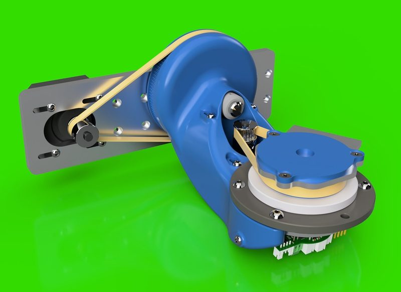</a> | [**Open5x**](https://github.com/FreddieHong19/Open5x) *Freddie Hong* Kit that turns a 3-axis printer into a 5-axis printer. A printed trunnion replaces the bed, and a slewing-ring plate on it tilts and spins. It runs on a Duet board with RepRapFirmware and comes with a Grasshopper conformal slicer. The first build is a Prusa i3. BrendonBuilds ported it to an E3D ToolChanger, a Voron V0.1, and his mod0. Garth-42 and tobywhy ported it to the Jubilee. | — | — | mod0 port [2024-06](https://github.com/BrendonBuilds/mod0/commit/88e52bc2990330fccb4a3359abab9539524b8c76) |  [⏯️⁠179K](https://www.youtube.com/watch?v=f09oCH1REAs) [❤️⁠3.3K](https://www.youtube.com/watch?v=f09oCH1REAs) | [CAD](https://github.com/FreddieHong19/Open5x/blob/main/3D_Model/Open5x%20Assembly.f3z) Prusa i3 [STL](https://github.com/FreddieHong19/Open5x/tree/main/3D_Model/Prusa%20i3) Prusa i3 [BOM](https://github.com/FreddieHong19/Open5x/blob/main/3D_Model/Prusa%20i3/Materials_and_supplier.md) Prusa i3 [Config](https://github.com/FreddieHong19/Open5x/tree/main/Duet2_Configuration) Prusa i3 [STEP](https://github.com/FreddieHong19/Open5x/blob/main/3D_Model/E3D_ToolChanger/ToolChanger-Open5x-assembly.step) E3D ToolChanger [STEP](https://github.com/FreddieHong19/Open5x/blob/main/3D_Model/Voron_0/voron-0-open5x.step) Voron 0 [Config](https://github.com/FreddieHong19/Open5x/tree/main/3D_Model/Voron_0/DuetConfig) Voron 0 [STEP](https://github.com/FreddieHong19/Open5x/blob/main/3D_Model/Jubilee%20Tool%20changer/Jubilee-Open5x-assembly.step) Jubilee [BOM](https://github.com/FreddieHong19/Open5x/blob/main/3D_Model/Jubilee%20Tool%20changer/5%20Axis%20Jubilee%20BOM.pdf) Jubilee [Manual](https://github.com/FreddieHong19/Open5x/blob/main/3D_Model/Jubilee%20Tool%20changer/Guide%20to%205%20Axis%20on%20the%20Jubilee.pdf) Jubilee [Config](https://github.com/FreddieHong19/Open5x/tree/main/3D_Model/Jubilee%20Tool%20changer/System%20files) Jubilee [STEP](https://github.com/BrendonBuilds/mod0/blob/main/CAD/Open5x/mod0-open5x-v1.step) mod0 [Files](https://github.com/FreddieHong19/Open5x/tree/main/Grasshopper_Definition) slicer [Video](https://www.youtube.com/watch?v=x9rG15qrDIE) [Video](https://www.youtube.com/watch?v=LZs5z4K3-sw) Voron 0 | — |
| <a href="printers/core-r-theta/README.md">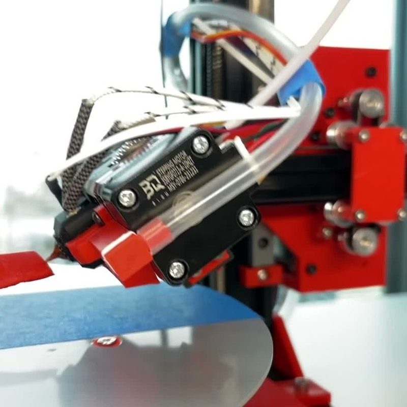</a> | [**Core R-Theta Printer**](https://github.com/jyjblrd/Core-R-Theta-4-Axis-Printer) *Joshua Bird* Polar 4-axis printer designed from scratch. The bed spins without limit. Two coupled belt motors move the head along the radius and turn its tilted nozzle. It prints with the author's open [Radial Non-Planar Slicer](https://github.com/jyjblrd/Radial_Non_Planar_Slicer) and [S4 Slicer](https://github.com/jyjblrd/S4_Slicer). There is no build guide. Builders use the repo Discussions. | — | — | CAD [2025-04](https://github.com/jyjblrd/Core-R-Theta-4-Axis-Printer/commit/c3e7d44e1b7beef01fdc57f265835dfef7c02588) |  [⏯️⁠857K](https://www.youtube.com/watch?v=VEgwnhLHy3g) [❤️⁠45.3K](https://www.youtube.com/watch?v=VEgwnhLHy3g) | [STEP](https://github.com/jyjblrd/Core-R-Theta-4-Axis-Printer/blob/main/4%20axis%20polar%203d%20printer.step) [CAD](https://github.com/jyjblrd/Core-R-Theta-4-Axis-Printer/blob/main/4%20axis%20polar%203d%20printer.f3z) [STL](https://github.com/jyjblrd/Core-R-Theta-4-Axis-Printer/tree/main/stl%20files) [BOM](https://github.com/jyjblrd/Core-R-Theta-4-Axis-Printer#bom) [Config](https://github.com/jyjblrd/Core-R-Theta-4-Axis-Printer/tree/main/reprap%20firmware%20config) [Video](https://www.youtube.com/watch?v=VEgwnhLHy3g) | — |
|  | [**Gen5X**](https://github.com/GenerativeMachine/Gen5X) *Ric Real / Generative Machine* Printed frame shaped by generative design in Fusion 360. A trunnion bed tilts and spins for five axes, on a Duet 2 with RepRapFirmware. The repo has STL files, a parts list, and a config. The Fusion 360 links no longer open, and the repo has no STEP files. | — | — | Files [2023-01](https://github.com/GenerativeMachine/Gen5X/commit/f1ed07278acc3515e1f4db8dda1e63cf91b136a2) |  [💙⁠147](https://www.thingiverse.com/thing:5840067) [⏯️⁠43K](https://www.youtube.com/watch?v=1nEVuf8HH0A) [❤️⁠517](https://www.youtube.com/watch?v=1nEVuf8HH0A) | [STL](https://github.com/GenerativeMachine/Gen5X/tree/main/Gen5X%20V1%20STL%20Files) [BOM](https://github.com/GenerativeMachine/Gen5X/blob/main/Parts%20List%20and%20Assembly/Gen5X%20V1%20Parts%20list.pdf) [CAD](https://grabcad.com/library/gen5x-1) Fusion 360 [Config](https://github.com/GenerativeMachine/Gen5X/tree/main/Gen5X%20Firmware) [Video](https://www.youtube.com/watch?v=1nEVuf8HH0A) | — |
| <a href="printers/fractal-5-pro/README.md">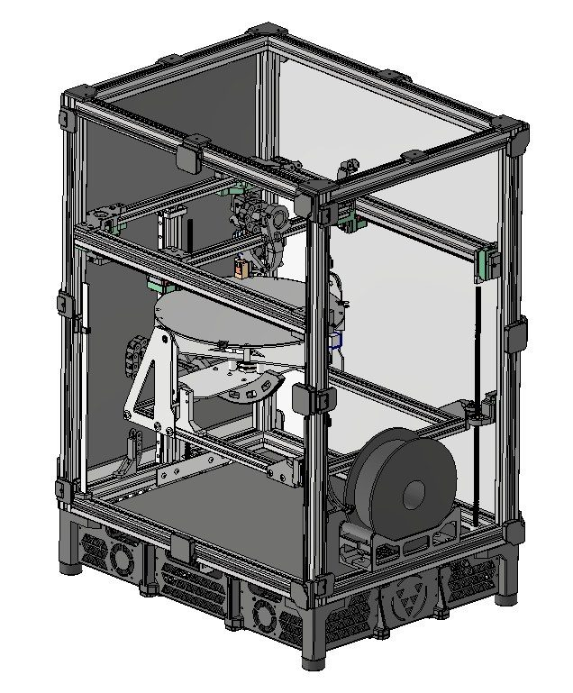</a> | [**Fractal 5 Pro**](https://github.com/fractalrobotics/Fractal-5-Pro) *Dan Brogan / Fractal Robotics* Enclosed CoreXY with a bed that tilts 90° and spins without limit, for multidirectional 5-axis printing. It pairs with the open [Fractal Cortex](https://github.com/fractalrobotics/Fractal-Cortex) slicer. | Ø300×250 | — | CAD [2025-07](https://github.com/fractalrobotics/Fractal-5-Pro/commit/d49f96fd9aecdf43031ffbe9cf406f3a0c864487) |  [⏯️⁠105K](https://www.youtube.com/watch?v=2_BY-7XOgWg) [❤️⁠7.1K](https://www.youtube.com/watch?v=2_BY-7XOgWg) | [STEP](https://github.com/fractalrobotics/Fractal-5-Pro/blob/main/CAD/Fractal_5_Pro_Assembly.zip) [BOM](https://github.com/fractalrobotics/Fractal-5-Pro/blob/main/BOM/BOM.xlsx) [Config](https://github.com/fractalrobotics/Fractal-5-Pro/tree/main/Firmware) [Video](https://www.youtube.com/watch?v=2_BY-7XOgWg) | [Discord](https://discord.gg/PvPyGN2HSb) EN 166 |
| <a href="printers/iwk-5x/README.md">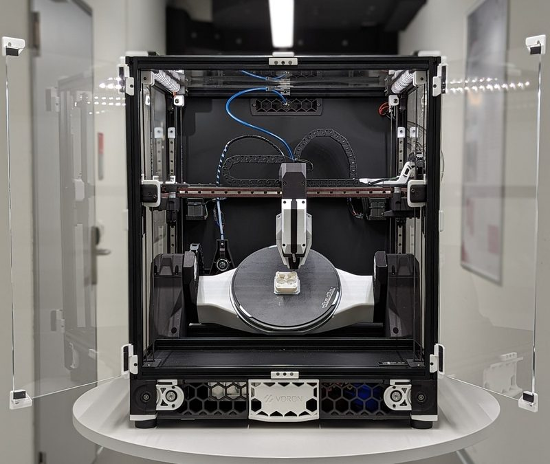</a> | [**IWK 5X**](https://github.com/danielom123/IWK5X) *Daniel Omidvarkarjan, Daniel Aeschbacher, Simon Grimm, Cedric Kundert / IWK, OST* 5-axis printer built on a Voron 2.4r2 frame. An AC trunnion bridge tilts and spins the bed. A manual tool changer takes filament, pellet, and fluid heads. | Ø220×195 | — | CAD [2026-07](https://github.com/danielom123/IWK5X/commit/be5e108c5d4fd50eb9cbcbbc40b7efe0f79dc089) |  | [STEP](https://github.com/danielom123/IWK5X/blob/main/CAD/CAD-files/IWKX5_Master.stp) [STL](https://github.com/danielom123/IWK5X/tree/main/STLs) [BOM](https://github.com/danielom123/IWK5X/blob/main/CAD/BOM_IWK5X_rc1.xlsx) [Manual](https://github.com/danielom123/IWK5X/blob/main/Manual/Assembly_Manual_base_2.4r2.pdf) | — |

## Conversions

These are commonly built by reusing a donor printer or modifying an existing family; some also support a fresh build. Check the exact donor model and revision before ordering parts.

| Photo | Printer and why it’s interesting | Build volume (X×Y×Z) | Exterior (W×D×H) | Latest version | Stars Likes Views | Links | Groups |
| --- | --- | --- | --- | --- | --- | --- | --- |
|  | [**Ender-3 NG**](https://www.printables.com/model/922401-ender-3-ng-v12-corexy-conversion) *RH3D* Ender-3 CoreXY conversion with a dedicated guide; the listed volume is from a creator beta build. Versions are the 2023 beta and v1.2. | 235×235×245 | — | Log [2025-06](https://www.printables.com/model/922401-ender-3-ng-v12-corexy-conversion) | [🧡⁠2.7K](https://www.printables.com/model/922401-ender-3-ng-v12-corexy-conversion) [⏯️⁠107K](https://www.youtube.com/watch?v=u4b6Ni18ap4) [❤️⁠3.3K](https://www.youtube.com/watch?v=u4b6Ni18ap4) | [Files](https://rh3d.xyz/E3NG_v1_2/standard/files) v1.2 [Manual](https://rh3d.xyz/E3NG_v1_2/standard/build_guide) v1.2 [STL](https://www.printables.com/model/469280-ender-3-ng-corexy-beta) old beta | [Discord](https://discord.com/invite/Zkvu6uu2AR) EN 4.8K |
| <a href="printers/satsuma/README.md">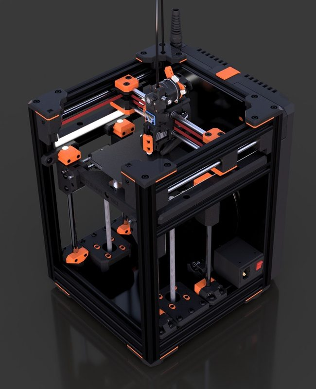</a> | [**Satsuma 180**](https://www.printables.com/model/487266-satsuma-180-v10) *Squirrelbrain* CoreXY that reuses Prusa MINI parts, including the bed, and uses square nuts instead of heat-set inserts. The row covers Satsuma 180 v1.0 and the smaller [Satsuma 120](https://www.printables.com/model/564986-satsuma-120-beta) beta. | 180: 180×180×? 120: 120×120×? | — | v1.0 [2023-12](https://www.printables.com/model/487266-satsuma-180-v10/files) | [🧡⁠1.1K](https://www.printables.com/model/487266-satsuma-180-v10) | [Files](https://www.printables.com/model/487266-satsuma-180-v10/files) 180 [BOM](https://docs.google.com/spreadsheets/d/1j9XkWJjpuDxKR5D-tsqN0p6wRn4Gp6H0tIH2ABmrAIE/edit) 180 [Files](https://www.printables.com/model/564986-satsuma-120-beta/files) 120 | — |
|  | [**Ender_SW**](https://github.com/boubounokefalos/Ender_SW) *DaRk_dOg / boubounokefalos* Unofficial Ender-3 Pro/V2 to CoreXZ conversion, redesigned from Triano’s original community Switchwire mod. | 220×220×220 | — | v2.0 [2023-02](https://github.com/boubounokefalos/Ender_SW/releases/tag/v.2.0) |  | [Original](https://github.com/VoronDesign/VoronUsers/tree/main/printer_mods/Triano/Ender_3Pro_Switchwire) [CAD](https://github.com/boubounokefalos/Ender_SW/tree/main/CAD) [Wiki](https://github.com/boubounokefalos/Ender_SW/wiki) | [Discord](https://discord.gg/voron) EN 40.8K |
|  | [**Voron Switchwire**](https://github.com/VoronDesign/Voron-Switchwire) *Voron family* Official CoreXZ bedslinger with a custom 3030/3060 frame and Prusa MK52 bed; builders can reuse Prusa parts or source a fresh build. | — | — | V1.0 [2020-08](https://github.com/VoronDesign/Voron-Switchwire/releases/tag/V1.0) |  [⏯️⁠88.8K](https://www.youtube.com/watch?v=jwPLl1v5ae4) [❤️⁠1K](https://www.youtube.com/watch?v=jwPLl1v5ae4) | [Manual](https://github.com/VoronDesign/Voron-Switchwire/blob/HEAD/Manuals/Assembly_Manual_SW.pdf) [CAD](https://github.com/VoronDesign/Voron-Switchwire/tree/HEAD/CAD) | [Discord](https://discord.gg/voron) EN 40.8K [Reddit](https://www.reddit.com/r/VORONDesign/) EN 39.7K [Forum](https://forum.vorondesign.com/) EN 12.8K [Facebook](https://www.facebook.com/groups/voroncorexy/) EN 54.2K [Facebook](https://www.facebook.com/groups/479932403103163/) DE 2.6K [Telegram](https://t.me/aboutvoron) RU 551 [Telegram](https://t.me/voron_siboor_es) ES 212 [Forum](https://www.lesimprimantes3d.fr/forum/154-voron/) FR |
|  | [**Tridex**](https://github.com/FrankenVoron/Tridex) *FrankenVoron* Advanced Trident-derived IDEX for dual-material printing; the creator says it may eventually become release-worthy, and documentation is still in progress. | single toolhead: 225×250×250 dual toolhead: 205×250×250 | — | CAD [2023-01](https://github.com/FrankenVoron/Tridex/commit/e81abf1519dcd1ead141bc3ad16c281365a4d6df) |  [⏯️⁠62.6K](https://www.youtube.com/watch?v=31fqpKYj7v4) [❤️⁠1.1K](https://www.youtube.com/watch?v=31fqpKYj7v4) | [CAD](https://github.com/FrankenVoron/Tridex/tree/main/CAD) [BOM](https://github.com/FrankenVoron/Tridex/blob/main/Documentation/0_bill_of_materials.md) [Manual](https://github.com/FrankenVoron/Tridex/blob/main/Documentation/1_assembly_instructions.md) [STL](https://github.com/FrankenVoron/Tridex/tree/main/STLs) | [Discord](https://discord.gg/voron) EN 40.8K [Discord](https://discord.gg/doomcube) EN 6.9K [Reddit](https://www.reddit.com/r/voroncorexy/) EN 30.3K |
|  | [**Dueling Zero**](https://github.com/zruncho3d/DuelingZero) *zruncho3d* Voron V0-derived dual-gantry project. | configurable | — | v3 gantry [2023-09](https://github.com/zruncho3d/DuelingZero#releases) |  [⏯️⁠53.5K](https://www.youtube.com/watch?v=2YI3_g30EwA) [❤️⁠541](https://www.youtube.com/watch?v=2YI3_g30EwA) | [CAD](https://github.com/zruncho3d/DuelingZero/tree/HEAD/CAD) [Manual](https://github.com/zruncho3d/DuelingZero/blob/HEAD/INSTRUCTIONS.md) | [Discord](https://discord.gg/voron) EN 40.8K [Discord](https://discord.gg/doomcube) EN 6.9K [Reddit](https://www.reddit.com/r/voroncorexy/) EN 30.3K |
| <a href="printers/virtu-e3/README.md">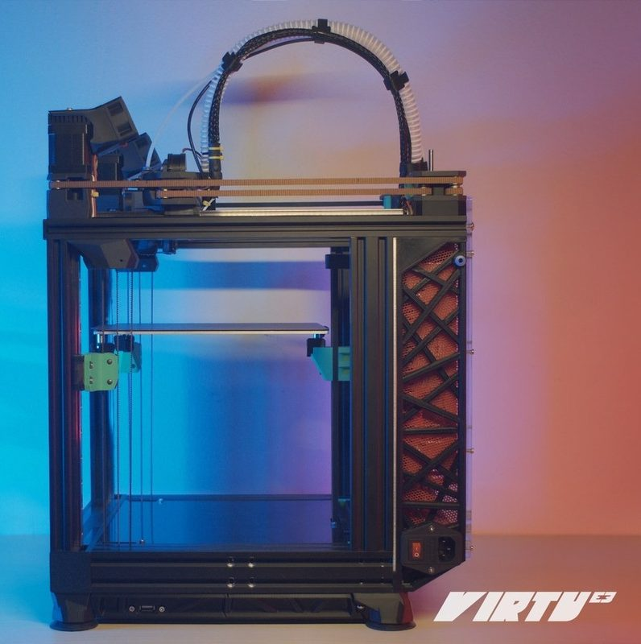</a> | [**VIRTU E3**](https://www.printables.com/model/1476283-virtu-e3) *RH3D* CoreXY rebuild of an Ender 3 and the successor of the Ender-3 NG. It has a bolted aluminium frame, a belt-driven triple Z and the V-ION toolhead. | 230×230×230 | 350×400×500 | Log [2026-05](https://www.printables.com/model/1476283-virtu-e3) | [🧡⁠242](https://www.printables.com/model/1476283-virtu-e3) [⏯️⁠17.8K](https://www.youtube.com/watch?v=Tc4B_fnmx10) [❤️⁠696](https://www.youtube.com/watch?v=Tc4B_fnmx10) | [STL](https://www.printables.com/model/1476283-virtu-e3/files) [BOM](https://rh3d.xyz/virtu/build/sourcing_parts/self_sourcing) [Video](https://www.youtube.com/watch?v=Tc4B_fnmx10) | [Discord](https://discord.com/invite/Zkvu6uu2AR) EN 4.8K |
|  | [**ProosaXY**](https://github.com/SnakeOilXY/ProosaXY) *SnakeOilXY* Prusa MK3/S CoreXY conversion that reuses donor parts; requires irreversible drilling and cutting. | — | — | CAD [2026-07](https://github.com/SnakeOilXY/ProosaXY/commit/2044ed8e015997882eb6bf1c48cddba3956e670f) |  [🧡⁠583](https://www.printables.com/model/518614-proosaxy-mk3s-to-corexy-conversion) [⏯️⁠9.2K](https://www.youtube.com/watch?v=Dink3JQ-bNY) [❤️⁠91](https://www.youtube.com/watch?v=Dink3JQ-bNY) | [CAD](https://github.com/SnakeOilXY/ProosaXY/tree/master/src) [STL](https://github.com/SnakeOilXY/ProosaXY/tree/master/STLs) [BOM](https://github.com/SnakeOilXY/ProosaXY#bom) | [Discord](https://discord.gg/WZVP2HuAag) EN 1.3K |
|  | [**Double Dragon**](https://github.com/zruncho3d/double-dragon) *zruncho3d* Alpha-stage Voron V0-derived IDEX experiment for dual extrusion. | 114×120×? | — | alpha 1 [2021-12](https://github.com/zruncho3d/double-dragon#alpha-1-release-2021-12-31) |  [⏯️⁠9.6K](https://www.youtube.com/watch?v=GY29F2O1unw) [❤️⁠116](https://www.youtube.com/watch?v=GY29F2O1unw) | [CAD](https://github.com/zruncho3d/double-dragon/tree/HEAD/CAD) | [Discord](https://discord.gg/voron) EN 40.8K [Discord](https://discord.gg/doomcube) EN 6.9K [Reddit](https://www.reddit.com/r/VORONDesign/) EN 39.7K |
|  | [**F-Zero**](https://github.com/zruncho3d/f-zero) *zruncho3d* V0-component flying-gantry CoreXY that can be built fresh or as an upgrade. | 120×120×120 | — | Update [2021-11](https://github.com/zruncho3d/f-zero#status-updates) |  [⏯️⁠29.3K](https://www.youtube.com/watch?v=jLSPeJ7L9R4) [❤️⁠429](https://www.youtube.com/watch?v=jLSPeJ7L9R4) | [CAD](https://github.com/zruncho3d/f-zero/tree/main/CAD) [Manual](https://github.com/zruncho3d/f-zero#buildlog-and-design-doc) | [Discord](https://discord.gg/voron) EN 40.8K [Discord](https://discord.gg/doomcube) EN 6.9K [Reddit](https://www.reddit.com/r/voroncorexy/) EN 30.3K |
| <a href="printers/crucible/README.md">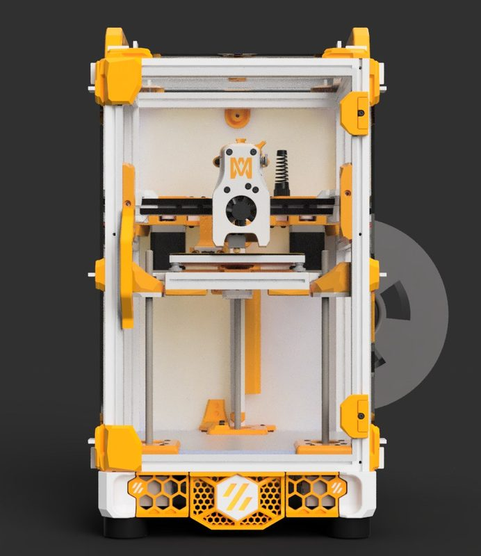</a> | [**Crucible**](https://github.com/PrintersForAnts/Crucible) *Printers for Ants* Voron Trident layout at V0 scale, with three lead screws for Z. It converts a Voron V0.1. | 120×120×120 | 230×230×360 | STEP [2023-01](https://github.com/PrintersForAnts/Crucible/commit/4eca7b1fc3a8aed970f4643f99da9df2bf980e70) |  | [STEP](https://github.com/PrintersForAnts/Crucible/blob/main/CAD/Crucible_Assembly_9.10.22.zip) [CAD](https://github.com/PrintersForAnts/Crucible/blob/main/CAD/Crucible_Assembly_9.10.22.f3d) [BOM](https://github.com/PrintersForAnts/Crucible#parts-needed-for-v01-conversion) | [Discord](https://discord.gg/doomcube) EN 6.9K |
|  | [**Duender**](https://github.com/Irbis3D/Duender) *Irbis3D* Turns parts from two Ender-3 printers into one CoreXY. Versions are v1 on wheels, v2 on MGN9H rails, and the 2026 project with wheel, MGN9H, and MGN12H builds and pin idlers. | — | — | CAD [2026-05](https://github.com/Irbis3D/Duender/commit/ab563b7019b3c5501ba2fb651d9546def44c3920) |  [🧡⁠742](https://www.printables.com/model/1174545) [⏯️⁠72.7K](https://www.youtube.com/watch?v=zOplNhr5SfA) [❤️⁠3.3K](https://www.youtube.com/watch?v=zOplNhr5SfA) | [STEP](https://github.com/Irbis3D/Duender/tree/HEAD/STEP%20KITS) 2026 [STL](https://www.printables.com/model/1798903-duender-project-ender-3-to-corexy-conversion) 2026 [STL](https://www.printables.com/model/1300968) old v2 MGN9H [STL](https://www.printables.com/model/1174545) old v1 [Manual](https://github.com/Irbis3D/Duender/tree/HEAD/Manual) 2026 | [Discord](https://discord.gg/ae44FHv786) EN 2.9K |
|  | [**Mercury One**](https://github.com/ZeroGDesign/MercuryOne) *ZeroG* CoreXY conversion for Ender-5 family machines. Mercury One.1 replaced the first Mercury One, whose files stay in the old repo. | — | — | One.1 [2025-05](https://github.com/ZeroGDesign/MercuryOne/releases/tag/Release) |  [⏯️⁠15.2K](https://www.youtube.com/watch?v=nUwLjH3-oIc) [❤️⁠164](https://www.youtube.com/watch?v=nUwLjH3-oIc) | [CAD](https://github.com/ZeroGDesign/MercuryOne/tree/HEAD/CAD) One.1 [Manual](https://docs.zerog.one/manual/build/mercury_eva) One.1 [STEP](https://github.com/ZeroGDesign/Mercury-OUTDATED/blob/main/CAD/Zero%20G%20-%20Mercury%20One.step) old Mercury One | [Discord](https://discord.gg/zerog) EN 9.7K |
| <a href="printers/diversion/README.md">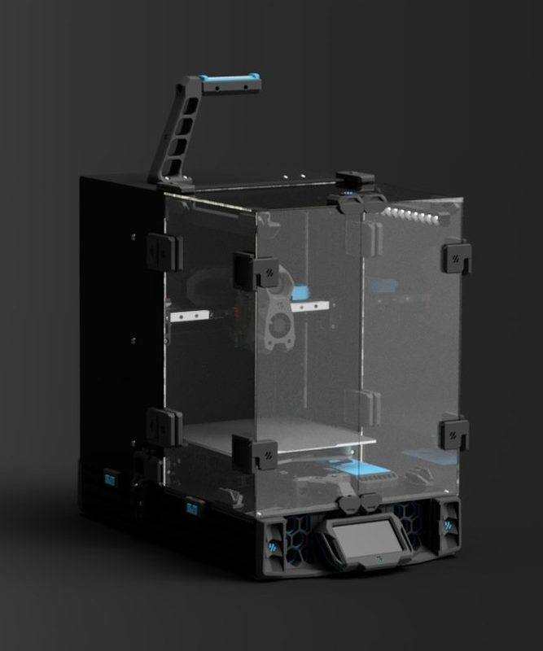</a> | [**Diversion MK_I**](https://github.com/boubounokefalos/Diversion) *DaRk_dOg / boubounokefalos* Enclosed CoreXZ Switchwire mod with blind-joint frame, 4080 C-beam base, and dual Y rails. It reuses an Ender-3 bed and carriage, and the enclosure is held by magnets. The author marks it alpha. | — | — | CAD [2025-08](https://github.com/boubounokefalos/Diversion/commit/45f3210aa15b14fc4514bae330d0f68525c29705) |  | [Original](https://github.com/VoronDesign/Voron-Switchwire) [CAD](https://github.com/boubounokefalos/Diversion/tree/main/CAD) [STL](https://github.com/boubounokefalos/Diversion/tree/main/STLS) [BOM](https://github.com/boubounokefalos/Diversion/blob/main/docs/BoM.md) | [Discord](https://discord.gg/voron) EN 40.8K |

## Concepts and prototypes

Experimental designs and one-off ideas. Most have no public CAD or complete build package. Use them to study an idea, not as a build plan.

| Photo | Printer and why it’s interesting | Build type | Build volume (X×Y×Z) | Exterior (W×D×H) | Latest version | Stars Likes Views | Links | Groups |
| --- | --- | --- | --- | --- | --- | --- | --- | --- |
|  | [**Minuteman**](https://www.youtube.com/watch?v=iMAWa9vfxcE) *Roetz 4.0* One-off, Benchy-sized speed printer with a four-cable winch XY, air-bearing moving bed, and independent Z toolhead. Its CAD, BOM, and build guide are not public, but the build series is fun to watch. | Cable winch XY moving bed | 60×60×73 | — | Video [2026-05](https://www.youtube.com/watch?v=iMAWa9vfxcE) | [⏯️⁠4.3M](https://www.youtube.com/watch?v=AJhCPCpLYcE) [❤️⁠18.1K](https://www.youtube.com/watch?v=AJhCPCpLYcE) | [Video](https://www.youtube.com/playlist?list=PLT7wyh27LmscPT1EZpoS3BTWUJjAOQ5Gf) [Hotend](https://github.com/Roetz4point0/Roetz-End) | [Discord](https://discord.gg/nr6QrWE9Dd) EN 819 |
|  | [**Quark**](https://www.youtube.com/watch?v=JCcKdnAFfds) *RobertGcode* Palm-sized Cartesian bedslinger and functional design exercise with a 24 mm print cube; no public build package was located. | Cartesian bedslinger | 24×24×24 | 100×100×100 | First release [2025-10](https://www.youtube.com/watch?v=JCcKdnAFfds) | [⏯️⁠55.4K](https://www.youtube.com/watch?v=JCcKdnAFfds) [❤️⁠2.3K](https://www.youtube.com/watch?v=JCcKdnAFfds) | [Video](https://www.youtube.com/watch?v=JCcKdnAFfds) | — |
|  | [**Infini-Z**](https://projectquine.substack.com/p/the-first-infini-z) *SunShine / Andras* Experimental self-climbing Z axis. | Climbing Z | — | — | Files [2023-12](https://www.printables.com/model/581766-infini-z-3d-printer) | [💙⁠240](https://www.thingiverse.com/thing:6217366) [🧡⁠844](https://www.printables.com/model/581766) [💛⁠33](https://cults3d.com/en/3d-model/tool/infini-z-3d-printer) [⏯️⁠1.5M](https://www.youtube.com/watch?v=Ek_7tBOCcAI) [❤️⁠46K](https://www.youtube.com/watch?v=Ek_7tBOCcAI) | [Files](https://www.printables.com/model/581766-infini-z-3d-printer/files) | — |
| <a href="printers/inverted-cantilever-delta/README.md">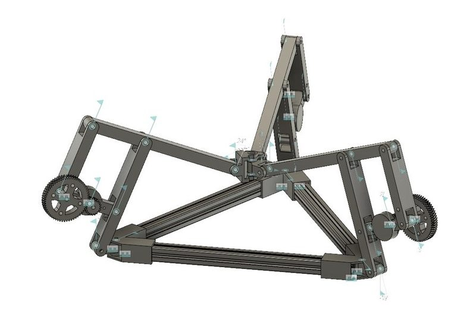</a> | [**Inverted Cantilever Delta**](https://www.thingiverse.com/thing:1857648) *Apsu* Grounded delta prototype in the GUS Simpson line. A parallel linkage moves each arm motor to the base, where it drives the arm through a 3:1 gear pair. | Inverted cantilever delta | — | — | Files [2016-10](https://www.thingiverse.com/thing:1857648/files) | [💙⁠52](https://www.thingiverse.com/thing:1857648) [⏯️⁠2.6K](https://www.youtube.com/watch?v=bkq-SWTHQcE) [❤️⁠31](https://www.youtube.com/watch?v=bkq-SWTHQcE) | [STL](https://github.com/Apsu/Parallel-Grounded-Delta) [Files](https://www.thingiverse.com/thing:1857648/files) [Video](https://www.youtube.com/watch?v=bkq-SWTHQcE) | — |
| <a href="printers/deltafold/README.md">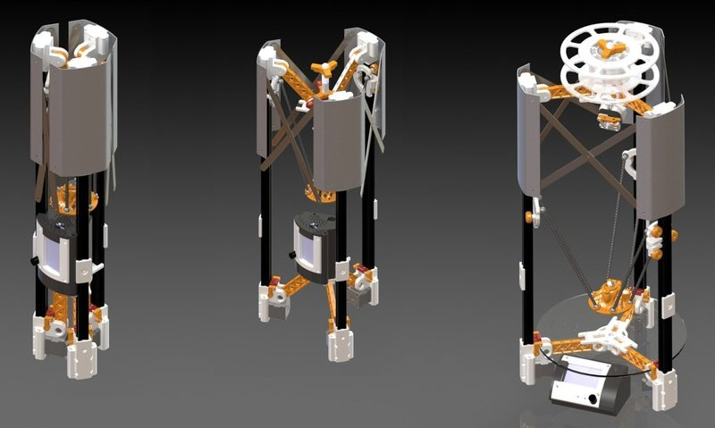</a> | [**DeltaFold**](https://github.com/htaxil/DeltaFold) *Hubert Taxil (CherHubert)* Foldable delta for transport, under 6 kg, that folds to a 180 mm wide cylinder. The French RepRap wiki log covers three prototypes from 2015 to 2021, but only part of the STL set is public. | Foldable delta | Ø220×290 | Open: Ø373×730 Folded: Ø180×? | CAD [2021-02](https://github.com/htaxil/DeltaFold/commit/5a7770af4d941d4d8d270d91b23b2e92dcdb25e3) |  | [STL](https://github.com/htaxil/DeltaFold/tree/main/docs/components) [Wiki](https://reprap.org/wiki/DeltaFold) | — |
|  | [**FoldaRapX**](https://reprap.org/wiki/FoldaRapX) *Emmanuel Gilloz* Portable printer in a flight case. A scissor lift is the Z axis, so the machine unfolds as the print grows. The prototype stopped at version 0.1, because firmware for the non-linear Z axis was never finished. | Scissor-lift Z | — | — | CAD [2020-05](https://github.com/EmmanuelG/FoldaRapX/commit/075d811cd35dd8bc92e509428f954cf5ef3d8455) |  | [Files](https://github.com/EmmanuelG/FoldaRapX) [BOM](https://github.com/EmmanuelG/FoldaRapX/blob/master/Bill%20Of%20Materials.ods) [Wiki](https://reprap.org/wiki/FoldaRapX) | — |

## Legacy designs

The files still work, but the design is no longer developed. A design is legacy if it has no update in two years and no active group, if its repository is archived, or if a newer version replaced it. Archived status was checked on 2026-10-20.

| Photo | Printer and why it’s interesting | Build volume (X×Y×Z) | Exterior (W×D×H) | Latest version | Stars Likes Views | Links | Groups |
| --- | --- | --- | --- | --- | --- | --- | --- |
| <a href="printers/toyrep/README.md">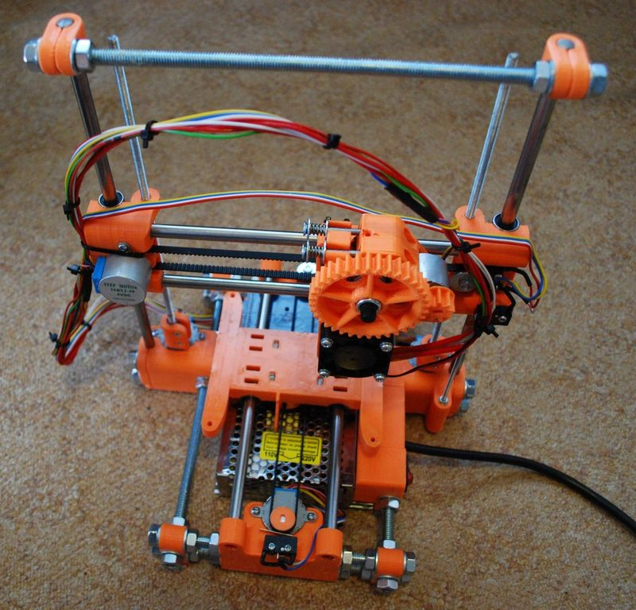</a> | [**ToyREP**](https://reprap.org/wiki/ToyREP) *Thorgal* Tiny threaded-rod Cartesian printer driven by cheap 28BYJ-48 geared steppers with a bipolar hack. The author calls it a technology demonstrator or toy, with 10 to 12.5 mm/s on X and Y. No update since 2015-07. | 100: 100×100×100 125: 125×125×100 | 100: 255×245×295 125: 265×265×295 | First release [2015-07](https://reprap.org/wiki/ToyREP) | [💙⁠3.7K](https://www.thingiverse.com/thing:945156) | [STL](https://www.thingiverse.com/thing:945156/files) [Manual](https://reprap.org/wiki/ToyREP_Build_Manual) [BOM](https://reprap.org/wiki/ToyREP_Buyers_Guide) [Wiki](https://reprap.org/wiki/ToyREP) | — |
| <a href="printers/archie/README.md">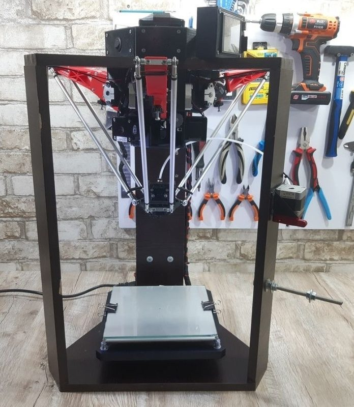</a> | [**Archie**](https://www.thingiverse.com/thing:4591379) *Alex Korvin Workshop* Rotary delta printer: three geared motors swing printed arms, and the frame is laminated chipboard. Versions: Mk3 (2019) with STEP files and Mk4 (2020) with STL files, both shown in a Russian build series, and a Mk5 build series started in 2025 without public files. No update since 2020-09. | — | — | Mk4 Files [2020-09](https://www.thingiverse.com/thing:4591379/files) | [💙⁠769](https://www.thingiverse.com/thing:3489886) [⏯️⁠220K](https://www.youtube.com/watch?v=6oefrWdS_3M) [❤️⁠11K](https://www.youtube.com/watch?v=6oefrWdS_3M) | [STL](https://www.thingiverse.com/thing:4591379/files) [Video](https://www.youtube.com/watch?v=EwMg9Ciu0s8) [STEP](https://www.thingiverse.com/thing:3489886/files) old Mk3 [Video](https://www.youtube.com/watch?v=6oefrWdS_3M) old Mk3 | [Telegram](https://t.me/alexkorvinworkshop) RU 1K |
|  | [**Jubilee**](https://github.com/machineagency/jubilee) *Machine Agency* Open tool-changing platform. No update since 2021-10. | 300×300×300 | 476×604×558 | v2.2.2 [2021-10](https://github.com/machineagency/jubilee/releases/tag/v2.2.2) |  [💙⁠994](https://www.thingiverse.com/thing:3843001) [⏯️⁠779](https://www.youtube.com/watch?v=TfB29j_LmQw) [❤️⁠16](https://www.youtube.com/watch?v=TfB29j_LmQw) | [STEP](https://github.com/machineagency/jubilee/blob/HEAD/frame/cads/STEP/jubilee.STEP) [Wiki](https://jubilee3d.com/) | [Discord](https://discord.gg/XkphRqb) EN 2K [Reddit](https://www.reddit.com/r/Jubilee3D/) EN 88 |
|  | [**Cherry Pi IIIS**](https://www.thingiverse.com/thing:543303) *AndyCart* Fourth version of the delta, after the [Cherry Pi](https://www.thingiverse.com/thing:210028) (2013), the [Cherry Pi II](https://www.thingiverse.com/thing:298168) (2014) and the [Cherry Pi III](https://www.thingiverse.com/thing:344408) (2014). It joins the effector with Spectra line and springs. No update since 2014-11. | — | — | IIIS [2014-11](https://www.thingiverse.com/thing:543303) | [💙⁠503](https://www.thingiverse.com/thing:344408) [⏯️⁠2.3K](https://www.youtube.com/watch?v=9hL9AQpA93Y) [❤️⁠4](https://www.youtube.com/watch?v=9hL9AQpA93Y) | [Files](https://www.thingiverse.com/thing:543303/files) IIIS [Files](https://www.thingiverse.com/thing:344408/files) III | [Forum](https://reprap.org/forum/list.php?178) EN [Facebook](https://www.facebook.com/groups/delta3dp/) EN 2.7K inactive |
|  | [**Tiny-M**](https://github.com/gsl12/Tiny-M) *gsl12* Archived 150 mm Voron V0-inspired CoreXY. V4 is the current version, and V5 is an unfinished beta. No update since 2023-04. | 150×150×150 | — | V5 beta [2023-04](https://github.com/gsl12/Tiny-M-V5-beta/commit/e8ffcb555eefc445ff6db2ec855eee5e925c3001) |  | [STEP](https://github.com/gsl12/Tiny-M/tree/HEAD/CAD/V4) V4 [STEP](https://github.com/gsl12/Tiny-M-V5-beta/tree/HEAD/CAD) V5 beta [BOM](https://github.com/gsl12/Tiny-M/tree/master/BOM) V4 | [Discord](https://discord.gg/tmZkjWs) EN 2.8K |
|  | [**Rat Rig V-Cast**](https://lab.ratrig.com/vcast_1_5/) *Rat Rig family* Cartesian bed slinger on 3030 extrusion with single or IDEX toolheads and an optional wider "Wide Boy" frame for full IDEX travel. Versions: 1.0 sold as a kit from 2020 to 2022, and 1.5 is an unsold prototype update with a reworked X drive and dual Y motors. No update since 2022-10. | 300×300×? | — | 1.5 [2022-10](https://lab.ratrig.com/vcast_1_5/) | [⏯️⁠33.4K](https://www.youtube.com/watch?v=3iKGS-H3x1g) [❤️⁠377](https://www.youtube.com/watch?v=3iKGS-H3x1g) | [CAD](https://a360.co/3S9SQY0) [CAD](https://a360.co/3ySI41x) Wide Boy [BOM](https://lab.ratrig.com/vcast_1_5/#bill-of-materials) [CAD](https://a360.co/3TbjzVw) old 1.0 [CAD](https://a360.co/3Tpx1Vi) old 1.0 Wide Boy [BOM](https://lab.ratrig.com/vcast_1_0/#bill-of-materials) old 1.0 [Video](https://www.youtube.com/watch?v=3iKGS-H3x1g) old 1.0 | [Facebook](https://www.facebook.com/groups/ratrig3dprintercommunity) EN 19.9K [Discord](https://discord.gg/ratrig) EN 13.8K [Reddit](https://www.reddit.com/r/RatRig/) EN 3K |
|  | [**Rat Rig V-Core 3**](https://github.com/Rat-Rig/V-core-3) *Rat Rig family* Scalable CoreXY on a 3030 T-slot frame with MGN12 rails on all axes, stacked 9 mm belts, three Z lead screws under a kinematic bed, and the EVA 3 carriage. The row covers the 3.1 and the 3.2H upgrade kit (2025), which adds two Y motors for a hybrid gantry and needs the Enclosure 2.0. Replaced by the Rat Rig V-Core 4.1. | 300: 300×300×300 400: 400×400×400 500: 500×500×500 | 300: 518×583×560 400: 618×683×660 500: 718×783×760 | 3.2H [2025-07](https://github.com/Rat-Rig/RatRig-PrintedParts/commit/fb8e395696ec78e6ae29a135dae008f4754d30c4) |  [💙⁠340](https://www.thingiverse.com/thing:5430377) [🧡⁠227](https://www.printables.com/model/240707) [⏯️⁠131K](https://www.youtube.com/watch?v=bZ3ZrTCEBIw) [❤️⁠1.5K](https://www.youtube.com/watch?v=bZ3ZrTCEBIw) | [Files](https://wiki.ratrig.com/products/v-core-3-2h/files) 3.2H [CAD](https://github.com/Rat-Rig/V-core-3/tree/HEAD/cad) 3.1 [Manual](https://github.com/Rat-Rig/V-core-3/tree/HEAD/docs) 3.1 | [Facebook](https://www.facebook.com/groups/ratrig3dprintercommunity) EN 19.9K [Discord](https://discord.gg/ratrig) EN 13.8K [Reddit](https://www.reddit.com/r/RatRig/) EN 3K |
|  | [**V-King CoreXY**](https://github.com/RoyBerntsenDesign/V-King-CoreXY) *Roy Berntsen / PRO 3D* Hypercube-style CoreXY with no smooth rods: all axes run on V-wheels in V-slot extrusion, and a worm gear drives the belted Z. No update since 2022-01. | 340×390×330 | — | Files [2022-01](https://github.com/RoyBerntsenDesign/V-King-CoreXY/commit/59a7ad08779e54fee8d0c5510eb178a15f1034da) |  [💙⁠541](https://www.thingiverse.com/thing:2921021) [🤍⁠21](https://www.myminifactory.com/object/3d-print-v-king-corexy-v2-0-73409) [⏯️⁠43K](https://www.youtube.com/watch?v=wINF7qM0DQU) [❤️⁠458](https://www.youtube.com/watch?v=wINF7qM0DQU) | [CAD](https://github.com/RoyBerntsenDesign/V-King-CoreXY/tree/master/Source%20File%20Library) [STL](https://github.com/RoyBerntsenDesign/V-King-CoreXY/tree/master/Part%20File%20Library) [BOM](https://github.com/RoyBerntsenDesign/V-King-CoreXY/blob/master/Document%20Library/Bill%20Of%20Materials/V-King%20CoreXY%20V2%20-%20Part%20Order%20List.xlsx) [Manual](https://github.com/RoyBerntsenDesign/V-King-CoreXY/blob/master/Document%20Library/V-king%20MK2%20Assembly%20Manual%20V1.0.pdf) [Config](https://github.com/RoyBerntsenDesign/V-King-CoreXY/tree/master/Firmware%20Files/RRF-Duet) | [Facebook](https://www.facebook.com/groups/viking3d/) EN |
|  | [**3d Mini Cube (iChalix)**](https://www.thingiverse.com/thing:3910543) *iChalix* 120 mm BLV MGN Cube derivative with a single Z axis; documentation remains work in progress. No update since 2019. | 120×120×110 | 325×355×338 | Log [2019-12](https://www.thingiverse.com/thing:3910543) | [💙⁠165](https://www.thingiverse.com/thing:3910543) | [Files](https://www.thingiverse.com/thing:3910543/files) | [Facebook](https://www.facebook.com/groups/BenLevi) EN 7K |
|  | [**Annex K2 / Chhogori**](https://github.com/Annex-Engineering/Chhogori-K2) *Annex Engineering* Archived moving-bed, enclosed cross-gantry design; the final XY and Z files are labelled beta and alpha. Replaced by the Annex K3. | 250×250×250 | — | CAD [2024-04](https://github.com/Annex-Engineering/Chhogori-K2/commit/9a151664698ac46f051df6135afb2e2e730ac703) |  [⏯️⁠35.3K](https://www.youtube.com/watch?v=MTtGYOv85oY) [❤️⁠225](https://www.youtube.com/watch?v=MTtGYOv85oY) | [CAD](https://github.com/Annex-Engineering/Chhogori-K2/tree/master/Release_4.0) [BOM](https://docs.google.com/spreadsheets/d/1O3eyVuQ6M4F03MJSDs4Z71_XyNjXL5HFTZr1jsaAtRc/edit) | [Discord](https://discord.gg/MzTR3zE) EN 11.4K |
|  | [**Voron Legacy**](https://github.com/VoronDesign/Voron-Legacy) *Voron family* Recreation of the [Voron 1.0](https://github.com/VoronDesign/Voron-1/tree/Voron1.0), the first Voron: a CoreXY with a fixed gantry, rods and linear bearings on all axes, and a bed on two lead screws. The row also links the original V1.0 files. No update since 2020-12. | 230×230×260 | — | V1.0 [2020-12](https://github.com/VoronDesign/Voron-Legacy/releases/tag/V1.0) |  [⏯️⁠70.6K](https://www.youtube.com/watch?v=NZqvRLa8ShE) [❤️⁠1.5K](https://www.youtube.com/watch?v=NZqvRLa8ShE) | [CAD](https://github.com/VoronDesign/Voron-Legacy/tree/main/CAD) [STL](https://github.com/VoronDesign/Voron-Legacy/tree/main/STLs) [BOM](https://vorondesign.com/voron_legacy) [CAD](https://github.com/VoronDesign/Voron-1/tree/Voron1.0/CAD) old V1.0 [BOM](https://github.com/VoronDesign/Voron-1/blob/Voron1.0/BOM/voron.md) old V1.0 | [Discord](https://discord.gg/voron) EN 40.8K [Reddit](https://www.reddit.com/r/VORONDesign/) EN 39.7K [Forum](https://forum.vorondesign.com/) EN 12.8K [Facebook](https://www.facebook.com/groups/voroncorexy/) EN 54.2K [Facebook](https://www.facebook.com/groups/479932403103163/) DE 2.6K [Telegram](https://t.me/aboutvoron) RU 551 [Telegram](https://t.me/voron_siboor_es) ES 212 [Forum](https://www.lesimprimantes3d.fr/forum/154-voron/) FR |
|  | [**Annex K1 / Masherbrum**](https://github.com/Annex-Engineering/Masherbrum-K1) *Annex Engineering* Archived moving-gantry, enclosed cross-gantry design with a documented 250 mm build and scalable frame. Replaced by the Annex K3. | 250×250×250 | — | CAD [2024-04](https://github.com/Annex-Engineering/Masherbrum-K1/commit/b85286efd96cf836858ddcb3c3916108828c910e) |  | [XY CAD](https://github.com/Annex-Engineering/Masherbrum-K1/tree/master/Release_3_0) [Z CAD](https://github.com/Annex-Engineering/Masherbrum-K1/tree/master/Release_2_2) [BOM](https://docs.google.com/spreadsheets/d/1O3eyVuQ6M4F03MJSDs4Z71_XyNjXL5HFTZr1jsaAtRc/edit) | [Discord](https://discord.gg/MzTR3zE) EN 11.4K |
| <a href="printers/v-baby-corexy/README.md">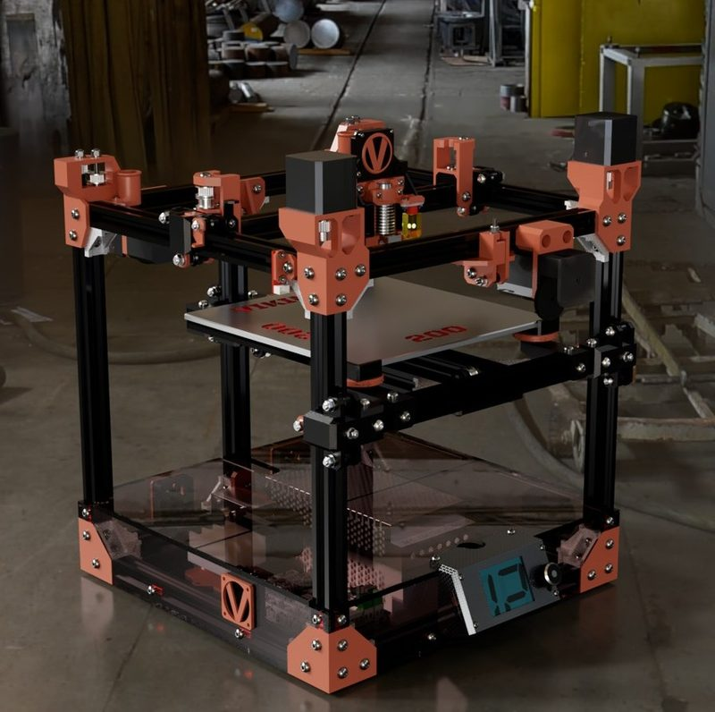</a> | [**V-Baby CoreXY**](https://github.com/RoyBerntsenDesign/V-Baby-CoreXY) *Roy Berntsen / PRO 3D* Small sibling of the V-King: a desktop CoreXY where V-wheels run in V-slot extrusion and belts drive all three axes. Version 1.2 adds a belted 3:1 Z gear in place of the worm gear. No update since 2021-04. | 200×200×200 | — | 1.2 [2021-04](https://github.com/RoyBerntsenDesign/V-Baby-CoreXY/releases/tag/1.2) |  [💙⁠141](https://www.thingiverse.com/thing:3863246) [🤍⁠76](https://www.myminifactory.com/object/3d-print-101026) [⏯️⁠9.6K](https://www.youtube.com/watch?v=y4W0cese5Mc) [❤️⁠220](https://www.youtube.com/watch?v=y4W0cese5Mc) | [STEP](https://github.com/RoyBerntsenDesign/V-Baby-CoreXY/blob/master/Source%20Files/V-Baby%20V1.2.0%20step%20simplified.step) [CAD](https://github.com/RoyBerntsenDesign/V-Baby-CoreXY/blob/master/Source%20Files/V-Baby%20V1.2.0.f3z) [STL](https://github.com/RoyBerntsenDesign/V-Baby-CoreXY/tree/master/Part%20Print%20Files) [BOM](https://github.com/RoyBerntsenDesign/V-Baby-CoreXY/blob/master/Document%20Library/Bill%20Of%20Materials/V-Baby%20BOM.xlsx) [Config](https://github.com/RoyBerntsenDesign/V-Baby-CoreXY/tree/master/Firmware) | [Facebook](https://www.facebook.com/groups/viking3d/) EN |
|  | [**Tantillus**](https://github.com/Intrinsically-Sublime/Tantillus) *Sublime* Small, portable printer with fishing-line drives and printed or laser-cut enclosure options. It inspired the Tantillus R. No update since 2013. | 100×100×100 | printed: 225×225×300 laser-cut: 240×240×300 | CAD [2013-07](https://github.com/Intrinsically-Sublime/Tantillus/commit/64c1c6ecd790764a1e828ce54a4ee6f9e18b8753) |  [⏯️⁠6.2K](https://www.youtube.com/watch?v=F6E36g0zuRg) | [Files](https://github.com/Intrinsically-Sublime/Tantillus) [Wiki](https://reprap.org/wiki/Tantillus) | [Forum](https://reprap.org/forum/list.php?279) EN inactive |
| <a href="printers/bcn3d-sigma/README.md">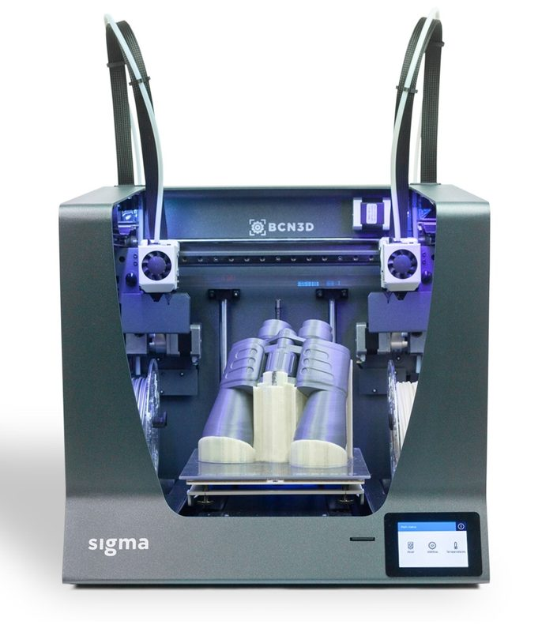</a> | [**BCN3D Sigma / Sigma R19 / Sigmax**](https://github.com/BCN3D/BCN3DSigma-Mechanics) *BCN3D Technologies* IDEX printer with two independent heads on one X beam and a welded aluminium unibody frame, released with SolidWorks CAD, drawings and BOMs. The row covers the Sigma, the Sigma R19 and the wide Sigmax. No update since 2019-10. | Sigma, R19: 210×297×210 Sigmax: 420×297×210 | Sigma, R19: 465×440×? Sigmax: 675×440×? | v0.1 [2019-10](https://github.com/BCN3D/BCN3DSigmaR19/releases/tag/v0.1) |  [⏯️⁠161K](https://www.youtube.com/watch?v=q7UxQWz5Nm8) [❤️⁠310](https://www.youtube.com/watch?v=q7UxQWz5Nm8) | [CAD](https://github.com/BCN3D/BCN3DSigma-Mechanics/tree/master/CAD) Sigma [BOM](https://github.com/BCN3D/BCN3DSigma-Mechanics/blob/master/BOM.pdf) Sigma [STEP](https://github.com/BCN3D/BCN3DSigmaR19/blob/master/CAD/BCN3DSigma%20R19.STEP.zip) R19 [Files](https://github.com/BCN3D/BCN3DSigmaR19/tree/master/PDF) R19 [STEP](https://github.com/BCN3D/BCN3DSigmax-Mechanics/tree/master/CAD/STEP) Sigmax [BOM](https://github.com/BCN3D/BCN3DSigmax-Mechanics/blob/master/BOM%20Sigmax.pdf) Sigmax | — |
|  | [**Little Cube**](https://www.thingiverse.com/thing:4487878) *longlh / looong-made* CoreXY with a 100 × 100 × 100 mm print volume, fixed bed, and belt-driven Z; an involved self-sourced build. No update since 2020 and no active group. | 100×100×100 | — | First release [2020-06](https://www.thingiverse.com/thing:4487878) | [💙⁠105](https://www.thingiverse.com/thing:4487878) | [Files](https://www.thingiverse.com/thing:4487878/files) | — |
| <a href="printers/ratrig-v-origin/README.md">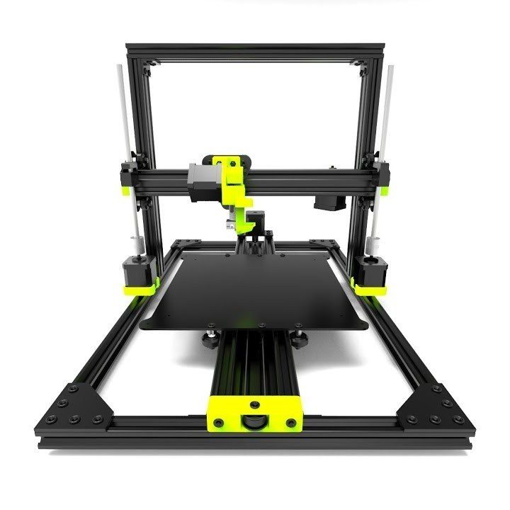</a> | [**Rat Rig V-Origin**](https://www.thingiverse.com/thing:3443230) *Rat Rig family* Cartesian bedslinger on OpenBuilds parts, with aluminium plates and few printed parts. Rat Rig marks it deprecated. No update since 2019-02. | 250×250×295 | 405×580×? | Files [2019-02](https://www.thingiverse.com/thing:3443230/files) | [💙⁠91](https://www.thingiverse.com/thing:3443230) [⏯️⁠12.4K](https://www.youtube.com/watch?v=6ELITCsie2c) [❤️⁠131](https://www.youtube.com/watch?v=6ELITCsie2c) | [CAD](https://a360.co/2vkpXRS) [STL](https://www.thingiverse.com/thing:3443230/files) [BOM](https://docs.google.com/spreadsheets/d/1NneQarmi92Av1yabjeuD9ZWnH-XDte1QXwP40EmKBBo/edit) [Manual](https://drive.google.com/file/d/1G6Gle4UKW4M9TjeicbE7cGz7B_opFSlW/view) [Video](https://drive.google.com/drive/folders/1TaIGtnsjPD9w8f2wQuvZ7oanVlsiz9wN) | [Facebook](https://www.facebook.com/groups/ratrig3dprintercommunity) EN 19.9K [Discord](https://discord.gg/ratrig) EN 13.8K [Reddit](https://www.reddit.com/r/RatRig/) EN 3K |
| <a href="printers/echorap/README.md">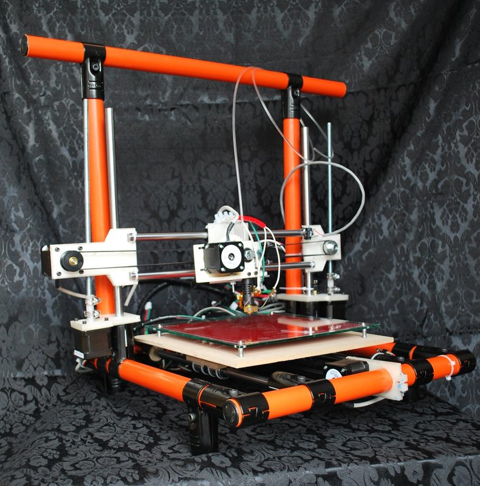</a> | [**EchoRap**](https://reprap.org/wiki/Echorap) *Stéphane Rousseau / Robotic Sequencing* Low-cost Mendel-derived RepRap from the ÉchoFab fab lab in Montreal. The frame is steel tubes joined with tube couplings, and longer tubes enlarge each axis. No update since 2012-10. | 220×220×200 | 510×585×540 | Rev1 [2012-10](https://www.thingiverse.com/thing:32557) | [💙⁠76](https://www.thingiverse.com/thing:32557) [⏯️⁠3.3K](https://www.youtube.com/watch?v=3Qng64k36mw) [❤️⁠1](https://www.youtube.com/watch?v=3Qng64k36mw) | [STL](https://www.thingiverse.com/thing:32557/files) [BOM](https://reprap.org/wiki/Echorap) [Firmware](https://github.com/roboticseq/RSEchoRapSprinterForPrintrBoardRevD) [Video](https://www.youtube.com/watch?v=tCaJwnWEe9o) | — |
|  | [**FuseBox2 / 2R**](https://github.com/alexyu132/fusebox2) *Alex Yu* Earlier compact CoreXY; the creator recommends the 2R rail-gantry variant for a fresh build. Replaced by the FuseBox3. | 2: 210×200×210 2R: 210×205×210 | 390×340×412 | 2R CAD [2019-12](https://github.com/alexyu132/fusebox2/commit/67b5c9bdce200988ecd771d23534e7a76fff9275) |  [💙⁠545](https://www.thingiverse.com/thing:2422839) [💚⁠16](https://makerworld.com/en/models/27001) [⏯️⁠6.3K](https://www.youtube.com/watch?v=aUQ9sjp_YzY) [❤️⁠24](https://www.youtube.com/watch?v=aUQ9sjp_YzY) | [CAD](https://github.com/alexyu132/fusebox2/blob/master/FuseBox2R.skp) [Manual](https://github.com/alexyu132/fusebox2/blob/master/Build%20Tips.md) [BOM](https://github.com/alexyu132/fusebox2#bom) | — |
|  | [**ITopie**](https://github.com/skarab42/RepRap-iTopie) *skarab42* Older framed Cartesian RepRap with released files and a build manual. No update since 2015. | 200×200×230 | 390×440×440 | v2 [2015-11](https://github.com/skarab42/RepRap-iTopie/commit/520b5ebc5bcf347bb984b34748413ea4d1357ede) |  [💙⁠228](https://www.thingiverse.com/thing:888609) | [Manual](https://reprap.org/wiki/ITopie_Build_Manual) [Wiki](https://reprap.org/wiki/ITopie) | [Forum](https://reprap.org/forum/list.php?406) EN |
|  | [**PhoenixDelta**](https://github.com/rolohaun/PhoenixDelta) *Rolohaun* Large experimental delta built around a 350 mm bed; work in progress. No update since 2022-06. | — | — | v136 [2022-06](https://github.com/rolohaun/PhoenixDelta/commit/db586e7d112afa5ce4109a48907ebc12a832534a) |  [⏯️⁠16K](https://www.youtube.com/watch?v=zeQo-jdcAlM) [❤️⁠260](https://www.youtube.com/watch?v=zeQo-jdcAlM) | [STEP](https://github.com/rolohaun/PhoenixDelta/blob/main/Phoenix%20v136.step) [BOM](https://github.com/rolohaun/PhoenixDelta#phoenix-delta) | [Discord](https://discord.gg/rolohaun-3d-946191040682008666) EN 7.8K |
|  | [**Cerberus**](https://github.com/grabercars/Cerberus) *Steve Graber* Tall experimental delta derived from Rostock. No followers, and no update since 2013. | Ø245×560 | — | CAD [2013-07](https://github.com/grabercars/Cerberus/commit/f44c189698d5743c76fa486338614f112379a17b) |  [⏯️⁠78.4K](https://www.youtube.com/watch?v=32bxll7pv9U) [❤️⁠303](https://www.youtube.com/watch?v=32bxll7pv9U) | [Files](https://github.com/grabercars/Cerberus) [Wiki](https://reprap.org/wiki/Cerberus) | [Google Groups](https://groups.google.com/g/deltabot) EN [Forum](https://reprap.org/forum/list.php?178) EN |
|  | [**Denali**](https://github.com/Annex-Engineering/Denali) *Annex Engineering* Scalable enclosed CoreXY with a three-motor moving bed; repository is archived. | 200: 200×200×200 250: 250×250×200 350: 350×350×300 | 200: 380×380×620 250: 430×430×620 350: 530×530×720 | R1.1 [2021-01](https://github.com/Annex-Engineering/Denali/releases/tag/R1.1) |  | [CAD](https://github.com/Annex-Engineering/Denali/tree/master/CAD) [STL](https://github.com/Annex-Engineering/Denali/tree/master/STLs) [BOM](https://docs.google.com/spreadsheets/d/1O3eyVuQ6M4F03MJSDs4Z71_XyNjXL5HFTZr1jsaAtRc/edit) | [Discord](https://discord.gg/MzTR3zE) EN 11.4K |
| <a href="printers/ulticampy/README.md">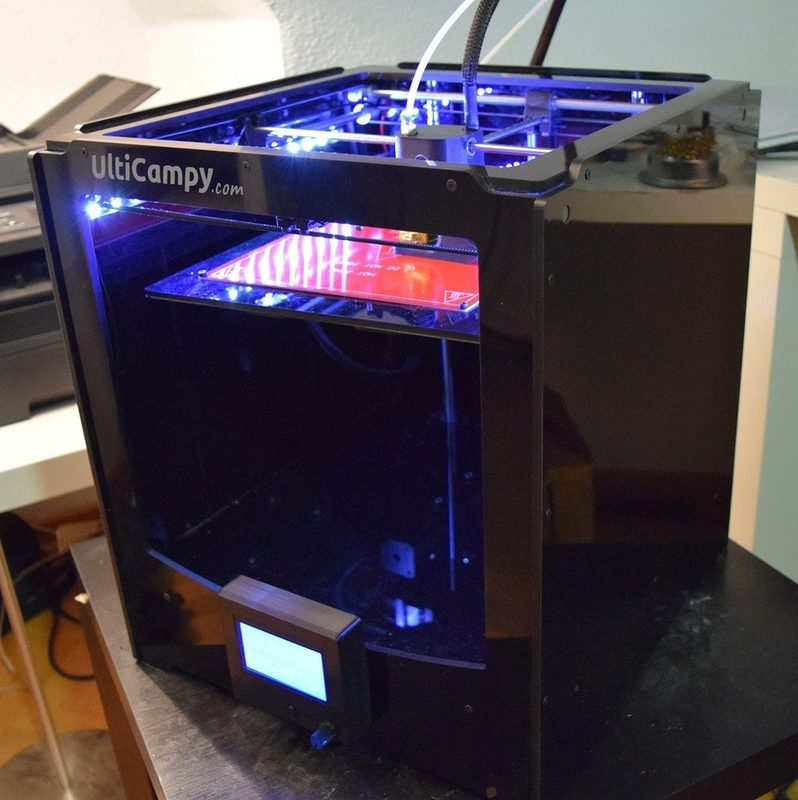</a> | [**Ulticampy**](https://github.com/campy/UlticampyV3) *Juan Campillos / 3DCampy* Ultimaker-style cross-gantry printer in a closed box of CNC-cut panels, built from RepRap parts with a Bowden feed and bronze bushings. V1 has an MDF frame, V2 has black panels, and V3 adds SolidWorks sources and CAM files. No update since 2015-10. | 225×235×200 | — | CAD [2015-10](https://github.com/campy/UlticampyV3/commit/ebac48152278c8273b3421cc69940f300ca900f8) |  [💙⁠196](https://www.thingiverse.com/thing:640166) [⏯️⁠12.7K](https://www.youtube.com/watch?v=YYdzM99KZmc) [❤️⁠15](https://www.youtube.com/watch?v=YYdzM99KZmc) | [Files](https://github.com/campy/UlticampyV3) [STL](https://github.com/campy/UlticampyV3/tree/master/STL%20Printer%20parts) [Firmware](https://github.com/campy/UlticampyV3/tree/master/Frimware%20Ulticampy%20V3) [V2](https://github.com/campy/Ulticampy-V2) [V1](https://github.com/campy/Ulticampy-V1) | — |
| <a href="printers/micro-delta/README.md">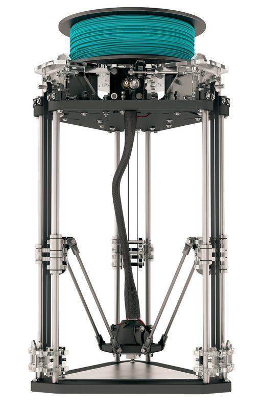</a> | [**µDelta / MicroDelta Rework**](https://github.com/eMotion-Tech/uDelta) *eMotion Tech* Small French delta kit with few screws and a software calibration plugin. The µDelta (2014) has acrylic and wood parts, and the MicroDelta Rework (2016) has steel plates, an aluminium core, and a larger print area. No update since 2017-11. | µDelta: Ø120×190 Rework: Ø150×200 | 250×250×440 | CAD [2017-11](https://github.com/eMotion-Tech/MicroDeltaRework/commit/05652e6ac85632057785f8720d8c781dbe143677) |  [⏯️⁠28.9K](https://www.youtube.com/watch?v=JO8-RkK0Y1A) [❤️⁠51](https://www.youtube.com/watch?v=JO8-RkK0Y1A) | [CAD](https://github.com/eMotion-Tech/MicroDeltaRework) Rework [Manual](https://data.emotion-tech.com/files/microdelta_rework/technical/Documentation%20-%20User%20guide/MicroDelta%20Rework_KIT_Assembly%20instructions.pdf) Rework [Files](https://github.com/eMotion-Tech/uDelta/tree/master/Parts) µDelta [Manual](https://github.com/eMotion-Tech/uDelta/tree/master/assembly) µDelta [Wiki](https://reprap.org/wiki/Micro_Delta) µDelta | — |
| <a href="printers/witbox/README.md">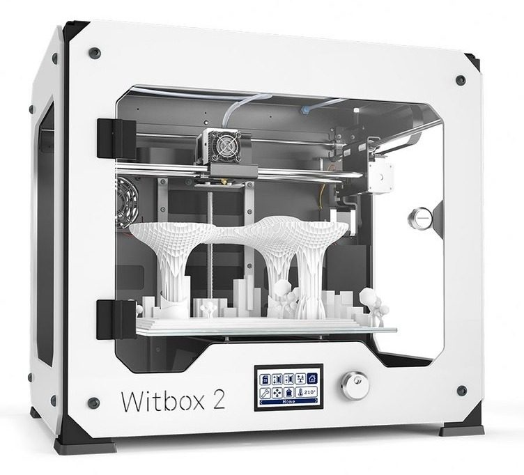</a> | [**bq Witbox / Witbox 2**](https://github.com/bq/witbox-2) *bq* Enclosed Spanish desktop printer with a moving XY head and a Z bed, sold fully assembled and released with CC BY-SA sources. Versions: the first Witbox with Inventor, STEP, and FreeCAD files, and the 2015 Witbox 2 with a STEP model and electronics sources. No update since 2016-04. | 2: 297×210×200 | — | 2 STEP [2015-11](https://github.com/bq/witbox-2/commit/f4445575270c3df5d6a8b3285e9c9b3b22cb3ff1) |  [⏯️⁠40.4K](https://www.youtube.com/watch?v=_dJlHRiK4JY) [❤️⁠84](https://www.youtube.com/watch?v=_dJlHRiK4JY) | [STEP](https://github.com/bq/witbox-2/blob/master/Mechanical%20Design/Mechanics_Witbox2.zip) [BOM](https://github.com/bq/witbox-2/blob/master/Witbox2-LOM.ods) [Files](https://github.com/bq/witbox-2/tree/master/Electronic%20Design) [Firmware](https://github.com/bq/Marlin) [STEP](https://github.com/bq/witbox/blob/master/autodesk-inventor/step/Witbox-assembly-original_v04.stp.zip) old 1 [CAD](https://github.com/bq/witbox/tree/master/freecad) old 1 [BOM](https://github.com/bq/witbox/blob/master/Witbox-BOM.ods) old 1 | — |
| <a href="printers/cairo-mini/README.md">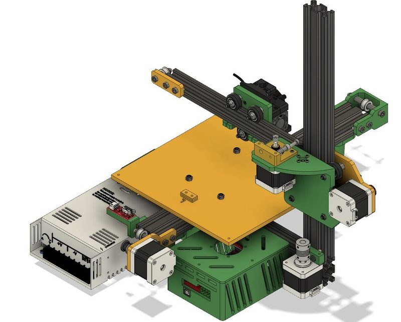</a> | [**Cairo Mini**](https://makesomestuff.org/cairo-3d-printer/) *Ahmed Ibrahim / Make Some Stuff* Low-cost Egyptian bed-slinger with one Z column, OpenBuilds extrusions, and laser-cut acrylic plates. No update since 2022-08. | 200×200×? | — | Files [2022-08](https://makesomestuff.org/cairo-3d-printer/) | [💙⁠32](https://www.thingiverse.com/thing:5317471) [⏯️⁠2K](https://www.youtube.com/watch?v=0Tp4MT6AKvg) [❤️⁠18](https://www.youtube.com/watch?v=0Tp4MT6AKvg) | [STEP](https://grabcad.com/library/cairo-mini-3d-printer-1) [STL](https://makesomestuff.org/wp-content/uploads/2022/02/Cairo-Mini-3d-printer-STLs.zip) [Files](https://makesomestuff.org/wp-content/uploads/2022/02/Cairo-Mini-3d-printer-DXFs.zip) [BOM](https://docs.google.com/spreadsheets/d/187KG_uXhkyZ2cOBT2ysIGeC7GsLDITJhXSNtQAEOgio/edit) [Manual](https://makesomestuff.org/building-the-structure/) [Firmware](https://makesomestuff.org/wp-content/uploads/2022/12/Marlin-bugfix-2.0.x_updated.zip) | [Facebook](https://www.facebook.com/groups/2085101554986922/) EN |
|  | [**Tantillus R**](https://github.com/toolson/Tantillus_R) *Toolson and Protoprinter* A 2018 rebuild of the Tantillus with a heated bed and fishing-line drives. No update since 2019. | 100×100×100 | 220×220×300 | CAD [2019-01](https://github.com/toolson/Tantillus_R/commit/66ac49aca91cd4d73db92f3ad83a7b9df1d87bf3) |  | [Files](https://github.com/toolson/Tantillus_R) [Wiki](https://reprap.org/wiki/Tantillus_R) | — |
|  | [**RailCore II**](https://github.com/railcore/parts) *RailCore family* Rail-guided, rigid CoreXY. No update since 2020-10. | 300ZL: 300×300×330 300ZLT: 300×300×600 | 300ZL: 572×495×546 300ZLT: 572×495×830 | CAD [2020-10](https://github.com/railcore/parts/commit/45a68a4f941d5f8e2e07596e1877a5b1ad6989ae) |  [💙⁠568](https://www.thingiverse.com/thing:2407174) [🧡⁠19](https://www.printables.com/model/160936) [⏯️⁠6.4K](https://www.youtube.com/watch?v=7e-cUZTqmMM) [❤️⁠47](https://www.youtube.com/watch?v=7e-cUZTqmMM) | [STEP](https://github.com/railcore/parts/tree/HEAD/STEP) | [Facebook](https://www.facebook.com/groups/RailCore/) EN 2.6K [Discord](https://discord.gg/Sy569Hq) EN 742 [Reddit](https://www.reddit.com/r/railcore/) EN 206 |
|  | [**UConduit**](https://github.com/iquizzle/uconduit) *Lee Miller* Early single-belt H-bot with a frame of hardware-store steel conduit and parametric OpenSCAD source. No update since 2013. | 265×250×240 | 485×445×380 | CAD [2013-12](https://github.com/iquizzle/uconduit/commit/3d66a1659d0b6aba79ace77930395a757839446d) |  [💙⁠367](https://www.thingiverse.com/thing:102972) [⏯️⁠22K](https://www.youtube.com/watch?v=73MlaBWCTPU) [❤️⁠50](https://www.youtube.com/watch?v=73MlaBWCTPU) | [Files](https://github.com/iquizzle/uconduit) [Manual](https://hackaday.com/2013/06/12/using-electrical-conduit-for-a-3d-printer-frame/) [BOM](https://github.com/iquizzle/uconduit/blob/HEAD/UCON_BOM.pdf) [Wiki](https://reprap.org/wiki/Uconduit) | — |
|  | [**Dagoma DiscoEasy200**](https://github.com/dagoma3d/STL-DiscoEasy200-Official) *Dagoma* French low-cost Cartesian kit with a moving bed. About 40% of its parts are printed. No update since 2019-07. | 200×200×200 | — | STL [2019-07](https://github.com/dagoma3d/STL-DiscoEasy200-Official/commit/546247fa57ace0d6ab88400405de789029451057) |  [💙⁠178](https://www.thingiverse.com/thing:1754185) [⏯️⁠60.1K](https://www.youtube.com/watch?v=b0K4VhmD5mY) [❤️⁠80](https://www.youtube.com/watch?v=b0K4VhmD5mY) | [STL](https://github.com/dagoma3d/STL-DiscoEasy200-Official/tree/Release/Pi%C3%A8ces%20Imprim%C3%A9es) [Files](https://github.com/dagoma3d/STL-DiscoEasy200-Official) [Manual](https://github.com/dagoma3d/notices) | — |
|  | [**Hbot Pro ST / XL**](https://github.com/campy/Hbot) *3DCampy / 3DEspana* Single-belt H-bot from a former Spanish vendor, with SolidWorks CAD, DXF panels, and Duet firmware; documents are in Spanish. No update since 2022. | 325×325×400 | 550×630×630 | CAD [2022-03](https://github.com/campy/Hbot/commit/8f550f7288705a9960774d909cd47a718f97e8a6) |  [⏯️⁠21.2K](https://www.youtube.com/watch?v=CTP1-fysIOw) [❤️⁠1.1K](https://www.youtube.com/watch?v=CTP1-fysIOw) | [Files](https://github.com/campy/Hbot) [Manual](https://github.com/campy/Hbot/tree/HEAD/Instrucciones%20Hbot%20Pro) | — |
| 📷 | [**Rat Rig V-Core Pro 1.3**](https://github.com/Rat-Rig/V-Core-Pro-1.3) *Rat Rig family* Final V-Core Pro: a CoreXY on 2020 and 2040 V-slot with 3 mm aluminium plates, MGN15 rails on all axes, and a three-point kinematic bed on three Z motors with TR8x8 lead screws. It ships with the EVA 2 carriage and is also an upgrade kit for the Pro 1.1 and 1.2. Replaced by the Rat Rig V-Core 3. No update since 2021-03. | 300: 300×300×300 400: 400×400×400 500: 500×500×500 | — | Pro 1.3 [2021-03](https://github.com/Rat-Rig/V-Core-Pro-1.3/commit/9c0d56da3873094cb1c4e60dda2a2c02fb13f4dd) |  | [CAD](https://github.com/Rat-Rig/V-Core-Pro-1.3/tree/HEAD/cad) [BOM](https://github.com/Rat-Rig/V-Core-Pro-1.3/tree/HEAD/docs/bom) [Manual](https://wiki.ratrig.com/build-guides/v-core-13) | [Facebook](https://www.facebook.com/groups/ratrig3dprintercommunity) EN 19.9K [Discord](https://discord.gg/ratrig) EN 13.8K [Reddit](https://www.reddit.com/r/RatRig/) EN 3K |
| <a href="printers/seckit-sk-300/README.md">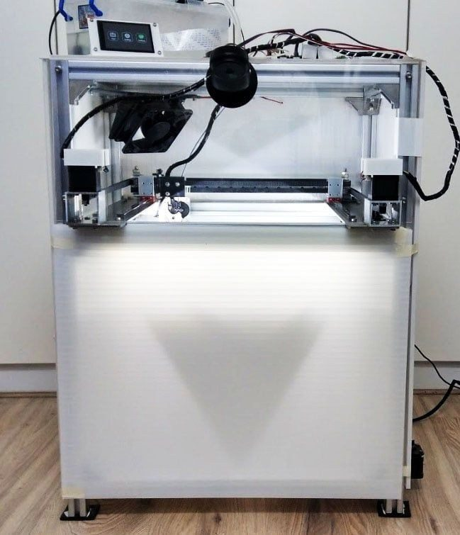</a> | [**SecKit SK-300 / SK-600**](https://github.com/SecKit/SK-300_SK-600) *SecKit family* All-metal CoreXY frame kit on 3030 extrusion with MGN12 rails, servo XY motors, and a water-cooled extruder. SK-300 and SK-600 differ in Z height. No update since 2019-11. | SK-300: ?×?×300 SK-600: ?×?×600 | — | Files [2019-11](https://github.com/SecKit/SK-300_SK-600/commit/79827b6d206d8ea0f3f24df997df5e887371b192) |  [💙⁠27](https://www.thingiverse.com/thing:3611127) [⏯️⁠5.9K](https://www.youtube.com/watch?v=K5naAu8HsZ4) [❤️⁠25](https://www.youtube.com/watch?v=K5naAu8HsZ4) | [STL](https://github.com/SecKit/SK-300_SK-600/tree/master/printed%20parts%20STL) [Files](https://github.com/SecKit/SK-300_SK-600/tree/master/frame%20spec) [Manual](https://github.com/SecKit/SK-300_SK-600/blob/master/assembly%20manual/%5Ben%5D%20SecKit%20SK-300%20Assembly%20Manual.pdf) | [Facebook](https://www.facebook.com/groups/SecKitCoreXY3DP/) EN 2.6K |
|  | [**CrazyCreatorCube**](https://crazycreatorcube.notion.site/CrazyCreatorCube-9c3a3c3e242b42e78920e49dc1d180df) *Andreas Fricke and team* CoreXY toolchanger for up to four tools with a magnetic kinematic coupling, based on the E3D toolchanger motion system. The files stopped at Beta 0.9.6. No update since 2020-11. | 350×330×400 | 600×600×600 | Files [2020-11](https://crazycreatorcube.notion.site/c3ee2eca588f40cfa626e6a32b98aae4) | [💙⁠14](https://www.thingiverse.com/thing:4111728) [🧡⁠12](https://www.printables.com/model/100893) [⏯️⁠2K](https://www.youtube.com/watch?v=ieHzbuYLtvw) [❤️⁠21](https://www.youtube.com/watch?v=ieHzbuYLtvw) | [Files](https://crazycreatorcube.notion.site/36e3e15898e84799a97ddfb9b4dca4f0) [BOM](https://crazycreatorcube.notion.site/ed57916179c4499496eb0558b678a58c) [Manual](https://crazycreatorcube.notion.site/a64bb78a88fa46268ef8e895a60c252a) [Config](https://github.com/CrazyCreatorCube/Software/tree/HEAD/Firmware) | [Discord](https://discord.gg/WKWhDyq) EN 122 [Facebook](https://www.facebook.com/groups/crazycreatorcube/) |
|  | [**Cranestyle Mini**](https://github.com/whosawhatsis/cranestyle-mini) *Whosawhatsis* Small crane-style Cartesian, nicknamed "Cute", with a single Z column, a cantilever X arm, and a moving bed. The repo has OpenSCAD parts only, with no README or BOM. No update since 2017-06. | — | — | CAD [2017-06](https://github.com/whosawhatsis/cranestyle-mini/commit/e6e194223795b807f1e9c1163c4df5e4f9dde5d6) |  | [CAD](https://github.com/whosawhatsis/cranestyle-mini) | — |
| <a href="printers/mondrian/README.md">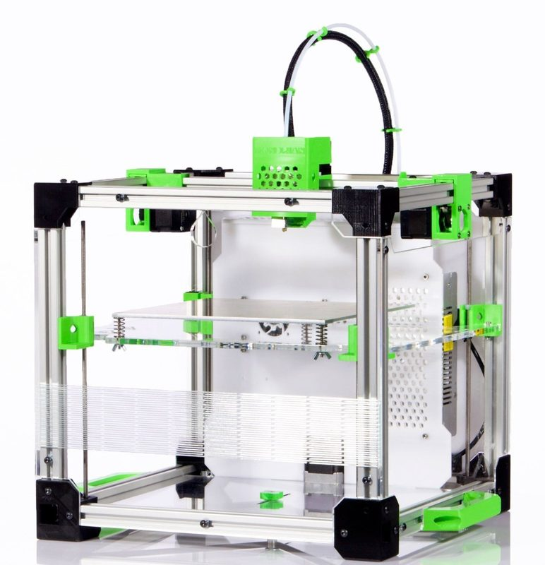</a> | [**Mondrian**](https://reprap.org/wiki/Mondrian) *Emmanuel Gilloz* Modular Cartesian RepRap. The 20×20 mm extrusion frame is the linear guide for all three axes. Open Edge offered version 3.0 as a kit on Kickstarter in 2015. No update since 2016-09. | 200×200×200 | 240×240×? | 3.0 [2016-09](https://github.com/OpenEdge/Mondrian3/commit/19e97ebabb76139520f8f536f755c1b2fb436180) |  [💙⁠260](https://www.thingiverse.com/thing:22956) [⏯️⁠4.9K](https://www.youtube.com/watch?v=iblqWGGPKoU) [❤️⁠12](https://www.youtube.com/watch?v=iblqWGGPKoU) | [CAD](https://github.com/OpenEdge/Mondrian3/tree/master/source) 3.0 [STL](https://github.com/OpenEdge/Mondrian3/tree/master/hardware/STL) 3.0 [Firmware](https://github.com/OpenEdge/Mondrian3/tree/master/firmware) 3.0 [Files](https://github.com/OpenEdge/Mondrian2.5) 2.5 [Files](https://github.com/OpenEdge/Mondrian2.2) 2.2 [Files](https://github.com/OpenEdge/Mondrian2.1) 2.1 [Files](https://github.com/OpenEdge/Mondrian2.0) 2.0 [Files](https://github.com/OpenEdge/Mondrian1) 1 [Wiki](https://reprap.org/wiki/Mondrian) | [Forum](https://reprap.org/forum/list.php?283) EN inactive |
| <a href="printers/mooncake/README.md">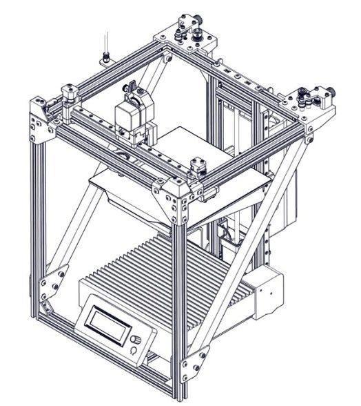</a> | [**MoonCake**](https://blog.cosple.com/p/mooncake-3d-printer.html) *Cosple* HyperCube conversion with a remixed CoreXY Frame v2.0 gantry and a cantilevered bed. The author rebuilt his HyperCube with about $130 of new parts, and a build from scratch is also possible. No update since 2024-09. | 235×235×235 | — | Files [2024-09](https://www.thingiverse.com/thing:6750788/files) | [💙⁠10](https://www.thingiverse.com/thing:6750788) [⏯️⁠11](https://www.youtube.com/watch?v=dsfZC68hlRk) [❤️⁠1](https://www.youtube.com/watch?v=dsfZC68hlRk) | [STEP](https://drive.google.com/drive/folders/1WUbSV5v8jRJC_n0Rr_Xp8Tz_RwKdh0l9) [CAD](https://drive.google.com/drive/folders/19EnLLluydvubGU_bFZdw_DULscENRd3Q) [STL](https://drive.google.com/drive/folders/1lboVt4HrINnv_04e_-BZ7Ns2sOPO7DR2) [BOM](https://docs.google.com/spreadsheets/d/1MVMqGYyTMESelgtg1oHkVLwO6pQapZF-s05zPe9S6Ss/edit) [Config](https://drive.google.com/drive/folders/1Zp4zCJq6PAArV6sGPy5wrHUU07uxivh9) [Video](https://www.youtube.com/watch?v=dsfZC68hlRk) | — |
|  | [**RepRapPro Fisher 1**](https://github.com/reprappro/Fisher) *RepRapPro* Compact panel-frame delta with released STEP, DXF, and STL files and complete archived build instructions. RepRapPro closed, and there is no update since 2015. | Ø150×150 | — | Fisher 1 [2015-10](https://github.com/reprappro/Fisher/commit/3763feae76a749156fb1b7430c6995d73042990d) |  [⏯️⁠5.1K](https://www.youtube.com/watch?v=AAedSxTJ1j8) [❤️⁠18](https://www.youtube.com/watch?v=AAedSxTJ1j8) | [STEP](https://github.com/reprappro/Fisher/tree/master/step) [Manual](https://reprapltd.com/reprappro/documentation/fisher-1/index.html) | [Forum](https://reprap.org/forum/list.php?409) EN [Forum](https://reprap.org/forum/list.php?178) EN |
|  | [**MiniCube (Kotvic)**](https://www.thingiverse.com/thing:4795475) *Kotvic* Compact CoreXY with Fusion 360 files; marked work in progress and missing assembly instructions. No update since 2021 and no active group. | 149×140×135 | 265×265×265 | First release [2021-03](https://www.thingiverse.com/thing:4795475) | [💙⁠9](https://www.thingiverse.com/thing:4795475) | [Files](https://www.thingiverse.com/thing:4795475/files) | — |
|  | [**SecKit SK-Cube**](https://github.com/SecKit/SK-Cube) *SecKit family* Smaller self-sourceable 200 mm CoreXY. No update since 2024-10. | 200×200×200 | — | CAD [2024-10](https://github.com/SecKit/SK-Cube/commit/511a88e391036c4d58976461c35562cc03a3d76a) |  [⏯️⁠4.4K](https://www.youtube.com/watch?v=wUzZTefc6xk) [❤️⁠42](https://www.youtube.com/watch?v=wUzZTefc6xk) | [STEP](https://github.com/SecKit/SK-Cube/tree/main/STEP%20files) [BOM](https://github.com/SecKit/SK-Cube/tree/main/self-sourcing%20components) [Manual](https://sites.google.com/view/seckit-wiki/sk-cube-200x200x200/assembly-manual/sk-cube-assembly-manual) | [Facebook](https://www.facebook.com/groups/SecKitCoreXY3DP/) EN 2.6K |
| <a href="printers/workhorse/README.md">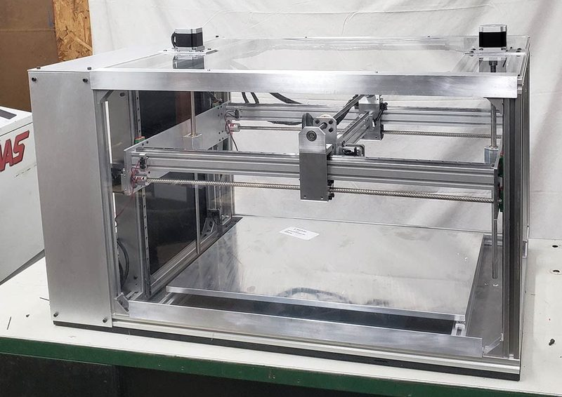</a> | [**WorkHorse**](https://github.com/shanehooper/WorkHorse3DPrinter) *Shane Hooper / 3D Distributed* Large fixed-bed gantry Cartesian that drives X, Y, and Z with lead screws instead of belts. Versions are the Pilot Printer (2017), WorkHorse V1 and V2, and the 600 mm WorkHorse XL. No update since 2022-05. | 650×350×350 XL: 600×600×600 | — | Log [2022-05](https://hackaday.io/project/177793/log/206423-upgraded-z-axis-stepper-motor-mounts) |  [💙⁠179](https://www.thingiverse.com/thing:2764064) [⏯️⁠34.3K](https://www.youtube.com/watch?v=Wc8GtOipFH0) [❤️⁠251](https://www.youtube.com/watch?v=Wc8GtOipFH0) | [STEP](https://cdn.hackaday.io/files/1777937606695712/Workhorse%20Printer%20v150.step) [CAD](https://github.com/shanehooper/WorkHorse3DPrinter/blob/main/Workhorse%20Printer%20v150.zip) [BOM](https://drive.google.com/file/d/1DFuWNZOoG8Cqf1KFIUr0Qn61HkigWl7B/view) [Manual](https://3ddistributed.com/3d-printer-assembly-instructions/) [Config](https://drive.google.com/drive/folders/17vdb16JmCTgNdajL9iVTMRIMCVJ3nyBD) [Files](https://www.thingiverse.com/thing:2638636) old Pilot | [Facebook](https://www.facebook.com/groups/advanced3dprinter) EN |
| <a href="printers/polar-printer-v2/README.md">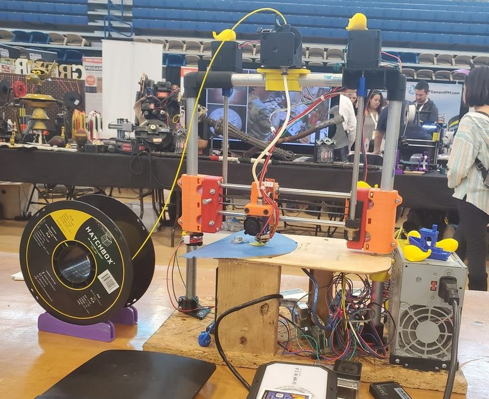</a> | [**Polar printer v2**](https://www.thingiverse.com/thing:4032809) *Rob Mink* Polar printer with a rotating half-round bed and a radial arm on one Z column. Version 2 is a full redesign of the machine that Rob Mink showed at ERRF 2019. The page is marked work in progress. No update since 2019-12. | — | — | Files [2019-12](https://www.thingiverse.com/thing:4032809/files) | [💙⁠8](https://www.thingiverse.com/thing:4032809) [⏯️⁠2K](https://www.youtube.com/watch?v=9lM06mLXj50) [❤️⁠39](https://www.youtube.com/watch?v=9lM06mLXj50) | [Files](https://www.thingiverse.com/thing:4032809/files) v2 [Firmware](https://github.com/RobMink/UpdatedPolarFirmware---Marlin) [CAD](https://github.com/RobMink/Polar) v1 [Video](https://www.youtube.com/watch?v=5Q1t9RF6neE) | [Discord](https://discord.gg/NTDZMsCwXh) EN 888 |
|  | [**Cerberus Pup**](https://github.com/grabercars/Cerberus_Pup_170_GT2_belt_drive) *Steve Graber* Small delta from the Cerberus line with magnetic ball joints and a hinged hotend that works as the Z probe. Versions are the first Pup with a spectra-line drive (2013-08) and the Pup 170 GT2 with belts (2014-01). No update since 2014-01. | Ø170×175 | ?×?×500 | CAD [2014-01](https://github.com/grabercars/Cerberus_Pup_170_GT2_belt_drive/commit/86395df7d50b7719e71c8342dd7ff87961720b6b) |  [⏯️⁠8.5K](https://www.youtube.com/watch?v=Ypm4oHYM4Uo) [❤️⁠25](https://www.youtube.com/watch?v=Ypm4oHYM4Uo) | [Files](https://github.com/grabercars/Cerberus_Pup_170_GT2_belt_drive) 170 GT2 [BOM](https://github.com/grabercars/Cerberus_Pup_170_GT2_belt_drive/blob/master/CERBERUS%20PUP%20170%20GT2%20PARTS%20BOM.pdf) 170 GT2 [Firmware](https://github.com/grabercars/Marlin_FW-for-Cerberus_Pup_GT2_Belt) 170 GT2 [Files](https://github.com/grabercars/pup) old Pup | [Google Groups](https://groups.google.com/g/deltabot) EN [Forum](https://reprap.org/forum/list.php?178) EN |
| <a href="printers/tobeca/README.md">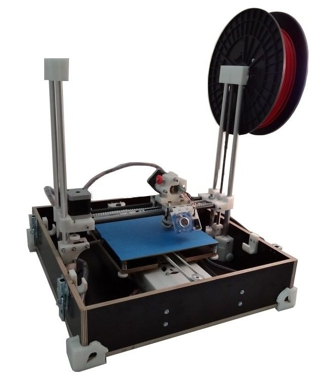</a> | [**Tobeca 2**](https://github.com/tobeca/Tobeca2) *Adrien Grelet / Tobeca* French Cartesian printer that folds into its own wooden carrying case, sold as a kit with open files. Versions are the Tobeca of 2013 and the Tobeca 2 of 2014 to 2017. No update since 2017-01. | Tobeca 2: 200×200×250 Tobeca: 200×200×220 | open: 440×414×430 closed: 440×414×175 | CAD [2017-01](https://github.com/tobeca/Tobeca2/commit/f4495f5a51f7b09e82490aa3095d12cbda40ffb6) |  [💙⁠131](https://www.thingiverse.com/thing:147011) | [CAD](https://github.com/tobeca/Tobeca2/tree/master/SKP) Tobeca 2 [STL](https://github.com/tobeca/Tobeca2/tree/master/STL) Tobeca 2 [BOM](https://github.com/tobeca/Tobeca2/blob/master/PARTS%20LIST%203.3.ods) Tobeca 2 [Firmware](https://github.com/tobeca/Tobeca2/tree/master/FW) Tobeca 2 [Files](https://github.com/pyroboynroses/Tobeca) old Tobeca [BOM](https://github.com/pyroboynroses/Tobeca/blob/master/BOM.ods) old Tobeca [Wiki](https://reprap.org/wiki/Tobeca) old Tobeca | — |
|  | [**Clock 3**](https://github.com/jon-harper/clock-3) *Jon Harper* Enclosed, temperature-controlled prototype; development is halted and the full Fusion assembly was not released. | 300×300×350 | 640×675×875 | Log [2022-06](https://github.com/jon-harper/clock-3/blob/main/docs/status/changelog.md#2022-06-18) |  | [BOM](https://github.com/jon-harper/clock-3/tree/main/BOM) [STL](https://github.com/jon-harper/clock-3/tree/main/STL) [Manual](https://github.com/jon-harper/clock-3/tree/main/docs) | — |
| <a href="printers/alto/README.md">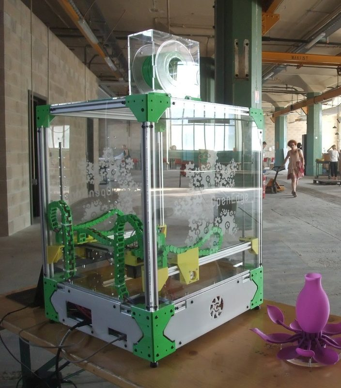</a> | [**Alto**](https://github.com/OpenEdge/Alto1) *Emmanuel Gilloz / OpenEdge* Enclosed, scalable Cartesian RepRap on 20×20 extrusion. The frame is the linear guide for all three axes, and the same printed parts build a small cube or a large frame. Builds were made for schools and companies in France. No update since 2016-02. | A-333: 300×300×300 A-422: 400×200×200 A-444: 400×400×400 | — | CAD [2016-02](https://github.com/OpenEdge/Alto1/commit/147f4b5a704367a76029858cd078e892beff00fa) |  [⏯️⁠1.2K](https://www.youtube.com/watch?v=nIDGWXvktuU) [❤️⁠2](https://www.youtube.com/watch?v=nIDGWXvktuU) | [CAD](https://github.com/OpenEdge/Alto1/tree/master/source) [Files](https://github.com/OpenEdge/Alto1/tree/master/hardware) [Config](https://github.com/OpenEdge/Alto1/tree/master/firmware/Smoothieboard_5X) [Wiki](https://reprap.org/wiki/Alto) | — |
| <a href="printers/ucorexy/README.md">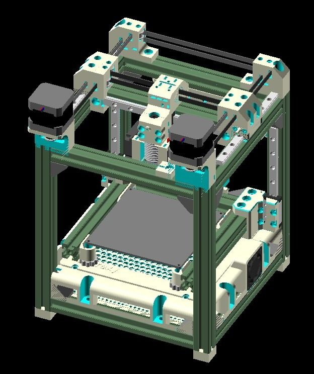</a> | [**ucorexy**](https://github.com/aleknest/ucorexy) *aleknest* Small parametric OpenSCAD CoreXY on 2020 extrusion and MGN9 rails, with Klipper config and two bed sizes (120 and 220 mm). No update since 2022-03. | 120 bed: 105×105×80 220 bed: — | — | CAD [2022-03](https://github.com/aleknest/ucorexy/commit/63121a71f5a127e5f168eab8a1f0a8e498ca1458) |  | [CAD](https://github.com/aleknest/ucorexy/blob/main/ucorexy.scad) [STL](https://github.com/aleknest/ucorexy/tree/main/produce/ucorexy_bed120mm) 120 bed [STL](https://github.com/aleknest/ucorexy/tree/main/produce/ucorexy_bed220mm) 220 bed [BOM](https://github.com/aleknest/ucorexy/blob/main/bom.txt) [Config](https://github.com/aleknest/ucorexy/blob/main/printer.cfg) | — |
|  | [**Rook E3**](https://github.com/Kanrog/Rook-E3) *Kanrog / Rook family* Rook 2020 mod that turns the parts of an Ender 3 V2 into a CoreXY. Only the STEP model is public, and the creator calls it obsolete next to the Rook 2020 Scalable and the Ender-3 NG. No update since 2023-05. | 230×230×300 | — | STEP [2023-05](https://github.com/Kanrog/Rook-E3/commit/704e7449ef641c0bc947157f32905275587d2188) |  [🧡⁠76](https://www.printables.com/model/487388-rook-e3) | [STEP](https://www.printables.com/model/487388-rook-e3/files) [Original](https://www.printables.com/model/447255-rook-2020-mk1) | [Discord](https://discord.gg/rolohaun-3d-946191040682008666) EN 7.8K |
|  | [**Cairo30**](https://makesomestuff.org/cairo30-3d-printer/) *Ahmed Ibrahim / Make Some Stuff* Larger successor of the [Cairo Mini](#cairo-mini) with a two-post gantry, OpenBuilds extrusions, and laser-cut acrylic plates. No update since 2023-01. | 300×300×350 | — | Files [2023-01](https://makesomestuff.org/cairo30-3d-printer/) | [💙⁠2](https://www.thingiverse.com/thing:5832418) [⏯️⁠1.3K](https://www.youtube.com/watch?v=MpDkiP7E44c) [❤️⁠18](https://www.youtube.com/watch?v=MpDkiP7E44c) | [STEP](https://grabcad.com/library/cairo30-3d-printer-1) [STL](https://makesomestuff.org/wp-content/uploads/2022/12/Cairo30_STLs.zip) [Files](https://makesomestuff.org/wp-content/uploads/2022/12/Cairo30_DXFs.zip) [BOM](https://docs.google.com/spreadsheets/d/11ssOeSZUKrPMiOd8EV-hkTQURSHo0WZH6QxySQ_BI0A/edit) [Manual](https://makesomestuff.org/cairo30-3d-printer-building-the-structure/) [Firmware](https://makesomestuff.org/wp-content/uploads/2022/12/Marlin-bugfix-2.0.x_Cairo30.zip) | [Facebook](https://www.facebook.com/groups/2085101554986922/) EN |
|  | [**Delteron**](https://github.com/Apsu/delteron) *Apsu* Colinear Tripteron in a linear-delta frame. Three towers drive arms that hang the effector from above, with linear kinematics that need custom firmware code. No update since 2017-01. | — | — | CAD [2017-01](https://github.com/Apsu/delteron/commit/d3e515120f3ed0c558a1e7e840fbe96bb36307c9) |  [💙⁠121](https://www.thingiverse.com/thing:1948394) [⏯️⁠28.6K](https://www.youtube.com/watch?v=-PqMazYsqIQ) [❤️⁠259](https://www.youtube.com/watch?v=-PqMazYsqIQ) | [STL](https://github.com/Apsu/delteron) [Files](https://www.thingiverse.com/thing:1948394/files) [Firmware](https://github.com/Apsu/Smoothieware/blob/edge/src/modules/robot/arm_solutions/ColinearTripteronSolution.cpp) [Video](https://www.youtube.com/watch?v=-PqMazYsqIQ) | [Forum](https://reprap.org/forum/read.php?166,719575) EN inactive |
| <a href="printers/frax3d/README.md">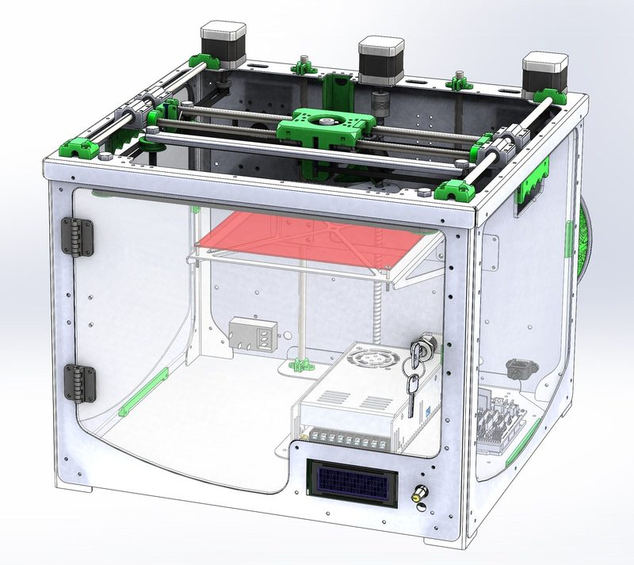</a> | [**Frax3D**](https://github.com/frax3d/Frax3D) *FraxDesign / BCN Dynamics* CoreXY with a frame of folded stainless steel sheet, an acrylic door, and an E3D hotend. BCN Dynamics sold it as a kit. The repository has STEP and STL files for each printed, sheet-metal, and acrylic part. No update since 2016-04. | — | — | STEP [2016-04](https://github.com/frax3d/Frax3D/commit/39f3a5f6a0f7c56962bbd95b6f747f53c8458072) |  [💙⁠87](https://www.thingiverse.com/thing:1489094) [⏯️⁠17.4K](https://www.youtube.com/watch?v=fQFrWCCibYs) [❤️⁠572](https://www.youtube.com/watch?v=fQFrWCCibYs) | [Files](https://github.com/frax3d/Frax3D) [STL](https://www.thingiverse.com/thing:1489094/files) | — |

## Historical designs

Designs that shaped later printers and no longer get updates. They are useful for learning and restoration. A design that is still updated or sold, such as the Voron 2.4 or the Prusa i3 MK4, stays in its motion-system section. A wiki page here can describe a design without a complete build package.

| Photo | Printer and why it’s interesting | Build volume (X×Y×Z) | Exterior (W×D×H) | Latest version | Stars Likes Views | Links | Groups |
| --- | --- | --- | --- | --- | --- | --- | --- |
|  | [**HyperCube**](https://www.thingiverse.com/thing:1752766) *Tech2C* Influential extrusion-frame DIY CoreXY. Base and idea for many later cube builds. | 200×200×155 | 380×343×350 | Log [2020-01](https://www.thingiverse.com/thing:1752766) | [💙⁠15K](https://www.thingiverse.com/thing:1752766) [⏯️⁠280K](https://www.youtube.com/watch?v=xFt7vzweUiw) [❤️⁠2.2K](https://www.youtube.com/watch?v=xFt7vzweUiw) | [Files](https://www.thingiverse.com/thing:1752766/files) | [Facebook](https://www.facebook.com/groups/1871049783171141/) EN 6.9K inactive [Facebook](https://www.facebook.com/groups/139876176592778/) PT 2K inactive [Facebook](https://www.facebook.com/groups/hypercubesupport/) EN 1.8K inactive |
|  | [**HyperCube Evolution**](https://www.thingiverse.com/thing:2254103) *SCOTT_3D* Aluminum-extrusion evolution of the HyperCube, and the most built DIY CoreXY before Voron. | 300×300×300 | 480×470×500 | Log [2017-07](https://www.thingiverse.com/thing:2254103) | [💙⁠11.9K](https://www.thingiverse.com/thing:2254103) [⏯️⁠362K](https://www.youtube.com/watch?v=1rctCsUGnX8) [❤️⁠2.3K](https://www.youtube.com/watch?v=1rctCsUGnX8) | [Files](https://www.thingiverse.com/thing:2254103/files) | [Facebook](https://www.facebook.com/groups/Hypercubeevolution/) EN 14.8K inactive [Facebook](https://www.facebook.com/groups/1871049783171141/) EN 6.9K inactive [Facebook](https://www.facebook.com/groups/hevopro/) EN 3K inactive [Facebook](https://www.facebook.com/groups/HypercubeEvoDeutsch/) DE 2.1K inactive [Facebook](https://www.facebook.com/groups/139876176592778/) PT 2K inactive [Facebook](https://www.facebook.com/groups/hypercubeevolutionfr/) FR 1.6K inactive |
|  | [**BLV MGN Cube**](https://www.thingiverse.com/thing:3382718) *BLV* Cube design built around linear rails. It made linear rails common on DIY cubes. | 300×300×365 | 576×536×560 | Log [2019-09](https://www.thingiverse.com/thing:3382718) | [💙⁠8.5K](https://www.thingiverse.com/thing:3382718) [🧡⁠142](https://www.printables.com/model/46738) [⏯️⁠115K](https://www.youtube.com/watch?v=N3xaPhAPYKM) [❤️⁠417](https://www.youtube.com/watch?v=N3xaPhAPYKM) | [Files](https://www.thingiverse.com/thing:3382718/files) | [Facebook](https://www.facebook.com/groups/BenLevi) EN 7K [Facebook](https://www.facebook.com/groups/578496329454012/) TR 190 [Facebook](https://www.facebook.com/groups/419619945577500/) IT 174 [Facebook](https://www.facebook.com/groups/386234302158871/) DE 158 |
|  | [**D-Bot**](https://www.thingiverse.com/thing:1001065) *spauda01* Extrusion-frame DIY CoreXY derived from the C-Bot, with a large modding community. | configurable | — | Files [2017-06](https://www.thingiverse.com/thing:1001065/files) | [💙⁠7.6K](https://www.thingiverse.com/thing:1001065) | [Files](https://www.thingiverse.com/thing:1001065/files) | [Facebook](https://www.facebook.com/groups/881368788659827/) RU 258 [Facebook](https://www.facebook.com/groups/1711323699127948/) EN 5K inactive [Telegram](https://t.me/cbotdbotcorexy) ES 260 |
|  | [**Rostock**](https://reprap.org/wiki/Rostock) *Johann C. Rocholl* Foundational parallel-arm delta, and the first popular delta printer. | Ø200×400 | — | CAD [2012-07](https://github.com/jcrocholl/rostock/commit/bd5bcebd93ce10676dd72583e95322dceb57ef08) | [💙⁠3.1K](https://www.thingiverse.com/thing:17175) [⏯️⁠388K](https://www.youtube.com/watch?v=AYs6jASd_Ww) [❤️⁠982](https://www.youtube.com/watch?v=AYs6jASd_Ww) | [CAD](https://github.com/jcrocholl/rostock) | [Forum](https://reprap.org/forum/list.php?178) EN [Facebook](https://www.facebook.com/groups/delta3dp/) EN 2.7K inactive |
|  | [**Smartrap**](https://reprap.org/wiki/Smartrap_mini) *Smartfriendz* Compact, low-part-count Cartesian RepRap design with a large following. | 250×250×200 | — | CAD [2015-07](https://github.com/smartfriendz/smartrap/commit/5ff51f4ab0f82a5eb2dacf58f4ec6b549e961622) | [💙⁠2.4K](https://www.thingiverse.com/thing:177256) | — | [Forum](https://reprap.org/forum/list.php?344) EN [Facebook](https://www.facebook.com/groups/Smartrap/) EN 64 |
|  | [**Original Ender-3**](https://github.com/Creality3DPrinting/Ender-3) *Creality* The best-selling budget printer, with an open hardware release of its mechanical and electronics files. | 220×220×250 | 440×410×465 | CAD [2018-06](https://github.com/Creality3DPrinting/Ender-3/commit/c94ec770d9ebf4795b31d178da24e0c77cc77167) |  [⏯️⁠319K](https://www.youtube.com/watch?v=yxkwERZXfaQ) [❤️⁠3.5K](https://www.youtube.com/watch?v=yxkwERZXfaQ) | [CAD](https://github.com/Creality3DPrinting/Ender-3/tree/master/Ender-3%20Mechanical) [Firmware](https://github.com/Creality3DPrinting/Ender-3/tree/master/Ender-3%20Firmware%20%28Marlin%29) | [Facebook](https://www.facebook.com/groups/ender3ender3procreality) EN 113K [Discord](https://discord.com/invite/creality) EN 25K [Reddit](https://www.reddit.com/r/ender3/) EN 257K [Telegram](https://t.me/Ender3Spain) ES 5.4K [Reddit](https://www.reddit.com/r/Creality/) EN 76.4K [Telegram](https://t.me/crealitybr) PT 737 |
|  | [**Thing-O-Matic**](https://www.thingiverse.com/thing:4973) *MakerBot* CupCake successor with a new plywood body, 3/8-inch shafts, a stepper-driven cantilever Z stage, Gen4 electronics with USB and endstops, and the Automated Build Platform, a conveyor belt that clears each finished print. | ABP: 100×100×100 Acrylic platform: 110×110×120 | 300×300×400 | Rev I [2011-05](https://www.thingiverse.com/thing:4973/files) | [💙⁠1.1K](https://www.thingiverse.com/thing:4973) [⏯️⁠878](https://www.youtube.com/watch?v=lQ7oprADaY4) [❤️⁠2](https://www.youtube.com/watch?v=lQ7oprADaY4) | [Files](https://www.thingiverse.com/thing:4973/files) [BOM](https://web.archive.org/web/20111215111456/http://www.thingiverse.com/thing:4973/partlist) [Manual](https://web.archive.org/web/20121126083014/http://wiki.makerbot.com/thingomatic-doc:thingomatic-assembly-instructions) [Firmware](https://github.com/makerbot/G3Firmware) | [Google Groups](https://groups.google.com/g/makerbot) EN inactive [Reddit](https://www.reddit.com/r/makerbot/) EN 5.2K |
|  | [**MakerBot Replicator**](https://www.thingiverse.com/thing:18813) *MakerBot* MakerBot's last open printer: a plywood box with a moving-head XY gantry on 8 mm shafts, a Z build platform and optional dual extrusion. The Replicator 2 kept the layout, but MakerBot did not release its body files. | 225×145×150 | 467×320×381 | Files [2012-05](https://www.thingiverse.com/thing:18813/files) | [💙⁠1K](https://www.thingiverse.com/thing:18813) [⏯️⁠563K](https://www.youtube.com/watch?v=DY6VSu-oOws) [❤️⁠521](https://www.youtube.com/watch?v=DY6VSu-oOws) | [Files](https://www.thingiverse.com/thing:18813/files) [Files](https://www.thingiverse.com/thing:16058) MightyBoard [Firmware](https://github.com/makerbot/MightyBoardFirmware) | [Google Groups](https://groups.google.com/g/makerbot) EN inactive [Reddit](https://www.reddit.com/r/makerbot/) EN 5.2K |
|  | [**C-Bot**](https://www.thingiverse.com/thing:500041) *Carl Feniak* V-slot wheel CoreXY on extrusion, and the parent of the D-Bot. | configurable | — | Rework [2016-03](https://www.thingiverse.com/thing:500041/files) | [💙⁠859](https://www.thingiverse.com/thing:500041) | [Files](https://www.thingiverse.com/thing:500041/files) | [Facebook](https://www.facebook.com/groups/1711323699127948/) EN 5K inactive [Telegram](https://t.me/cbotdbotcorexy) ES 260 |
|  | [**HevORT**](https://github.com/MirageC79/HevORT) *MirageC79* Well-known large-format DIY CoreXY community design. The author seems inactive since 2024. | 315: 315×315×340 415: 415×415×440 | — | ZR V2.6 [2024-09](https://github.com/MirageC79/HevORT/commit/c5fda5aa6289384b712de6a05a97f9e8f1eeac27) |  [💙⁠925](https://www.thingiverse.com/thing:3532039) [⏯️⁠728K](https://www.youtube.com/watch?v=ibsBiALMMSE) [❤️⁠10.1K](https://www.youtube.com/watch?v=ibsBiALMMSE) | [Manual](https://github.com/MirageC79/HevORT/tree/HEAD/docs) [BOM](https://github.com/MirageC79/HevORT/tree/HEAD/bom) | [Facebook](https://www.facebook.com/groups/hevort) EN 6.6K [Discord](https://discord.gg/nCYRQAZPWV) EN 3.8K |
| <a href="printers/cupcake-cnc/README.md">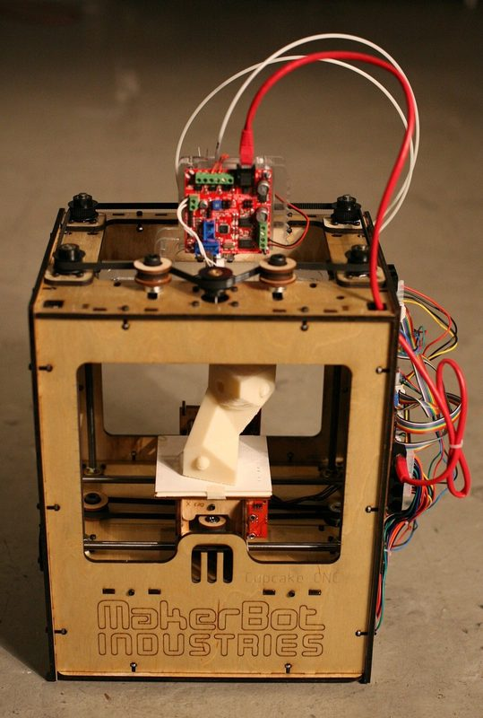</a> | [**CupCake CNC**](https://www.thingiverse.com/thing:457) *MakerBot* MakerBot's first kit and a RepRap derivative: a laser-cut plywood box with a belt-driven X/Y build platform and a Z head on four threaded rods. It started the market for desktop 3D printer kits. | 100×100×130 | 350×240×450 | Batch 5 [2009-11](https://code.google.com/archive/p/makerbot/downloads) | [💙⁠633](https://www.thingiverse.com/thing:457) [⏯️⁠1.9K](https://www.youtube.com/watch?v=4jPKEJ5hQuI) [❤️⁠14](https://www.youtube.com/watch?v=4jPKEJ5hQuI) | [Files](https://www.thingiverse.com/thing:457/files) batch 1–2 [Files](https://storage.googleapis.com/google-code-archive-downloads/v2/code.google.com/makerbot/cupcake-cnc-batch-5.zip) batch 5 [BOM](https://web.archive.org/web/20120827102911/http://wiki.makerbot.com/cupcake-cnc-0:cupcake-parts-list) [Manual](https://web.archive.org/web/20121026124135/http://wiki.makerbot.com/cupcake-cnc-10:build-instructions) [Firmware](https://github.com/makerbot/G3Firmware) | [Google Groups](https://groups.google.com/g/makerbot) EN inactive [Reddit](https://www.reddit.com/r/makerbot/) EN 5.2K |
|  | [**Kossel**](https://reprap.org/wiki/Kossel) *Johann C. Rocholl* The most built delta. Many commercial deltas copy it. | Ø170×240 | — | CAD [2014-05](https://github.com/jcrocholl/kossel/commit/74e086041993af1f0ef2aae6850905a81c1b6bb2) |  [⏯️⁠314K](https://www.youtube.com/watch?v=0Ag3jeObNf8) [❤️⁠462](https://www.youtube.com/watch?v=0Ag3jeObNf8) | [CAD](https://github.com/jcrocholl/kossel) | [Forum](https://reprap.org/forum/list.php?178) EN [Facebook](https://www.facebook.com/groups/delta3dp/) EN 2.7K inactive |
|  | [**Snappy**](https://github.com/revarbat/snappy-reprap) *revarbat* Mostly printed, snap-together Cartesian RepRap. One of the first printers made almost entirely of printed parts. | 198×198×220 | — | v3.0.3 [2018-02](https://github.com/revarbat/snappy-reprap/releases/tag/snappy_3.0.3) |  [💙⁠1.1K](https://www.thingiverse.com/thing:1828359) [⏯️⁠54.6K](https://www.youtube.com/watch?v=3KJbrb0P8jQ) [❤️⁠172](https://www.youtube.com/watch?v=3KJbrb0P8jQ) | [Manual](https://github.com/revarbat/snappy-reprap/tree/HEAD/docs) | [Forum](https://reprap.org/forum/list.php?151) EN |
|  | [**Huxley**](https://reprap.org/wiki/Huxley) *Ed Sells / RepRapPro* Compact early Cartesian RepRap, and the first small RepRap. It began as the RepRap Mini Mendel, then came the RepRapPro Huxley kit and the dual-extruder RepRapPro Huxley Duo. | 140×140×110 | — | Huxley Duo [2015-05](https://github.com/reprappro/huxley-duo/commit/48620590fb0521d3a84cc472c45d9e97e1f0a055) | [💙⁠391](https://www.thingiverse.com/thing:16625) [⏯️⁠950](https://www.youtube.com/watch?v=qj9labKZU9g) [❤️⁠3](https://www.youtube.com/watch?v=qj9labKZU9g) | [Files](https://github.com/reprappro/huxley-duo) Huxley Duo [Files](https://github.com/reprappro/Huxley) RepRapPro [Manual](https://reprapltd.com/reprappro/documentation/huxley/) RepRapPro [Files](https://svn.code.sf.net/p/reprap/code/trunk/huxley/) RepRap original | [Forum](https://reprap.org/forum/list.php?214) EN |
|  | [**Prusa Mendel i2**](https://reprap.org/wiki/Prusa_Mendel) *Josef Prusa* An early simplification of the Mendel, and the most built RepRap of its time. It led to the i3. | 200×200×100 | — | iteration 2 [2012-02](https://github.com/josefprusa/PrusaMendel/commit/c2eb45864bb3021cfa3bfd2fee7b08c1e8e2b15a) |  [⏯️⁠32.5K](https://www.youtube.com/watch?v=40id30dChnU) [❤️⁠180](https://www.youtube.com/watch?v=40id30dChnU) | [CAD](https://github.com/josefprusa/PrusaMendel) | [Forum](https://reprap.org/forum/list.php?151) EN |
|  | [**Tripteron**](https://reprap.org/wiki/Tripteron) *Apsu* A rare working printer with three orthogonal parallel arms. | — | — | First release [2016-11](https://www.thingiverse.com/thing:1903757) | [💙⁠353](https://www.thingiverse.com/thing:1903757) [🧡⁠29](https://www.printables.com/model/157727) [⏯️⁠58.4K](https://www.youtube.com/watch?v=aRaI0pesDN0) [❤️⁠708](https://www.youtube.com/watch?v=aRaI0pesDN0) | — | [Forum](https://reprap.org/forum/read.php?166,719575) EN inactive |
| <a href="printers/ultimaker/README.md">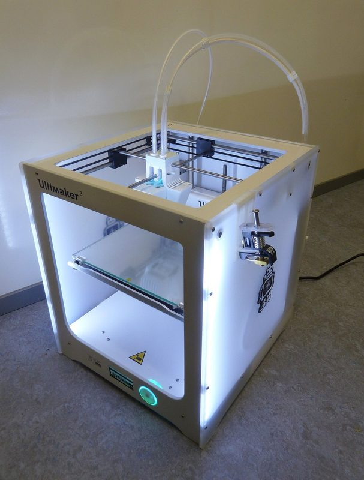</a> | [**Ultimaker (Original to 3)**](https://github.com/Ultimaker/Ultimaker2) *Ultimaker* Open-hardware line that made the moving-head cross gantry and the Bowden feed popular. It grew from the wooden Original and Original+ through the UM2, UM2 Extended, compact UM2 Go, UM2+ and UM2 Extended+ to the dual-extrusion UM3 and UM3 Extended with swappable print cores. | UM3: 215×215×200 UM3 Extended: 215×215×300 UM2, UM2+: 223×223×205 UM2 Extended, Extended+: 223×223×305 UM2 Go: 120×120×115 Original+: 210×210×205 Original: 205×205×200 | UM3: 342×380×389 UM3 Extended: 342×380×489 UM2, UM2+: 342×357×388 UM2 Extended, Extended+: 342×357×488 UM2 Go: 258×250×288 Original+: 357×342×388 | UM2+ [2018-07](https://github.com/Ultimaker/Ultimaker2Plus/commit/830bcb6203b9c5c9794401b153fd75a019132bd2) |  [⏯️⁠379K](https://www.youtube.com/watch?v=ScfMl3u-uT8) [❤️⁠1.2K](https://www.youtube.com/watch?v=ScfMl3u-uT8) | [STEP](https://github.com/Ultimaker/Ultimaker3/blob/master/3D%20model%20Ultimaker%203/9066.STEP.zip) UM3 [BOM](https://github.com/Ultimaker/Ultimaker3/tree/master/BOM) UM3 [Manual](https://um-support-files.ultimaker.com/manuals/user-manual/UM3/Ultimaker%203%20-%20User%20manual%20EN%20v1.4.pdf) UM3 [STEP](https://github.com/Ultimaker/Ultimaker3Extended/blob/master/3D%20model%20Ultimaker%203%20extended/9511.STEP.zip) UM3 Extended [STEP](https://github.com/Ultimaker/Ultimaker2Plus/blob/master/3D%20model%20Ultimaker%202%2B/Main%20assembly%20Ultimaker%202%2B.zip) UM2+ [BOM](https://github.com/Ultimaker/Ultimaker2Plus/tree/master/BOM) UM2+ [STEP](https://github.com/Ultimaker/Ultimaker2ExtendedPlus/blob/master/3D%20model%20Ultimaker2extended%2B/Main%20assembly%20Ultimaker2extended%2B.STEP.zip) UM2 Extended+ [STEP](https://github.com/Ultimaker/Ultimaker2Go/blob/master/3D%20model/UM%202%20GO.STEP) UM2 Go [Manual](https://um-support-files.ultimaker.com/manuals/user-manual/UM2GO/Ultimaker%202%20Go%20-%20User%20manual%20EN%20v2.1.pdf) UM2 Go [STEP](https://github.com/Ultimaker/Ultimaker2/blob/master/Assembly%20UM2%20stepfile.STEP) UM2 [BOM](https://github.com/Ultimaker/Ultimaker2/tree/master/_BOM) UM2 [Manual](https://github.com/Ultimaker/Ultimaker2/blob/master/um2%20assembly%20manual%20V1.1%20_english.pdf) UM2 [STEP](https://github.com/Ultimaker/Ultimaker2Extended/blob/master/3D%20model/UM%20Extended.STEP) UM2 Extended [Files](https://github.com/Ultimaker/Ultimaker-Original-Plus) Original+ [Manual](https://github.com/Ultimaker/Ultimaker-Original-Plus/blob/master/Buildmanual%20UM%20Original%20%2B%20v2.pdf) Original+ [BOM](https://github.com/Ultimaker/UltimakerOriginal/tree/HEAD/BOM) Original | [Forum](https://community.ultimaker.com/) EN [Forum](https://community.ultimaker.com/forum/124-deutsch/) DE [Forum](https://community.ultimaker.com/forum/126-fran%C3%A7ais/) FR [Forum](https://community.ultimaker.com/forum/125-espa%C3%B1ol/) ES [Forum](https://community.ultimaker.com/forum/123-nederlands/) NL [Reddit](https://www.reddit.com/r/ultimaker/) EN 4.6K |
|  | [**Mendel90**](https://github.com/nophead/Mendel90) *nophead* Well-documented sheet-frame Mendel variant, also sold as a kit. | configurable | — | CAD [2018-10](https://github.com/nophead/Mendel90/commit/e0060e806687ef0b93cf8d4ccdb9d789b004228f) |  [💙⁠364](https://www.thingiverse.com/thing:17826) [⏯️⁠8.2K](https://www.youtube.com/watch?v=QDsL-gZ5PHs) [❤️⁠4](https://www.youtube.com/watch?v=QDsL-gZ5PHs) | [Files](https://github.com/nophead/Mendel90) | [Forum](https://reprap.org/forum/list.php?292) EN [Forum](https://reprap.org/forum/list.php?151) EN |
|  | [**Tribotron**](https://www.thingiverse.com/thing:3013586) *VaggelisG2* Single-belt H-bot with a 2020/2040 extrusion frame and MGN12 rails on all axes. Its successor [KEEVO](https://www.thingiverse.com/thing:4129443) is CoreXY. One of the few H-bots with full files. | 300×300×380 | 460×460×540 | Files [2019-01](https://www.thingiverse.com/thing:3013586/files) | [💙⁠247](https://www.thingiverse.com/thing:3013586) [⏯️⁠19.7K](https://www.youtube.com/watch?v=K0pcGKAQ4eA) [❤️⁠141](https://www.youtube.com/watch?v=K0pcGKAQ4eA) | [Files](https://www.thingiverse.com/thing:3013586/files) [Manual](https://www.instructables.com/Tribotron-3D-Printer/) [Video](https://youtu.be/K0pcGKAQ4eA) | — |
|  | [**Original CR-10**](https://github.com/Creality3DPrinting/CR-10) *Creality* Large-bed moving-bed Cartesian printer with an OSHWA-certified source release. It made large, cheap bed printers common. | 300×300×400 | — | CAD [2018-12](https://github.com/Creality3DPrinting/CR-10/commit/d2973de01cb922b8a2afb646b59a6a76d5c136c5) |  [⏯️⁠4K](https://www.youtube.com/watch?v=o29NP2wDsc4) [❤️⁠45](https://www.youtube.com/watch?v=o29NP2wDsc4) | [Files](https://github.com/Creality3DPrinting/CR-10/tree/master/3D) [BOM](https://github.com/Creality3DPrinting/CR-10/tree/master/BOM) [Wiring](https://github.com/Creality3DPrinting/CR-10/tree/master/Circuit%20diagram) | [Facebook](https://www.facebook.com/groups/2209962369021560/) EN 9.9K [Discord](https://discord.com/invite/creality) EN 25K [Reddit](https://www.reddit.com/r/CR10/) EN 41.3K [Telegram](https://t.me/joinchat/ANAZJ0PRxYzfNTg0d6tF0Q) ES 359 [Reddit](https://www.reddit.com/r/Creality/) EN 76.4K [Telegram](https://t.me/crealitybr) PT 737 |
|  | [**CeXY H-Bot MK2**](https://www.thingiverse.com/thing:3383389) *xDOOTx* H-bot on 2020 extrusion with 8 mm rods and standard parts. It replaced the [first CeXY](https://www.thingiverse.com/thing:3080955) and adds a BOM, a photo build guide, and Fusion files. No update since 2019. | 200×200×? | — | Files [2019-12](https://www.thingiverse.com/thing:3383389/files) | [💙⁠162](https://www.thingiverse.com/thing:3383389) | [Files](https://www.thingiverse.com/thing:3383389/files) MK2 [Files](https://www.thingiverse.com/thing:3080955/files) old MK1 | — |
|  | [**GUS Simpson**](https://reprap.org/wiki/GUS_Simpson) *Nicholas Seward* Experimental grounded delta prototype with an unusual arm layout. | — | — | CAD [2014-01](https://github.com/NicholasSeward/ConceptFORGE/commit/3dcbc6ba5797609bff680bafbcaf4fe8c3eb378b) |  [⏯️⁠81.7K](https://www.youtube.com/watch?v=IEGTe1G2Gqs) [❤️⁠402](https://www.youtube.com/watch?v=IEGTe1G2Gqs) | [Files](https://github.com/NicholasSeward/ConceptFORGE/tree/master/GUS%20Simpson) | [Forum](https://reprap.org/forum/list.php?178) EN |
|  | [**LISA Simpson**](https://reprap.org/wiki/LISA_Simpson) *Nicholas Seward* Experimental grounded delta variant that followed the GUS Simpson. | — | — | CAD [2013-12](https://github.com/NicholasSeward/ConceptFORGE/commit/45678f0afa2dc6453e01f95c084fde2b6fef4e30) |  [⏯️⁠48.1K](https://www.youtube.com/watch?v=N7XVxtgHHhY) [❤️⁠325](https://www.youtube.com/watch?v=N7XVxtgHHhY) | [STEP](https://github.com/NicholasSeward/ConceptFORGE/tree/master/LISA%20Simpson/STEPs) [CAD](https://github.com/NicholasSeward/ConceptFORGE/tree/master/LISA%20Simpson/INVENTOR%20FILES) [STL](https://github.com/NicholasSeward/ConceptFORGE/tree/master/LISA%20Simpson/STLs) [BOM](https://github.com/NicholasSeward/ConceptFORGE/blob/master/LISA%20Simpson/BOM.csv) | [Forum](https://reprap.org/forum/list.php?178) EN |
|  | [**Wally**](https://reprap.org/wiki/Wally) *Nicholas Seward* Compact printed SCARA, and one of the early SCARA printers. | 150×150×? Ø200×? | — | CAD [2014-03](https://github.com/NicholasSeward/ConceptFORGE/commit/ac16f74621393b2546382053cf1fa064c8461e51) |  [⏯️⁠31.5K](https://www.youtube.com/watch?v=iVg7WrgHJik) [❤️⁠171](https://www.youtube.com/watch?v=iVg7WrgHJik) | [STEP](https://github.com/NicholasSeward/ConceptFORGE/tree/master/Wally/STEPs) [CAD](https://github.com/NicholasSeward/ConceptFORGE/tree/master/Wally/INVENTOR) [STL](https://github.com/NicholasSeward/ConceptFORGE/tree/master/Wally/STLs) [BOM](https://github.com/NicholasSeward/ConceptFORGE/blob/master/Wally/BOM%20WALLY.csv) | [Forum](https://reprap.org/forum/list.php?185) EN |
|  | [**RepRap Morgan**](https://reprap.org/wiki/RepRap_Morgan) *Quentin Harley* Articulated-arm SCARA printer, and the best-known SCARA RepRap. The classic Morgan led to Lilian, the open base of the commercial Morgan Pro 2. | v1: 200×200×200 Pro 2: 380×220×200 | — | Lilian [2017-10](https://github.com/RepRapMorgan/lilian/commit/303b7ee624fcbefedc1778529a221b1034b10e8b) |  [⏯️⁠50.9K](https://www.youtube.com/watch?v=oSmo7iZ10Bk) [❤️⁠123](https://www.youtube.com/watch?v=oSmo7iZ10Bk) | [CAD](https://github.com/RepRapMorgan/lilian/tree/master/source) Lilian [STL](https://github.com/RepRapMorgan/lilian/tree/master/stl) Lilian [CAD](https://github.com/qharley/Morgan) classic | [Forum](https://reprap.org/forum/list.php?185) EN |
|  | [**RepRapPro Ormerod 1 / 2**](https://github.com/reprappro/Ormerod) *RepRapPro* Cantilevered Cartesian kit with full assembly files and build instructions. The first printer with the Duet board, now common on DIY printers. | 200×200×200 | 500×460×410 | 528.5 [2015-05](https://github.com/reprappro/Ormerod/releases/tag/528.5) |  [⏯️⁠7K](https://www.youtube.com/watch?v=HoZ7rOVZr-Q) [❤️⁠20](https://www.youtube.com/watch?v=HoZ7rOVZr-Q) | [CAD](https://github.com/reprappro/Ormerod/tree/master/freeCAD) [Manual](https://reprap.org/wiki/Ormerod#Build_instructions) | [Forum](https://reprap.org/forum/list.php?340) EN |
|  | [**FoldaRap**](https://github.com/EmmanuelG/Foldarap) *Emmanuel Gilloz* Folding, portable Cartesian RepRap, and an early portable printer design. | 300×300×300 | — | v4.0 [2017](https://github.com/EmmanuelG/Foldarap/blob/master/README.md#L18) |  [💙⁠1.6K](https://www.thingiverse.com/thing:15877) [⏯️⁠12.7K](https://www.youtube.com/watch?v=XODWCUfyM1o) [❤️⁠48](https://www.youtube.com/watch?v=XODWCUfyM1o) | [Files](https://github.com/EmmanuelG/Foldarap) | [Forum](https://reprap.org/forum/list.php?283) EN inactive |
|  | [**Wallace**](https://github.com/whosawhatsis/RepRap-Wallace) *Whosawhatsis* Parametric, minimalist early Cartesian design. Later simple RepRaps copied its minimal frame. | 200×200×140 | — | CAD [2012-02](https://github.com/whosawhatsis/RepRap-Wallace/commit/22788bdad7114b5d66fb84c0653973bc2ed760f2) |  [💙⁠436](https://www.thingiverse.com/thing:14208) [⏯️⁠32.5K](https://www.youtube.com/watch?v=0QrEmGlZT0w) [❤️⁠22](https://www.youtube.com/watch?v=0QrEmGlZT0w) | [Manual](https://reprap.org/wiki/Wallace) | — |
|  | [**SmartCore**](https://github.com/smartfriendz/smartcore) *Smartfriendz* Simple CoreXY in a wooden box from the Smartrap maker, and an early DIY CoreXY. Versions are the wooden SmartrapCore 1.2, the SmartrapCore ALU on aluminium extrusions, and the larger ALU XL300. | 300×300×300 | — | Log [2017-07](https://www.thingiverse.com/thing:651117) |  [💙⁠1.9K](https://www.thingiverse.com/thing:651117) | [Files](https://github.com/smartfriendz/smartcore/tree/master/sources) 1.2.4 [STL](https://github.com/smartfriendz/smartcore/tree/master/stl) 1.2.4 [STL](https://www.thingiverse.com/thing:1007070) ALU [STL](https://github.com/smartfriendz/smartrapcore-XL/tree/master/stl) XL300 [Wiki](https://reprap.org/wiki/SmartrapCore) | [Forum](https://reprap.org/forum/list.php?397) EN [Forum](https://reprap.org/forum/list.php?344) EN |
|  | [**R-360 Polar**](https://reprap.org/wiki/R_360) *Kornel Farkas* Radial polar motion experiment. One of the few documented open polar printers. | Ø210×200 | — | CAD [2016-12](https://github.com/kory75/R-360-3D-Printer/commit/bb1308cb728c34756b5bd67819abd588ab218c91) |  [⏯️⁠33.3K](https://www.youtube.com/watch?v=lvcS7TT98mA) [❤️⁠178](https://www.youtube.com/watch?v=lvcS7TT98mA) | [Files](https://github.com/kory75/R-360-3D-Printer) | [Forum](https://reprap.org/forum/list.php?185) EN |
|  | [**MendelMax**](https://github.com/maxbots/MendelMax) *Maxbots* Aluminum-extrusion Mendel variant. It made extrusion frames common on RepRaps. The row covers versions 1.0 (2011) and 1.5 (2012), which differ mainly in the Z motor placement. The redesigned 2.0 has its own row, [MendelMax 2.0](#mendelmax-2). | 230×250×175 | — | 1.5 [2012](https://www.thingiverse.com/thing:20355) |  [💙⁠763](https://www.thingiverse.com/thing:20355) | [Files](https://www.thingiverse.com/thing:20355) 1.5 [STEP](https://github.com/maxbots/MendelMax/blob/HEAD/MendelMax.stp) 1.0 [Wiki](https://reprap.org/wiki/MendelMax) | [Forum](https://reprap.org/forum/list.php?177) EN [Forum](https://reprap.org/forum/list.php?151) EN |
| <a href="printers/reprap-helios/README.md">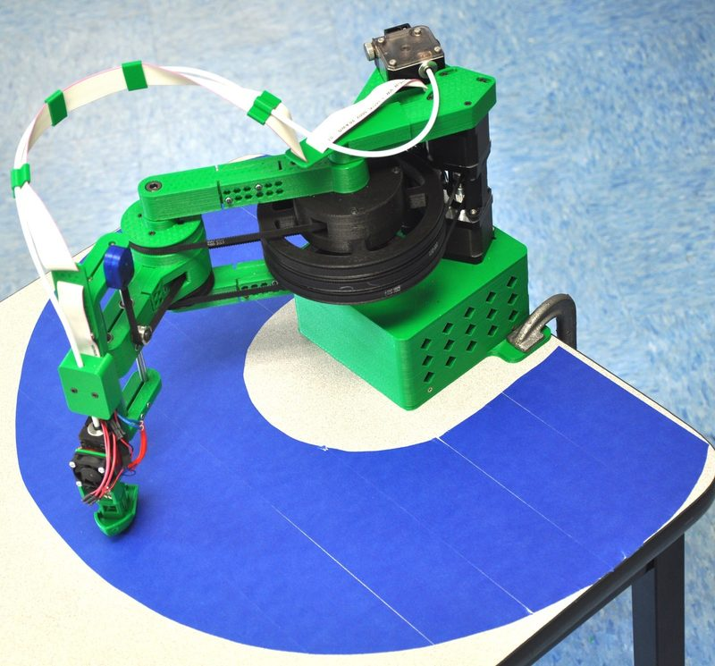</a> | [**RepRap HELIOS**](https://github.com/NicholasSeward/proto_RepRap_HELIOS) *Nicholas Seward* Printed SCARA arm with every stepper fixed in the base, over a half-ring bed much larger than the machine. The repo holds the v0.1 prototype files, and the author asks people not to build this version. | half ring Ø600×100 | — | CAD [2017-05](https://github.com/NicholasSeward/proto_RepRap_HELIOS/commit/c704cb023661720901c8685f7688f451f7705a44) |  [⏯️⁠47.8K](https://www.youtube.com/watch?v=CJ2F-YjHe2k) [❤️⁠841](https://www.youtube.com/watch?v=CJ2F-YjHe2k) | [CAD](https://github.com/NicholasSeward/proto_RepRap_HELIOS/tree/master) [Firmware](https://github.com/NicholasSeward/proto_RepRap_HELIOS/tree/master/Smootieware) [Config](https://github.com/NicholasSeward/proto_RepRap_HELIOS/blob/master/assets/config.txt) [Video](https://www.youtube.com/watch?v=CJ2F-YjHe2k) | [Forum](https://reprap.org/forum/list.php?185) EN |
| 📷 | [**MendelMax 2.0**](https://reprap.org/wiki/MendelMax_2) *Maxbots* Redesign of the [MendelMax](#mendelmax) with a right-triangle frame of aluminium extrusions and flat plates, which can be machined, printed, laser cut or cut by hand. It moved X and Y to linear rails and keeps shafts and bushings on Z. | 230×310×225 | 450×340×460 | 2.0 [2013-11](https://github.com/Makers-Tool-Works/MendelMax-2.0/commit/2014c24b3b87bc7305690026667d116881b01d57) |  | [CAD](https://github.com/Makers-Tool-Works/MendelMax-2.0/tree/master/Sources) [STL](https://github.com/Makers-Tool-Works/MendelMax-2.0/tree/master/STLs) [CAD](https://cad.onshape.com/documents/581d1d7ce5385f105d0cc7fe/w/31fc6c14bc3a6d4652915048/e/e3665072d0724de48ff22476) Onshape [Wiki](https://reprap.org/wiki/MendelMax_2) | [Forum](https://reprap.org/forum/list.php?177) EN [Forum](https://reprap.org/forum/list.php?151) EN |
|  | [**Mendel**](https://reprap.org/wiki/Mendel) *Ed Sells* Influential second-generation RepRap, and the parent of the Prusa Mendel and MendelMax. | 200×200×140 | — | Files [2011-05](https://sourceforge.net/projects/reprap/files/) |  [⏯️⁠55.2K](https://www.youtube.com/watch?v=toZpNpHQI7w) [❤️⁠29](https://www.youtube.com/watch?v=toZpNpHQI7w) | [CAD](https://github.com/reprap/mendel/tree/master/mechanics/solid-models) | [Forum](https://reprap.org/forum/list.php?151) EN |
| <a href="printers/fusebox-v1/README.md">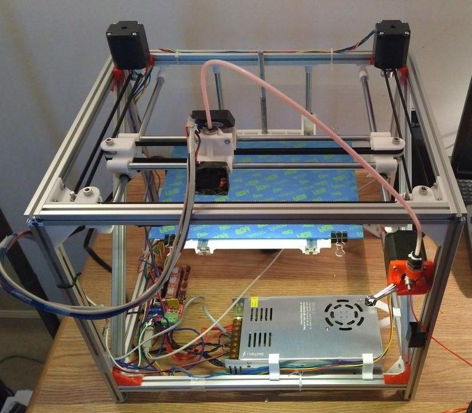</a> | [**FuseBox**](https://github.com/alexyu132/fusebox) *Alex Yu* Low-cost CoreXY on a 1515 extrusion frame with a stacked belt path that avoids crossed belts. Versions 1.0 to 1.4 are on Thingiverse and the RepRap wiki, and version 1.5 moved to GitHub in 2017. | 200×200×200 | — | 1.5 CAD [2019-09](https://github.com/alexyu132/fusebox/commit/e576252e7e7ff73ca86320ed0da06b6547512bc9) |  [💙⁠1.1K](https://www.thingiverse.com/thing:1047193) [⏯️⁠25.1K](https://www.youtube.com/watch?v=kshVDL2V_oc) [❤️⁠66](https://www.youtube.com/watch?v=kshVDL2V_oc) | [CAD](https://github.com/alexyu132/fusebox/blob/master/FuseBox1.5.skp) [STL](https://github.com/alexyu132/fusebox/tree/master/stl) [Files](https://www.thingiverse.com/thing:1047193/files) old 1.4 [Wiki](https://reprap.org/wiki/FuseBox) [Video](https://www.youtube.com/watch?v=kshVDL2V_oc) | — |
|  | [**Darwin**](https://reprap.org/wiki/Darwin) *RepRap* The first RepRap, and one of the earliest self-replicating printer designs. The project started here. | 230×230×100 | — | 1.0.6 [2008-12](http://blog.reprap.org/2008/12/solid-model-files-for-darwins-cartesian.html) |  [⏯️⁠81.9K](https://www.youtube.com/watch?v=Mo5Hp_6uD-E) [❤️⁠111](https://www.youtube.com/watch?v=Mo5Hp_6uD-E) | [Files](https://github.com/reprap/darwin) [Manual](https://reprap.org/wiki/RepRapOneDarwin) | [Forum](https://reprap.org/forum/list.php?150) EN inactive |
| 📷 | [**Rat Rig V-Core 2**](https://www.thingiverse.com/thing:2970162) *Rat Rig family* Early Rat Rig CoreXY kit, a plate-heavy cube of OpenBuilds 20-series V-slot with V-wheels instead of rails and a moving bed on two lead screws. It led to the V-Core Pro. | 300×300×300 | — | First release [2018-06](https://www.thingiverse.com/thing:2970162) | — | [Files](https://www.thingiverse.com/thing:2970162/files) | [Facebook](https://www.facebook.com/groups/ratrig3dprintercommunity) EN 19.9K [Discord](https://discord.gg/ratrig) EN 13.8K [Reddit](https://www.reddit.com/r/RatRig/) EN 3K |
|  | **RepRap H-Bot Project** *RepRap* H-bot project from an earlier version of this list; its wiki page now redirects to CoreXY. The original project page and files are lost. If you know where they are, a short PR is welcome. | — | — | — | — | — | — |

## Column notes

**Photo:** The main picture of the printer. Click it to open the printer page with all pictures. The [gallery](GALLERY.md) shows the main pictures in one grid.

**Sizes:** All sizes are in millimetres. Build volume is the printable X×Y×Z. Exterior is the body or frame W×D×H, without the spool, cables, or bed travel. If a source gives a range, the cell shows the largest value. `?` means the axis is not confirmed, `—` means no reliable figure, and `configurable` means no fixed volume. `Ø` is the print diameter of a delta. `∞` is the open print length of a belt printer.

**Latest version:** The date of the latest public revision, linked to its source. A tagged release or a changelog comes first. Next is the last CAD commit or file upload, then the first publication. The label names the revision or the source: `CAD` or `STEP` for a CAD commit, `Files` for a file upload, `Update` for a page update, `Log` for a changelog, and `First release` or `First video`. A year alone means the source gives no month. `—` means the source is lost.

**Stars Likes Views:** The gray badge shows live GitHub stars. The other counts are likes on the author's own pages, checked 2026-10-21: 💙 Thingiverse, 🧡 Printables, 💚 MakerWorld, 💛 Cults3D, and 🤍 MyMiniFactory. ⏯️ and ❤️ are the views and likes of the author's most-viewed video about the printer. Copies and remixes by other people do not count. `—` means no count was found.

**Links:** `STEP` is a STEP model, `CAD` is native CAD such as Fusion or OpenSCAD, and `STL` is printable parts. `Files` is a mixed set of design files, `BOM` is the bill of materials, and `Manual` is the build guide. `Wiki`, `Config`, `Firmware`, and `Video` go to those pages. `—` means no direct link was found.

**Groups:** Builder communities for the printer, its family, or its creator, checked 2026-10-20. Official groups come first, then the largest. Each line shows the platform, the language, and the member count. No number means the platform hides the count. `inactive` marks a large group with no posts in the last year. General groups such as r/3Dprinting are not listed.

## Mini footprint comparison

For a desk, **extra width and depth beyond printable XY** is easier to picture than an area ratio. Each value is exterior W minus printable X, and exterior D minus printable Y; it is not a required clearance on each side. The measurements use different body, enclosing, or open configurations, so check spool placement and bed travel before planning a tight space.

| Printer | Printable XY | Reported footprint | Extra W × D |
| --- | --- | --- | --- |
| [Positron V3.2](#positron-v3) (open) | 180×180 | 200×200 | +20×20 mm |
| [Cubiron](#cubiron) | 70×70 | 144×145 | +74×75 mm |
| [Quark](#quark) | 24×24 | 100×100 | +76×76 mm |
| [Encore](#encore) (body) | 120×120 | 219×221 | +99×101 mm |
| [Rook MK1](#rook-mk1) | 120×120 | 220×250 | +100×130 mm |
| [Voron V0](#voron-v0) | 120×120 | 230×230 | +110×110 mm |
| [MiniCube (Kotvic)](#minicube-kotvic) (body) | 149×140 | 265×265 | +116×125 mm |
| [Tantillus R](#tantillus-r) | 100×100 | 220×220 | +120×120 mm |
| [Tantillus](#tantillus) (printed frame) | 100×100 | 225×225 | +125×125 mm |
| [Ultimaker 2 Go](#ultimaker) (desktop) | 120×120 | 258×250 | +138×130 mm |
| [BabyCube](#babycube) (enclosing) | 90×80 | 248×272 | +158×192 mm |
| [Prusa MINI](#prusa-mini) (no spool or PSU) | 180×180 | 380×330 | +200×150 mm |
| [3d Mini Cube (iChalix)](#mini-cube-ichalix) | 120×120 | 325×355 | +205×235 mm |
| [RailCore Mini](#railcore-mini) (no loom) | 150×150 | 400×312 | +250×162 mm |
| [BabyBelt Pro](#babybelt-pro) | 100×100 | — | — |
| [Bastion](#bastion) | 180×180 | — | — |
| [Delta Flyer](#delta-flyer) | Ø115 | — | — |
| [F-Zero](#f-zero) | 120×120 | — | — |
| [Fisher 1](#reprappro-fisher) | Ø150 | — | — |
| [GBot Tiny](#gbot-tiny) | 120×120 | — | — |
| [Kappy](#kappy) | 120×120 | — | — |
| [Lemontron](#lemontron) | 180×180 | — | — |
| [Little Cube](#little-cube) | 100×100 | — | — |
| [Micron](#micron) | 120×120 180×180 | — | — |
| [MIN Micro Delta](#min-micro-delta) | Ø70 | — | — |
| [Panda Mini](#panda-mini) | 140×140 | — | — |
| [Rat Rig V-Minion](#ratrig-v-minion) | 180×180 | — | — |
| [Rook MK2](#rook-mk2) | 120×120 | — | — |
| [Salad Fork](#salad-fork) | 120×120 160×160 180×180 | — | — |
| [TicTac 2.1](#tictac-2-1) | 120×120 | — | — |
| [Tiny-M](#tiny-m) | 150×150 | — | — |
| [Tiny-T](#tiny-t) | 150×150 | — | — |
| [V-Chonk](#v-chonk) | 180×180 | — | — |
| [VzBot Vz150](#vzbot-vz150) | 150×150 | — | — |

Kotvic's MiniCube grows to **265×340×350 mm** with the spool, extruder, and Bowden tube included. BabyCube's enclosing figure excludes its spool, Bowden tube, and wiring. Those accessory differences matter more than a small difference in the table's overhead.

## Browse by maker or family

The same printer appears only once above. These links jump to its row; use your browser's page search for smaller maker tags.

- **Voron family**
  - **Original Voron Design**  
  [2](#voron-2) · [Trident and V1.8](#voron-trident) · [V0](#voron-v0) · [Switchwire](#voron-switchwire) · [Legacy and V1.0](#voron-legacy)
  - **Printers for Ants**  
  [Micron](#micron) · [Salad Fork](#salad-fork) · [Tiny-T](#tiny-t) · [Crucible](#crucible)
  - **zruncho3d**  
  [F-Zero](#f-zero) · [Double Dragon](#double-dragon) · [Dueling Zero](#dueling-zero)
  - **FrankenVoron**  
  [Tridex](#tridex)
  - **gsl12**  
  [Tiny-M](#tiny-m)
  - **DaRk_dOg**  
  [Ender_SW](#ender-sw) · [Diversion](#diversion)
  - **rogerlz**  
  [Doron Velta](#doron-velta)

- **Rolohaun**  
  [Rook MK1](#rook-mk1) · [Rook MK2](#rook-mk2) · [Rook 2020](#rook-2020) · [SimpleCore](#simplecore) · [Panda Mini](#panda-mini) · [Bastion](#bastion) · [Defiant](#defiant) · [Kappy](#kappy) · [MIN Micro Delta](#min-micro-delta) · [Delta Flyer](#delta-flyer) · [PhoenixDelta](#phoenix-delta) · [Rook E3](#rook-e3)
- **Rat Rig**  
  [V-Core 4.1](#ratrig-v-core-4-1) · [V-Core 3](#ratrig-v-core-3) · [V-Core Pro 1.3](#ratrig-v-core-pro) · [V-Core 2](#ratrig-v-core-2) · [V-Chonk](#v-chonk) · [V-Minion](#ratrig-v-minion) · [TicTac 2.1](#tictac-2-1) · [V-Cast](#ratrig-v-cast) · [V-Origin](#ratrig-v-origin)
- **VzBot**  
  [Vz330 / Vz235](#vzbot) · [Vz150](#vzbot-vz150)
- **BLV MGN Cube**  
  [BLV MGN Cube](#blv-mgn-cube) · [3d Mini Cube (iChalix)](#mini-cube-ichalix)
- **Martin Budden**  
  [BabyCube](#babycube) · [MaybeCube](#maybecube)
- **RobertGcode**  
  [Cubiron](#cubiron) · [Quark](#quark)
- **Alex Yu**  
  [Encore](#encore) · [FuseBox3](#fusebox3) · [FuseBox2 / 2R](#fusebox2) · [FuseBox](#fusebox-v1)
- **SnakeOilXY**  
  [SnakeOil XY](#snakeoil-xy) · [ProosaXY](#proosaxy)
- **SecKit**  
  [SK-Go](#seckit-sk-go) · [SK-Tank](#seckit-sk-tank) · [SK-Cube](#seckit-sk-cube) · [SK-300 / SK-600](#seckit-sk-300)
- **Prusa / RepRap**  
  [CORE One / CORE One L](#prusa-core-one) · [XL / XL+](#prusa-xl) · [MINI / MINI+](#prusa-mini) · [i3 (early to MK4S)](#prusa-i3) · [Prusa Mendel i2](#prusa-mendel-i2)
- **RailCore**  
  [RailCore II](#railcore-ii) · [RailCore Mini](#railcore-mini)
- **Annex Engineering**  
  [Denali](#denali) · [K1 / Masherbrum](#annex-k1) · [K2 / Chhogori](#annex-k2) · [K3 / Gasherbrum](#annex-k3)
- **Creality**  
  [Original Ender-3](#ender-3) · [Original CR-10](#creality-cr-10)
- **Smartfriendz**  
  [Smartrap](#smartrap) · [SmartCore](#smartcore)
- **RepRapPro**  
  [Ormerod 1 / 2](#ormerod-2) · [Fisher 1](#reprappro-fisher)
- **Matt the Printing Nerd**  
  [THE100](#the100) · [T250](#t250)
- **Roy Berntsen / PRO 3D**  
  [Valkyrie](#valkyrie) · [V-King](#v-king) · [V-Baby](#v-baby-corexy)
- **Squirrelbrain**  
  [TicTac 2.1](#tictac-2-1) · [Satsuma](#satsuma)
- **Steve Graber**  
  [Cerberus](#cerberus) · [Cerberus Pup](#cerberus-pup)
- **Emmanuel Gilloz**  
  [FoldaRap](#foldarap) · [FoldaRapX](#foldarapx) · [Mondrian](#mondrian) · [Alto](#alto)
- **Apsu**  
  [Delteron](#delteron) · [Inverted Cantilever Delta](#inverted-cantilever-delta) · [Tripteron](#tripteron)
- **Shane Hooper / 3D Distributed**  
  [SolidCore](#solidcore) · [WorkHorse](#workhorse)
- **Whosawhatsis**  
  [Wallace](#wallace) · [Cranestyle Mini](#cranestyle-mini)
- **Rob Mink**  
  [BabyBelt Pro](#babybelt-pro) · [Polar printer v2](#polar-printer-v2)
- **3DCampy**  
  [Hbot Pro](#hbot-pro) · [Ulticampy](#ulticampy)
- **Make Some Stuff**  
  [Cairo Mini](#cairo-mini) · [Cairo30](#cairo30)
- **RH3D**  
  [Ender-3 NG](#ender-3-ng) · [VIRTU E3](#virtu-e3)
- **Dayu DIY**  
  [Xuanwu](#dayu-xuanwu) · [Yunque](#dayu-yunque)
- **MakerBot**  
  [CupCake CNC](#cupcake-cnc) · [Thing-O-Matic](#thing-o-matic) · [Replicator](#makerbot-replicator)
- **Maxbots**  
  [MendelMax](#mendelmax) · [MendelMax 2.0](#mendelmax-2)
- **Nicholas Seward**  
  [Wally](#wally) · [GUS Simpson](#gus-simpson) · [LISA Simpson](#lisa-simpson) · [RepRap HELIOS](#reprap-helios)
- **Johann C. Rocholl**  
  [Rostock](#rostock) · [Kossel](#kossel)
- **RepRap project**  
  [Darwin](#darwin) · [Mendel](#mendel) · [Huxley](#huxley) · [Prusa Mendel i2](#prusa-mendel-i2)
- **HyperCube family**  
  [HyperCube](#hypercube) · [HyperCube Evolution](#hypercube-evolution) · [MoonCake](#mooncake)
- **C-Bot family**  
  [C-Bot](#c-bot) · [D-Bot](#d-bot)
- **Tantillus**  
  [Tantillus](#tantillus) · [Tantillus R](#tantillus-r)

## How to contribute

Pull requests are welcome. To suggest a printer, add its project page and one sentence on why it is interesting. Add direct links to the build guide, BOM, CAD, and the creator's video if they exist. Do not add homepages, dead links, duplicates, or claims such as "best" or "cheapest".

To add a full row, follow "Column notes":

1. Put the row in the table for its motion system and size. If the design has no update since 2024-10 and no active group, use Legacy. If it shaped later printers and no longer gets updates, use Historical.
2. Count only the creator's own pages and videos. For a GitHub repository, add the star badge from an existing row.
3. Sort rows by GitHub stars, highest first. If a row has no repository, use its highest like count. Rows with no counts go last.

## License

The text of this list is in the public domain under [CC0 1.0](LICENSE). The pictures in `printers/` are not covered by this license. Their authors keep all rights. Each printer page credits the authors, and [GALLERY.md](GALLERY.md#picture-credits) tells you how to ask for a fix or a removal.
