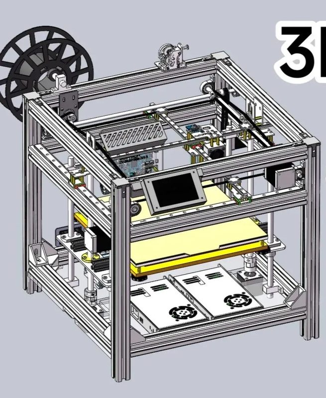
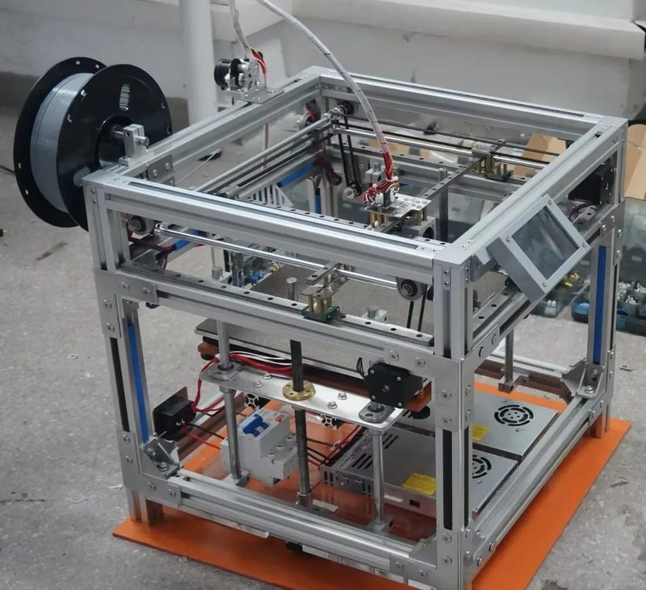

# 0xC0FFEE_ZY 3D printer

[Catalog row](../../README.md#0xc0ffee-zy) · [Gallery](../../GALLERY.md)

| Field | Value |
| --- | --- |
| Section | Cross-gantry |
| Project page | [https://github.com/0xC0FFEE-ZY/3D_Printer-Hardware-and-Firmware](https://github.com/0xC0FFEE-ZY/3D_Printer-Hardware-and-Firmware) |
| Author | 0xC0FFEE_ZY |
| About | Ultimaker-style cross-gantry printer on 3030 extrusion with a self-designed STM32F407 mainboard and TMC2209 driver boards. The repo has the SolidWorks model, DWG drawings for the steel and acrylic parts, the PCB projects, and a Marlin 2.1.3 config with Chinese comments. |
| Build volume (X×Y×Z) | 250×255×200 |
| Exterior (W×D×H) | — |
| Latest version | CAD [2026-09](https://github.com/0xC0FFEE-ZY/3D_Printer-Hardware-and-Firmware/commit/d14bd302b5498f1fb9ef6d917b8ac5e4c94a03f2) |
| Stars Likes Views |  |
| Links | [CAD](https://github.com/0xC0FFEE-ZY/3D_Printer-Hardware-and-Firmware/tree/main/%E4%B8%89%E7%BB%B4%E5%BB%BA%E6%A8%A1) [Files](https://github.com/0xC0FFEE-ZY/3D_Printer-Hardware-and-Firmware/tree/main/CAD%E5%9B%BE%E7%BA%B8_3D%E6%89%93%E5%8D%B0%E6%9C%BA%E7%BB%93%E6%9E%84%E4%BB%B6) [Firmware](https://github.com/0xC0FFEE-ZY/3D_Printer-Hardware-and-Firmware/tree/main/Chinese_Version_Configured_Marlin2.1.3) [Video](https://www.bilibili.com/video/BV1Lnev6LE89) |
| Groups | — |
| License | [GPL-3.0](https://github.com/0xC0FFEE-ZY/3D_Printer-Hardware-and-Firmware#%E7%89%88%E6%9D%83%E4%B8%8E%E8%AE%B8%E5%8F%AF) |

## Pictures (2)

<table>
<tr><td align="center" width="33%"> Photo: <a href="https://oshwhub.com/zy_202411">0xC0FFEE_ZY</a></td><td align="center" width="33%"> Photo: <a href="https://oshwhub.com/zy_202411">0xC0FFEE_ZY</a></td></tr>
</table>
