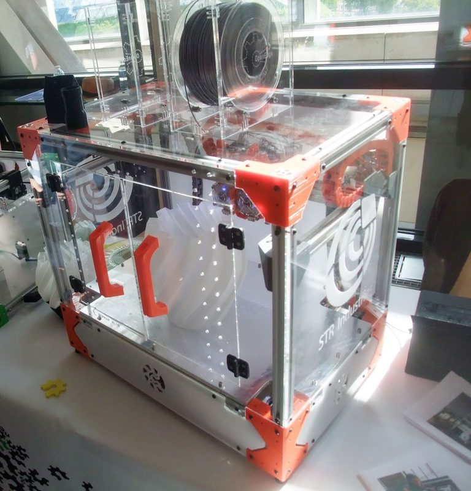
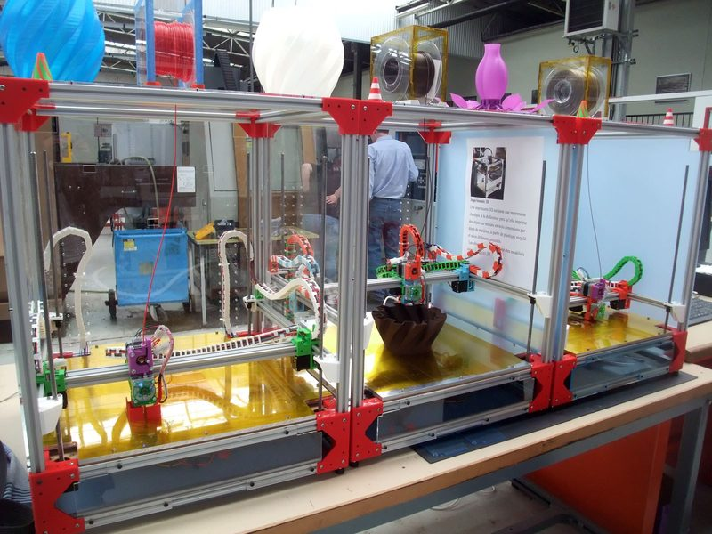
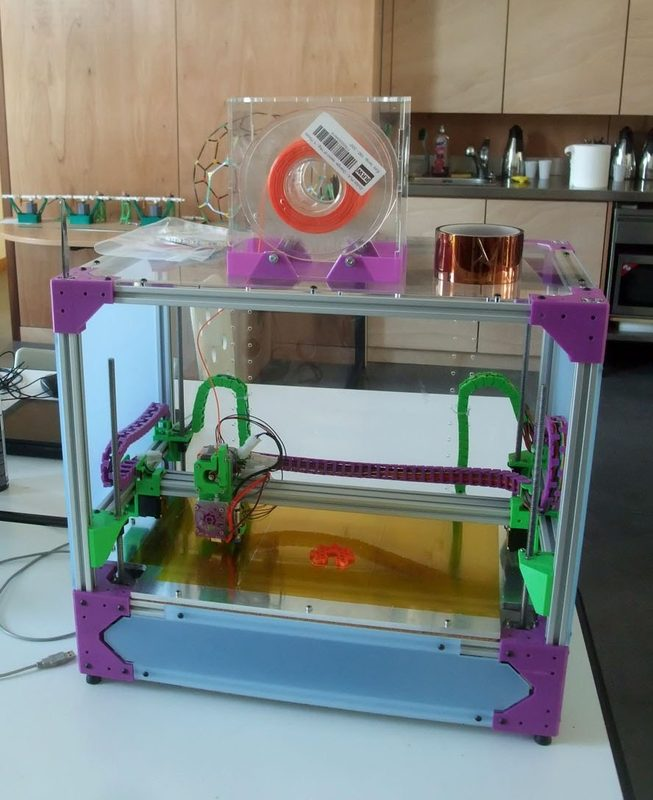
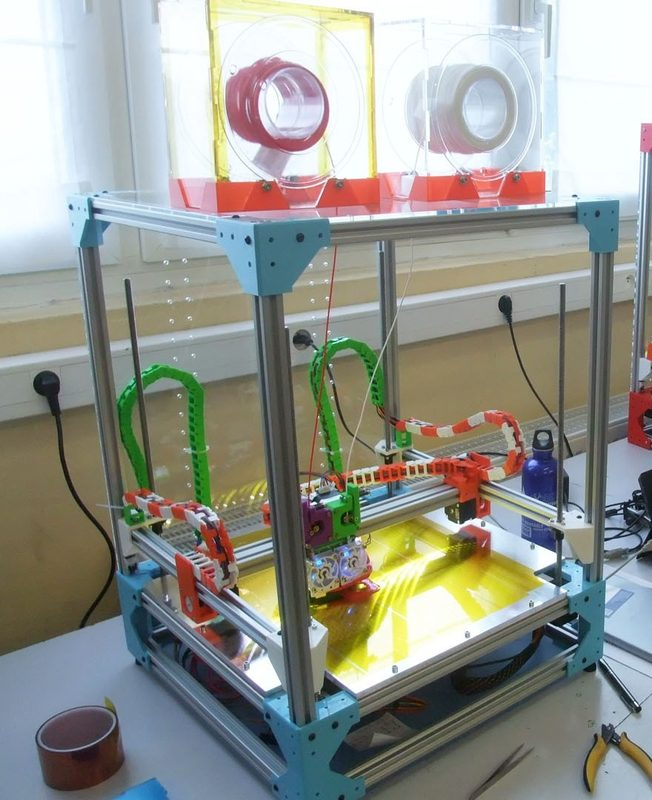
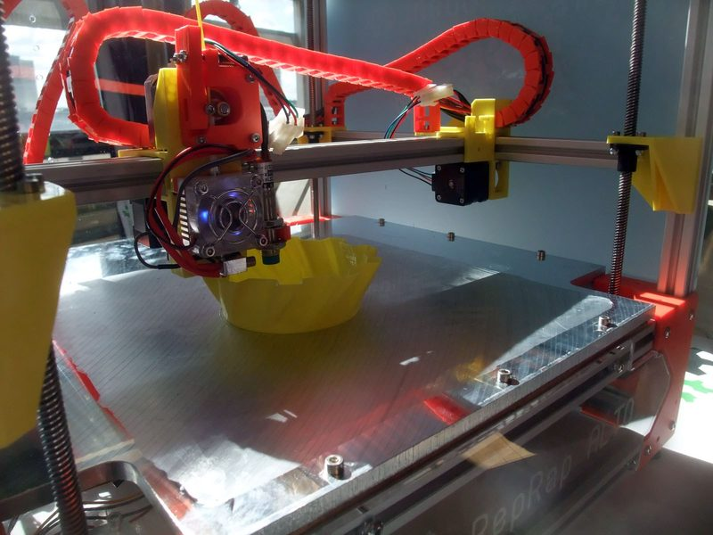

# Alto

[Catalog row](../../README.md#alto) · [Gallery](../../GALLERY.md)

| Field | Value |
| --- | --- |
| Section | Legacy designs |
| Project page | [https://github.com/OpenEdge/Alto1](https://github.com/OpenEdge/Alto1) |
| Author | Emmanuel Gilloz / OpenEdge |
| About | Enclosed, scalable Cartesian RepRap on 20×20 extrusion. The frame is the linear guide for all three axes, and the same printed parts build a small cube or a large frame. Builds were made for schools and companies in France. No update since 2016-02. |
| Build volume (X×Y×Z) | A-333: 300×300×300 A-422: 400×200×200 A-444: 400×400×400 |
| Exterior (W×D×H) | — |
| Latest version | CAD [2016-02](https://github.com/OpenEdge/Alto1/commit/147f4b5a704367a76029858cd078e892beff00fa) |
| Stars Likes Views |  [⏯️⁠1.2K](https://www.youtube.com/watch?v=nIDGWXvktuU) [❤️⁠2](https://www.youtube.com/watch?v=nIDGWXvktuU) |
| Links | [CAD](https://github.com/OpenEdge/Alto1/tree/master/source) [Files](https://github.com/OpenEdge/Alto1/tree/master/hardware) [Config](https://github.com/OpenEdge/Alto1/tree/master/firmware/Smoothieboard_5X) [Wiki](https://reprap.org/wiki/Alto) |
| Groups | — |
| License | [GPL-3.0](https://github.com/OpenEdge/Alto1/blob/master/LICENSE) |

## Pictures (6)

<table>
<tr><td align="center" width="33%"> Version: A-333 (#007) Photo: <a href="https://reprap.org/wiki/User:Emmanuel">Emmanuel Gilloz</a></td><td align="center" width="33%"> Version: A-422 (#008) Photo: <a href="https://reprap.org/wiki/User:Emmanuel">Emmanuel Gilloz</a></td><td align="center" width="33%"> Version: A-444 Photo: <a href="https://reprap.org/wiki/User:Emmanuel">Emmanuel Gilloz</a></td></tr>
<tr><td align="center" width="33%"> Version: A-422 Photo: <a href="https://reprap.org/wiki/User:Emmanuel">Emmanuel Gilloz</a></td><td align="center" width="33%"> Version: A-333 Photo: <a href="https://reprap.org/wiki/User:Emmanuel">Emmanuel Gilloz</a></td><td align="center" width="33%"> Version: A-333 (#009) Photo: <a href="https://reprap.org/wiki/User:Emmanuel">Emmanuel Gilloz</a></td></tr>
</table>
