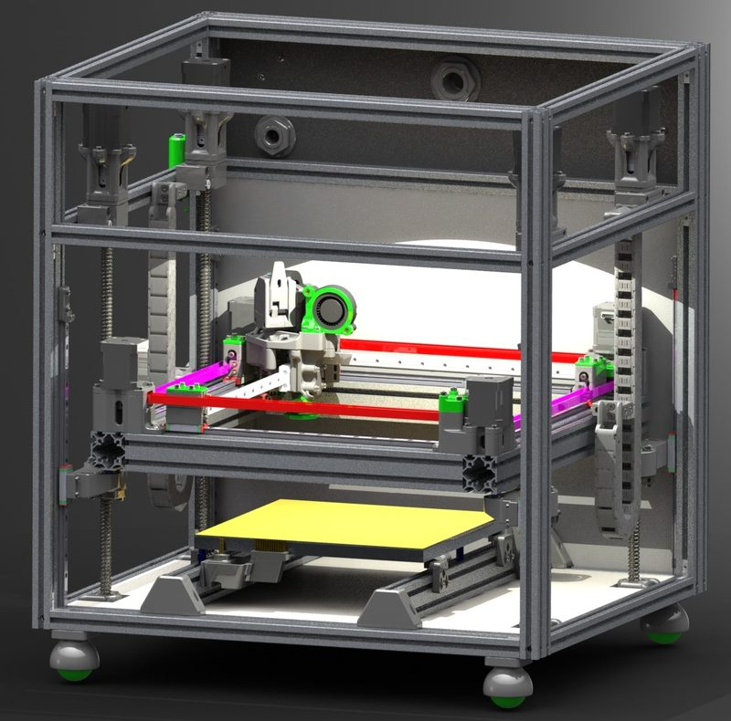
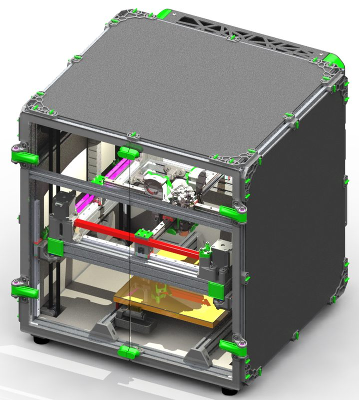
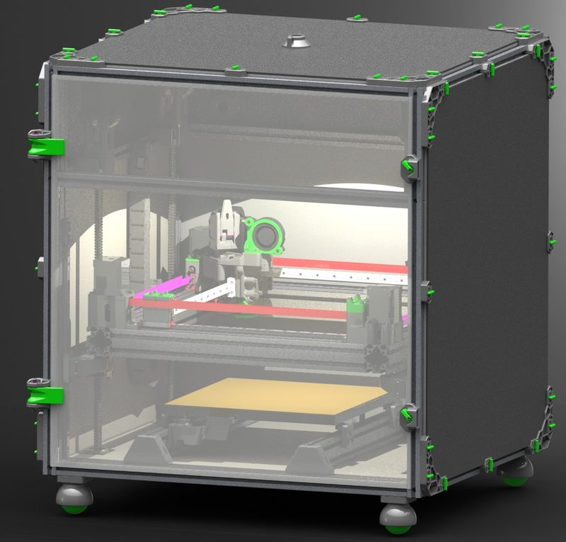
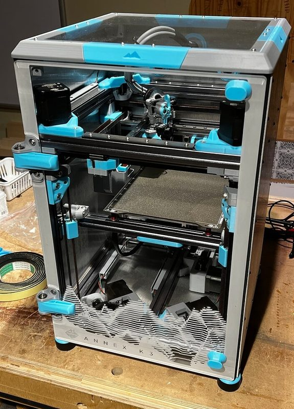
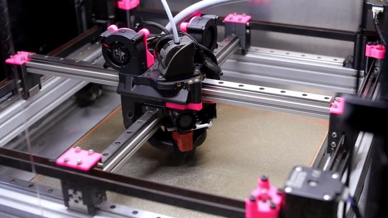

# Annex K1 / Masherbrum

[Catalog row](../../README.md#annex-k1) · [Gallery](../../GALLERY.md)

| Field | Value |
| --- | --- |
| Section | Legacy designs |
| Project page | [https://github.com/Annex-Engineering/Masherbrum-K1](https://github.com/Annex-Engineering/Masherbrum-K1) |
| Author | Annex Engineering |
| About | Archived moving-gantry, enclosed cross-gantry design with a documented 250 mm build and scalable frame. Replaced by the Annex K3. |
| Build volume (X×Y×Z) | 250×250×250 |
| Exterior (W×D×H) | — |
| Latest version | CAD [2024-04](https://github.com/Annex-Engineering/Masherbrum-K1/commit/b85286efd96cf836858ddcb3c3916108828c910e) |
| Stars Likes Views |  |
| Links | [XY CAD](https://github.com/Annex-Engineering/Masherbrum-K1/tree/master/Release_3_0) [Z CAD](https://github.com/Annex-Engineering/Masherbrum-K1/tree/master/Release_2_2) [BOM](https://docs.google.com/spreadsheets/d/1O3eyVuQ6M4F03MJSDs4Z71_XyNjXL5HFTZr1jsaAtRc/edit) |
| Groups | [Discord](https://discord.gg/MzTR3zE) EN 11.4K |
| License | [ANNEX Engineering License](https://github.com/Annex-Engineering/ANNEX-Engineering-License-Agreement/blob/master/LICENSE.md) |

## Pictures (6)

<table>
<tr><td align="center" width="33%"> Photo: <a href="https://github.com/Annex-Engineering">Annex Engineering</a></td><td align="center" width="33%"> Photo: <a href="https://github.com/Annex-Engineering">Annex Engineering</a></td><td align="center" width="33%"> Photo: <a href="https://github.com/Annex-Engineering">Annex Engineering</a></td></tr>
<tr><td align="center" width="33%"> Photo: <a href="https://github.com/Annex-Engineering">Annex Engineering</a></td><td align="center" width="33%"> Photo: <a href="https://forum.v1e.com/u/brenavich980">Brent Vecchi</a></td><td align="center" width="33%"> Photo: <a href="https://www.youtube.com/@annexedraven3020">Annexed Raven</a></td></tr>
</table>

## Other homes of the files

- Wayback Machine: [latest snapshot](https://web.archive.org/web/20260422143652/https://github.com/Annex-Engineering/Masherbrum-K1), 2026-04-22.
