# Annex K3 / Gasherbrum

[Catalog row](../../README.md#annex-k3) · [Gallery](../../GALLERY.md)

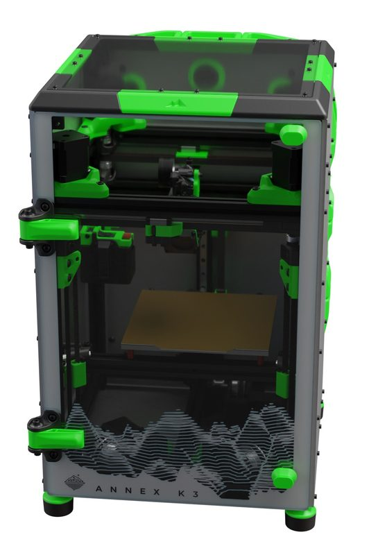

| Field | Value |
| --- | --- |
| Section | Cross-gantry |
| Project page | [https://github.com/Annex-Engineering/Gasherbrum-K3](https://github.com/Annex-Engineering/Gasherbrum-K3) |
| Author | Annex Engineering |
| About | Small enclosed cross-gantry machine with separate X and Y drives; its latest published release is R1.2 beta 1. |
| Build volume (X×Y×Z) | 180×180×180 |
| Exterior (W×D×H) | — |
| Latest version | R1.2 beta 1 [2023-07](https://github.com/Annex-Engineering/Gasherbrum-K3/releases/tag/R1.2B1) |
| Stars Likes Views |  [⏯️⁠28.6K](https://www.youtube.com/watch?v=kHAcm8c9pTk) [❤️⁠359](https://www.youtube.com/watch?v=kHAcm8c9pTk) |
| Links | [Files](https://github.com/Annex-Engineering/Gasherbrum-K3/tree/HEAD/Release_1_2) R1.2 beta 1 [CAD](https://github.com/Annex-Engineering/Gasherbrum-K3/tree/HEAD/Release_1_1/CAD) R1.1 |
| Groups | [Discord](https://discord.gg/MzTR3zE) EN 11.4K |
| License | [ANNEX Engineering License](https://github.com/Annex-Engineering/ANNEX-Engineering-License-Agreement/blob/main/LICENSE.md) |

## Pictures (13)

<table>
<tr><td align="center" width="33%"> Photo: <a href="https://github.com/rsghosh">Ryan Ghosh</a></td><td align="center" width="33%"><a href="1-annex-k3.jpg">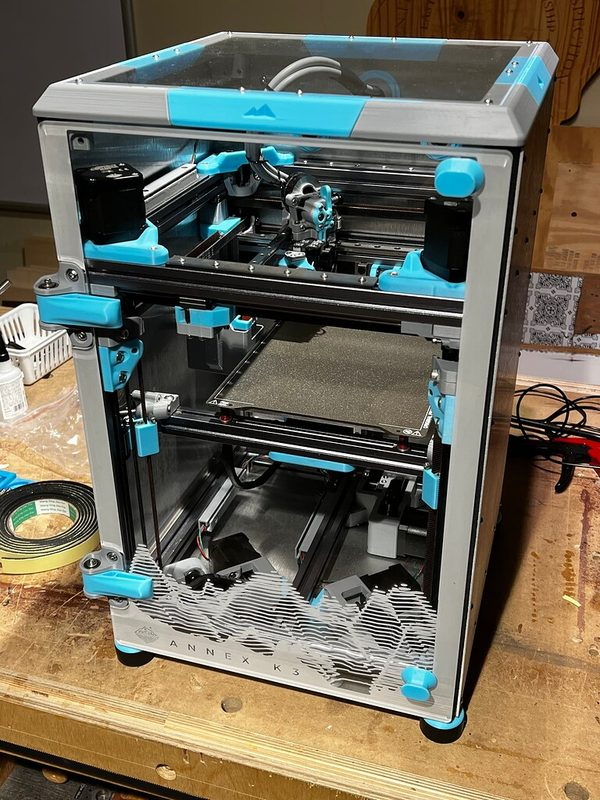</a> Photo: <a href="https://forum.v1e.com/u/brenavich980">Brent Vecchi</a></td><td align="center" width="33%"><a href="2-annex-k3.jpg">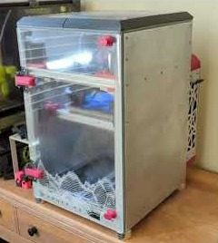</a> Photo: <a href="https://forum.v1e.com/u/brenavich980">Brent Vecchi</a></td></tr>
<tr><td align="center" width="33%"><a href="3-annex-k3.jpg">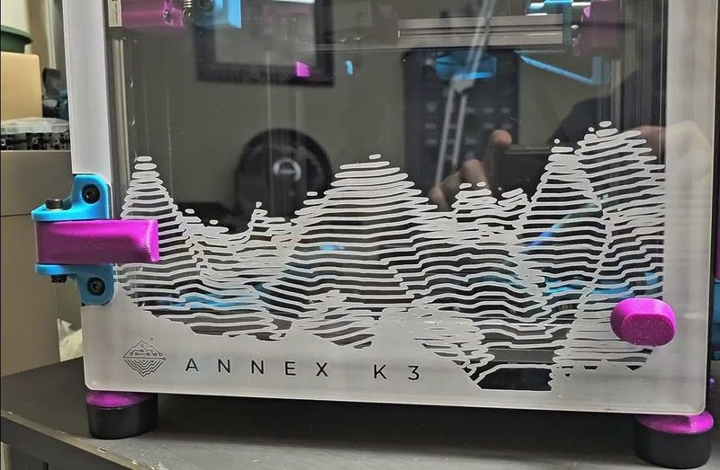</a> Photo: <a href="https://www.youtube.com/@oldguymeltsplastic">Steph AKA OGMP</a></td><td align="center" width="33%"><a href="4-annex-k3.jpg">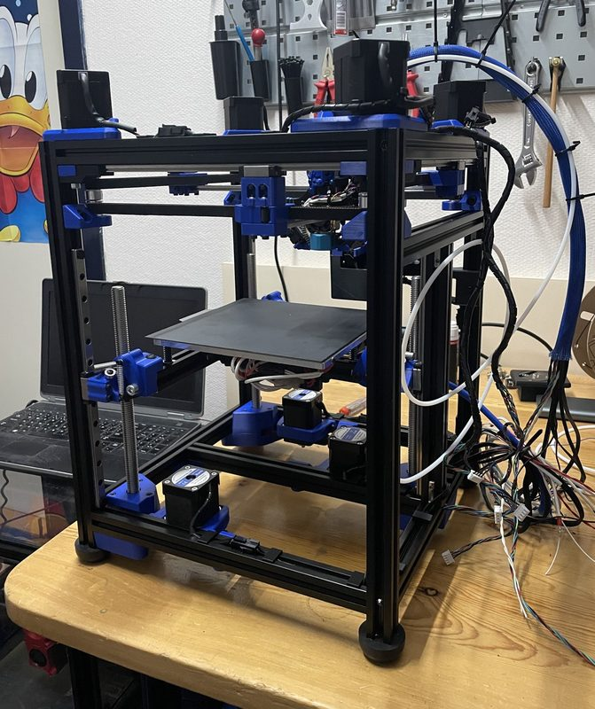</a> Photo: <a href="https://github.com/Annex-Engineering">Annex Engineering</a></td><td align="center" width="33%"><a href="5-annex-k3.jpg">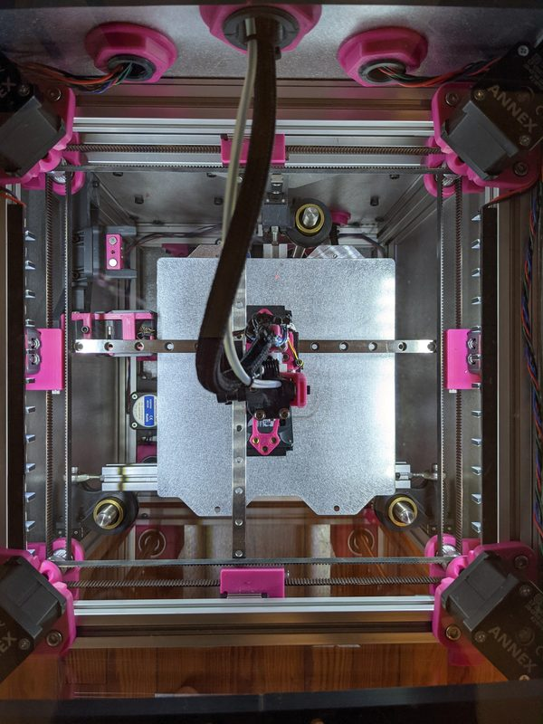</a> Photo: <a href="https://github.com/Annex-Engineering">Annex Engineering</a></td></tr>
<tr><td align="center" width="33%"><a href="6-annex-k3.jpg">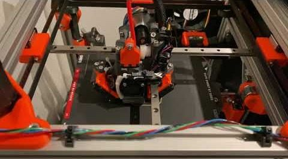</a> Photo: <a href="https://www.youtube.com/@nihiro3d">Nihiro</a></td><td align="center" width="33%"><a href="7-annex-k3.jpg">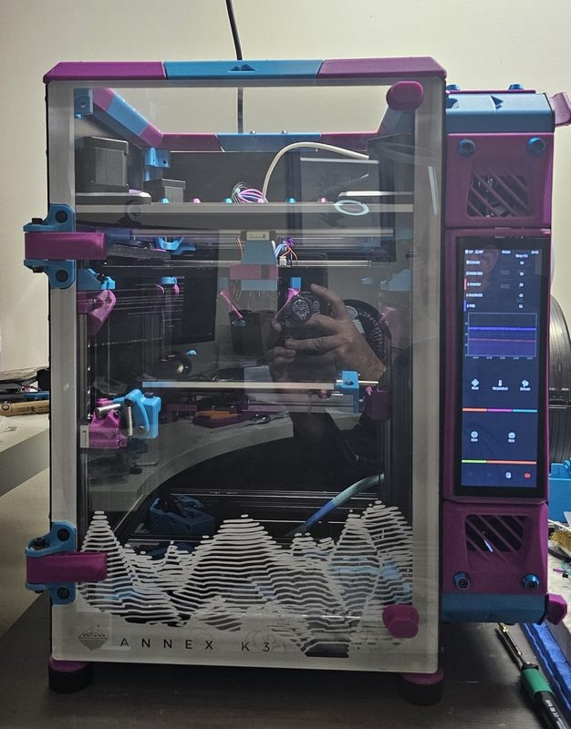</a> Version: Escalade build Photo: <a href="https://www.youtube.com/@oldguymeltsplastic">Steph AKA OGMP</a></td><td align="center" width="33%"><a href="8-annex-k3.jpg">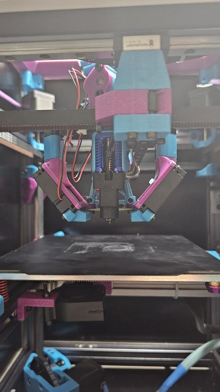</a> Version: Escalade build Photo: <a href="https://www.youtube.com/@oldguymeltsplastic">Steph AKA OGMP</a></td></tr>
<tr><td align="center" width="33%"><a href="9-annex-k3.jpg">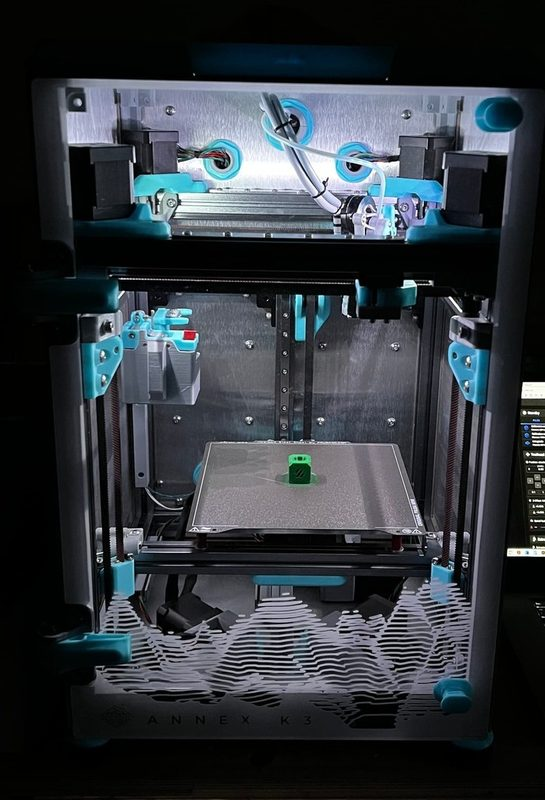</a> Photo: <a href="https://forum.v1e.com/u/brenavich980">Brent Vecchi</a></td><td align="center" width="33%"><a href="10-annex-k3.jpg">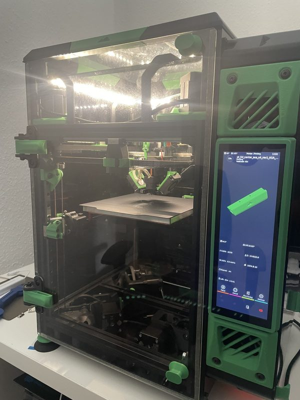</a> Photo: <a href="https://www.printables.com/@Rock2k11_248727">Rock2k11</a></td><td align="center" width="33%"><a href="11-annex-k3.jpg">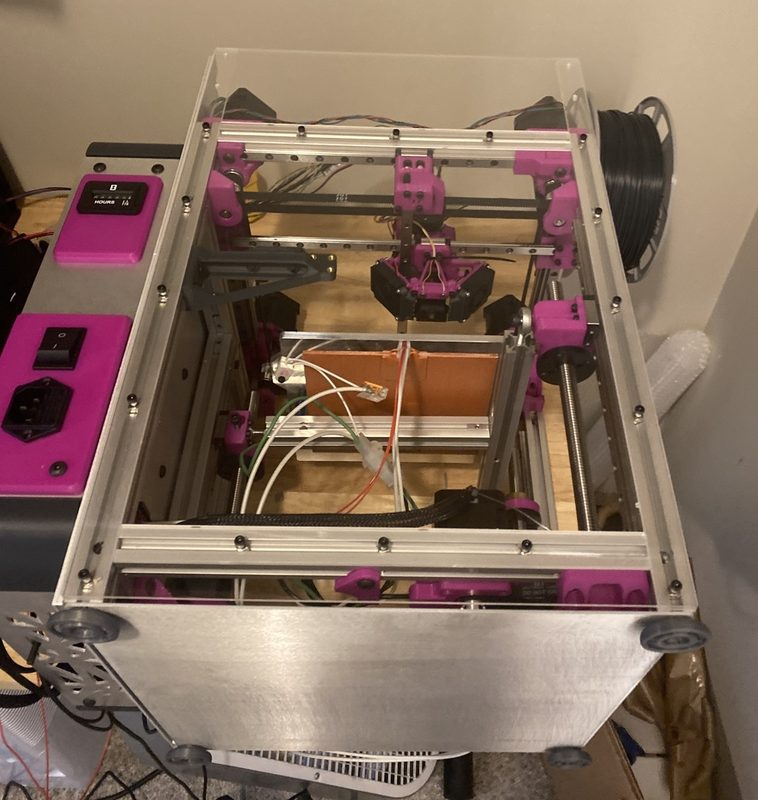</a> Version: Release 1 prototype Photo: <a href="https://github.com/Annex-Engineering">Annex Engineering</a></td></tr>
<tr><td align="center" width="33%"><a href="12-annex-k3.jpg">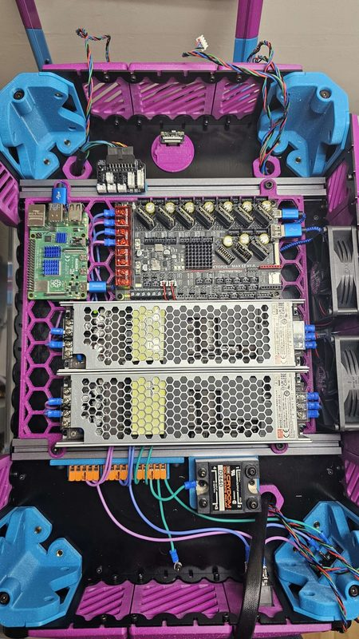</a> Photo: <a href="https://www.reddit.com/user/FizzysTech">u/FizzysTech</a></td></tr>
</table>

## Other homes of the files

- Wayback Machine: [latest snapshot](https://web.archive.org/web/20260506140850/https://github.com/Annex-Engineering/Gasherbrum-K3), 2026-05-06.

## Popular mods

- [SLM parts for the X, Y, and Z axis](https://github.com/MathematicalPotato/MP_DooKi3_SLM_Designs) by MathematicalPotato: SLM metal replacements for printed X, Y and Z axis parts. ANNEX Engineering License, non-commercial.
- [FT EMS Annex K3](https://www.printables.com/model/716944-ft-ems-annex-k3) by Fizzy: EMS frame that mounts the electronics under the printer, across the two lower extrusions. CC BY 4.0.
- [Annex K3 Waveshare 7.9" DSI Mount](https://www.printables.com/model/918020-annex-k3-waveshare-79-dsi-mount) by Rock2k11: mount for the Waveshare 7.9-inch DSI touch screen (not the HDMI version). CC BY-NC-SA 4.0.
- [Metal Toolhead Plates (DooKi3 toolhead)](https://github.com/MathematicalPotato/MP_DooKi3_Toolhead_V1) by MathematicalPotato: laser-cut, waterjet or CNC aluminium plates that replace the printed toolhead plate, with DXFs and extruder spacers. ANNEX Engineering License, non-commercial.
- [Karabox K3 eBox mod](https://github.com/karabox/MISC/tree/main/Annex%20Mods/K3%20eBox%20mod) by karabox: electronics box redesign with new mounting brackets, cable management and dual-tone panels. License not stated.
- [Annex K3 SLM Toolhead duct](https://github.com/stackingdeezlayers/Annex-K3-SLM-Toolhead) by stackingdeezlayers: SLM metal part-cooling duct for the laser-cut K3 toolhead, based on the Takeoff V2 duct, with a Beacon mount. CC BY-NC-SA 4.0.
- [Annex Engineering K3 Sidepack Waveshare 7.9" DSI Mount](https://www.printables.com/model/691631-annex-engineering-k3-sidepack-waveshare-79-dsi-mou) by OldGuyMeltsPlastic: waveshare 7.9-inch DSI screen mount for the sidepack electronics layout. GPL-3.0.
- [Annex K3 Beacon Nozzle Wiper Bambulab Wiper](https://www.printables.com/model/957263-annex-k3-beacon-nozzle-wiper-bambulab-wiper) by Danni Design: nozzle wiper that uses the Bambu Lab X1/P1 wiper with a Beacon probe. CC BY-NC 4.0.
- [Frostbite toolhead](https://github.com/Annex-Engineering/Annex-Engineering_User_Mods/tree/main/Printers/K3/annex_dev-Frostbite_toolhead) by Annex Engineering: frostbite development toolhead from the Annex team, published as a user mod. ANNEX Engineering License, non-commercial.
- [Long's magnetic Beacon nozzle wiper](https://github.com/Annex-Engineering/Annex-Engineering_User_Mods/tree/main/Printers/K3/long-Nozzle_Wiper_Beacon_Magnetic) by long: nozzle wiper and longer purge bucket with a magnetic spring arm, for a Beacon probe instead of Quickdraw. ANNEX Engineering License, non-commercial.
- [Airox double-pane tophat](https://github.com/Annex-Engineering/Annex-Engineering_User_Mods/tree/main/Printers/K3/airox-double-pane-tophat) by airox: tophat with two top panels and an interlocking design for less heat loss. ANNEX Engineering License, non-commercial.
