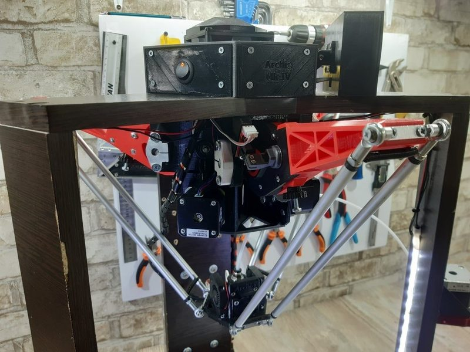
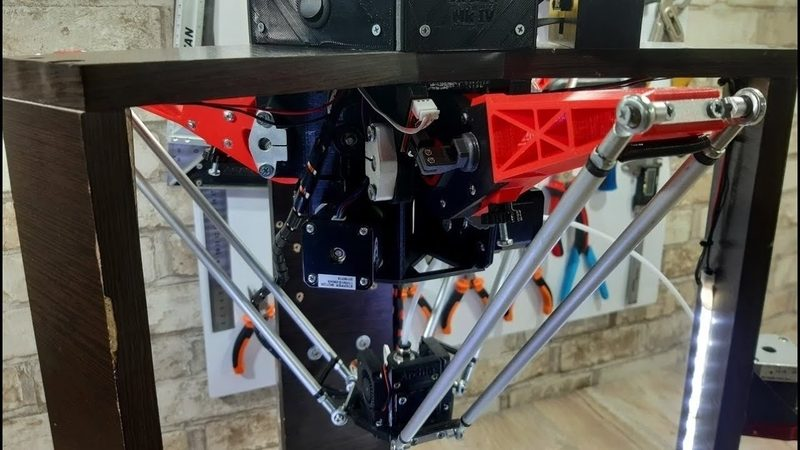
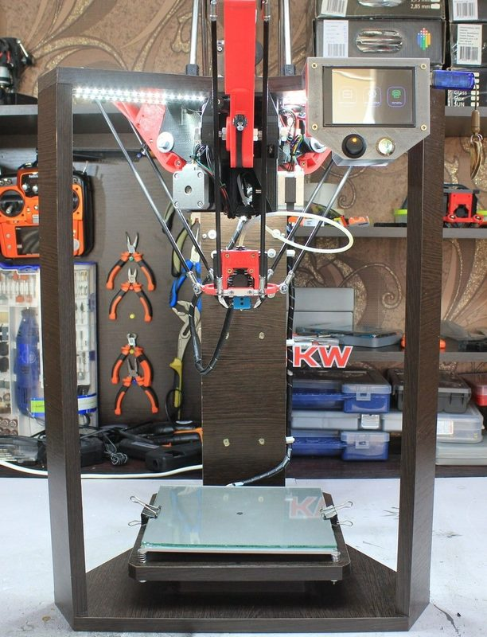
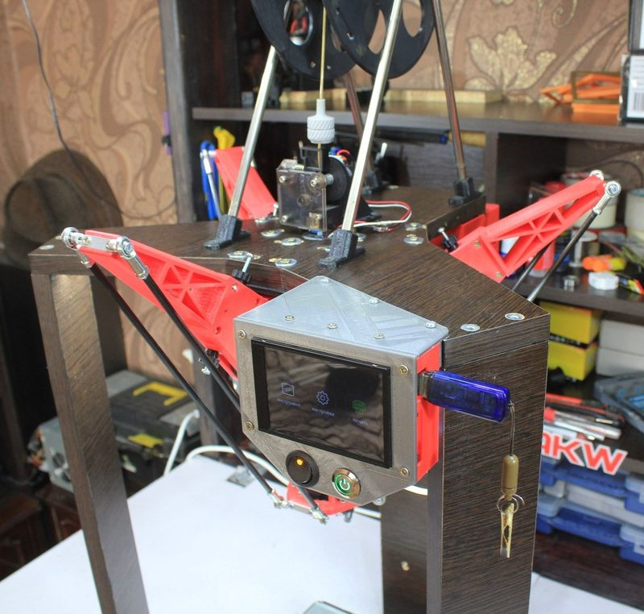

# Archie

[Catalog row](../../README.md#archie) · [Gallery](../../GALLERY.md)

| Field | Value |
| --- | --- |
| Section | Legacy designs |
| Project page | [https://www.thingiverse.com/thing:4591379](https://www.thingiverse.com/thing:4591379) |
| Author | Alex Korvin Workshop |
| About | Rotary delta printer: three geared motors swing printed arms, and the frame is laminated chipboard. Versions: Mk3 (2019) with STEP files and Mk4 (2020) with STL files, both shown in a Russian build series, and a Mk5 build series started in 2025 without public files. No update since 2020-09. |
| Build volume (X×Y×Z) | — |
| Exterior (W×D×H) | — |
| Latest version | Mk4 Files [2020-09](https://www.thingiverse.com/thing:4591379/files) |
| Stars Likes Views | [💙⁠769](https://www.thingiverse.com/thing:3489886) [⏯️⁠220K](https://www.youtube.com/watch?v=6oefrWdS_3M) [❤️⁠11K](https://www.youtube.com/watch?v=6oefrWdS_3M) |
| Links | [STL](https://www.thingiverse.com/thing:4591379/files) [Video](https://www.youtube.com/watch?v=EwMg9Ciu0s8) [STEP](https://www.thingiverse.com/thing:3489886/files) old Mk3 [Video](https://www.youtube.com/watch?v=6oefrWdS_3M) old Mk3 |
| Groups | [Telegram](https://t.me/alexkorvinworkshop) RU 1K |
| License | [CC BY 4.0 (Mk4, Thingiverse), GPL-2.0 (Mk3, Thingiverse)](https://www.thingiverse.com/thing:4591379) |

## Pictures (5)

<table>
<tr><td align="center" width="33%"> Version: Mk4 Photo: <a href="https://www.thingiverse.com/AlexKorvin/designs">Alex Korvin Workshop</a></td><td align="center" width="33%"> Version: Mk4 Photo: <a href="https://www.thingiverse.com/AlexKorvin/designs">Alex Korvin Workshop</a></td><td align="center" width="33%"> Version: Mk4 Photo: <a href="https://www.youtube.com/channel/UC1hTVMHtymDyki6jrfH8baQ">Alex Korvin Workshop</a></td></tr>
<tr><td align="center" width="33%"> Version: Mk3 Photo: <a href="https://www.thingiverse.com/AlexKorvin/designs">Alex Korvin Workshop</a></td><td align="center" width="33%"> Version: Mk3 Photo: <a href="https://www.thingiverse.com/AlexKorvin/designs">Alex Korvin Workshop</a></td></tr>
</table>
