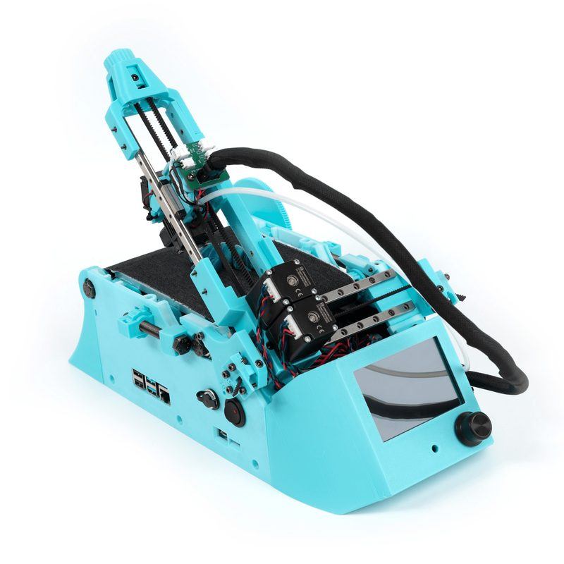
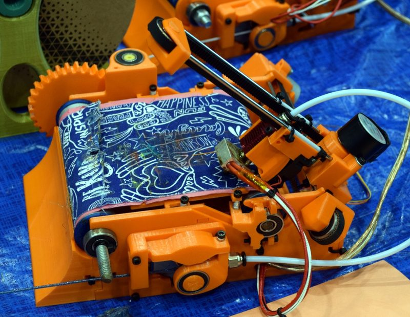
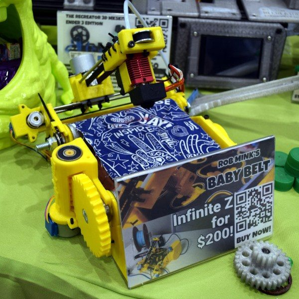
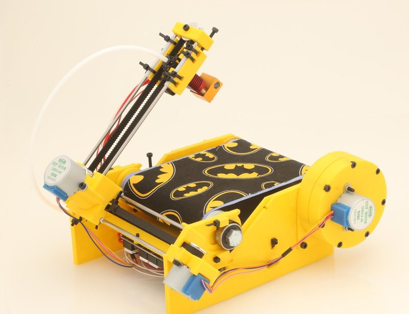
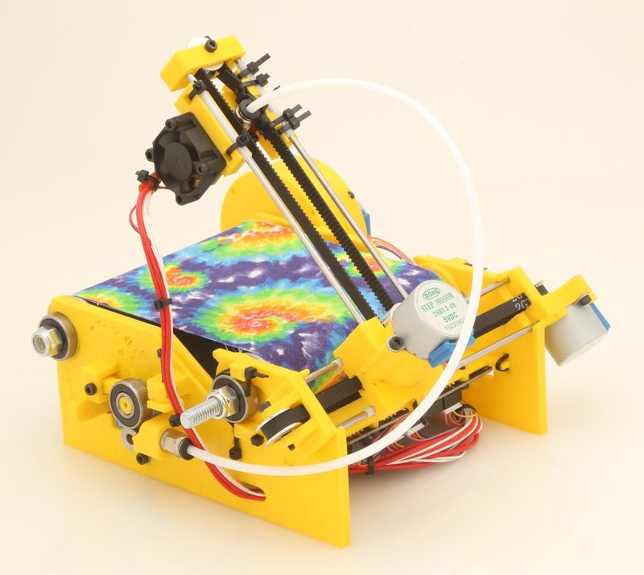
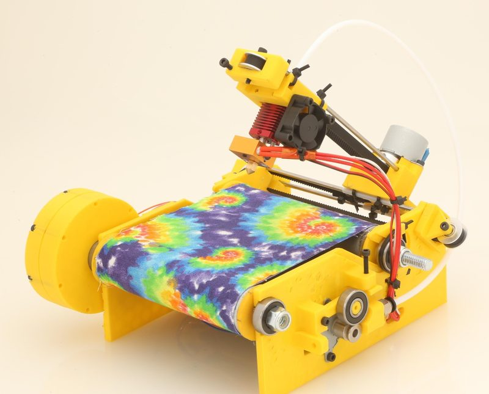

# BabyBelt Pro

[Catalog row](../../README.md#babybelt-pro) · [Gallery](../../GALLERY.md)

| Field | Value |
| --- | --- |
| Section | Other motion systems |
| Project page | [https://github.com/RobMink/BabyBeltPro](https://github.com/RobMink/BabyBeltPro) |
| Author | Rob Mink |
| About | Compact belt printer. |
| Build type | Belt printer |
| Build volume (X×Y×Z) | 100×100×∞ |
| Exterior (W×D×H) | — |
| Latest version | v2.6 [2026-06](https://github.com/RobMink/BabyBeltPro/blob/HEAD/documentation/CHANGE-LOG.md#2026-06-20) |
| Stars Likes Views |  [⏯️⁠2.1K](https://www.youtube.com/watch?v=joXvj6Lqx88) [❤️⁠72](https://www.youtube.com/watch?v=joXvj6Lqx88) |
| Links | [STEP](https://github.com/RobMink/BabyBeltPro/blob/HEAD/CAD/BBProV2POINT6.stp) [Manual](https://github.com/RobMink/BabyBeltPro/blob/HEAD/documentation/bbpv2_build_guide.md) |
| Groups | [Discord](https://discord.gg/NTDZMsCwXh) EN 886 |

## Pictures (7)

<table>
<tr><td align="center" width="33%"> Photo: <a href="https://github.com/rexit1982">rexit1982</a></td><td align="center" width="33%"> Photo: <a href="https://west3d.com/">West3D/LDO</a></td><td align="center" width="33%"> Photo: <a href="https://hackaday.com/author/tomnardi/">Tom Nardi</a></td></tr>
<tr><td align="center" width="33%"> Photo: <a href="https://hackaday.com/author/tomnardi/">Tom Nardi</a></td><td align="center" width="33%"> Photo: <a href="https://www.reddit.com/user/geking">u/geking</a></td><td align="center" width="33%"> Photo: <a href="https://www.reddit.com/user/Inserttext12">u/Inserttext12</a></td></tr>
<tr><td align="center" width="33%"> Photo: <a href="https://www.reddit.com/user/geking">u/geking</a></td></tr>
</table>
