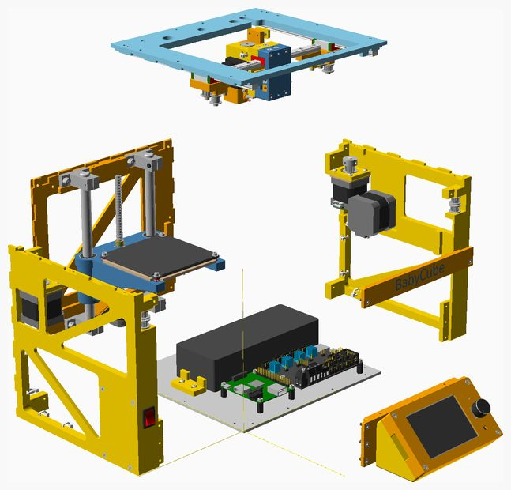
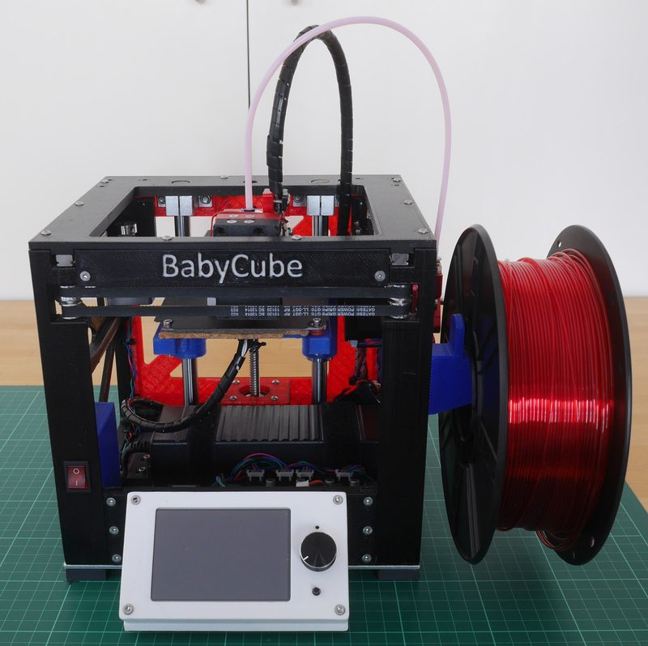
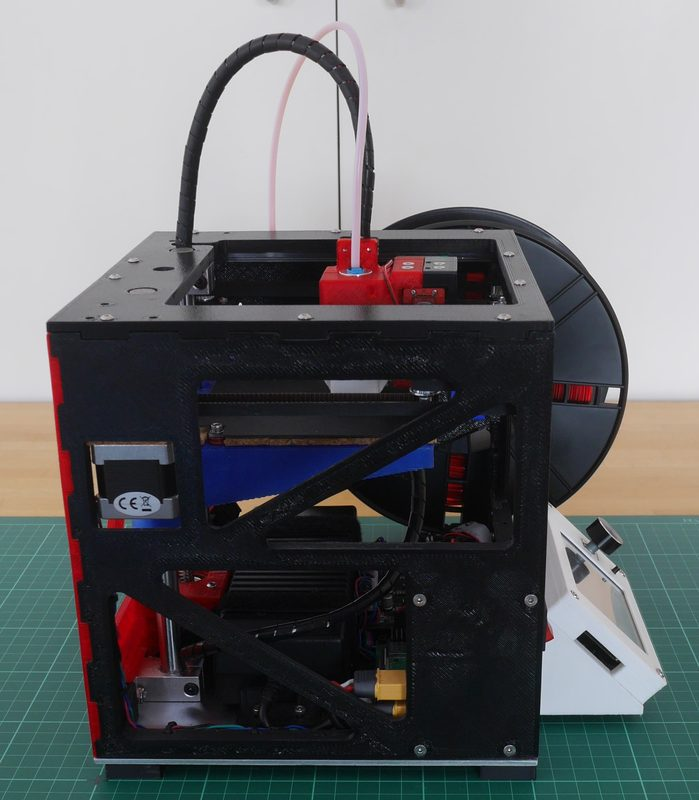
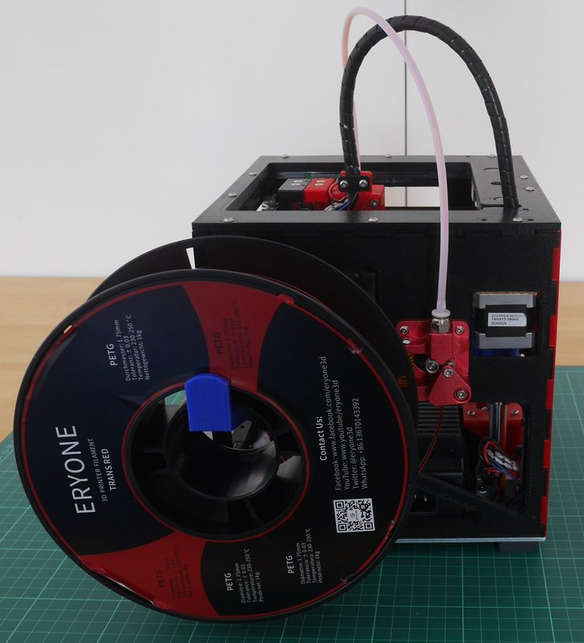
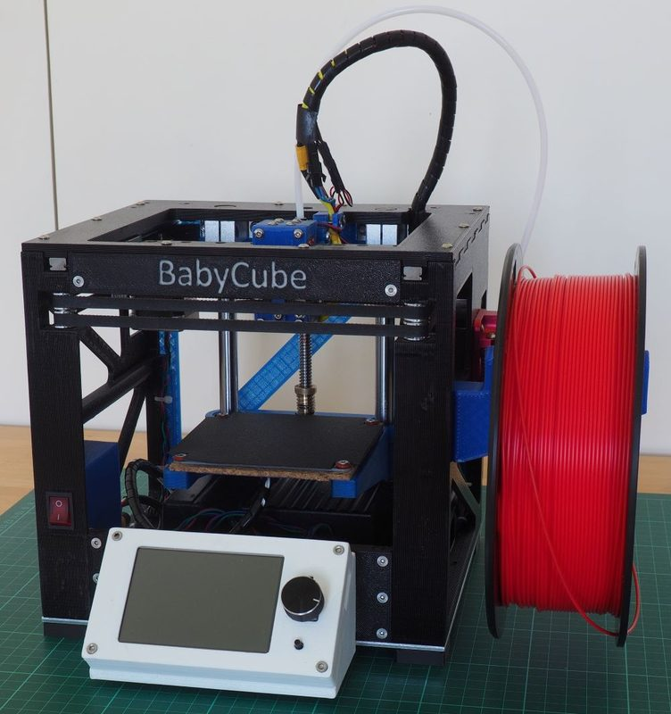

# BabyCube

[Catalog row](../../README.md#babycube) · [Gallery](../../GALLERY.md)

| Field | Value |
| --- | --- |
| Section | CoreXY · Small (≤180 mm representative X/Y size) |
| Project page | [https://github.com/martinbudden/BabyCube](https://github.com/martinbudden/BabyCube) |
| Author | Martin Budden |
| About | Printed-frame mini CoreXY with linear rails and a roughly 90 × 80 × 60 mm build volume. |
| Build volume (X×Y×Z) | 90×80×60 |
| Exterior (W×D×H) | 248×272×211 |
| Latest version | CAD [2024-11](https://github.com/martinbudden/BabyCube/commit/423e054dc83208dce2bd1ad6f3b843f601238b6d) |
| Stars Likes Views |  [💙⁠107](https://www.thingiverse.com/thing:4911835) [🧡⁠62](https://www.printables.com/model/218876-babycube-small-corexy-3d-printer) [⏯️⁠6.4K](https://www.youtube.com/watch?v=HpjnHnVyvj4) [❤️⁠125](https://www.youtube.com/watch?v=HpjnHnVyvj4) |
| Links | [Manual](https://github.com/martinbudden/BabyCube/blob/main/BC200/readme.md) [CAD](https://github.com/martinbudden/BabyCube/tree/main/scad) [Video](https://www.youtube.com/watch?list=PLbNI1Rcik-oIJZLZGHtmtgYNiHBKnzX2O&v=Hourt_4GOHs) |
| Groups | — |

## Pictures (6)

<table>
<tr><td align="center" width="33%"></td><td align="center" width="33%"></td><td align="center" width="33%"></td></tr>
<tr><td align="center" width="33%"></td><td align="center" width="33%"></td><td align="center" width="33%"></td></tr>
</table>
