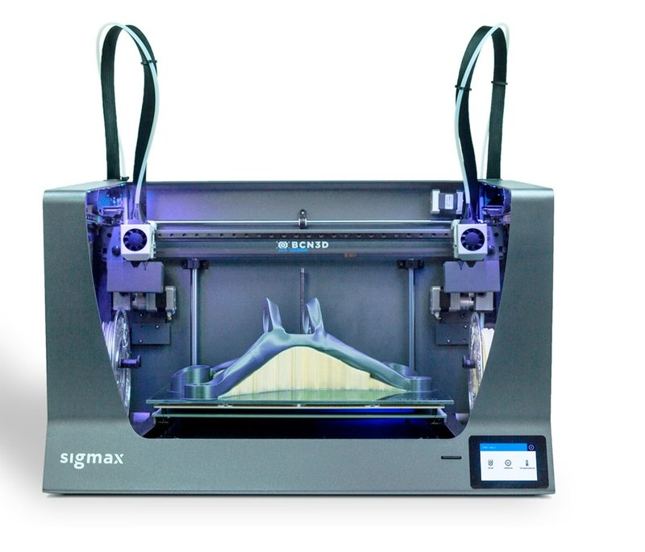
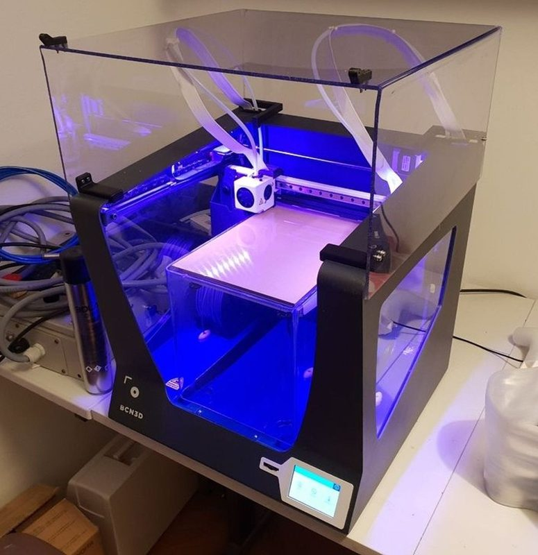

# BCN3D Sigma / Sigma R19 / Sigmax

[Catalog row](../../README.md#bcn3d-sigma) · [Gallery](../../GALLERY.md)

| Field | Value |
| --- | --- |
| Section | Legacy designs |
| Project page | [https://github.com/BCN3D/BCN3DSigma-Mechanics](https://github.com/BCN3D/BCN3DSigma-Mechanics) |
| Author | BCN3D Technologies |
| About | IDEX printer with two independent heads on one X beam and a welded aluminium unibody frame, released with SolidWorks CAD, drawings and BOMs. The row covers the Sigma, the Sigma R19 and the wide Sigmax. No update since 2019-10. |
| Build volume (X×Y×Z) | Sigma, R19: 210×297×210 Sigmax: 420×297×210 |
| Exterior (W×D×H) | Sigma, R19: 465×440×? Sigmax: 675×440×? |
| Latest version | v0.1 [2019-10](https://github.com/BCN3D/BCN3DSigmaR19/releases/tag/v0.1) |
| Stars Likes Views |  [⏯️⁠161K](https://www.youtube.com/watch?v=q7UxQWz5Nm8) [❤️⁠310](https://www.youtube.com/watch?v=q7UxQWz5Nm8) |
| Links | [CAD](https://github.com/BCN3D/BCN3DSigma-Mechanics/tree/master/CAD) Sigma [BOM](https://github.com/BCN3D/BCN3DSigma-Mechanics/blob/master/BOM.pdf) Sigma [STEP](https://github.com/BCN3D/BCN3DSigmaR19/blob/master/CAD/BCN3DSigma%20R19.STEP.zip) R19 [Files](https://github.com/BCN3D/BCN3DSigmaR19/tree/master/PDF) R19 [STEP](https://github.com/BCN3D/BCN3DSigmax-Mechanics/tree/master/CAD/STEP) Sigmax [BOM](https://github.com/BCN3D/BCN3DSigmax-Mechanics/blob/master/BOM%20Sigmax.pdf) Sigmax |
| Groups | — |
| License | [CERN OHL v1.2 (GitHub)](https://github.com/BCN3D/BCN3DSigma-Mechanics/tree/master/LICENSE) |

## Pictures (3)

<table>
<tr><td align="center" width="33%"> Version: Sigma R19 Photo: <a href="https://github.com/BCN3D">BCN3D</a></td><td align="center" width="33%"> Version: Sigmax R19 Photo: <a href="https://github.com/BCN3D">BCN3D</a></td><td align="center" width="33%"> Photo: <a href="https://www.printables.com/@Jonni_351951">Jonni</a></td></tr>
</table>
