# BLV MGN Cube

[Catalog row](../../README.md#blv-mgn-cube) · [Gallery](../../GALLERY.md)

| Field | Value |
| --- | --- |
| Section | Historical designs |
| Project page | [https://www.thingiverse.com/thing:3382718](https://www.thingiverse.com/thing:3382718) |
| Author | BLV |
| About | Cube design built around linear rails. It made linear rails common on DIY cubes. |
| Build volume (X×Y×Z) | 300×300×365 |
| Exterior (W×D×H) | 576×536×560 |
| Latest version | Log [2019-09](https://www.thingiverse.com/thing:3382718) |
| Stars Likes Views | [💙⁠8.5K](https://www.thingiverse.com/thing:3382718) [🧡⁠142](https://www.printables.com/model/46738) [⏯️⁠115K](https://www.youtube.com/watch?v=N3xaPhAPYKM) [❤️⁠417](https://www.youtube.com/watch?v=N3xaPhAPYKM) |
| Links | [Files](https://www.thingiverse.com/thing:3382718/files) |
| Groups | [Facebook](https://www.facebook.com/groups/BenLevi) EN 7K [Facebook](https://www.facebook.com/groups/578496329454012/) TR 190 [Facebook](https://www.facebook.com/groups/419619945577500/) IT 174 [Facebook](https://www.facebook.com/groups/386234302158871/) DE 158 |
| License | [CC BY-NC-SA 3.0](https://web.archive.org/web/20190717111409/http://www.thingiverse.com/thing:3382718) |

## Pictures (15)

<table>
<tr><td align="center" width="33%"> Photo: <a href="https://www.printables.com/@BenLeviBLV">Ben Levi (BLV)</a></td><td align="center" width="33%"><a href="1-blv-mgn-cube.jpg">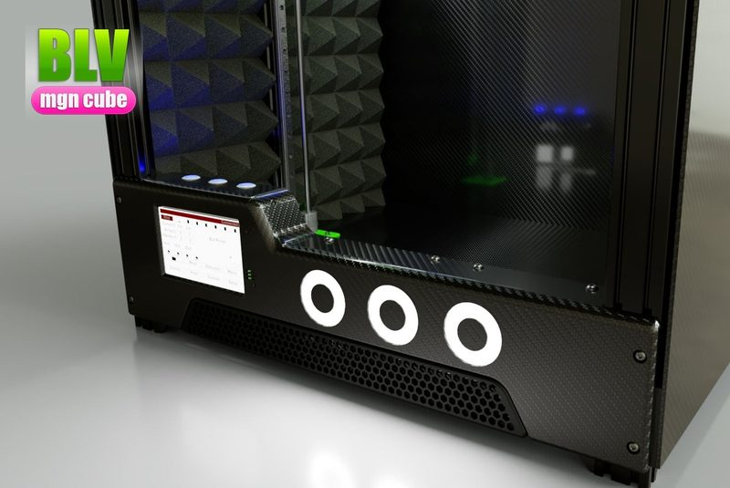</a> Photo: <a href="https://www.printables.com/@BenLeviBLV">Ben Levi (BLV)</a></td><td align="center" width="33%"><a href="2-blv-mgn-cube.jpg">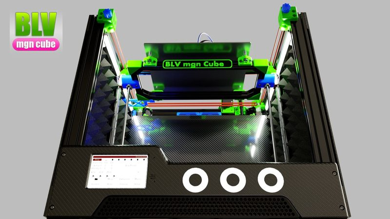</a> Photo: <a href="https://www.printables.com/@BenLeviBLV">Ben Levi (BLV)</a></td></tr>
<tr><td align="center" width="33%"><a href="3-blv-mgn-cube.jpg">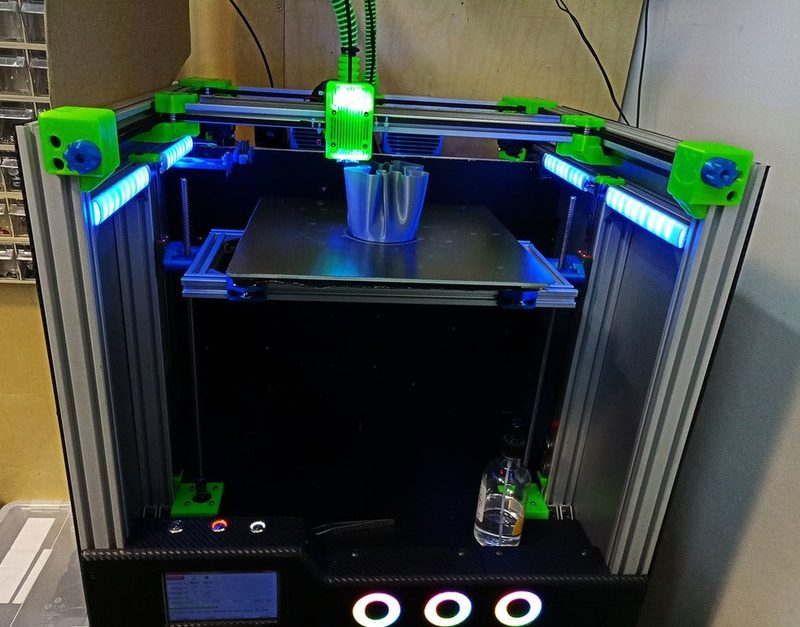</a> Photo: <a href="https://www.printables.com/@BenLeviBLV">Ben Levi (BLV)</a></td><td align="center" width="33%"><a href="4-blv-mgn-cube.jpg">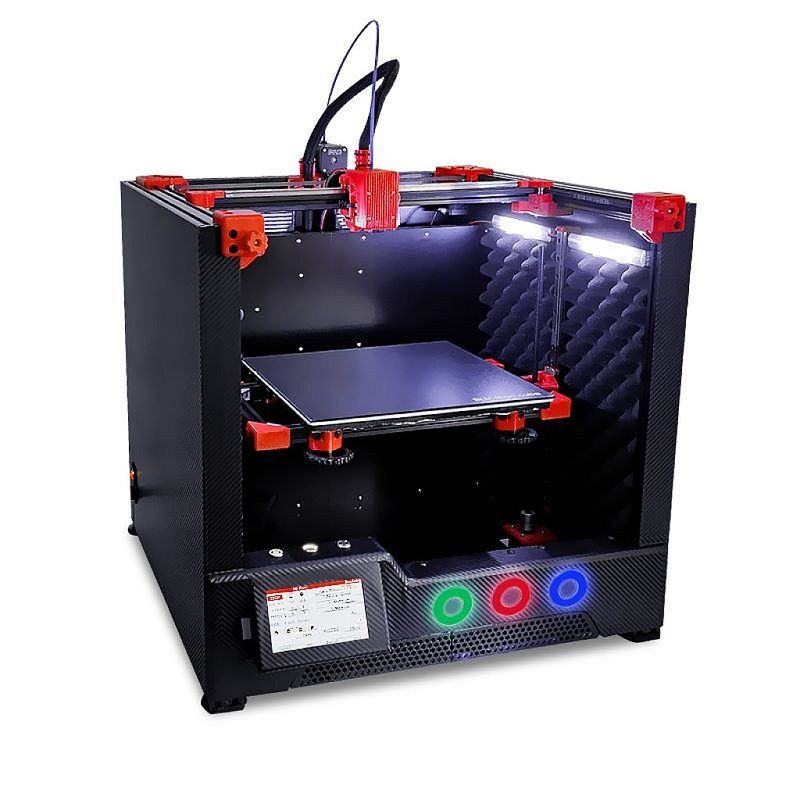</a> Photo: <a href="https://github.com/FYSETC">FYSETC</a></td><td align="center" width="33%"><a href="5-blv-mgn-cube.jpg">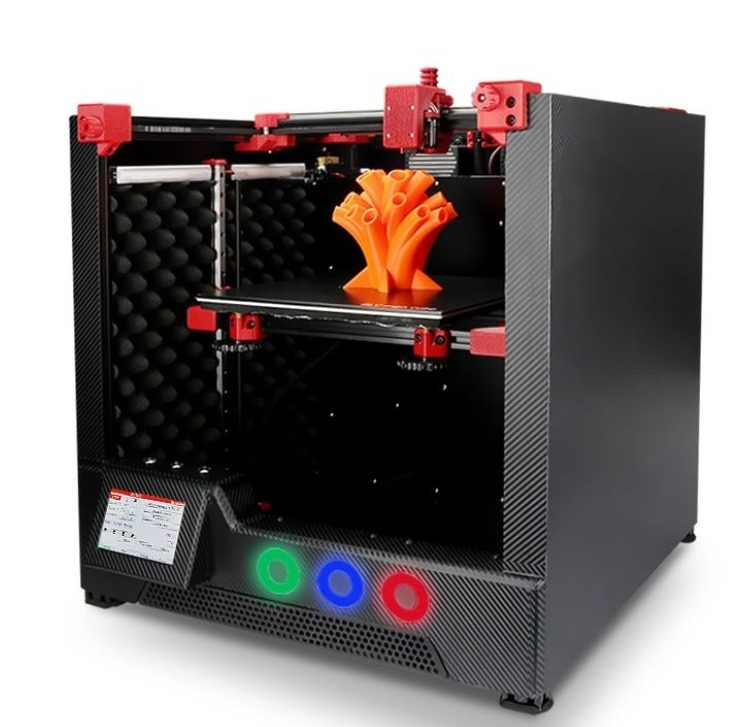</a> Photo: <a href="https://github.com/FYSETC">FYSETC</a></td></tr>
<tr><td align="center" width="33%"><a href="6-blv-mgn-cube.jpg">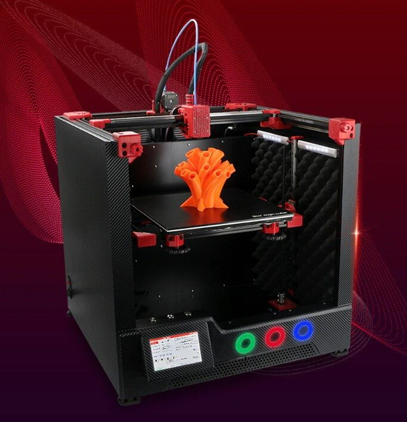</a> Photo: <a href="https://github.com/FYSETC">FYSETC</a></td><td align="center" width="33%"><a href="7-blv-mgn-cube.jpg">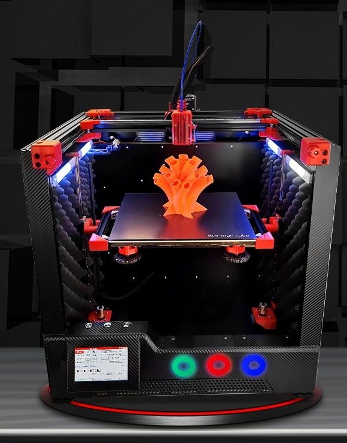</a> Photo: <a href="https://github.com/FYSETC">FYSETC</a></td><td align="center" width="33%"><a href="8-blv-mgn-cube.jpg">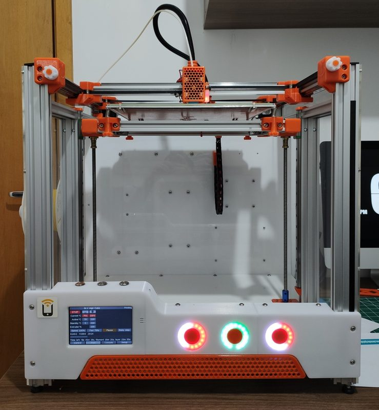</a> Photo: <a href="https://cults3d.com/en/users/antunisac">antunisac</a></td></tr>
<tr><td align="center" width="33%"><a href="9-blv-mgn-cube.jpg">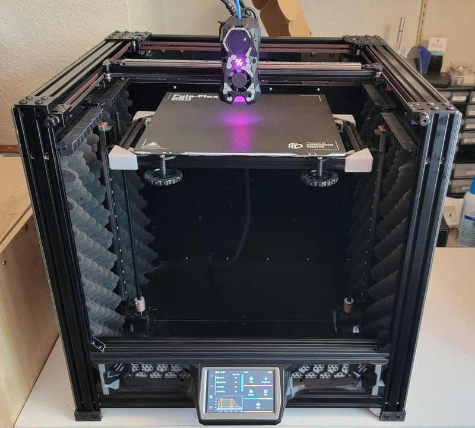</a> Photo: <a href="https://www.printables.com/@ChavoStyle_1054296">Chavo Style</a></td><td align="center" width="33%"><a href="10-blv-mgn-cube.jpg">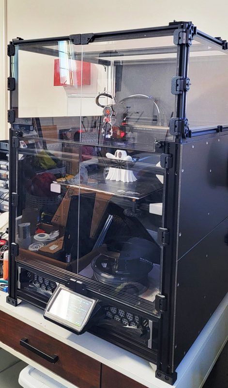</a> Version: TopHat enclosure mod Photo: <a href="https://www.printables.com/@ChavoStyle_1054296">Chavo Style</a></td><td align="center" width="33%"><a href="11-blv-mgn-cube.jpg">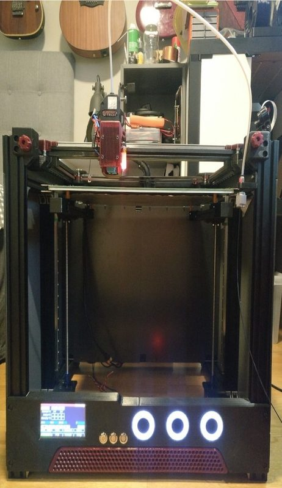</a> Version: 410 mm bed mod (CR-10S bed) Photo: <a href="https://www.printables.com/@Swesen_3047">Swesen</a></td></tr>
<tr><td align="center" width="33%"><a href="12-blv-mgn-cube.jpg">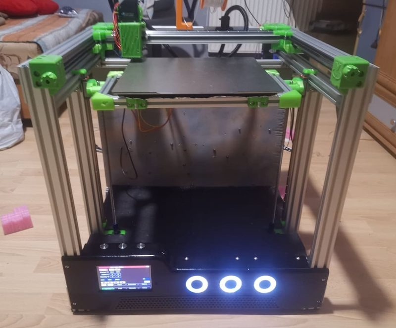</a> Photo: <a href="https://www.printables.com/@jacekpom">jacekpom</a></td><td align="center" width="33%"><a href="13-blv-mgn-cube.jpg">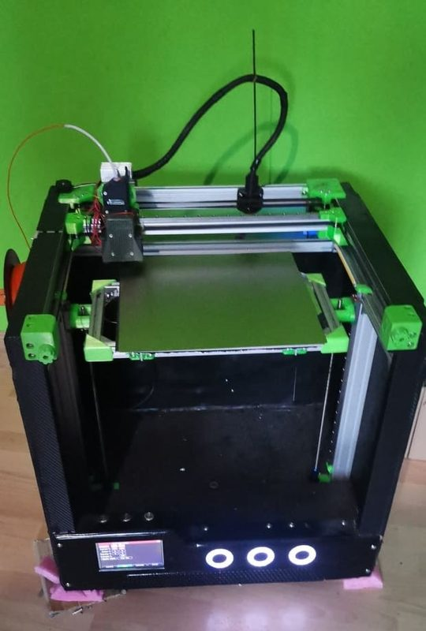</a> Photo: <a href="https://www.printables.com/@jacekpom">jacekpom</a></td><td align="center" width="33%"><a href="14-blv-mgn-cube.jpg">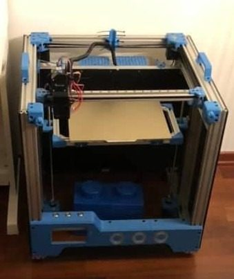</a> Photo: <a href="https://www.printables.com/@ChristianErazo">Christian Erazo</a></td></tr>
</table>

## Other homes of the files

- [Printables](https://www.printables.com/model/46738-blv-mgn-cube-3d-printer-by-ben-levi): full STEP assembly, carriage STEP and STL, uploaded 2020-11. CC BY-NC-SA.
- [GitHub, FYSETC](https://github.com/FYSETC/FYSETC-BLV-MGN-CUBE): STL, docs and firmware for the FYSETC kit version (re-upload by FYSETC). No license file.
- Wayback Machine: [latest snapshot](https://web.archive.org/web/20260907170126/https://www.thingiverse.com/thing:3382718), 2026-09-07.
