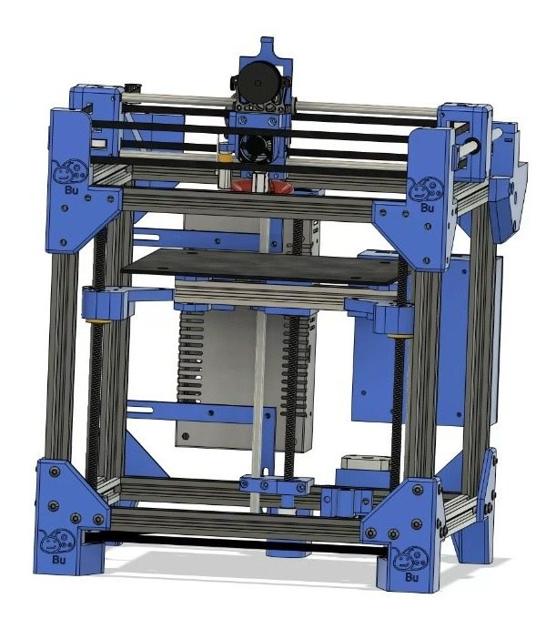
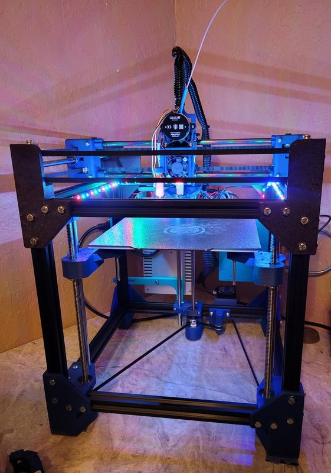
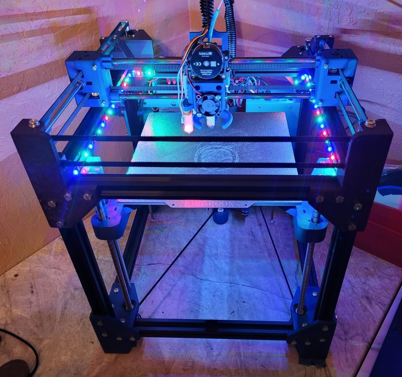
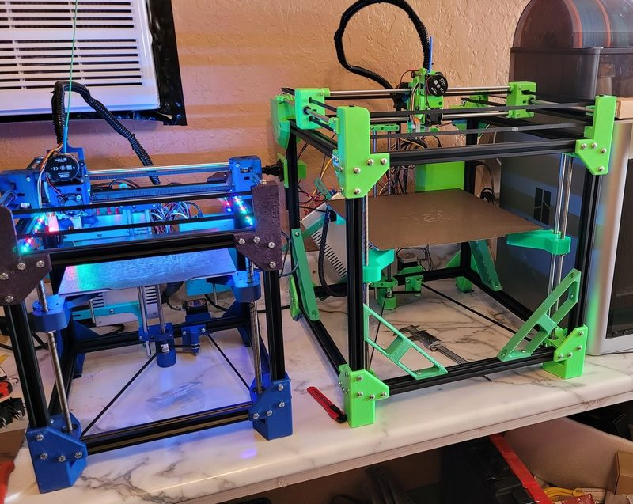
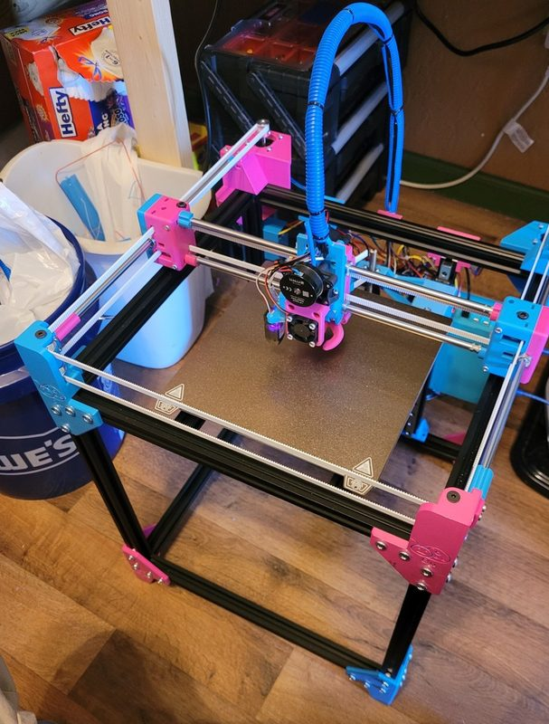
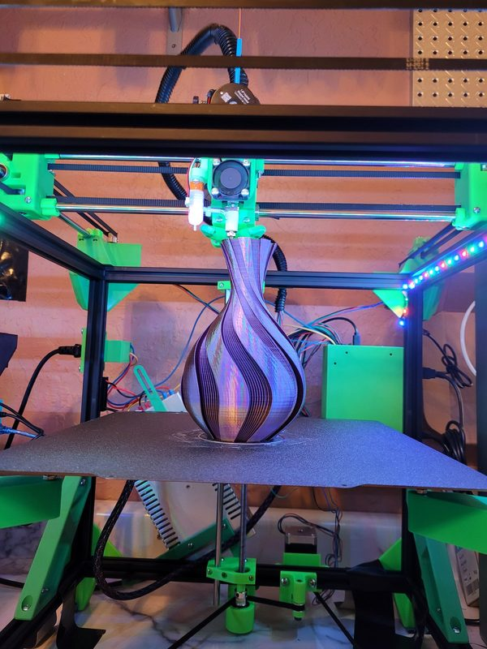

# BugBu

[Catalog row](../../README.md#bugbu) · [Gallery](../../GALLERY.md)

| Field | Value |
| --- | --- |
| Section | CoreXY · Medium (181–299 mm representative X/Y size) |
| Project page | [https://github.com/Rolls17/BugBu](https://github.com/Rolls17/BugBu) |
| Author | Royce Rentz |
| About | Low-cost CoreXY in the style of the Bambu Lab P1P, with linear rods on X and Y and one Z motor driving belted lead screws. It comes in 210, 260 and 310 sizes. |
| Build volume (X×Y×Z) | 210: 215×200×210 260: 260×250×300 310: 310×300×310 |
| Exterior (W×D×H) | 210: 300×300×? |
| Latest version | STEP [2024-03](https://github.com/Rolls17/BugBu/commit/44cc65658ebc31723f5b3ca60e9b84ceb41b248f) |
| Stars Likes Views |  [🧡⁠39](https://www.printables.com/model/481604-bugbu-260) [💚⁠50](https://makerworld.com/en/models/15420-bugbu-corexy-3d-printer) [⏯️⁠2.7K](https://www.youtube.com/watch?v=87gVqnMzinw) [❤️⁠55](https://www.youtube.com/watch?v=87gVqnMzinw) |
| Links | [STL](https://github.com/Rolls17/BugBu/tree/main/STL%20Files) [CAD](https://github.com/Rolls17/BugBu/tree/main/CAD) [STEP](https://github.com/Rolls17/BugBu/blob/main/CAD/BugBu%20310%20Step%20Parts.zip) 310 [BOM](https://github.com/Rolls17/BugBu/blob/main/Bugbu%20210%20BOM.pdf) 210 [BOM](https://github.com/Rolls17/BugBu/blob/main/260/Bugbu%20260%20BOM.pdf) 260 [BOM](https://github.com/Rolls17/BugBu/blob/main/Bugbu_310_BOM.pdf) 310 [Manual](https://github.com/Rolls17/BugBu/blob/main/Printer%20Orientation,%20Parts,%20&%20Assembly.pdf) [Manual](https://github.com/Rolls17/BugBu/blob/main/260/Printer%20Orientation,%20Parts,%20&%20Assembly%20260%20(1).pdf) 260 [Config](https://github.com/Rolls17/BugBu/tree/main/Mainboard%20Configs) |
| Groups | [Discord](https://discord.gg/kHFhCXZnxb) EN 557 |
| License | [CC BY-NC 4.0 (GitHub README, Printables)](https://github.com/Rolls17/BugBu#readme) |

## Pictures (6)

<table>
<tr><td align="center" width="33%"> Version: BugBu 210 Photo: <a href="https://github.com/Rolls17">Rolls17</a></td><td align="center" width="33%"> Version: BugBu 210 Photo: <a href="https://github.com/Rolls17">Rolls17</a></td><td align="center" width="33%"> Version: BugBu 210 Photo: <a href="https://github.com/Rolls17">Rolls17</a></td></tr>
<tr><td align="center" width="33%"> Version: BugBu 210 (left) and BugBu 310 (right) Photo: <a href="https://www.printables.com/@Rolls17_586768">Rolls17</a></td><td align="center" width="33%"> Version: BugBu 260 Photo: <a href="https://www.printables.com/@Rolls17_586768">Rolls17</a></td><td align="center" width="33%"> Version: BugBu 310 Photo: <a href="https://www.printables.com/@Rolls17_586768">Rolls17</a></td></tr>
</table>
