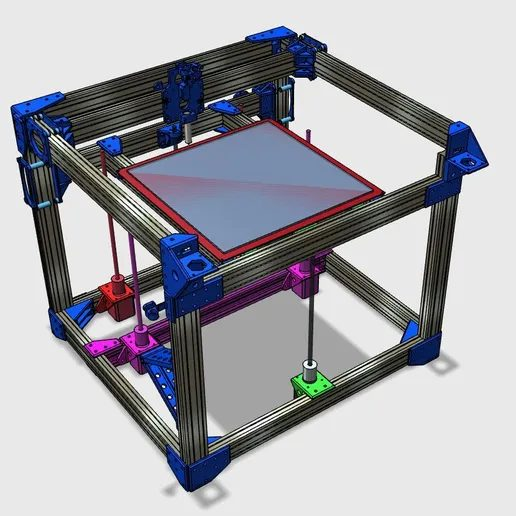
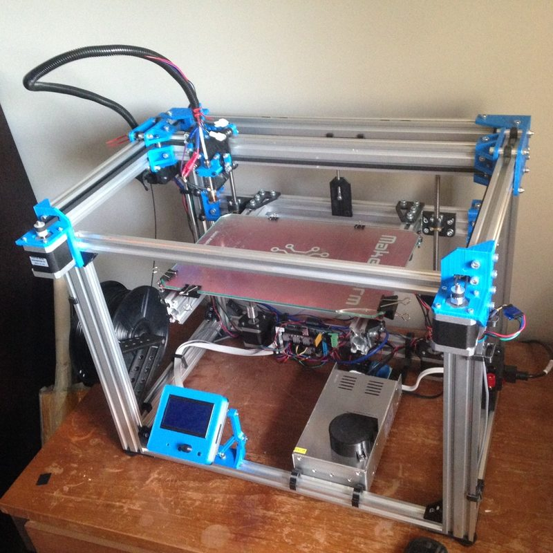
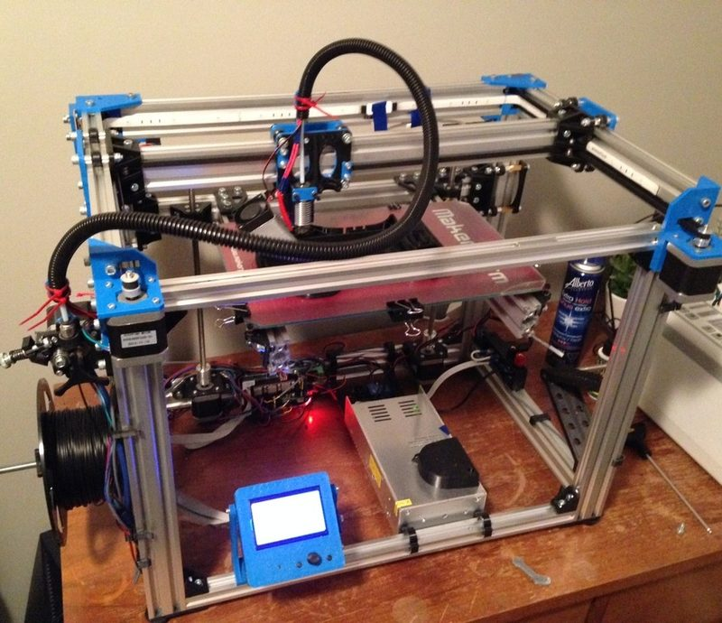
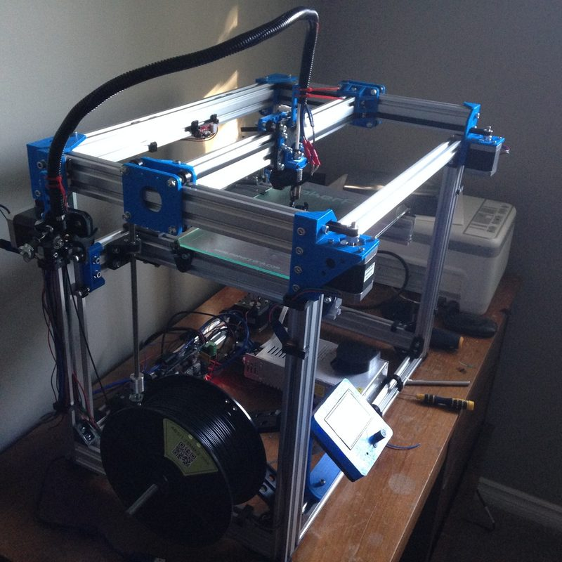
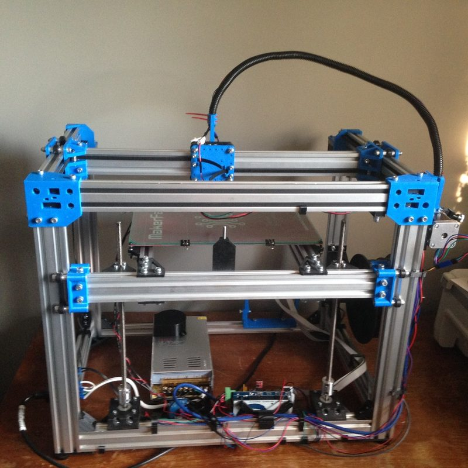
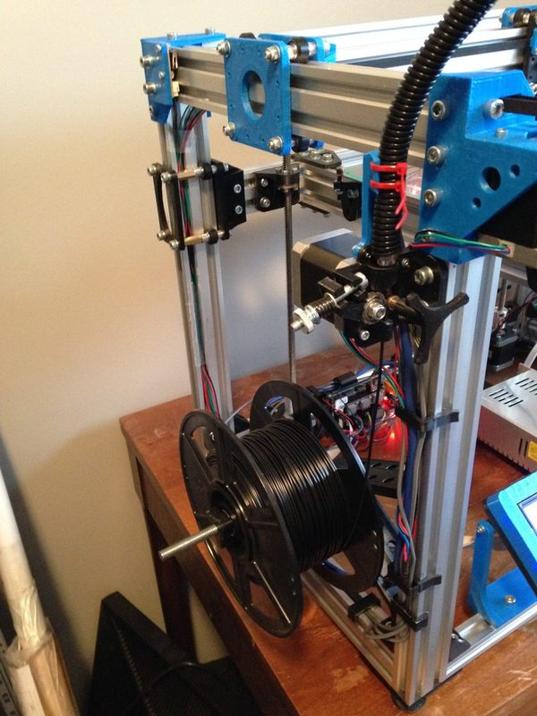
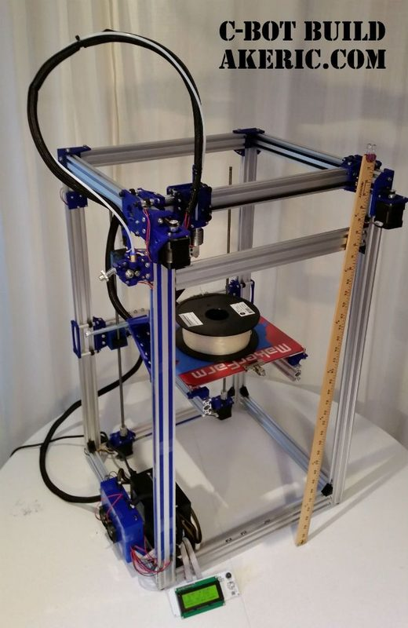
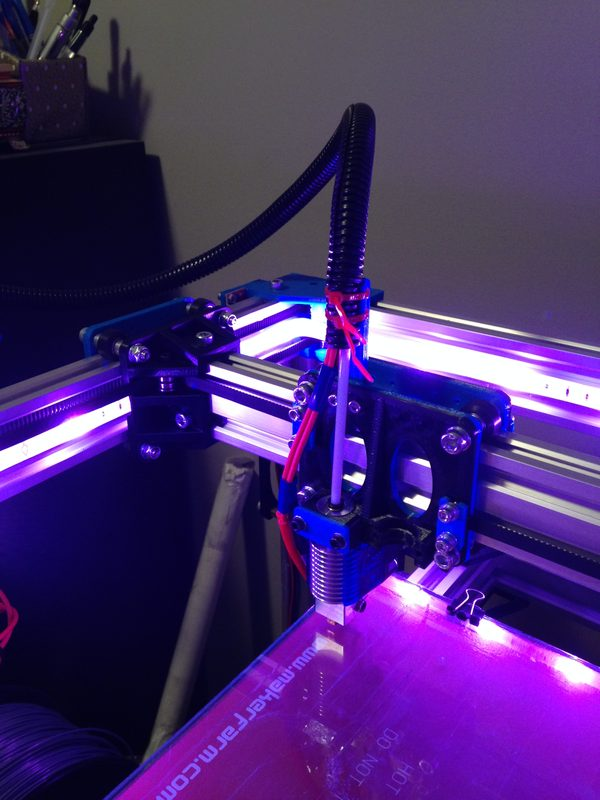
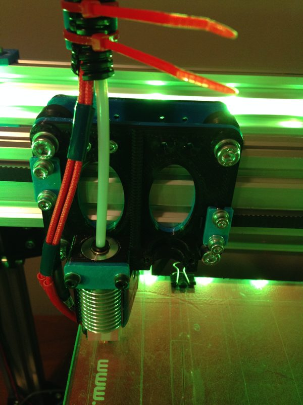

# C-Bot

[Catalog row](../../README.md#c-bot) · [Gallery](../../GALLERY.md)

| Field | Value |
| --- | --- |
| Section | Historical designs |
| Project page | [https://www.thingiverse.com/thing:500041](https://www.thingiverse.com/thing:500041) |
| Author | Carl Feniak |
| About | V-slot wheel CoreXY on extrusion, and the parent of the D-Bot. |
| Build volume (X×Y×Z) | configurable |
| Exterior (W×D×H) | — |
| Latest version | Rework [2016-03](https://www.thingiverse.com/thing:500041/files) |
| Stars Likes Views | [💙⁠859](https://www.thingiverse.com/thing:500041) |
| Links | [Files](https://www.thingiverse.com/thing:500041/files) |
| Groups | [Facebook](https://www.facebook.com/groups/1711323699127948/) EN 5K inactive [Telegram](https://t.me/cbotdbotcorexy) ES 260 |
| License | [CC BY-SA 3.0](https://web.archive.org/web/20170720055344/https://www.thingiverse.com/thing:500041) |

## Pictures (9)

<table>
<tr><td align="center" width="33%"></td><td align="center" width="33%"> Photo: <a href="https://cults3d.com/en/users/cfeniak">cfeniak</a></td><td align="center" width="33%"> Photo: <a href="https://cults3d.com/en/users/cfeniak">cfeniak</a></td></tr>
<tr><td align="center" width="33%"> Photo: <a href="https://cults3d.com/en/users/cfeniak">cfeniak</a></td><td align="center" width="33%"> Photo: <a href="https://cults3d.com/en/users/cfeniak">cfeniak</a></td><td align="center" width="33%"> Photo: <a href="https://cults3d.com/en/users/cfeniak">cfeniak</a></td></tr>
<tr><td align="center" width="33%"> Photo: <a href="http://www.akeric.com/">Eric Pavey (AKEric)</a></td><td align="center" width="33%"> Photo: <a href="https://www.thingiverse.com/cfeniak">cfeniak</a></td><td align="center" width="33%"> Photo: <a href="https://www.thingiverse.com/cfeniak">cfeniak</a></td></tr>
</table>

## Other homes of the files

- Wayback Machine: [latest snapshot](https://web.archive.org/web/20250326050110/https://www.thingiverse.com/thing:500041), 2025-03-26.
