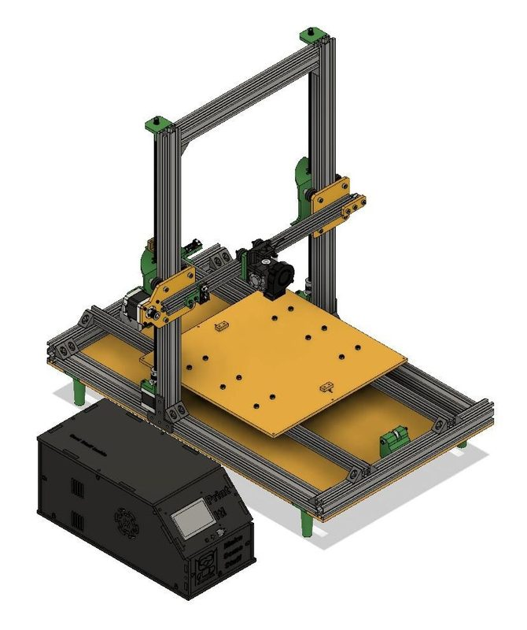
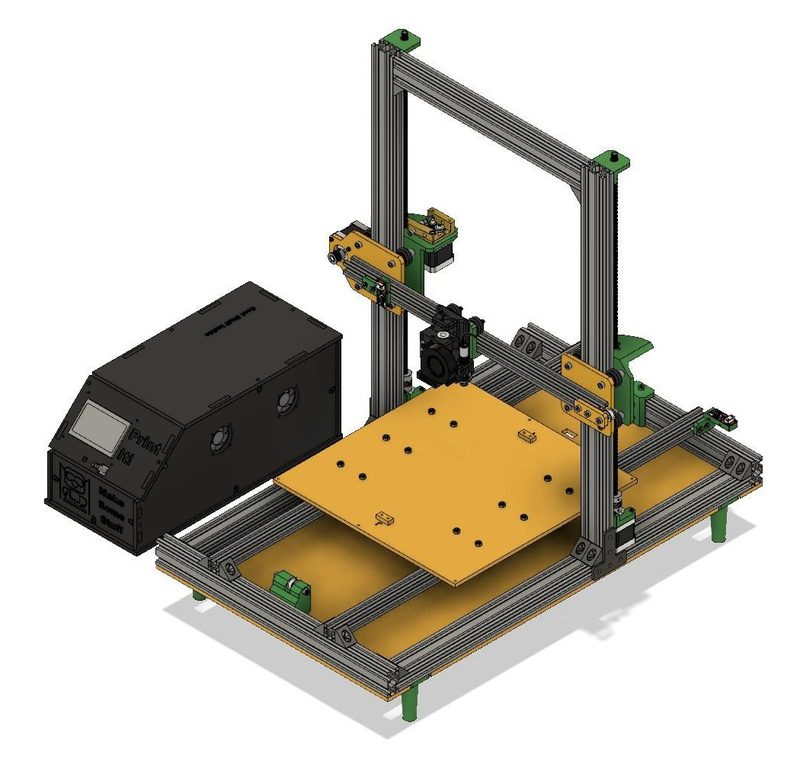
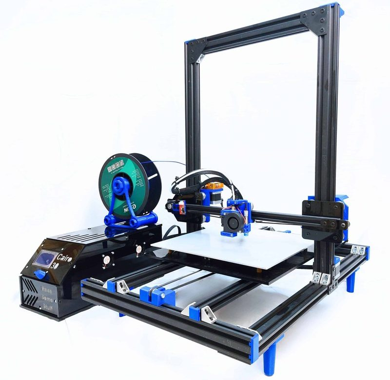
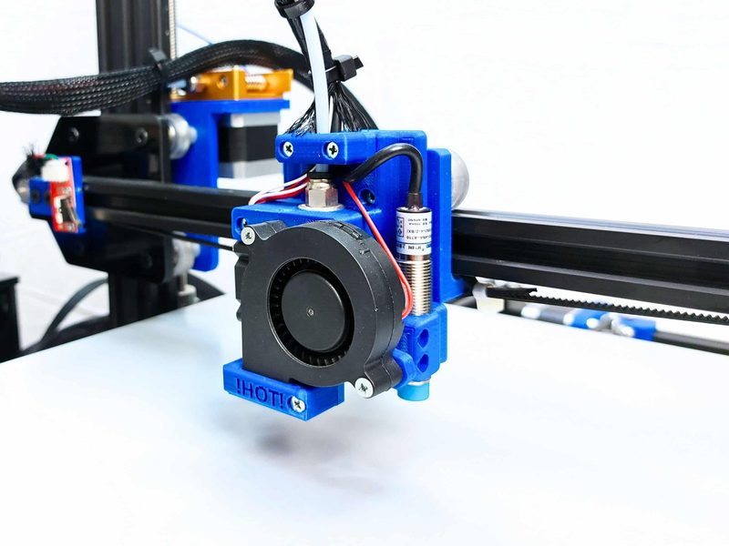
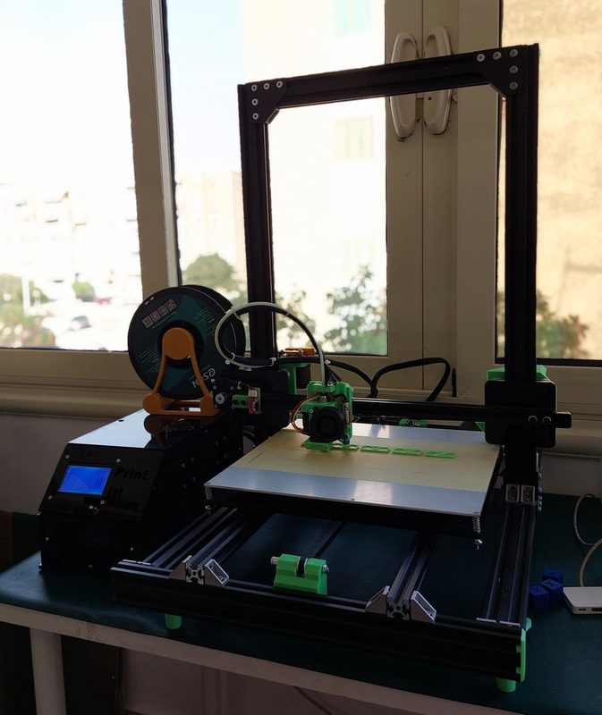
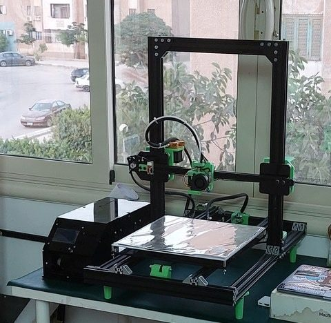

# Cairo30

[Catalog row](../../README.md#cairo30) · [Gallery](../../GALLERY.md)

| Field | Value |
| --- | --- |
| Section | Legacy designs |
| Project page | [https://makesomestuff.org/cairo30-3d-printer/](https://makesomestuff.org/cairo30-3d-printer/) |
| Author | Ahmed Ibrahim / Make Some Stuff |
| About | Larger successor of the [Cairo Mini](../../README.md#cairo-mini) with a two-post gantry, OpenBuilds extrusions, and laser-cut acrylic plates. No update since 2023-01. |
| Build volume (X×Y×Z) | 300×300×350 |
| Exterior (W×D×H) | — |
| Latest version | Files [2023-01](https://makesomestuff.org/cairo30-3d-printer/) |
| Stars Likes Views | [💙⁠2](https://www.thingiverse.com/thing:5832418) [⏯️⁠1.3K](https://www.youtube.com/watch?v=MpDkiP7E44c) [❤️⁠18](https://www.youtube.com/watch?v=MpDkiP7E44c) |
| Links | [STEP](https://grabcad.com/library/cairo30-3d-printer-1) [STL](https://makesomestuff.org/wp-content/uploads/2022/12/Cairo30_STLs.zip) [Files](https://makesomestuff.org/wp-content/uploads/2022/12/Cairo30_DXFs.zip) [BOM](https://docs.google.com/spreadsheets/d/11ssOeSZUKrPMiOd8EV-hkTQURSHo0WZH6QxySQ_BI0A/edit) [Manual](https://makesomestuff.org/cairo30-3d-printer-building-the-structure/) [Firmware](https://makesomestuff.org/wp-content/uploads/2022/12/Marlin-bugfix-2.0.x_Cairo30.zip) |
| Groups | [Facebook](https://www.facebook.com/groups/2085101554986922/) EN |
| License | [CERN-OHL-P-2.0 hardware, GPL-3.0 software, CC BY-SA 4.0 docs (project page), CC BY-SA 4.0 (Thingiverse), GPL (RepRap wiki)](https://makesomestuff.org/cairo30-3d-printer/) |

## Pictures (6)

<table>
<tr><td align="center" width="33%"> Photo: <a href="https://grabcad.com/ahmed.ibrahim-118">Ahmed Ibrahim</a></td><td align="center" width="33%"> Photo: <a href="https://grabcad.com/ahmed.ibrahim-118">Ahmed Ibrahim</a></td><td align="center" width="33%"> Photo: <a href="https://grabcad.com/ahmed.ibrahim-118">Ahmed Ibrahim</a></td></tr>
<tr><td align="center" width="33%"> Photo: <a href="https://grabcad.com/ahmed.ibrahim-118">Ahmed Ibrahim</a></td><td align="center" width="33%"> Version: prototype Photo: <a href="https://grabcad.com/ahmed.ibrahim-118">Ahmed Ibrahim</a></td><td align="center" width="33%"> Version: prototype Photo: <a href="https://grabcad.com/ahmed.ibrahim-118">Ahmed Ibrahim</a></td></tr>
</table>
