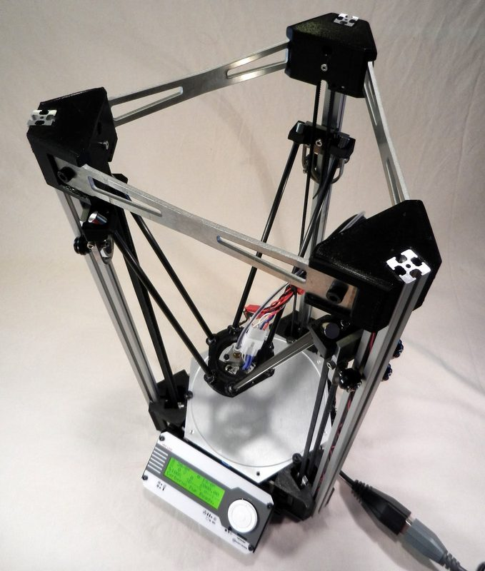
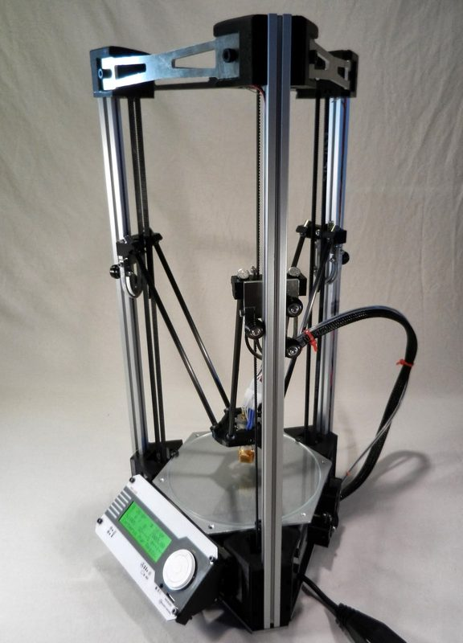
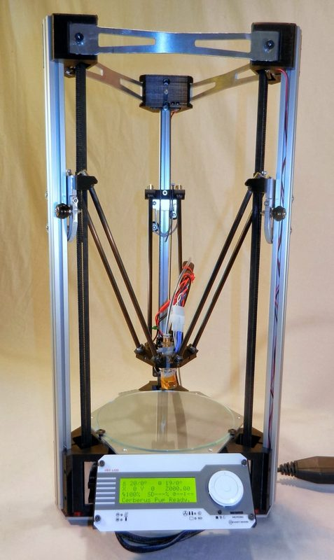
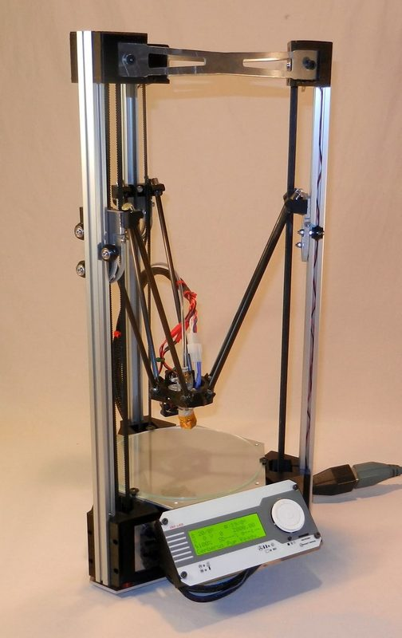
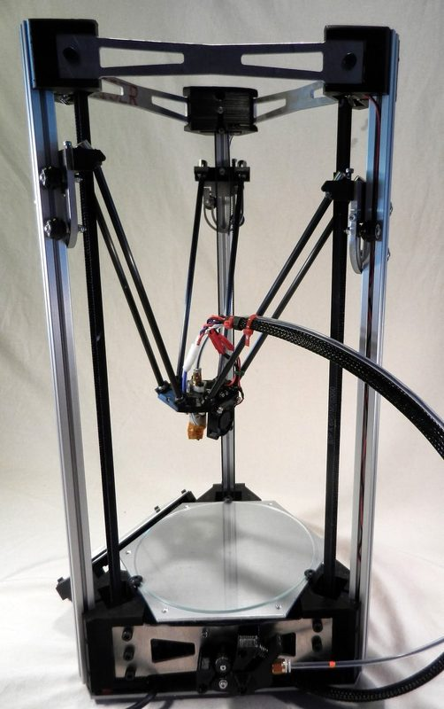
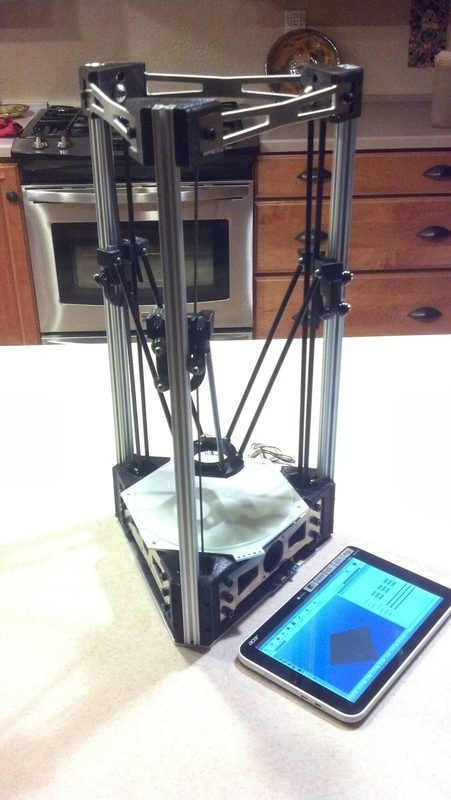
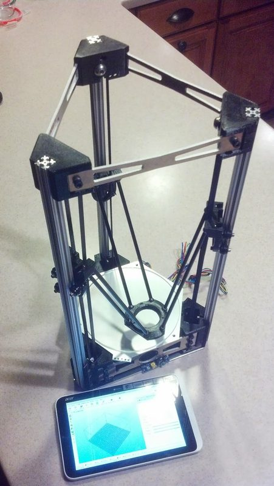

# Cerberus Pup

[Catalog row](../../README.md#cerberus-pup) · [Gallery](../../GALLERY.md)

| Field | Value |
| --- | --- |
| Section | Legacy designs |
| Project page | [https://github.com/grabercars/Cerberus_Pup_170_GT2_belt_drive](https://github.com/grabercars/Cerberus_Pup_170_GT2_belt_drive) |
| Author | Steve Graber |
| About | Small delta from the Cerberus line with magnetic ball joints and a hinged hotend that works as the Z probe. Versions are the first Pup with a spectra-line drive (2013-08) and the Pup 170 GT2 with belts (2014-01). No update since 2014-01. |
| Build volume (X×Y×Z) | Ø170×175 |
| Exterior (W×D×H) | ?×?×500 |
| Latest version | CAD [2014-01](https://github.com/grabercars/Cerberus_Pup_170_GT2_belt_drive/commit/86395df7d50b7719e71c8342dd7ff87961720b6b) |
| Stars Likes Views |  [⏯️⁠8.5K](https://www.youtube.com/watch?v=Ypm4oHYM4Uo) [❤️⁠25](https://www.youtube.com/watch?v=Ypm4oHYM4Uo) |
| Links | [Files](https://github.com/grabercars/Cerberus_Pup_170_GT2_belt_drive) 170 GT2 [BOM](https://github.com/grabercars/Cerberus_Pup_170_GT2_belt_drive/blob/master/CERBERUS%20PUP%20170%20GT2%20PARTS%20BOM.pdf) 170 GT2 [Firmware](https://github.com/grabercars/Marlin_FW-for-Cerberus_Pup_GT2_Belt) 170 GT2 [Files](https://github.com/grabercars/pup) old Pup |
| Groups | [Google Groups](https://groups.google.com/g/deltabot) EN [Forum](https://reprap.org/forum/list.php?178) EN |
| License | [CC BY-SA 3.0](https://github.com/grabercars/Cerberus_Pup_170_GT2_belt_drive#readme) |

## Pictures (7)

<table>
<tr><td align="center" width="33%"> Version: Pup 170 GT2 belt drive Photo: <a href="https://forum.makerforums.info/u/steve_graber">Steve Graber</a></td><td align="center" width="33%"> Version: Pup 170 GT2 belt drive Photo: <a href="https://forum.makerforums.info/u/steve_graber">Steve Graber</a></td><td align="center" width="33%"> Version: Pup 170 GT2 belt drive Photo: <a href="https://forum.makerforums.info/u/steve_graber">Steve Graber</a></td></tr>
<tr><td align="center" width="33%"> Version: Pup 170 GT2 belt drive Photo: <a href="https://forum.makerforums.info/u/steve_graber">Steve Graber</a></td><td align="center" width="33%"> Version: Pup 170 GT2 belt drive Photo: <a href="https://forum.makerforums.info/u/steve_graber">Steve Graber</a></td><td align="center" width="33%"> Version: Pup 170 GT2 belt drive Photo: <a href="https://forum.makerforums.info/u/steve_graber">Steve Graber</a></td></tr>
<tr><td align="center" width="33%"> Version: Pup 170 GT2 belt drive Photo: <a href="https://forum.makerforums.info/u/steve_graber">Steve Graber</a></td></tr>
</table>
