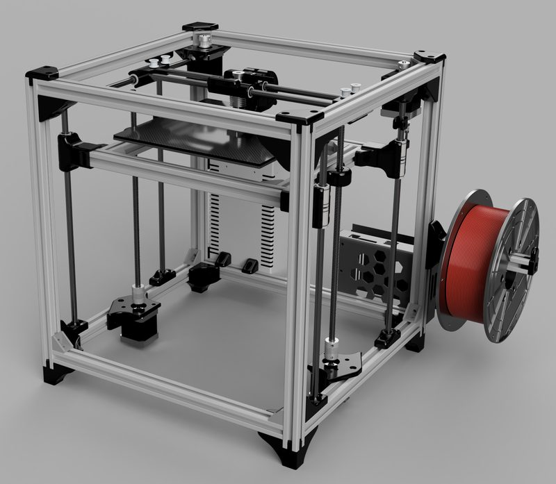
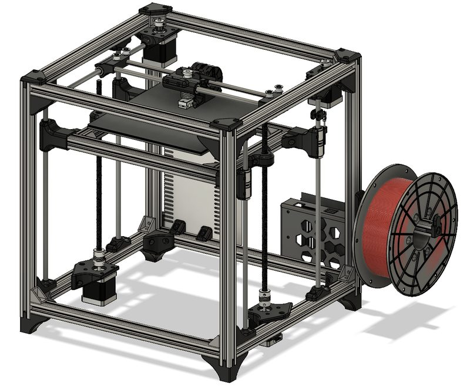
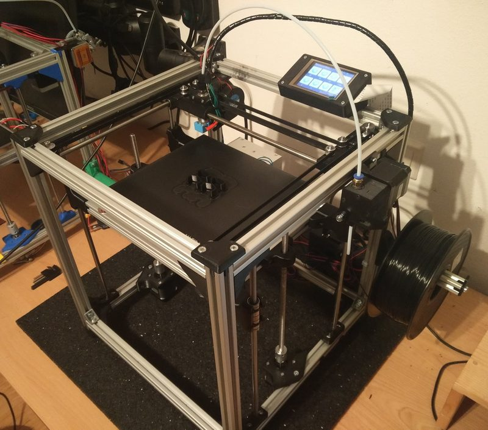
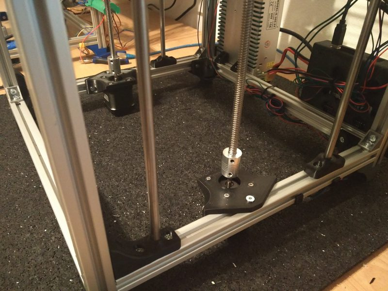

# CeXY H-Bot MK2

[Catalog row](../../README.md#cexy-h-bot) · [Gallery](../../GALLERY.md)

| Field | Value |
| --- | --- |
| Section | Historical designs |
| Project page | [https://www.thingiverse.com/thing:3383389](https://www.thingiverse.com/thing:3383389) |
| Author | xDOOTx |
| About | H-bot on 2020 extrusion with 8 mm rods and standard parts. It replaced the [first CeXY](https://www.thingiverse.com/thing:3080955) and adds a BOM, a photo build guide, and Fusion files. No update since 2019. |
| Build volume (X×Y×Z) | 200×200×? |
| Exterior (W×D×H) | — |
| Latest version | Files [2019-12](https://www.thingiverse.com/thing:3383389/files) |
| Stars Likes Views | [💙⁠162](https://www.thingiverse.com/thing:3383389) |
| Links | [Files](https://www.thingiverse.com/thing:3383389/files) |
| Groups | — |

## Pictures (4)

<table>
<tr><td align="center" width="33%"></td><td align="center" width="33%"></td><td align="center" width="33%"></td></tr>
<tr><td align="center" width="33%"></td></tr>
</table>
