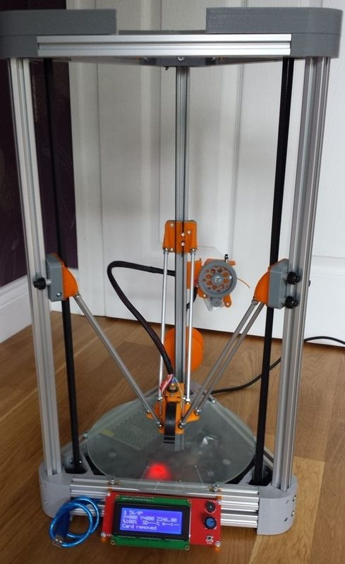
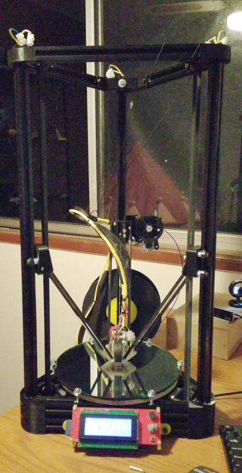
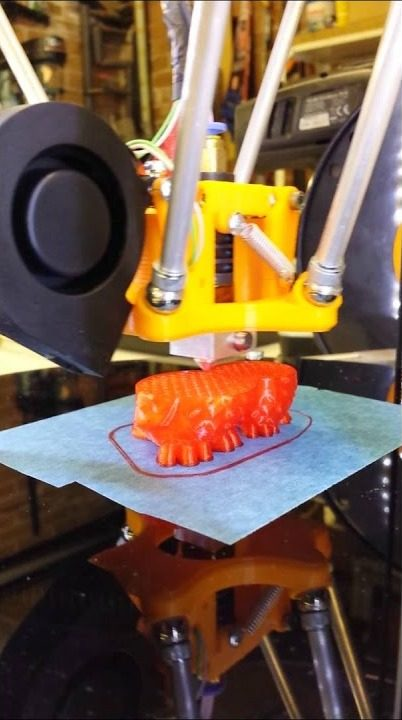

# Cherry Pi III

[Catalog row](../../README.md#cherry-pi-delta) · [Gallery](../../GALLERY.md)

| Field | Value |
| --- | --- |
| Section | Legacy designs |
| Project page | [https://www.thingiverse.com/thing:344408](https://www.thingiverse.com/thing:344408) |
| Author | AndyCart |
| About | Third version of the delta, after the [Cherry Pi](https://www.thingiverse.com/thing:210028) (2013) and the [Cherry Pi II](https://www.thingiverse.com/thing:298168) (2014). No update since 2014. |
| Build volume (X×Y×Z) | — |
| Exterior (W×D×H) | — |
| Latest version | III [2014-08](https://www.thingiverse.com/thing:344408) |
| Stars Likes Views | [💙⁠503](https://www.thingiverse.com/thing:344408) [⏯️⁠2.3K](https://www.youtube.com/watch?v=9hL9AQpA93Y) [❤️⁠4](https://www.youtube.com/watch?v=9hL9AQpA93Y) |
| Links | [Files](https://www.thingiverse.com/thing:344408/files) |
| Groups | [Forum](https://reprap.org/forum/list.php?178) EN [Facebook](https://www.facebook.com/groups/delta3dp/) EN 2.7K inactive |
| License | [CC BY-SA 4.0](https://www.thingiverse.com/thing:344408) |

## Pictures (3)

<table>
<tr><td align="center" width="33%"> Photo: <a href="https://www.thingiverse.com/AndyCart">AndyCart</a></td><td align="center" width="33%"> Photo: pugzor</td><td align="center" width="33%"> Photo: <a href="https://www.youtube.com/@andycart99">Andy Carter</a></td></tr>
</table>
