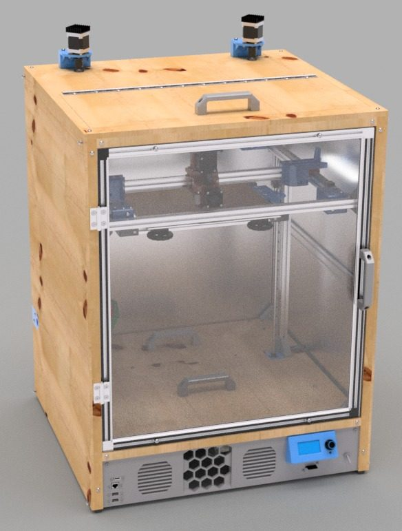
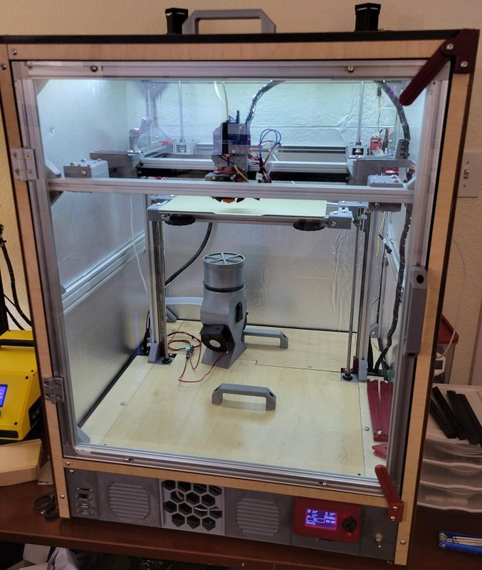
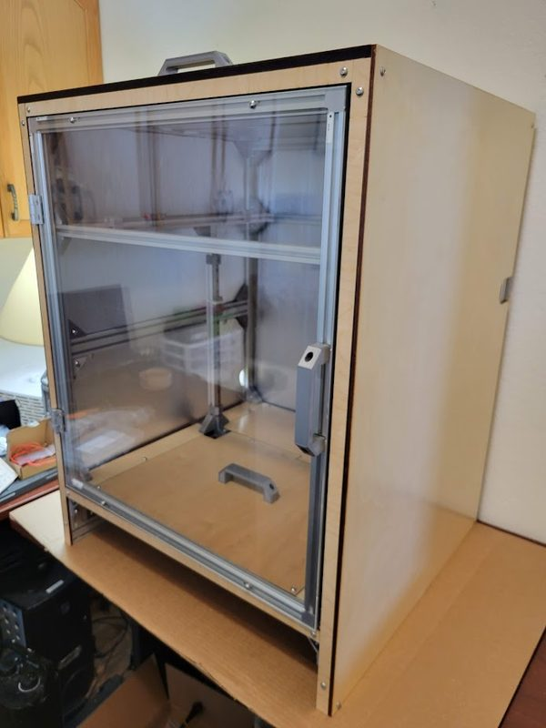

# Clock 3

[Catalog row](../../README.md#clock-3) · [Gallery](../../GALLERY.md)

| Field | Value |
| --- | --- |
| Section | Legacy designs |
| Project page | [https://github.com/jon-harper/clock-3](https://github.com/jon-harper/clock-3) |
| Author | Jon Harper |
| About | Enclosed, temperature-controlled prototype; development is halted and the full Fusion assembly was not released. |
| Build volume (X×Y×Z) | 300×300×350 |
| Exterior (W×D×H) | 640×675×875 |
| Latest version | Log [2022-06](https://github.com/jon-harper/clock-3/blob/main/docs/status/changelog.md#2022-06-18) |
| Stars Likes Views |  |
| Links | [BOM](https://github.com/jon-harper/clock-3/tree/main/BOM) [STL](https://github.com/jon-harper/clock-3/tree/main/STL) [Manual](https://github.com/jon-harper/clock-3/tree/main/docs) |
| Groups | — |

## Pictures (3)

<table>
<tr><td align="center" width="33%"></td><td align="center" width="33%"></td><td align="center" width="33%"></td></tr>
</table>
