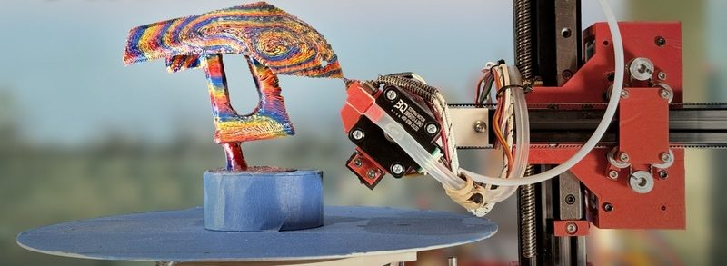
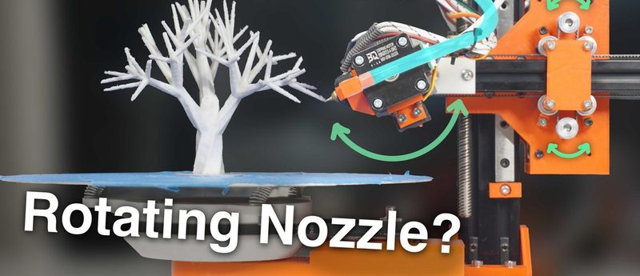
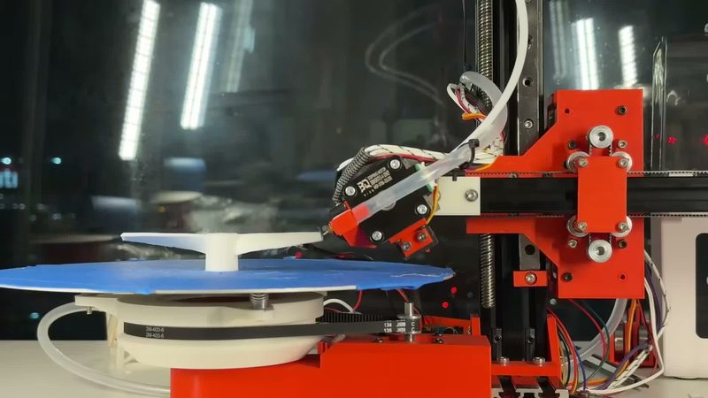
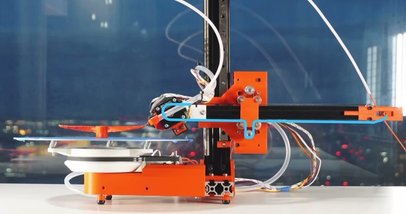
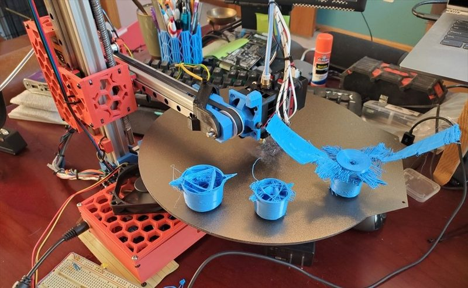
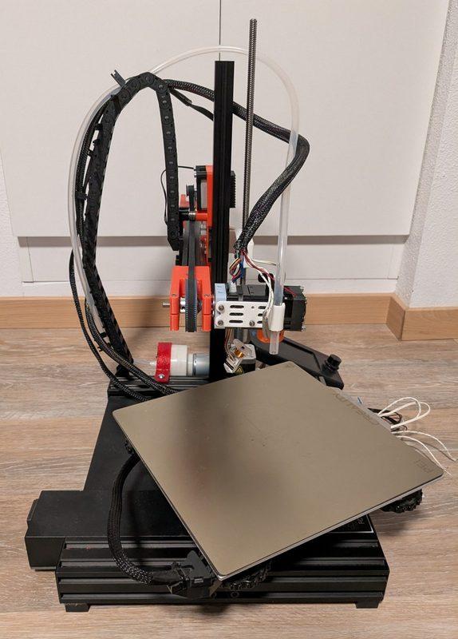
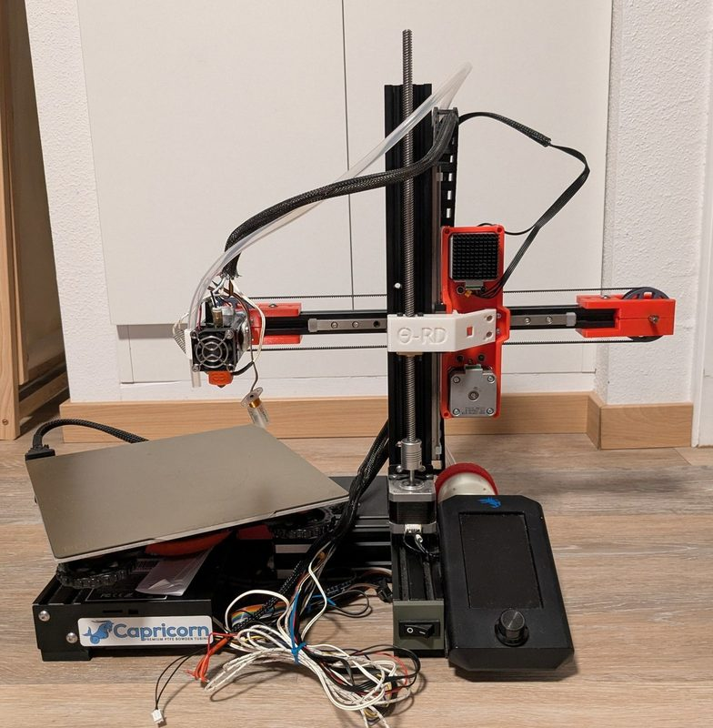

# Core R-Theta Printer

[Catalog row](../../README.md#core-r-theta) · [Gallery](../../GALLERY.md)

| Field | Value |
| --- | --- |
| Section | 5-axis |
| Project page | [https://github.com/jyjblrd/Core-R-Theta-4-Axis-Printer](https://github.com/jyjblrd/Core-R-Theta-4-Axis-Printer) |
| Author | Joshua Bird |
| About | Polar 4-axis printer designed from scratch. The bed spins without limit. Two coupled belt motors move the head along the radius and turn its tilted nozzle. It prints with the author's open [Radial Non-Planar Slicer](https://github.com/jyjblrd/Radial_Non_Planar_Slicer) and [S4 Slicer](https://github.com/jyjblrd/S4_Slicer). There is no build guide. Builders use the repo Discussions. |
| Build volume (X×Y×Z) | — |
| Exterior (W×D×H) | — |
| Latest version | CAD [2025-04](https://github.com/jyjblrd/Core-R-Theta-4-Axis-Printer/commit/c3e7d44e1b7beef01fdc57f265835dfef7c02588) |
| Stars Likes Views |  [⏯️⁠857K](https://www.youtube.com/watch?v=VEgwnhLHy3g) [❤️⁠45.3K](https://www.youtube.com/watch?v=VEgwnhLHy3g) |
| Links | [STEP](https://github.com/jyjblrd/Core-R-Theta-4-Axis-Printer/blob/main/4%20axis%20polar%203d%20printer.step) [CAD](https://github.com/jyjblrd/Core-R-Theta-4-Axis-Printer/blob/main/4%20axis%20polar%203d%20printer.f3z) [STL](https://github.com/jyjblrd/Core-R-Theta-4-Axis-Printer/tree/main/stl%20files) [BOM](https://github.com/jyjblrd/Core-R-Theta-4-Axis-Printer#bom) [Config](https://github.com/jyjblrd/Core-R-Theta-4-Axis-Printer/tree/main/reprap%20firmware%20config) [Video](https://www.youtube.com/watch?v=VEgwnhLHy3g) |
| Groups | — |
| License | [GPL-3.0 with no right to sell (GitHub)](https://github.com/jyjblrd/Core-R-Theta-4-Axis-Printer/blob/main/License) |

## Pictures (8)

<table>
<tr><td align="center" width="33%"> Photo: <a href="https://www.youtube.com/@joshuayjbird">Joshua Bird</a></td><td align="center" width="33%"> Photo: <a href="https://www.youtube.com/@joshuayjbird">Joshua Bird</a></td><td align="center" width="33%"> Photo: <a href="https://github.com/jyjblrd">Joshua Bird</a></td></tr>
<tr><td align="center" width="33%"> Photo: <a href="https://www.youtube.com/@joshuayjbird">Joshua Bird</a></td><td align="center" width="33%"> Photo: <a href="https://www.youtube.com/@joshuayjbird">Joshua Bird</a></td><td align="center" width="33%"> Photo: <a href="https://github.com/xobes">xobes</a></td></tr>
<tr><td align="center" width="33%"> Version: θ-RD (community derivative from Ender 3 V2 parts) Photo: <a href="https://github.com/ZiiB">ZiiB</a></td><td align="center" width="33%"> Version: θ-RD (community derivative from Ender 3 V2 parts) Photo: <a href="https://github.com/ZiiB">ZiiB</a></td></tr>
</table>

## Mods and variants

- [5-Axis Hybrid Printer](https://github.com/panditsaurabh4044-svg/5-Axis-Hybrid-Printer-Klipper) by panditsaurabh4044-svg: a linear Y axis under the rotating bed and a Klipper port, base Core R-Theta. License not stated.
