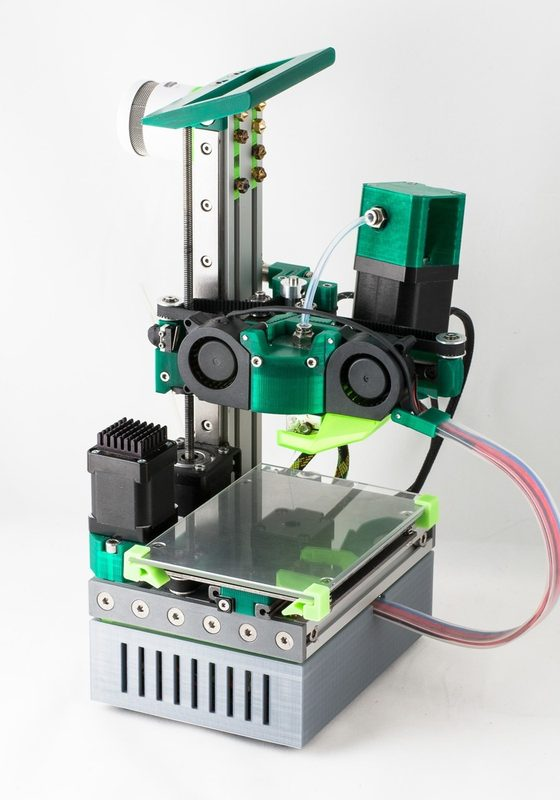
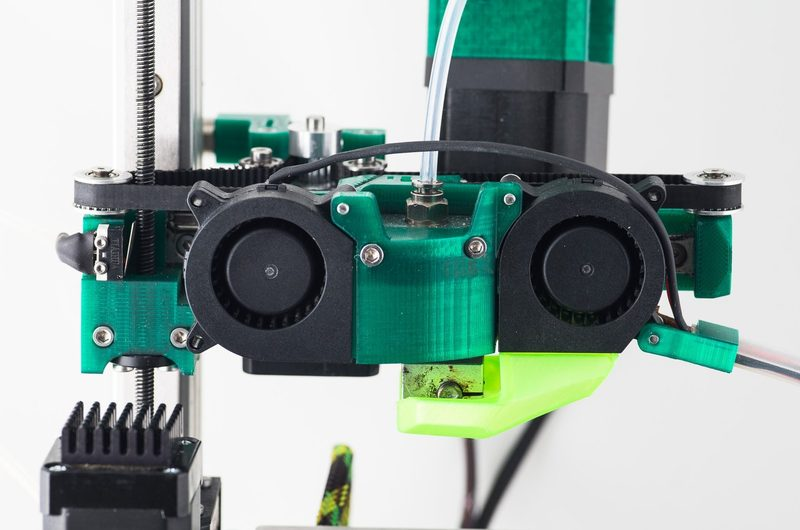
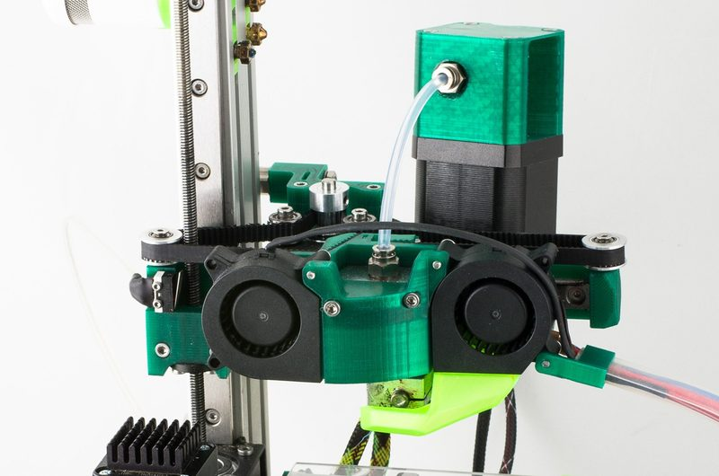

# Cranestyle Mini

[Catalog row](../../README.md#cranestyle-mini) · [Gallery](../../GALLERY.md)

| Field | Value |
| --- | --- |
| Section | Legacy designs |
| Project page | [https://github.com/whosawhatsis/cranestyle-mini](https://github.com/whosawhatsis/cranestyle-mini) |
| Author | Whosawhatsis |
| About | Small crane-style Cartesian, nicknamed "Cute", with a single Z column, a cantilever X arm, and a moving bed. The repo has OpenSCAD parts only, with no README or BOM. No update since 2017-06. |
| Build volume (X×Y×Z) | — |
| Exterior (W×D×H) | — |
| Latest version | CAD [2017-06](https://github.com/whosawhatsis/cranestyle-mini/commit/e6e194223795b807f1e9c1163c4df5e4f9dde5d6) |
| Stars Likes Views |  |
| Links | [CAD](https://github.com/whosawhatsis/cranestyle-mini) |
| Groups | — |
| License | [not stated](https://github.com/whosawhatsis/cranestyle-mini) |

## Pictures (3)

<table>
<tr><td align="center" width="33%"> Version: guideways version (walter&#x27;s build) Photo: <a href="https://thrinter.com/author/walter/">walter</a></td><td align="center" width="33%"> Version: guideways version Photo: <a href="https://thrinter.com/author/walter/">walter</a></td><td align="center" width="33%"> Version: guideways version Photo: <a href="https://thrinter.com/author/walter/">walter</a></td></tr>
</table>

## Mods and variants

- [Cranestyle Mini, guideways version](https://thrinter.com/cranestyle-mini-guideways-version/) by walter (Thrinter), 2018. A copy built on linear guideways and a 14 mm rail. It adds a pivoting dual-drive extruder, blower fans, and a Duet WiFi controller.
