# CrazyCreatorCube

[Catalog row](../../README.md#crazycreatorcube) · [Gallery](../../GALLERY.md)

| Field | Value |
| --- | --- |
| Section | Legacy designs |
| Project page | [https://crazycreatorcube.notion.site/CrazyCreatorCube-9c3a3c3e242b42e78920e49dc1d180df](https://crazycreatorcube.notion.site/CrazyCreatorCube-9c3a3c3e242b42e78920e49dc1d180df) |
| Author | Andreas Fricke and team |
| About | CoreXY toolchanger for up to four tools with a magnetic kinematic coupling, based on the E3D toolchanger motion system. The files stopped at Beta 0.9.6. No update since 2020-11. |
| Build volume (X×Y×Z) | 350×330×400 |
| Exterior (W×D×H) | 600×600×600 |
| Latest version | Files [2020-11](https://crazycreatorcube.notion.site/c3ee2eca588f40cfa626e6a32b98aae4) |
| Stars Likes Views | [💙⁠14](https://www.thingiverse.com/thing:4111728) [🧡⁠12](https://www.printables.com/model/100893) [⏯️⁠2K](https://www.youtube.com/watch?v=ieHzbuYLtvw) [❤️⁠21](https://www.youtube.com/watch?v=ieHzbuYLtvw) |
| Links | [Files](https://crazycreatorcube.notion.site/36e3e15898e84799a97ddfb9b4dca4f0) [BOM](https://crazycreatorcube.notion.site/ed57916179c4499496eb0558b678a58c) [Manual](https://crazycreatorcube.notion.site/a64bb78a88fa46268ef8e895a60c252a) [Config](https://github.com/CrazyCreatorCube/Software/tree/HEAD/Firmware) |
| Groups | [Discord](https://discord.gg/WKWhDyq) EN 122 [Facebook](https://www.facebook.com/groups/crazycreatorcube/) |
| License | [CC BY-NC-SA 4.0](https://crazycreatorcube.notion.site/c096782ca3784b22926e81d944a84967) |

## Pictures (14)

<table>
<tr><td align="center" width="33%"> Photo: <a href="https://www.youtube.com/@crazycreator8068">Andreas Fricke (CrazyCreator)</a></td><td align="center" width="33%"><a href="1-crazycreatorcube.jpg">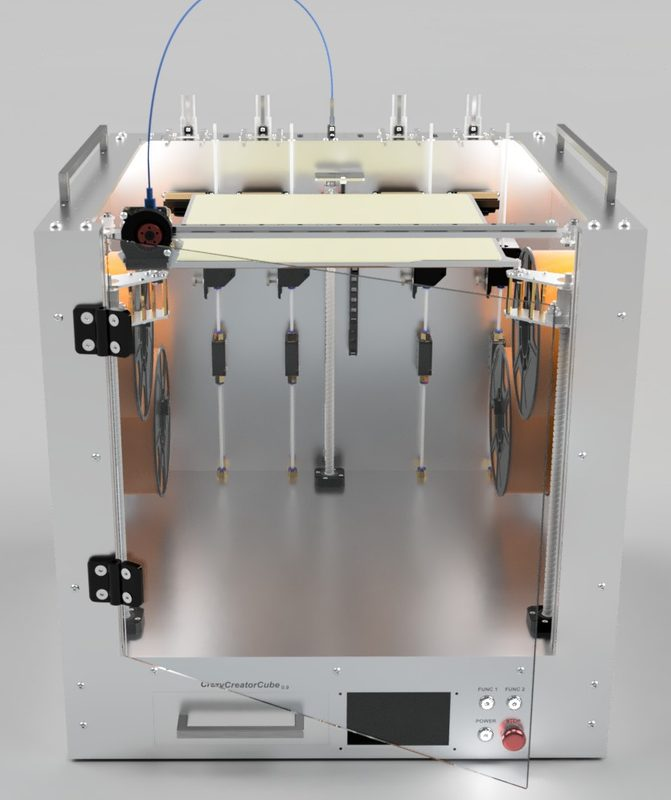</a> Photo: <a href="https://www.youtube.com/@crazycreator8068">Andreas Fricke (CrazyCreator)</a></td><td align="center" width="33%"><a href="2-crazycreatorcube.jpg">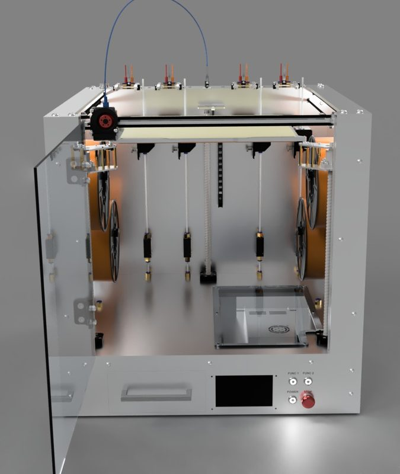</a> Photo: <a href="https://www.youtube.com/@crazycreator8068">Andreas Fricke (CrazyCreator)</a></td></tr>
<tr><td align="center" width="33%"><a href="3-crazycreatorcube.jpg">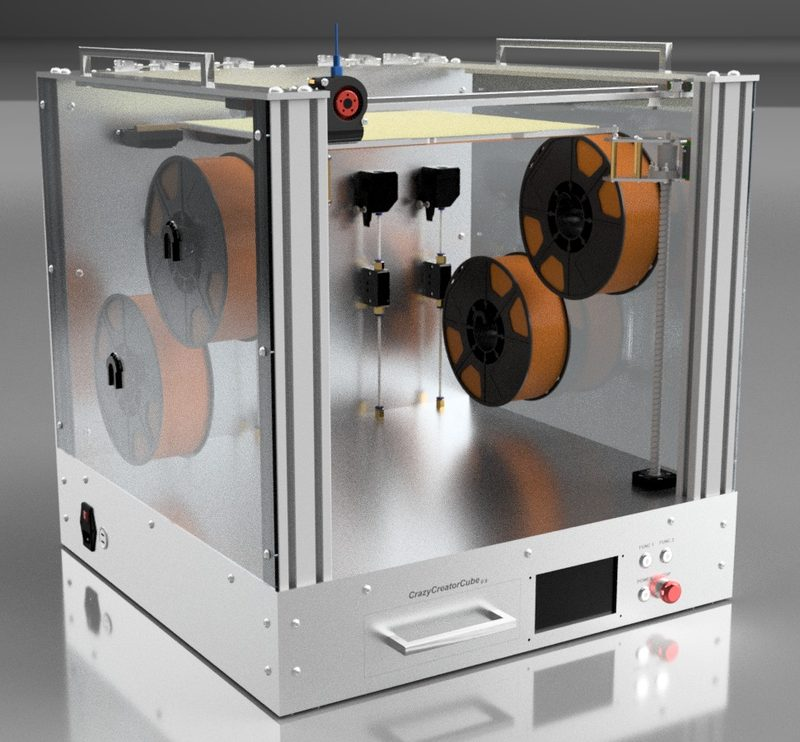</a> Photo: <a href="https://www.youtube.com/@crazycreator8068">Andreas Fricke (CrazyCreator)</a></td><td align="center" width="33%"><a href="4-crazycreatorcube.jpg">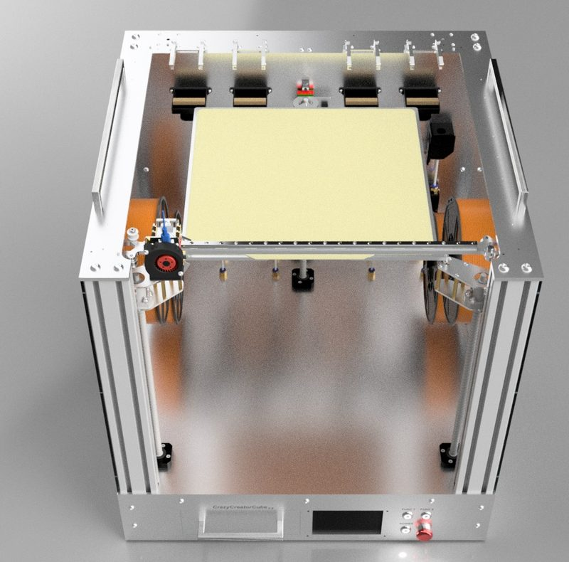</a> Photo: <a href="https://www.youtube.com/@crazycreator8068">Andreas Fricke (CrazyCreator)</a></td><td align="center" width="33%"><a href="5-crazycreatorcube.jpg">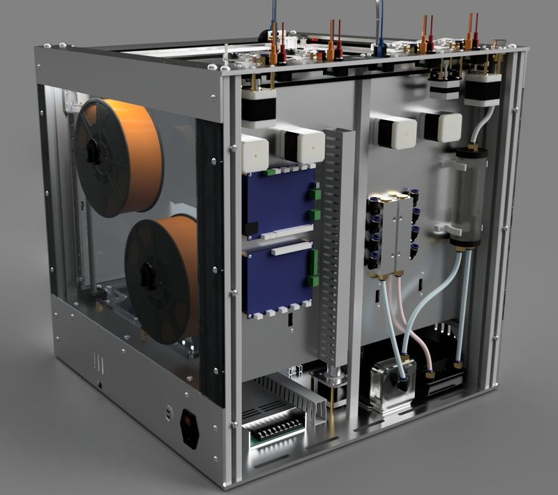</a> Photo: <a href="https://www.youtube.com/@crazycreator8068">Andreas Fricke (CrazyCreator)</a></td></tr>
<tr><td align="center" width="33%"><a href="6-crazycreatorcube.jpg">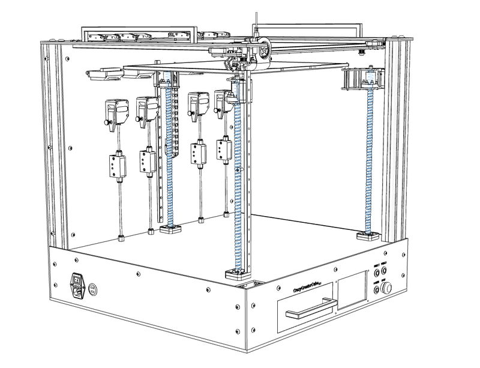</a> Photo: <a href="https://www.youtube.com/@crazycreator8068">Andreas Fricke (CrazyCreator)</a></td><td align="center" width="33%"><a href="7-crazycreatorcube.jpg">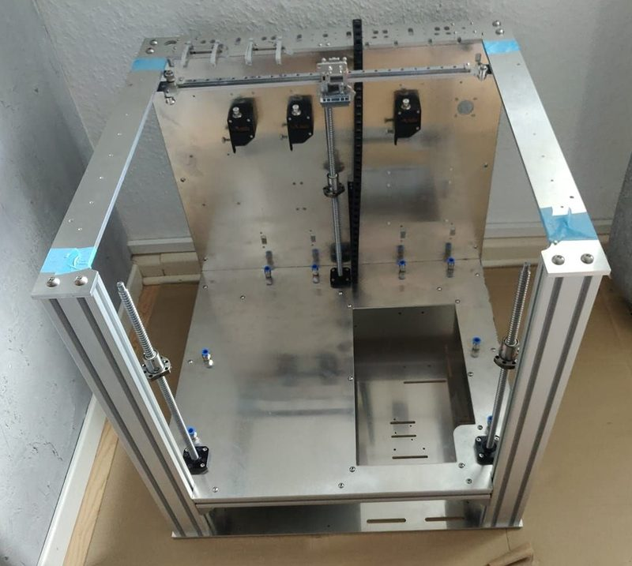</a> Photo: <a href="https://www.youtube.com/@crazycreator8068">Andreas Fricke (CrazyCreator)</a></td><td align="center" width="33%"><a href="8-crazycreatorcube.jpg">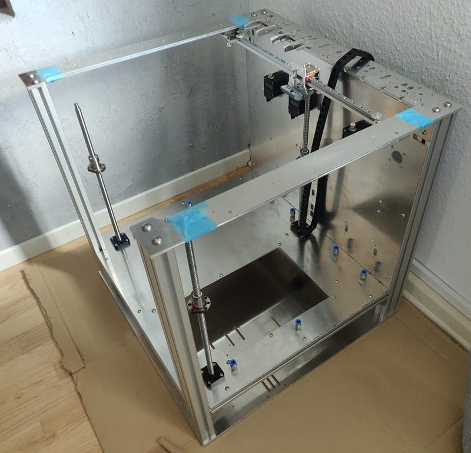</a> Photo: <a href="https://www.youtube.com/@crazycreator8068">Andreas Fricke (CrazyCreator)</a></td></tr>
<tr><td align="center" width="33%"><a href="9-crazycreatorcube.jpg">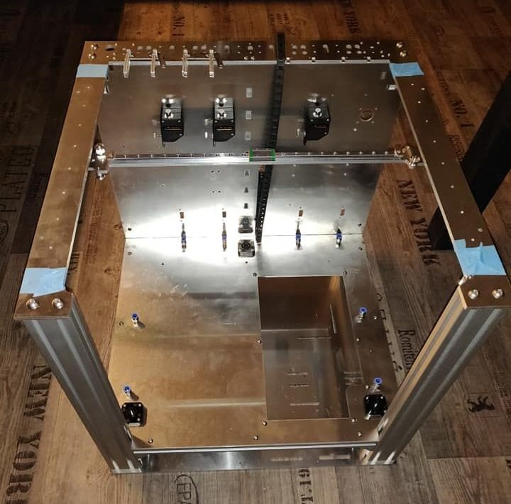</a> Photo: <a href="https://www.youtube.com/@crazycreator8068">Andreas Fricke (CrazyCreator)</a></td><td align="center" width="33%"><a href="10-crazycreatorcube.jpg">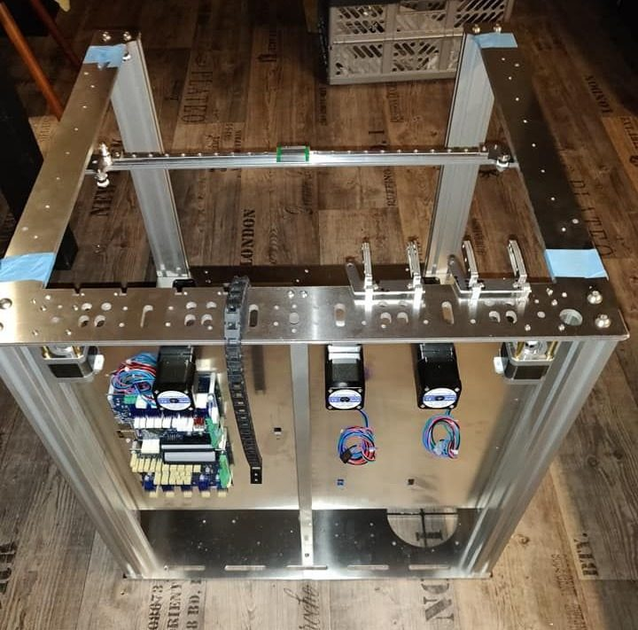</a> Photo: <a href="https://www.youtube.com/@crazycreator8068">Andreas Fricke (CrazyCreator)</a></td><td align="center" width="33%"><a href="11-crazycreatorcube.jpg">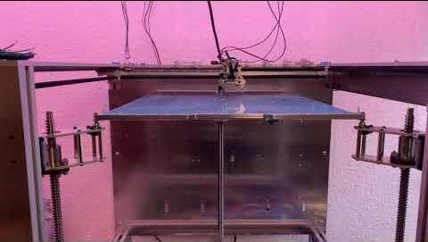</a> Photo: <a href="https://www.youtube.com/@crazycreator8068">CrazyCreator</a></td></tr>
<tr><td align="center" width="33%"><a href="12-crazycreatorcube.jpg">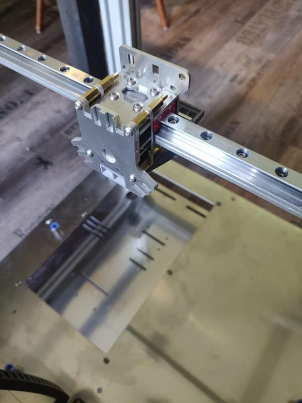</a> Photo: <a href="https://www.youtube.com/@crazycreator8068">Andreas Fricke (CrazyCreator)</a></td><td align="center" width="33%"><a href="13-crazycreatorcube.jpg">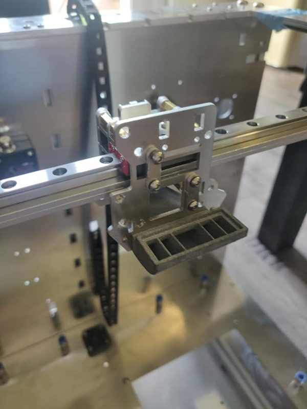</a> Photo: <a href="https://www.youtube.com/@crazycreator8068">Andreas Fricke (CrazyCreator)</a></td></tr>
</table>

## Other homes of the files

- [Thingiverse](https://www.thingiverse.com/thing:4111728): tool bench and holder parts only, CC BY-NC-SA, uploaded by CrazyCreator13.
- [Printables](https://www.printables.com/model/100893): the same tool parts, 4 STL, CC BY-NC-SA.
- [GitHub](https://github.com/CrazyCreatorCube/ToolDatabase): tool database, MIT.
- Wayback Machine: [latest snapshot](https://web.archive.org/web/20250618205044/https://crazycreatorcube.notion.site/CrazyCreatorCube-9c3a3c3e242b42e78920e49dc1d180df), 2025-06-18.
