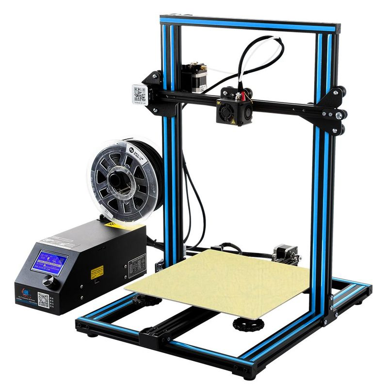
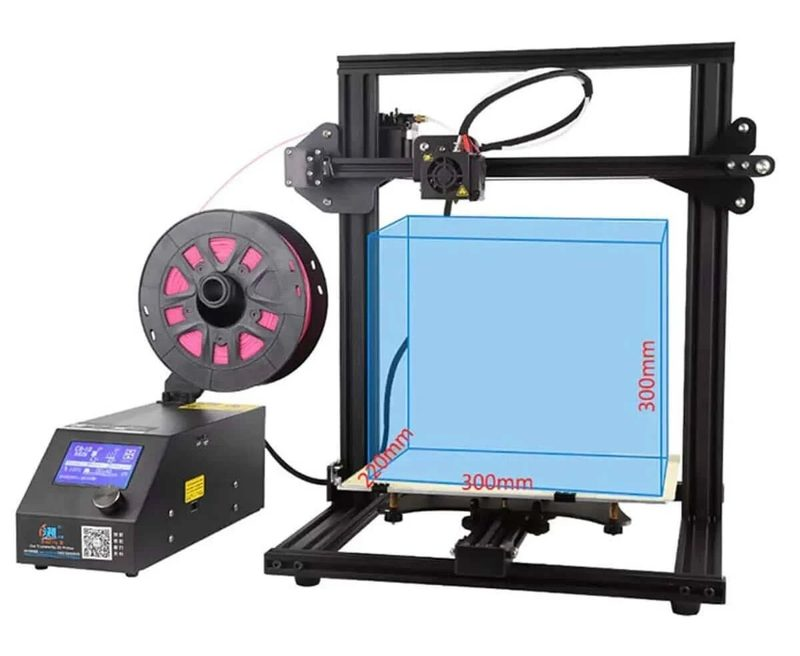
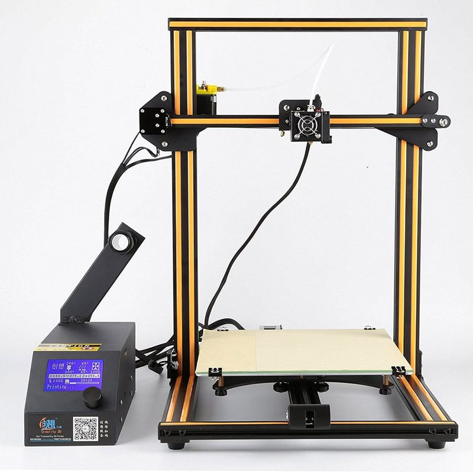
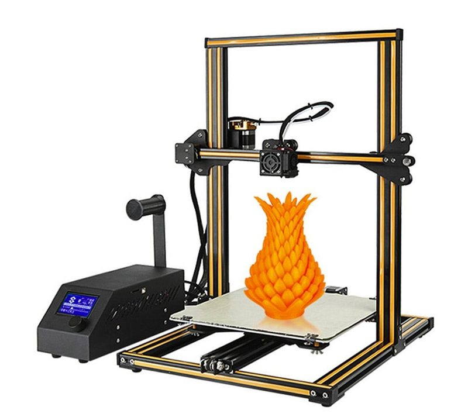
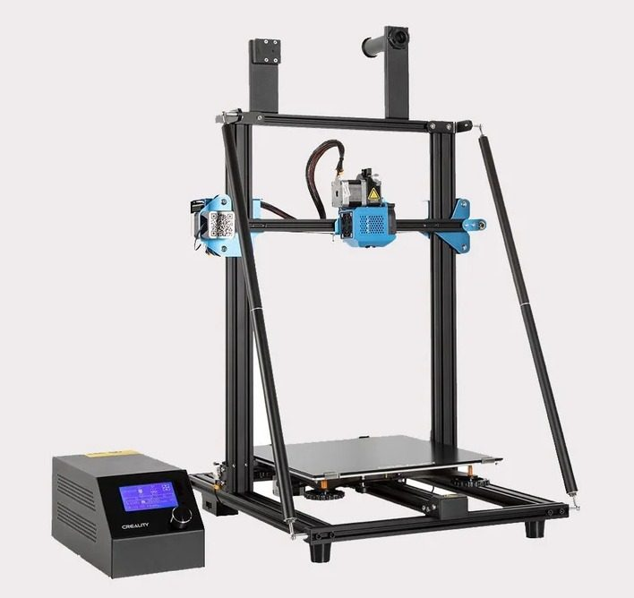

# Original CR-10

[Catalog row](../../README.md#creality-cr-10) · [Gallery](../../GALLERY.md)

| Field | Value |
| --- | --- |
| Section | Historical designs |
| Project page | [https://github.com/Creality3DPrinting/CR-10](https://github.com/Creality3DPrinting/CR-10) |
| Author | Creality |
| About | Large-bed moving-bed Cartesian printer with an OSHWA-certified source release. It made large, cheap bed printers common. |
| Build volume (X×Y×Z) | 300×300×400 |
| Exterior (W×D×H) | — |
| Latest version | CAD [2018-12](https://github.com/Creality3DPrinting/CR-10/commit/d2973de01cb922b8a2afb646b59a6a76d5c136c5) |
| Stars Likes Views |  [⏯️⁠4K](https://www.youtube.com/watch?v=o29NP2wDsc4) [❤️⁠45](https://www.youtube.com/watch?v=o29NP2wDsc4) |
| Links | [Files](https://github.com/Creality3DPrinting/CR-10/tree/master/3D) [BOM](https://github.com/Creality3DPrinting/CR-10/tree/master/BOM) [Wiring](https://github.com/Creality3DPrinting/CR-10/tree/master/Circuit%20diagram) |
| Groups | [Facebook](https://www.facebook.com/groups/2209962369021560/) EN 9.9K [Discord](https://discord.com/invite/creality) EN 25K [Reddit](https://www.reddit.com/r/CR10/) EN 41.3K [Telegram](https://t.me/joinchat/ANAZJ0PRxYzfNTg0d6tF0Q) ES 359 [Reddit](https://www.reddit.com/r/Creality/) EN 76.4K [Telegram](https://t.me/crealitybr) PT 737 |

## Pictures (5)

<table>
<tr><td align="center" width="33%"></td><td align="center" width="33%"></td><td align="center" width="33%"></td></tr>
<tr><td align="center" width="33%"></td><td align="center" width="33%"></td></tr>
</table>
