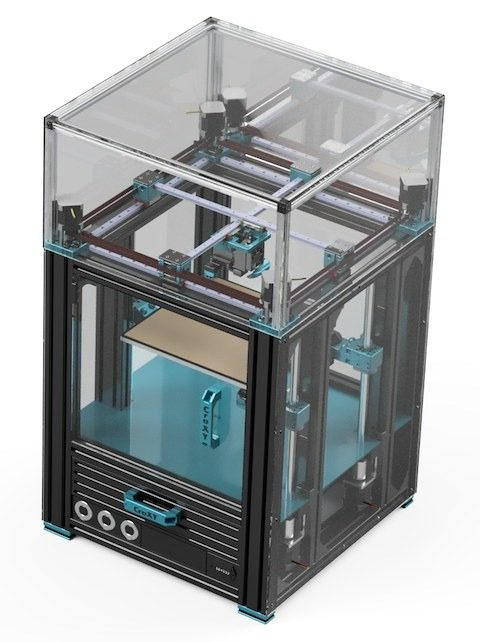
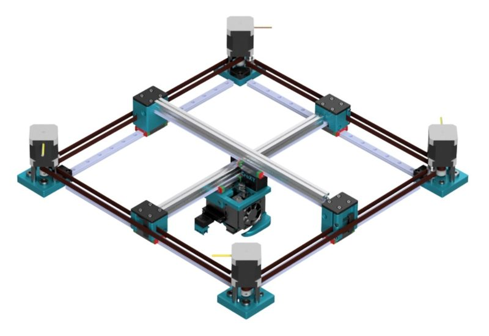
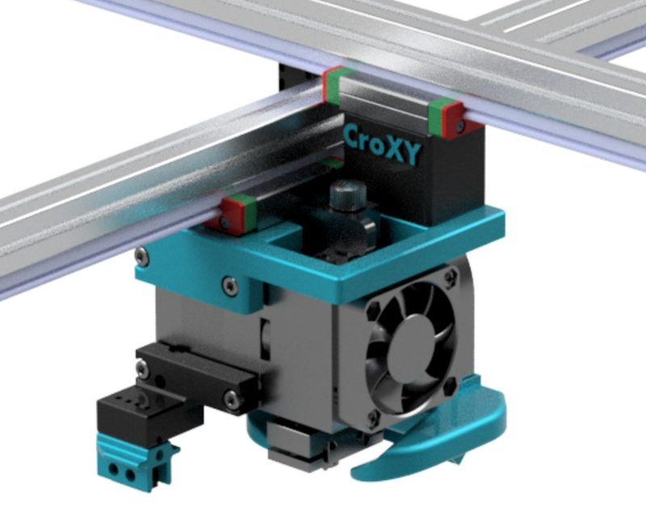
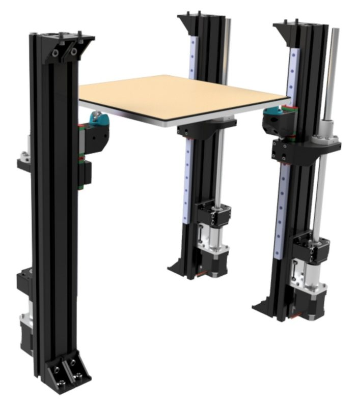
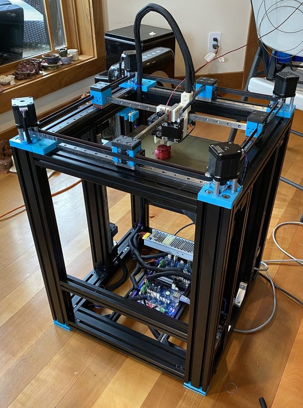
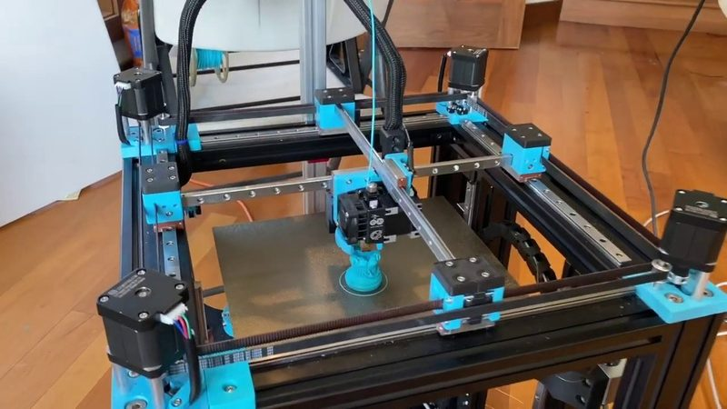

# CroXY

[Catalog row](../../README.md#croxy) · [Gallery](../../GALLERY.md)

| Field | Value |
| --- | --- |
| Section | Cross-gantry |
| Project page | [https://github.com/CroXY3D/CroXY](https://github.com/CroXY3D/CroXY) |
| Author | Wes Cherry |
| About | Cross-gantry printer built from laser-cut aluminum plates on 3060 extrusion, with four XY motors and a triple-belt Z. Only the cooling duct is printed. Version 3 is close to beta. The enclosure is still in work. [Defiant](../../README.md#defiant) is a CroXY build. |
| Build volume (X×Y×Z) | 300×300×300 |
| Exterior (W×D×H) | — |
| Latest version | v2.0.0 [2023-12](https://github.com/CroXY3D/CroXY/releases/tag/v2.0.0) |
| Stars Likes Views |  [⏯️⁠146K](https://www.youtube.com/watch?v=Kx4VfzS_V6c) [❤️⁠2K](https://www.youtube.com/watch?v=Kx4VfzS_V6c) |
| Links | [STEP](https://github.com/CroXY3D/CroXY/tree/HEAD/CAD) [STEP](https://github.com/CroXY3D/CroXY/tree/HEAD/STP) parts [Files](https://github.com/CroXY3D/CroXY/tree/HEAD/DXF) [STL](https://github.com/CroXY3D/CroXY/tree/HEAD/STL) [Config](https://github.com/CroXY3D/CroXY/blob/HEAD/Klipper/printer.cfg) |
| Groups | [Discord](https://discord.gg/ryj6wyx) EN 2.8K |
| License | [CC BY-NC-SA 4.0](https://github.com/CroXY3D/CroXY/blob/HEAD/LICENSE) |

## Pictures (7)

<table>
<tr><td align="center" width="33%"> Photo: <a href="https://github.com/CroXY3D">Wes Cherry</a></td><td align="center" width="33%"> Photo: <a href="https://github.com/CroXY3D">Wes Cherry</a></td><td align="center" width="33%"> Photo: <a href="https://github.com/CroXY3D">Wes Cherry</a></td></tr>
<tr><td align="center" width="33%"> Photo: <a href="https://github.com/CroXY3D">Wes Cherry</a></td><td align="center" width="33%"> Photo: <a href="https://github.com/CroXY3D">Wes Cherry</a></td><td align="center" width="33%"> Version: early build (2020-04) Photo: <a href="https://github.com/CroXY3D">Wes Cherry</a></td></tr>
<tr><td align="center" width="33%"> Version: early build (2020-04) Photo: <a href="https://www.youtube.com/channel/UCWzwWRhTU1AGjs8Trek5ckw">Wes Cherry</a></td></tr>
</table>
