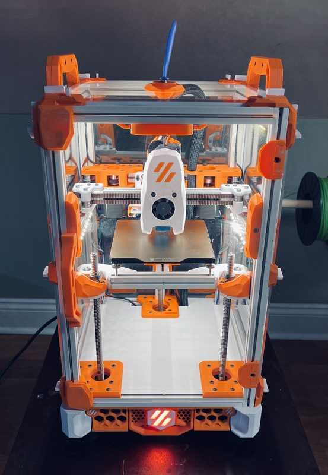
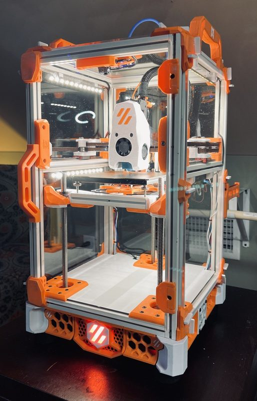

# Crucible

[Catalog row](../../README.md#crucible) · [Gallery](../../GALLERY.md)

| Field | Value |
| --- | --- |
| Section | Conversions |
| Project page | [https://github.com/PrintersForAnts/Crucible](https://github.com/PrintersForAnts/Crucible) |
| Author | Printers for Ants |
| About | Voron Trident layout at V0 scale, with three lead screws for Z. It converts a Voron V0.1. |
| Build volume (X×Y×Z) | 120×120×120 |
| Exterior (W×D×H) | 230×230×360 |
| Latest version | STEP [2023-01](https://github.com/PrintersForAnts/Crucible/commit/4eca7b1fc3a8aed970f4643f99da9df2bf980e70) |
| Stars Likes Views |  |
| Links | [STEP](https://github.com/PrintersForAnts/Crucible/blob/main/CAD/Crucible_Assembly_9.10.22.zip) [CAD](https://github.com/PrintersForAnts/Crucible/blob/main/CAD/Crucible_Assembly_9.10.22.f3d) [BOM](https://github.com/PrintersForAnts/Crucible#parts-needed-for-v01-conversion) |
| Groups | [Discord](https://discord.gg/doomcube) EN 6.9K |
| License | [GPL-3.0 (GitHub)](https://github.com/PrintersForAnts/Crucible/blob/main/LICENSE) |

## Pictures (3)

<table>
<tr><td align="center" width="33%"> Photo: <a href="https://github.com/PrintersForAnts">Printers for Ants</a></td><td align="center" width="33%"> Photo: <a href="https://github.com/PrintersForAnts">Printers for Ants</a></td><td align="center" width="33%"> Photo: <a href="https://github.com/PrintersForAnts">Printers for Ants</a></td></tr>
</table>
