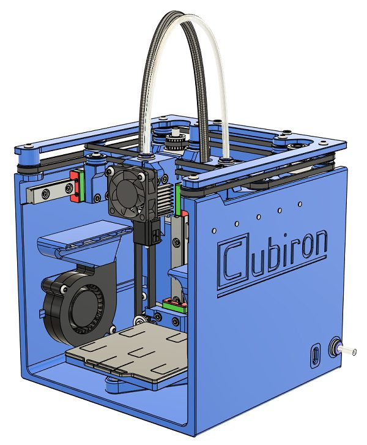
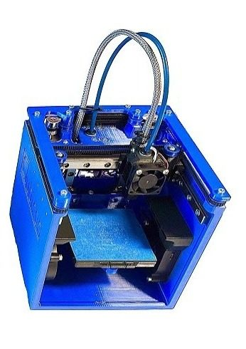
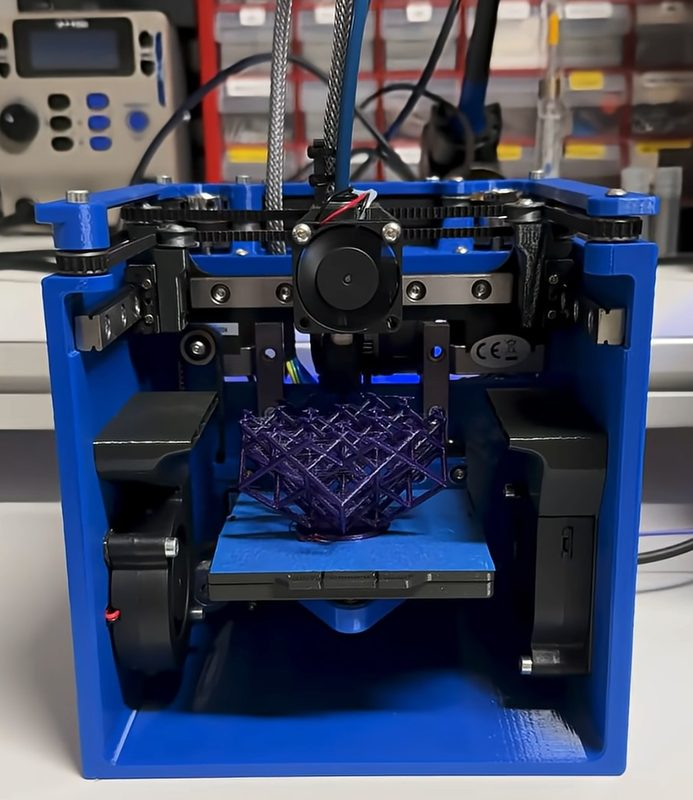
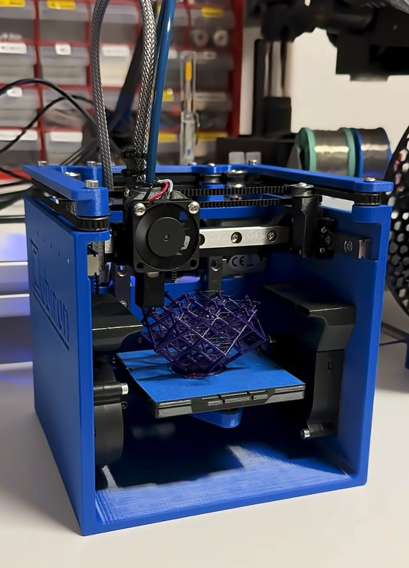
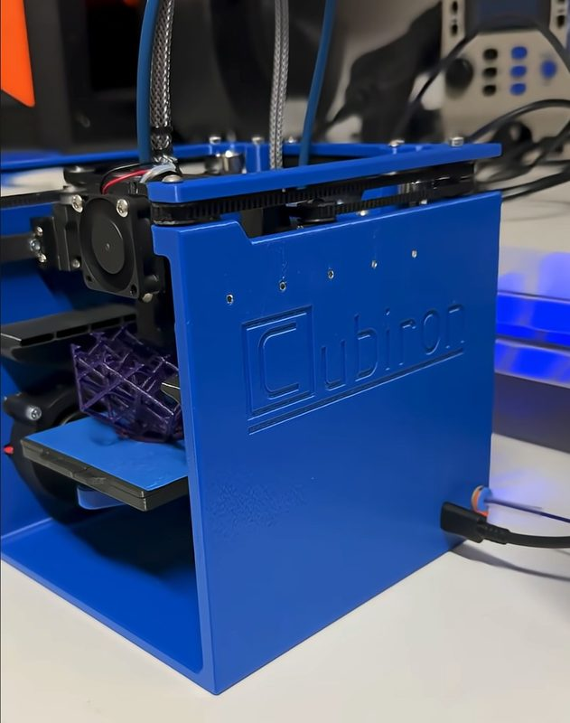

# Cubiron

[Catalog row](../../README.md#cubiron) · [Gallery](../../GALLERY.md)

| Field | Value |
| --- | --- |
| Section | CoreXY · Small (≤180 mm representative X/Y size) |
| Project page | [https://github.com/ThatGuyHes/CUBIRON](https://github.com/ThatGuyHes/CUBIRON) |
| Author | RobertGcode |
| About | Very small, documented CoreXY that runs on USB-C power; the current design has an unheated bed. |
| Build volume (X×Y×Z) | 70×70×65 |
| Exterior (W×D×H) | 144×145×148 |
| Latest version | First release [2025-09](https://github.com/ThatGuyHes/CUBIRON/blob/main/README.md#L9) |
| Stars Likes Views |  [⏯️⁠6.8K](https://www.youtube.com/watch?v=8Y_-ZeDuDzk) [❤️⁠328](https://www.youtube.com/watch?v=8Y_-ZeDuDzk) |
| Links | [STEP](https://github.com/ThatGuyHes/CUBIRON/tree/main/CAD) [Manual](https://github.com/ThatGuyHes/CUBIRON/tree/main/docs) [FW](https://github.com/ThatGuyHes/CUBIRON/tree/main/firmware) |
| Groups | — |
| License | [CERN-OHL-S-2.0](https://github.com/ThatGuyHes/CUBIRON/blob/main/LICENSE) |

## Pictures (5)

<table>
<tr><td align="center" width="33%"> Photo: <a href="https://github.com/ThatGuyHes">RobertGcode</a></td><td align="center" width="33%"> Photo: <a href="https://www.youtube.com/@robertgcode965">RobertGcode</a></td><td align="center" width="33%"> Photo: <a href="https://github.com/ThatGuyHes">RobertGcode</a></td></tr>
<tr><td align="center" width="33%"> Photo: <a href="https://github.com/ThatGuyHes">RobertGcode</a></td><td align="center" width="33%"> Photo: <a href="https://github.com/ThatGuyHes">RobertGcode</a></td></tr>
</table>
