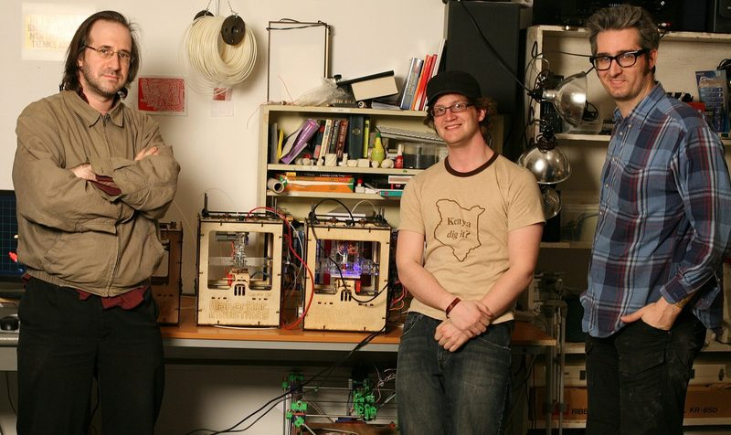
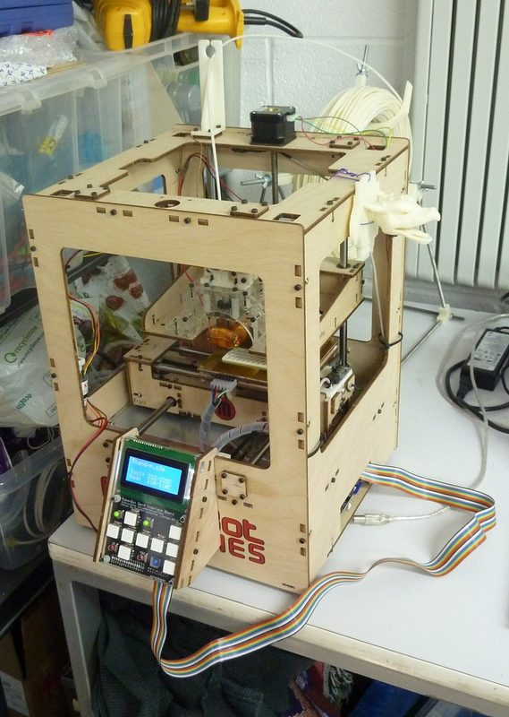
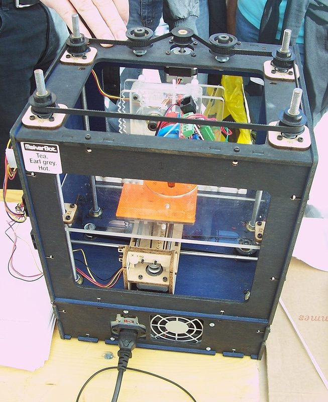
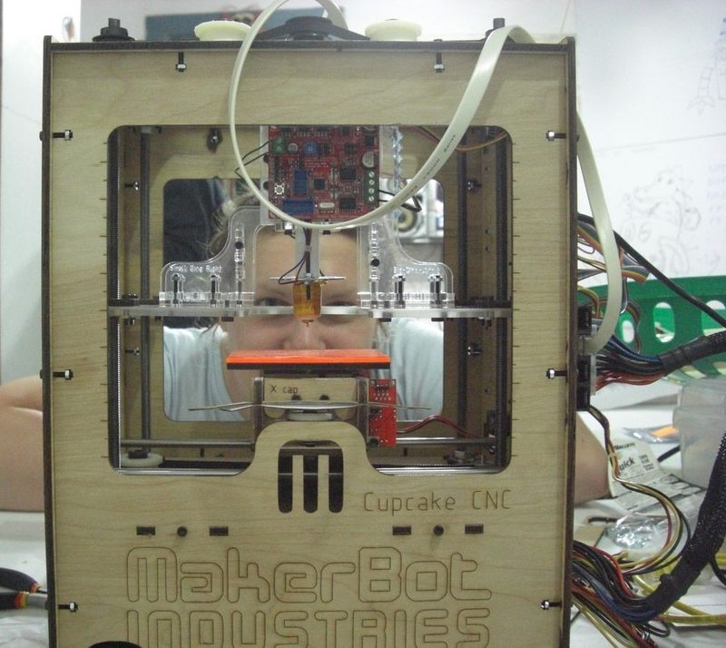
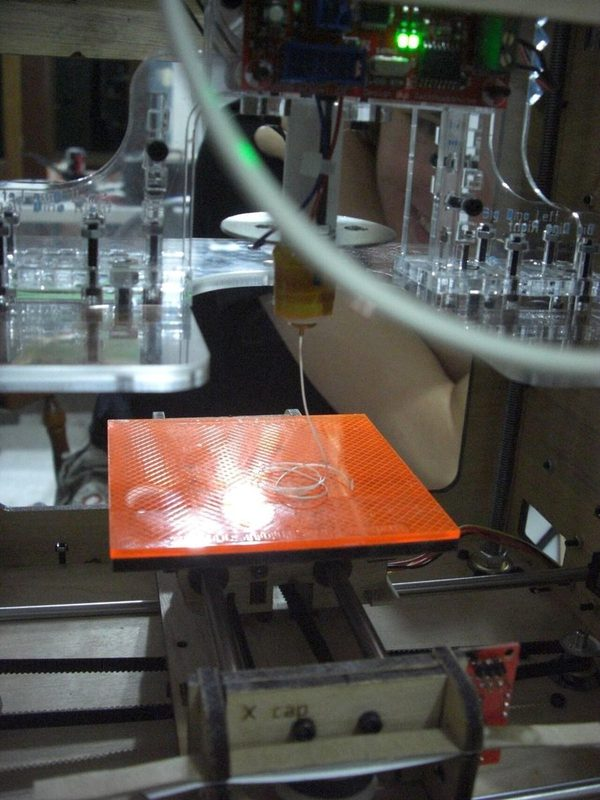
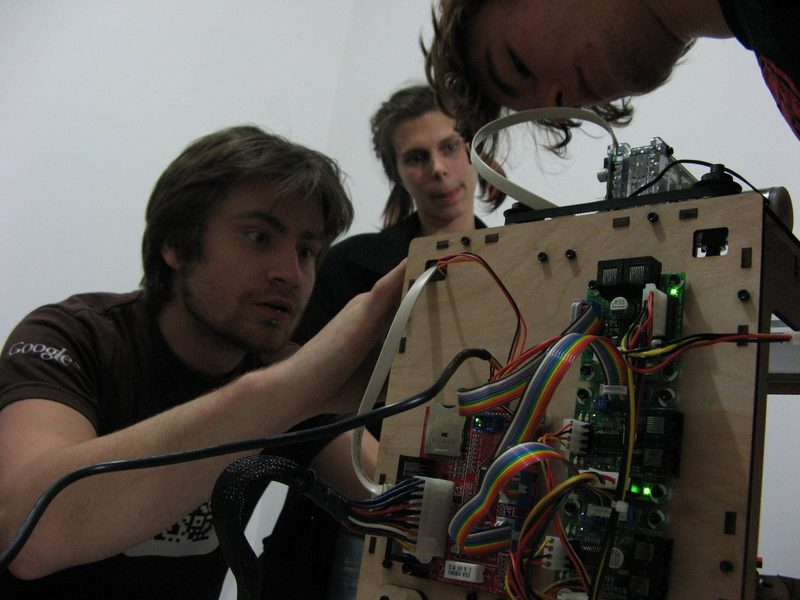

# CupCake CNC

[Catalog row](../../README.md#cupcake-cnc) · [Gallery](../../GALLERY.md)

| Field | Value |
| --- | --- |
| Section | Historical designs |
| Project page | [https://www.thingiverse.com/thing:457](https://www.thingiverse.com/thing:457) |
| Author | MakerBot |
| About | MakerBot's first kit and a RepRap derivative: a laser-cut plywood box with a belt-driven X/Y build platform and a Z head on four threaded rods. It started the market for desktop 3D printer kits. |
| Build volume (X×Y×Z) | 100×100×130 |
| Exterior (W×D×H) | 350×240×450 |
| Latest version | Batch 5 [2009-11](https://code.google.com/archive/p/makerbot/downloads) |
| Stars Likes Views | [💙⁠633](https://www.thingiverse.com/thing:457) [⏯️⁠1.9K](https://www.youtube.com/watch?v=4jPKEJ5hQuI) [❤️⁠14](https://www.youtube.com/watch?v=4jPKEJ5hQuI) |
| Links | [Files](https://www.thingiverse.com/thing:457/files) batch 1–2 [Files](https://storage.googleapis.com/google-code-archive-downloads/v2/code.google.com/makerbot/cupcake-cnc-batch-5.zip) batch 5 [BOM](https://web.archive.org/web/20120827102911/http://wiki.makerbot.com/cupcake-cnc-0:cupcake-parts-list) [Manual](https://web.archive.org/web/20121026124135/http://wiki.makerbot.com/cupcake-cnc-10:build-instructions) [Firmware](https://github.com/makerbot/G3Firmware) |
| Groups | [Google Groups](https://groups.google.com/g/makerbot) EN inactive [Reddit](https://www.reddit.com/r/makerbot/) EN 5.2K |
| License | [GPL-2.0 (Thingiverse), GPL-3.0 (Google Code project), GFDL (wiki docs)](https://www.thingiverse.com/thing:457) |

## Pictures (7)

<table>
<tr><td align="center" width="33%"> Version: final Cupcake CNC design (April 2009) Photo: <a href="https://www.flickr.com/people/44124453791@N01">Bre Pettis</a></td><td align="center" width="33%"> Version: final Cupcake CNC prototypes (April 2009) Photo: <a href="https://www.flickr.com/people/makerbot/">MakerBot</a></td><td align="center" width="33%"> Photo: <a href="https://commons.wikimedia.org/wiki/User:Andy_Dingley">Andy Dingley</a></td></tr>
<tr><td align="center" width="33%"> Photo: <a href="https://commons.wikimedia.org/wiki/User:Peter17">Peter Potrowl</a></td><td align="center" width="33%"> Version: Batch 5 kit Photo: <a href="https://www.flickr.com/people/38462165@N05">Mechatronics Guy</a></td><td align="center" width="33%"> Photo: <a href="https://www.flickr.com/people/38462165@N05">Mechatronics Guy</a></td></tr>
<tr><td align="center" width="33%"> Photo: <a href="https://www.flickr.com/people/38462165@N05">Mechatronics Guy</a></td></tr>
</table>

## Other homes of the files

- [Google Code archive, CupCake CNC Batch 1](https://storage.googleapis.com/google-code-archive-downloads/v2/code.google.com/makerbot/cupcake-cnc-batch-1.zip): the same DXF set as Thingiverse plus cutting layouts, guides and a rod-cutting guide, 2009-04-20.
- [Google Code archive, CupCake CNC Batch 5+](https://storage.googleapis.com/google-code-archive-downloads/v2/code.google.com/makerbot/cupcake-cnc-batch-5.zip): per-part laser-cut DXFs, a printed idler STL and an Art of Illusion assembly, 2009-11-02. Project license GPL-3.0.
- [MakerBot Subversion trunk, Wayback copy](https://web.archive.org/web/20100122154238/http://svn.makerbot.com/trunk/cupcake/): later laser-cut parts, partly archived. The live server is gone.
- [MakerBot wiki, CupCake CNC, Wayback copy](https://web.archive.org/web/20121126084615/http://wiki.makerbot.com/cupcake): specifications, build instructions for batches 1–9, batch 10 and the Ultimate kit. GFDL.
- [Thingiverse, SketchUp model of batch 3–4 by unrepentantgeek](https://www.thingiverse.com/thing:1449) and [batch 2 model by GeertB](https://www.thingiverse.com/thing:1450): community 3D models of the laser-cut parts. GPL.
- Wayback Machine: [latest snapshot](https://web.archive.org/web/20260604133903/https://www.thingiverse.com/thing:457), 2026-06-04.
