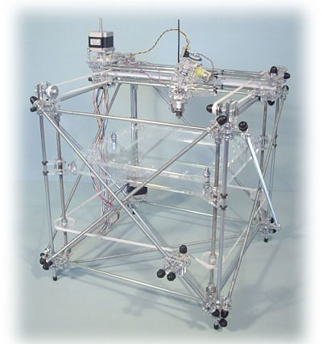
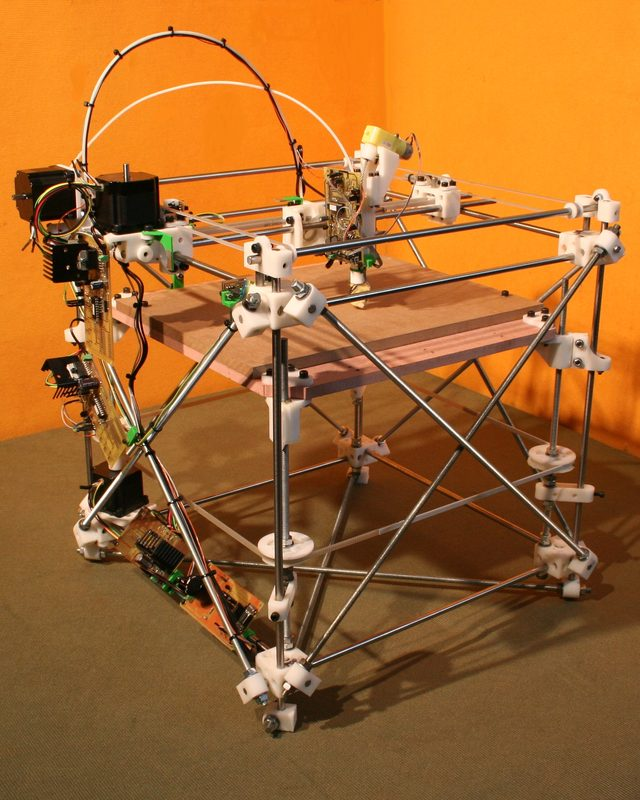
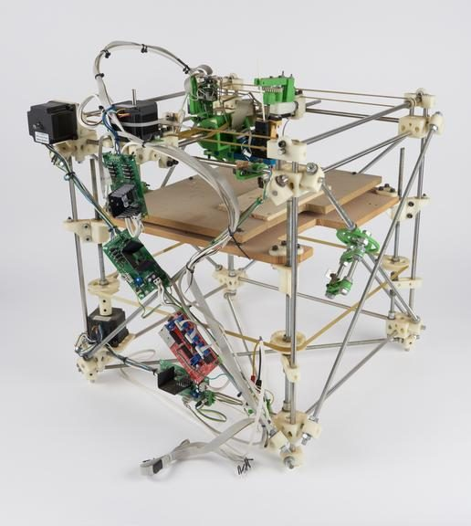
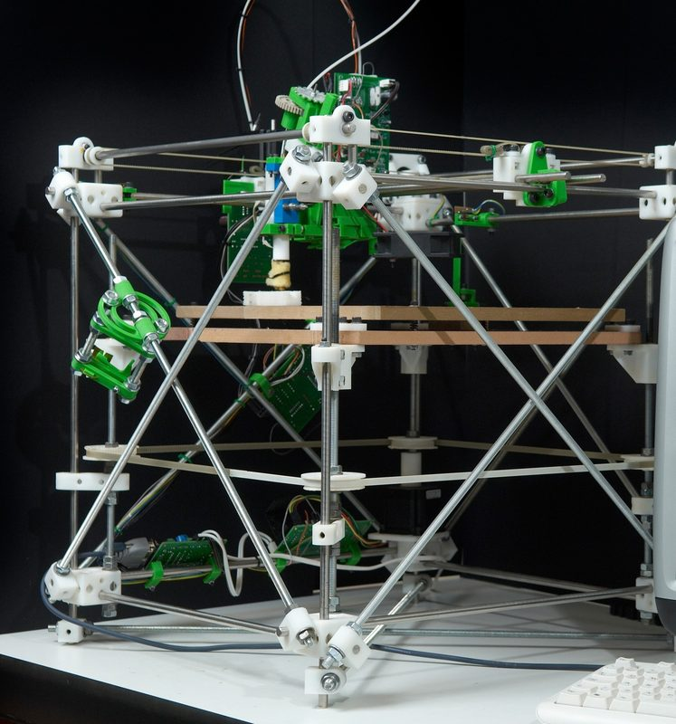
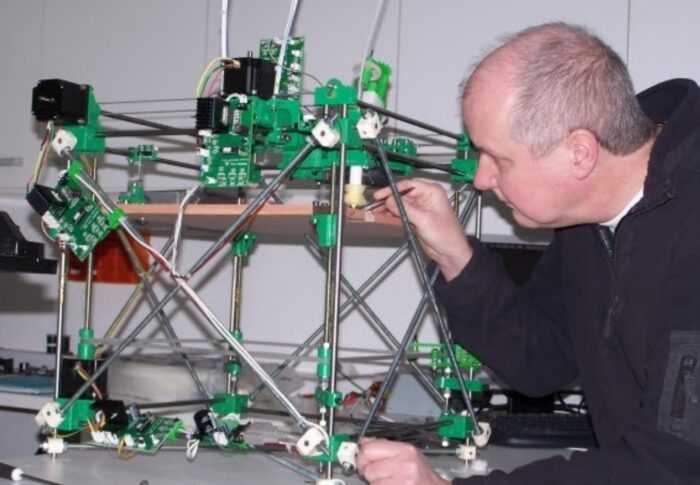
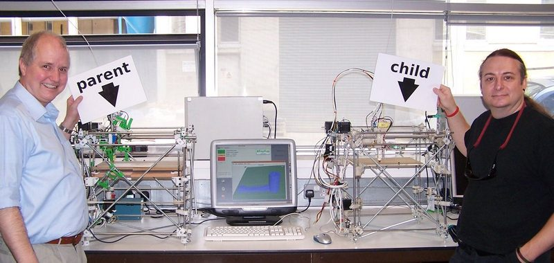
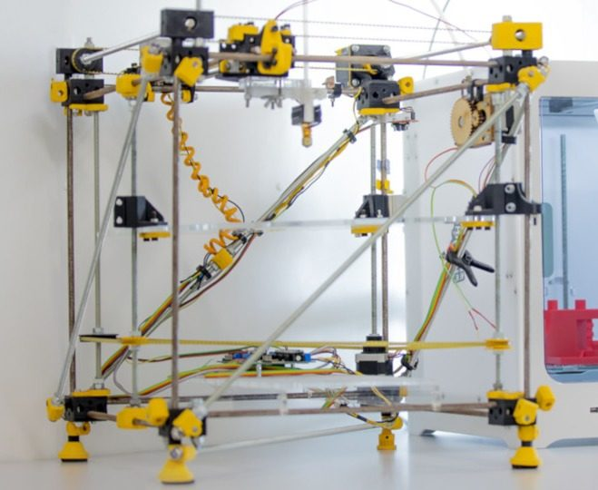

# Darwin

[Catalog row](../../README.md#darwin) · [Gallery](../../GALLERY.md)

| Field | Value |
| --- | --- |
| Section | Historical designs |
| Project page | [https://reprap.org/wiki/Darwin](https://reprap.org/wiki/Darwin) |
| Author | RepRap |
| About | The first RepRap, and one of the earliest self-replicating printer designs. The project started here. |
| Build volume (X×Y×Z) | 230×230×100 |
| Exterior (W×D×H) | — |
| Latest version | 1.0.6 [2008-12](http://blog.reprap.org/2008/12/solid-model-files-for-darwins-cartesian.html) |
| Stars Likes Views | [⏯️⁠81.9K](https://www.youtube.com/watch?v=Mo5Hp_6uD-E) [❤️⁠111](https://www.youtube.com/watch?v=Mo5Hp_6uD-E) |
| Links | — |
| Groups | [Forum](https://reprap.org/forum/list.php?150) EN inactive |

## Pictures (8)

<table>
<tr><td align="center" width="33%"></td><td align="center" width="33%"></td><td align="center" width="33%"></td></tr>
<tr><td align="center" width="33%"></td><td align="center" width="33%"></td><td align="center" width="33%"></td></tr>
<tr><td align="center" width="33%"></td><td align="center" width="33%"></td></tr>
</table>
