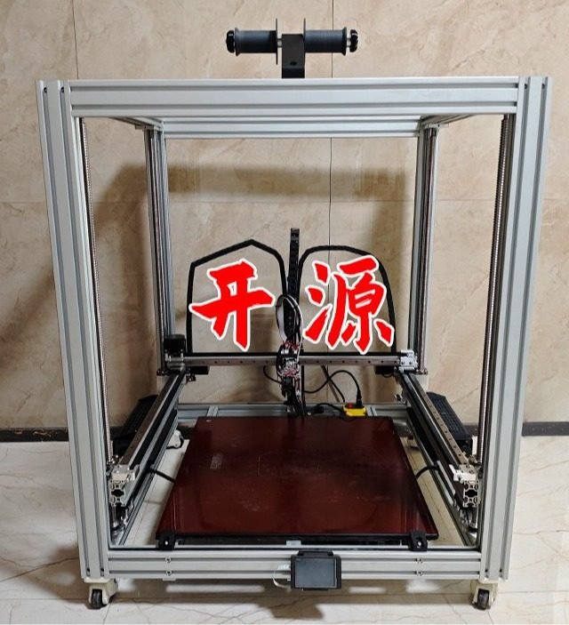
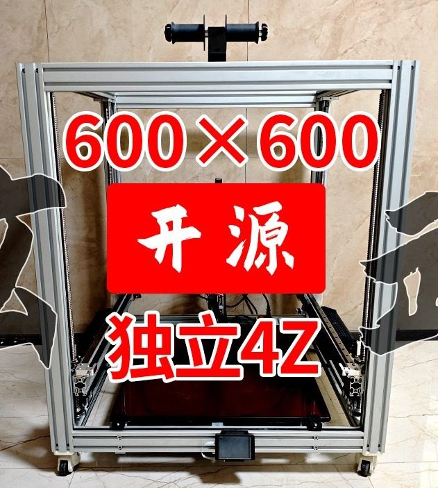

# Xuanwu (玄武)

[Catalog row](../../README.md#dayu-xuanwu) · [Gallery](../../GALLERY.md)

| Field | Value |
| --- | --- |
| Section | Cartesian · Medium and large (>180 mm on either X/Y axis) |
| Project page | [https://github.com/DayuDIY/Xuanwu](https://github.com/DayuDIY/Xuanwu) |
| Author | 大鱼DIY (Dayu DIY) |
| About | Large Cartesian printer with a 600 mm cube volume and a 0.8 mm nozzle. A dual-motor Y gantry carries X, and four independent ball screws lift the bed. |
| Build volume (X×Y×Z) | 600×600×600 |
| Exterior (W×D×H) | — |
| Latest version | Files [2025-03](https://github.com/DayuDIY/Xuanwu/commit/4455e758c96614665268c62088552c66618b1763) |
| Stars Likes Views |  [💚⁠20](https://makerworld.com/en/models/949921-bilibili-big-fish-diy-open-source-3d-printer-xuanw) |
| Links | [STEP](https://github.com/DayuDIY/Xuanwu/blob/master/B%E7%AB%99%E3%80%90%E5%A4%A7%E9%B1%BCDIY%E3%80%913D%E6%89%93%E5%8D%B0%E6%9C%BA_%E7%8E%84%E6%AD%A6%20V1.0.STEP) [STL](https://github.com/DayuDIY/Xuanwu/tree/master/%E7%8E%84%E6%AD%A6_3D%E6%89%93%E5%8D%B0%E9%9B%B6%E4%BB%B6) [BOM](https://github.com/DayuDIY/Xuanwu/blob/master/B%E7%AB%99%E3%80%90%E5%A4%A7%E9%B1%BCDIY%E3%80%913D%E6%89%93%E5%8D%B0%E6%9C%BA_%E7%8E%84%E6%AD%A6%20V1.0%E9%87%87%E8%B4%AD%E6%B8%85%E5%8D%95.xlsx) [Files](https://github.com/DayuDIY/Xuanwu/tree/master/%E7%8E%84%E6%AD%A6_%E9%93%9D%E5%90%88%E9%87%91CNC%E9%9B%B6%E4%BB%B6) [Config](https://github.com/DayuDIY/Xuanwu/tree/master/%E7%8E%84%E6%AD%A6_%E5%9B%BA%E4%BB%B6%E9%85%8D%E7%BD%AE%E5%8F%8AOrca%E5%88%87%E7%89%87%E5%8F%82%E6%95%B0) [Video](https://www.bilibili.com/video/BV1c6rmYjEGh/) |
| Groups | — |
| License | [AGPL-3.0 with no commercial use (GitHub), CC BY-NC-SA 4.0 (MakerWorld)](https://github.com/DayuDIY/Xuanwu/blob/master/LICENSE.txt) |

## Pictures (3)

<table>
<tr><td align="center" width="33%"> Photo: <a href="https://makerworld.com/en/@Dayu_DIY">大鱼DIY</a></td><td align="center" width="33%"> Version: 600×600 build (same machine as 01) Photo: <a href="https://makerworld.com/en/@Dayu_DIY">大鱼DIY</a></td><td align="center" width="33%"> Version: 600×600 build Photo: <a href="https://github.com/DayuDIY">大鱼DIY</a></td></tr>
</table>
