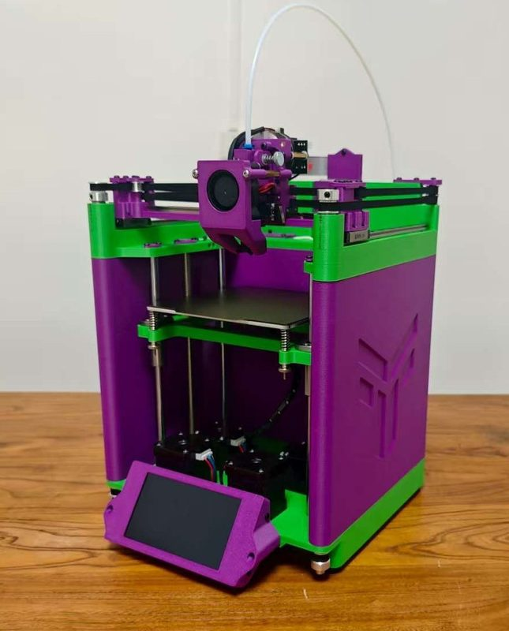
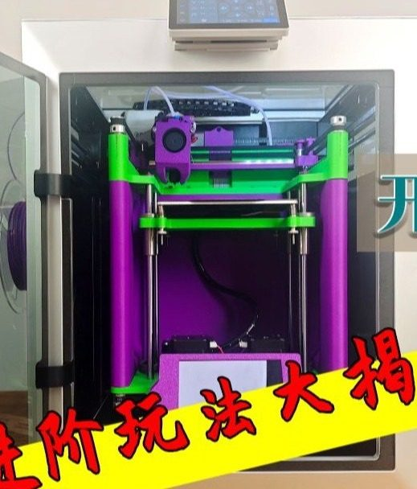
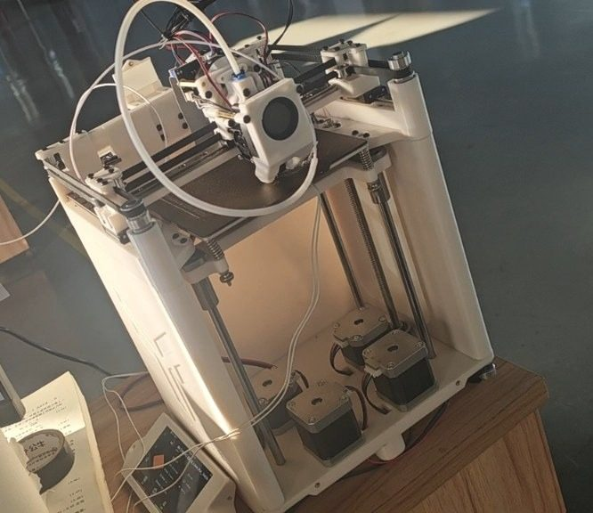
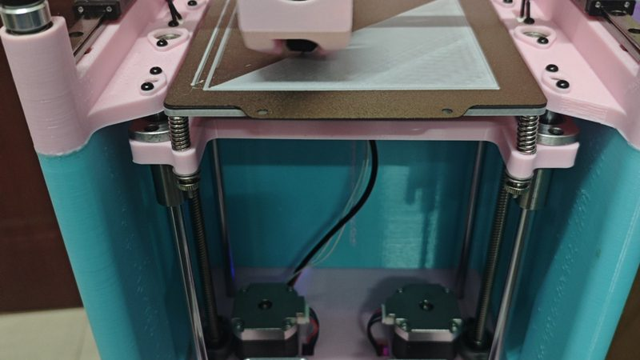

# Yunque (云雀)

[Catalog row](../../README.md#dayu-yunque) · [Gallery](../../GALLERY.md)

| Field | Value |
| --- | --- |
| Section | CoreXY · Small (≤180 mm representative X/Y size) |
| Project page | [https://makerworld.com.cn/zh/models/1590124-bzhan-da-yu-diy-zi-zhi-3dda-yin-ji-_yun-que-v1-06](https://makerworld.com.cn/zh/models/1590124-bzhan-da-yu-diy-zi-zhi-3dda-yin-ji-_yun-que-v1-06) |
| Author | 大鱼DIY (Dayu DIY) |
| About | Mini printer from the Bilibili maker Dayu DIY. All custom parts are 3D printed, and the author puts the material cost near 1,000 CNY. Bilibili users show their own replica builds. |
| Build volume (X×Y×Z) | — |
| Exterior (W×D×H) | — |
| Latest version | V1.06 [2025-09](https://makerworld.com/en/models/1799349-bilibili-big-fish-diy-diy-3d-printer_lark-v1-06) |
| Stars Likes Views | [💚⁠76](https://makerworld.com/en/models/1799349-bilibili-big-fish-diy-diy-3d-printer_lark-v1-06) |
| Links | [Files](https://makerworld.com/en/models/1799349-bilibili-big-fish-diy-diy-3d-printer_lark-v1-06) [Files](https://makerworld.com.cn/zh/models/1590124-bzhan-da-yu-diy-zi-zhi-3dda-yin-ji-_yun-que-v1-06) CN [Video](https://www.bilibili.com/video/BV1PVYNzREfh) |
| Groups | — |
| License | [CC BY-NC-SA 4.0 (MakerWorld)](https://makerworld.com/en/models/1799349-bilibili-big-fish-diy-diy-3d-printer_lark-v1-06) |

## Pictures (5)

<table>
<tr><td align="center" width="33%"> Version: V1.06 Photo: <a href="https://makerworld.com/en/@Dayu_DIY">Dayu DIY</a></td><td align="center" width="33%"> Version: V1.06 Photo: <a href="https://makerworld.com/en/@Dayu_DIY">Dayu DIY</a></td><td align="center" width="33%"> Photo: <a href="https://makerworld.com/en/@Dayu_DIY">Dayu DIY</a></td></tr>
<tr><td align="center" width="33%"> Version: community replica Photo: 地球玩家online</td><td align="center" width="33%"> Version: community replica Photo: <a href="https://space.bilibili.com/384143640">请你吃炸鸡不做面点师</a></td></tr>
</table>
