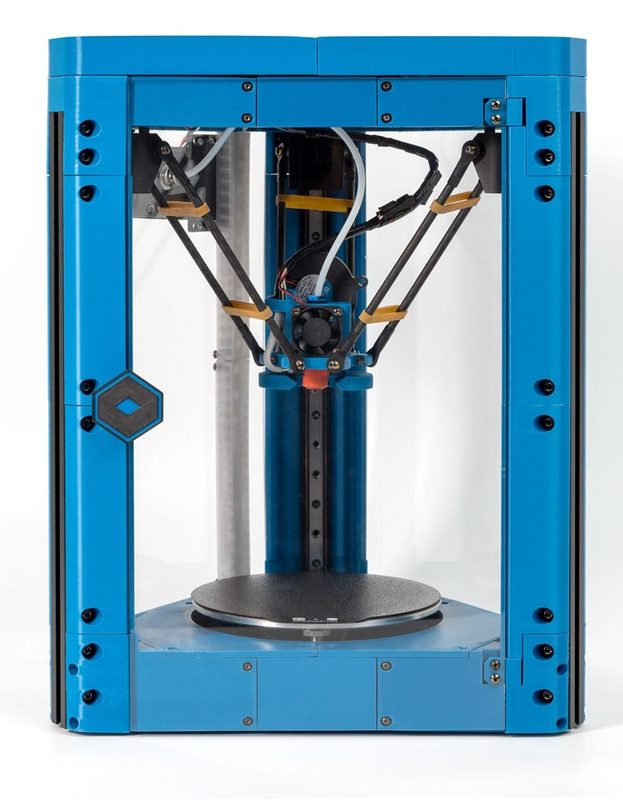
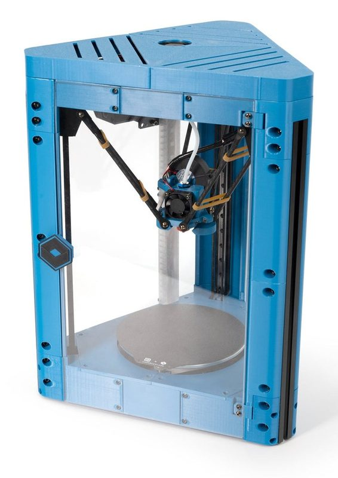
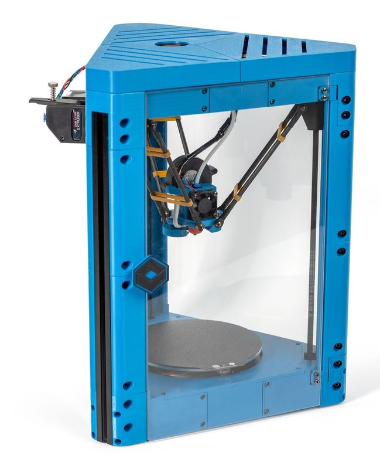
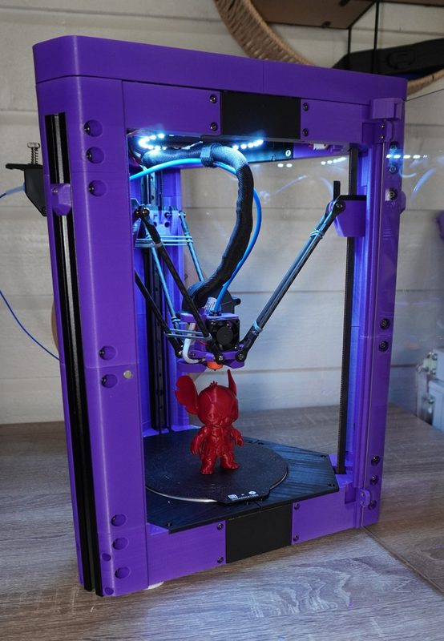
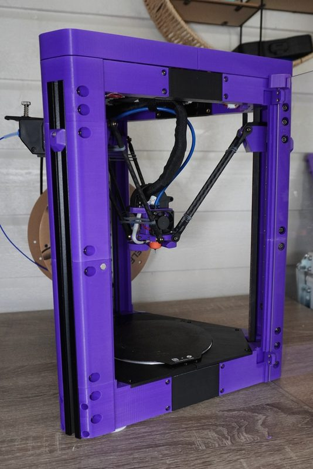

# Delta Flyer

[Catalog row](../../README.md#delta-flyer) · [Gallery](../../GALLERY.md)

| Field | Value |
| --- | --- |
| Section | Delta |
| Project page | [https://www.printables.com/model/1327596-delta-flyer-3d-printer](https://www.printables.com/model/1327596-delta-flyer-3d-printer) |
| Author | Rolohaun / Kanrog |
| About | Compact delta with linear rails and a published manual. |
| Build volume (X×Y×Z) | Ø115×115 |
| Exterior (W×D×H) | — |
| Latest version | Files [2026-04](https://www.printables.com/model/1327596-delta-flyer-3d-printer) |
| Stars Likes Views | [🧡⁠213](https://www.printables.com/model/1327596-delta-flyer-3d-printer) [⏯️⁠9.7K](https://www.youtube.com/watch?v=LaAyrJOo7wg) [❤️⁠368](https://www.youtube.com/watch?v=LaAyrJOo7wg) |
| Links | [Manual](https://kanrog.github.io/Delta-Flyer/) [BOM](https://docs.google.com/spreadsheets/d/1400rbdxxYbIA15yIi4UiYHQk1Ul_DCyP7nSTH7CUpFE/edit) [CAD](https://cad.onshape.com/documents/de9bc61850e74a1717307838/w/2a32f2b0d6edf7beeb9fcbf7/e/392043168b1092bab001d0df) |
| Groups | [Discord](https://discord.gg/rolohaun-3d-946191040682008666) EN 7.8K |
| License | [CC BY-NC](https://www.printables.com/model/1327596-delta-flyer-3d-printer) |

## Pictures (6)

<table>
<tr><td align="center" width="33%"> Photo: <a href="https://github.com/Kanrog">Kanrog</a></td><td align="center" width="33%"> Photo: <a href="https://store.dremc.com.au/">DREMC/LDO</a></td><td align="center" width="33%"> Photo: <a href="https://west3d.com/">West3D/LDO</a></td></tr>
<tr><td align="center" width="33%"> Photo: <a href="https://store.dremc.com.au/">DREMC/LDO</a></td><td align="center" width="33%"> Photo: <a href="https://github.com/Kanrog">Kanrog</a></td><td align="center" width="33%"> Photo: <a href="https://github.com/Kanrog">Kanrog</a></td></tr>
</table>

## Other homes of the files

- [GitHub, Kanrog](https://github.com/Kanrog/Delta-Flyer): source of the manual site and a Klipper config. GPL-3.0.
- Wayback Machine: [latest snapshot](https://web.archive.org/web/20260509192924/https://www.printables.com/model/1327596-delta-flyer-3d-printer), 2026-05-09.
