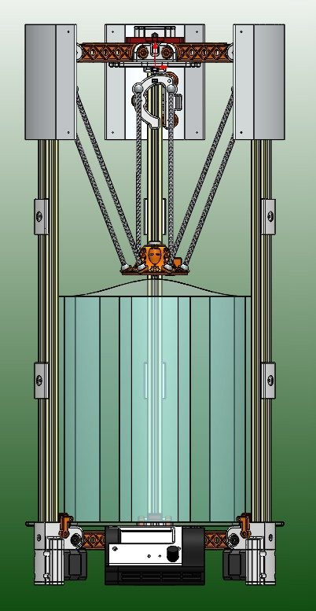
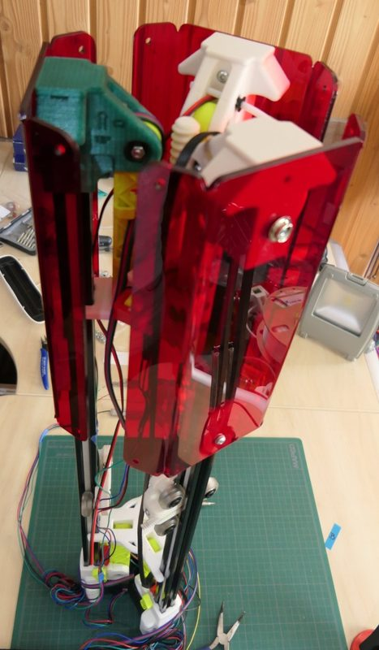
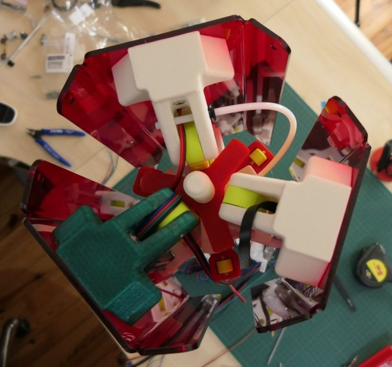
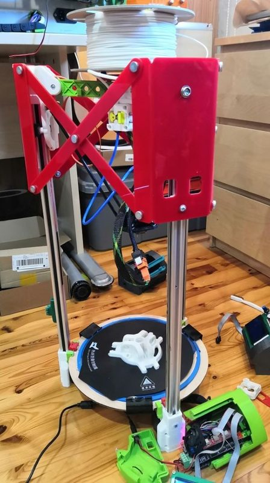
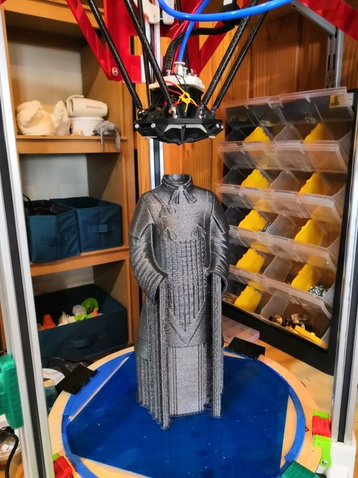
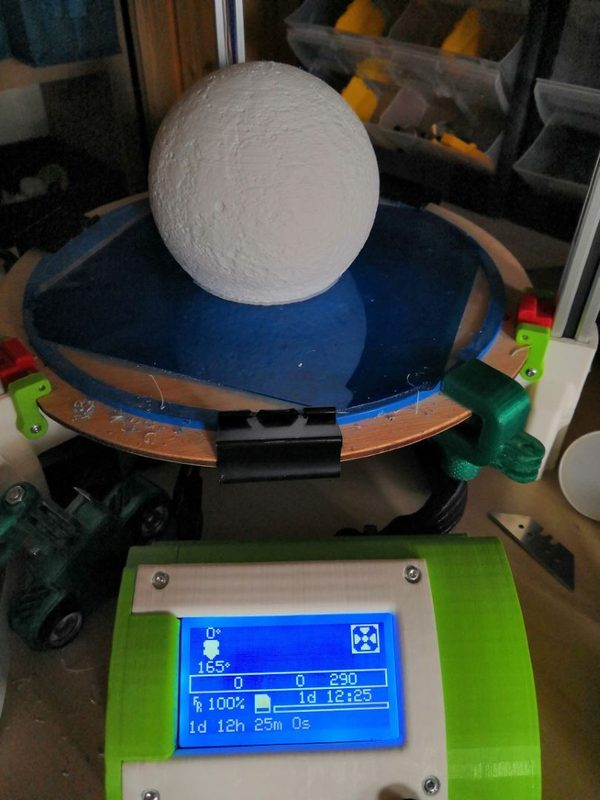

# DeltaFold

[Catalog row](../../README.md#deltafold) · [Gallery](../../GALLERY.md)

| Field | Value |
| --- | --- |
| Section | Concepts and prototypes |
| Project page | [https://github.com/htaxil/DeltaFold](https://github.com/htaxil/DeltaFold) |
| Author | Hubert Taxil (CherHubert) |
| About | Foldable delta for transport, under 6 kg, that folds to a 180 mm wide cylinder. The French RepRap wiki log covers three prototypes from 2015 to 2021, but only part of the STL set is public. |
| Build type | Foldable delta |
| Build volume (X×Y×Z) | Ø220×290 |
| Exterior (W×D×H) | Open: Ø373×730 Folded: Ø180×? |
| Latest version | CAD [2021-02](https://github.com/htaxil/DeltaFold/commit/5a7770af4d941d4d8d270d91b23b2e92dcdb25e3) |
| Stars Likes Views |  |
| Links | [STL](https://github.com/htaxil/DeltaFold/tree/main/docs/components) [Wiki](https://reprap.org/wiki/DeltaFold) |
| Groups | — |
| License | [MPL-2.0 (GitHub)](https://github.com/htaxil/DeltaFold/blob/main/LICENSE) |

## Pictures (7)

<table>
<tr><td align="center" width="33%"> Photo: <a href="https://reprap.org/wiki/User:CherHubert">Hubert Taxil</a></td><td align="center" width="33%"> Photo: <a href="https://reprap.org/wiki/User:CherHubert">Hubert Taxil</a></td><td align="center" width="33%"> Version: third prototype Photo: <a href="https://reprap.org/wiki/User:CherHubert">Hubert Taxil</a></td></tr>
<tr><td align="center" width="33%"> Version: third prototype Photo: <a href="https://reprap.org/wiki/User:CherHubert">Hubert Taxil</a></td><td align="center" width="33%"> Version: earlier prototype Photo: <a href="https://reprap.org/wiki/User:CherHubert">Hubert Taxil</a></td><td align="center" width="33%"> Photo: <a href="https://reprap.org/wiki/User:CherHubert">Hubert Taxil</a></td></tr>
<tr><td align="center" width="33%"> Photo: <a href="https://reprap.org/wiki/User:CherHubert">Hubert Taxil</a></td></tr>
</table>
