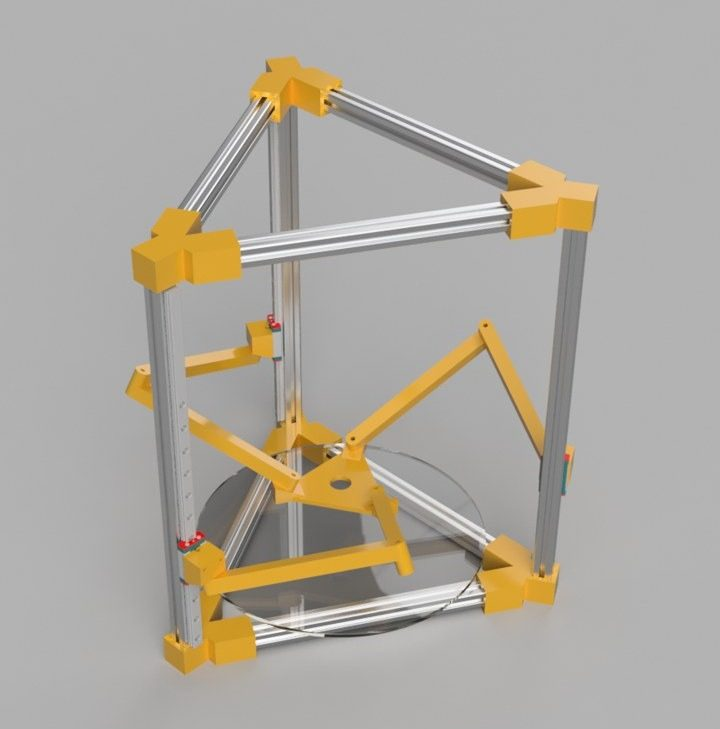
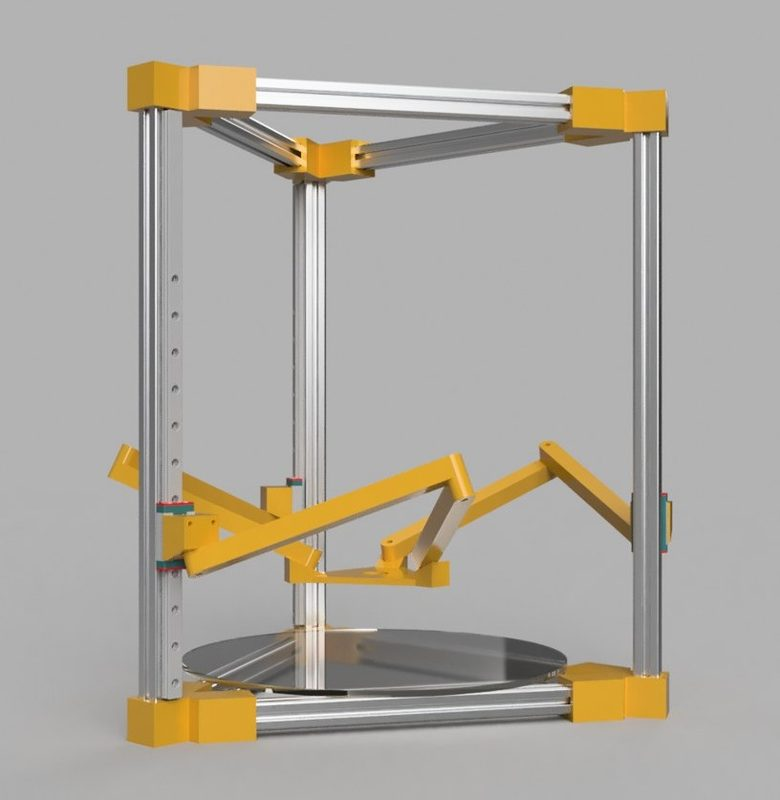
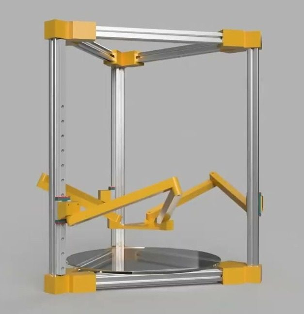
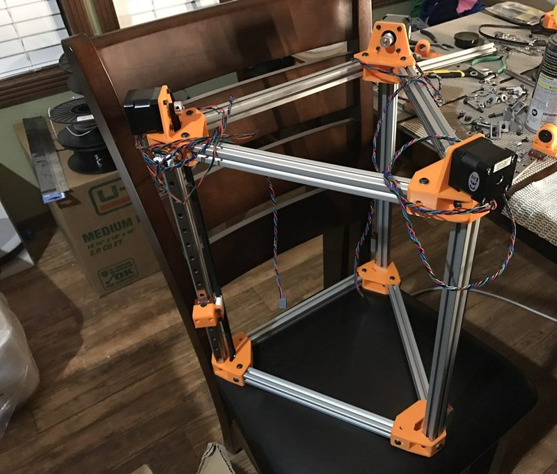
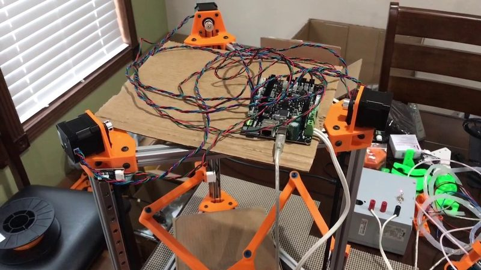
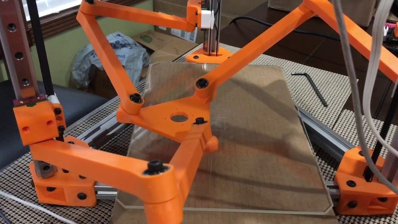
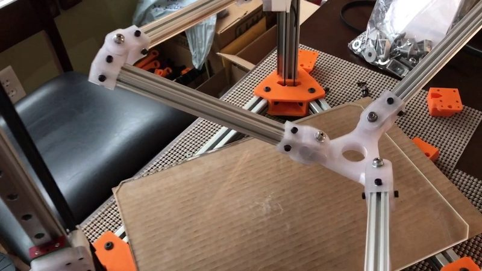

# Delteron

[Catalog row](../../README.md#delteron) · [Gallery](../../GALLERY.md)

| Field | Value |
| --- | --- |
| Section | Legacy designs |
| Project page | [https://github.com/Apsu/delteron](https://github.com/Apsu/delteron) |
| Author | Apsu |
| About | Colinear Tripteron in a linear-delta frame. Three towers drive arms that hang the effector from above, with linear kinematics that need custom firmware code. No update since 2017-01. |
| Build volume (X×Y×Z) | — |
| Exterior (W×D×H) | — |
| Latest version | CAD [2017-01](https://github.com/Apsu/delteron/commit/d3e515120f3ed0c558a1e7e840fbe96bb36307c9) |
| Stars Likes Views |  [💙⁠121](https://www.thingiverse.com/thing:1948394) [⏯️⁠28.6K](https://www.youtube.com/watch?v=-PqMazYsqIQ) [❤️⁠259](https://www.youtube.com/watch?v=-PqMazYsqIQ) |
| Links | [STL](https://github.com/Apsu/delteron) [Files](https://www.thingiverse.com/thing:1948394/files) [Firmware](https://github.com/Apsu/Smoothieware/blob/edge/src/modules/robot/arm_solutions/ColinearTripteronSolution.cpp) [Video](https://www.youtube.com/watch?v=-PqMazYsqIQ) |
| Groups | [Forum](https://reprap.org/forum/read.php?166,719575) EN inactive |
| License | [GPL-3.0 (GitHub LICENSE); CC BY-NC 4.0 (Thingiverse)](https://github.com/Apsu/delteron/blob/master/LICENSE) |

## Pictures (7)

<table>
<tr><td align="center" width="33%"> Photo: <a href="https://www.thingiverse.com/Apsu">Apsu</a></td><td align="center" width="33%"> Photo: <a href="https://www.thingiverse.com/Apsu">Apsu</a></td><td align="center" width="33%"> Photo: <a href="https://www.thingiverse.com/Apsu">Apsu</a></td></tr>
<tr><td align="center" width="33%"> Photo: <a href="https://www.thingiverse.com/Apsu">Apsu</a></td><td align="center" width="33%"> Version: first prototype Photo: <a href="https://www.thingiverse.com/Apsu">Apsu</a></td><td align="center" width="33%"> Version: prototype, second pass Photo: <a href="https://www.thingiverse.com/Apsu">Apsu</a></td></tr>
<tr><td align="center" width="33%"> Version: prototype, round two arms with 1515 beams Photo: <a href="https://www.thingiverse.com/Apsu">Apsu</a></td></tr>
</table>
