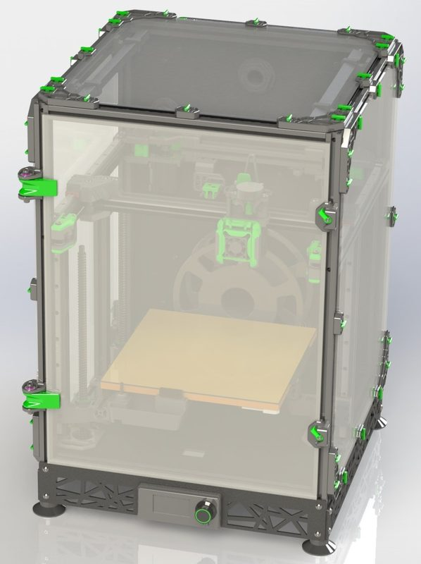
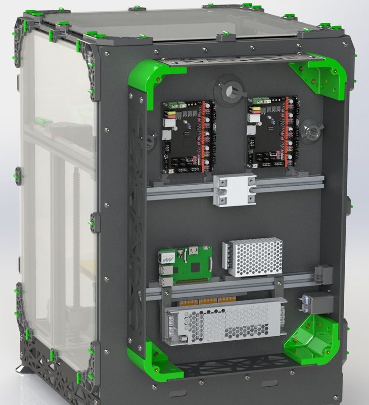
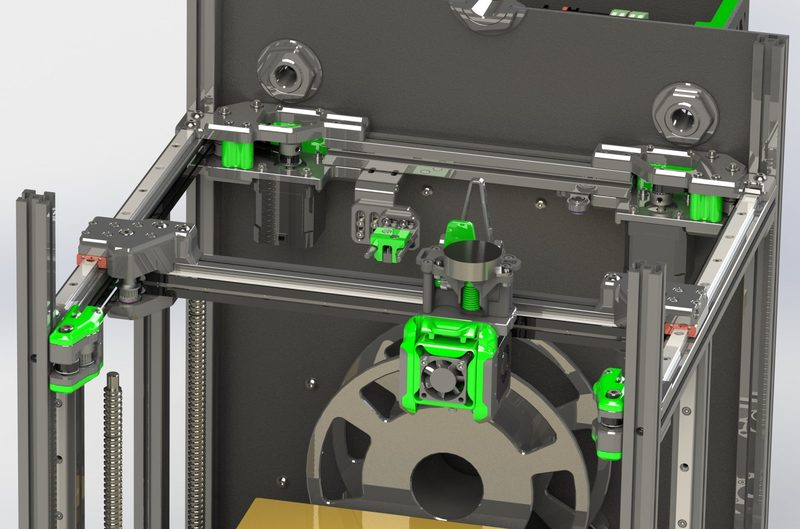

# Denali

[Catalog row](../../README.md#denali) · [Gallery](../../GALLERY.md)

| Field | Value |
| --- | --- |
| Section | Legacy designs |
| Project page | [https://github.com/Annex-Engineering/Denali](https://github.com/Annex-Engineering/Denali) |
| Author | Annex Engineering |
| About | Scalable enclosed CoreXY with a three-motor moving bed; repository is archived. |
| Build volume (X×Y×Z) | 200: 200×200×200 250: 250×250×200 350: 350×350×300 |
| Exterior (W×D×H) | 200: 380×380×620 250: 430×430×620 350: 530×530×720 |
| Latest version | R1.1 [2021-01](https://github.com/Annex-Engineering/Denali/releases/tag/R1.1) |
| Stars Likes Views |  |
| Links | [CAD](https://github.com/Annex-Engineering/Denali/tree/master/CAD) [STL](https://github.com/Annex-Engineering/Denali/tree/master/STLs) [BOM](https://docs.google.com/spreadsheets/d/1O3eyVuQ6M4F03MJSDs4Z71_XyNjXL5HFTZr1jsaAtRc/edit) |
| Groups | [Discord](https://discord.gg/MzTR3zE) EN 11.4K |

## Pictures (4)

<table>
<tr><td align="center" width="33%"> Photo: <a href="https://github.com/Annex-Engineering">Annex Engineering</a></td><td align="center" width="33%"> Photo: <a href="https://github.com/Annex-Engineering">Annex Engineering</a></td><td align="center" width="33%"> Photo: <a href="https://github.com/Annex-Engineering">Annex Engineering</a></td></tr>
<tr><td align="center" width="33%"> Photo: <a href="https://github.com/Annex-Engineering">Annex Engineering</a></td></tr>
</table>
