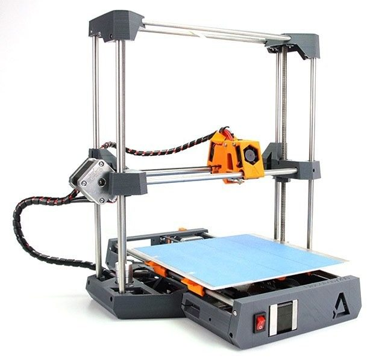
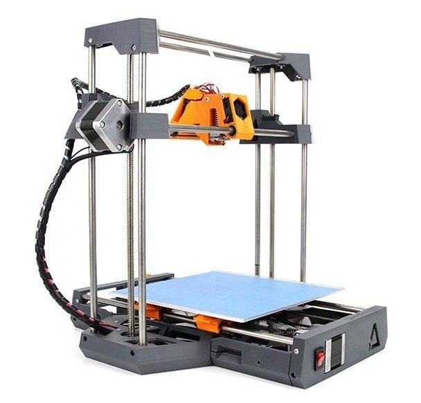
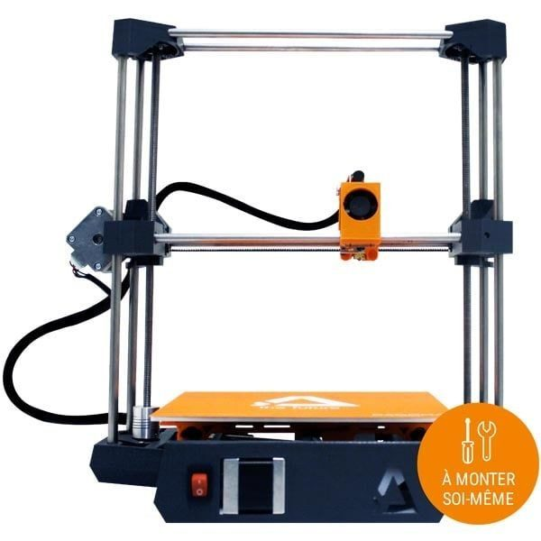
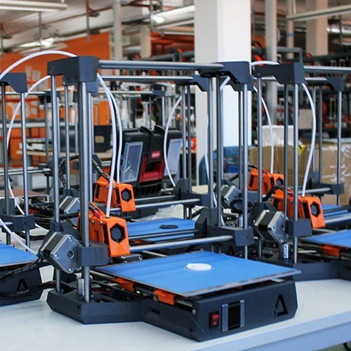

# Dagoma DiscoEasy200

[Catalog row](../../README.md#discoeasy200) · [Gallery](../../GALLERY.md)

| Field | Value |
| --- | --- |
| Section | Legacy designs |
| Project page | [https://github.com/dagoma3d/STL-DiscoEasy200-Official](https://github.com/dagoma3d/STL-DiscoEasy200-Official) |
| Author | Dagoma |
| About | French low-cost Cartesian kit with a moving bed. About 40% of its parts are printed. No update since 2019-07. |
| Build volume (X×Y×Z) | 200×200×200 |
| Exterior (W×D×H) | — |
| Latest version | STL [2019-07](https://github.com/dagoma3d/STL-DiscoEasy200-Official/commit/546247fa57ace0d6ab88400405de789029451057) |
| Stars Likes Views |  [💙⁠178](https://www.thingiverse.com/thing:1754185) [⏯️⁠60.1K](https://www.youtube.com/watch?v=b0K4VhmD5mY) [❤️⁠80](https://www.youtube.com/watch?v=b0K4VhmD5mY) |
| Links | [STL](https://github.com/dagoma3d/STL-DiscoEasy200-Official/tree/Release/Pi%C3%A8ces%20Imprim%C3%A9es) [Files](https://github.com/dagoma3d/STL-DiscoEasy200-Official) [Manual](https://github.com/dagoma3d/notices) |
| Groups | — |
| License | [CC BY-NC-SA 4.0 (GitHub), CC BY 4.0 (Thingiverse)](https://github.com/dagoma3d/STL-DiscoEasy200-Official/blob/Release/LICENSE) |

## Pictures (4)

<table>
<tr><td align="center" width="33%"> Photo: <a href="https://github.com/dagoma3d">Dagoma</a></td><td align="center" width="33%"> Version: with the trapezoidal-rod (Trapezoidales) Z add-on Photo: <a href="https://github.com/dagoma3d">Dagoma</a></td><td align="center" width="33%"> Version: kit version Photo: <a href="https://www.thingiverse.com/dagoma3D/designs">Dagoma</a></td></tr>
<tr><td align="center" width="33%"> Photo: <a href="https://www.thingiverse.com/dagoma3D/designs">Dagoma</a></td></tr>
</table>
