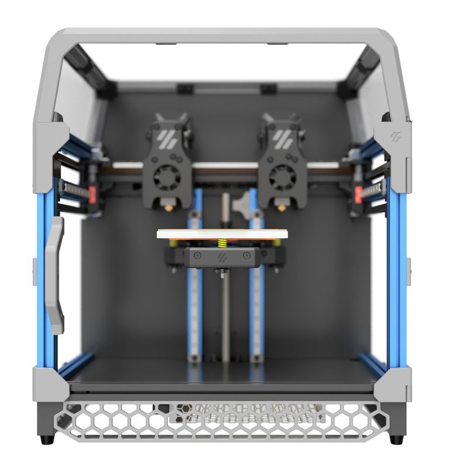
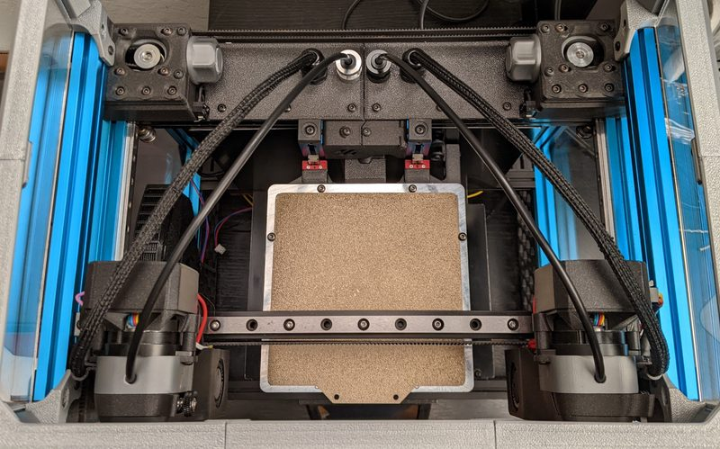

# Double Dragon

[Catalog row](../../README.md#double-dragon) · [Gallery](../../GALLERY.md)

| Field | Value |
| --- | --- |
| Section | Conversions |
| Project page | [https://github.com/zruncho3d/double-dragon](https://github.com/zruncho3d/double-dragon) |
| Author | zruncho3d |
| About | Alpha-stage Voron V0-derived IDEX experiment for dual extrusion. |
| Build volume (X×Y×Z) | 114×120×? |
| Exterior (W×D×H) | — |
| Latest version | alpha 1 [2021-12](https://github.com/zruncho3d/double-dragon#alpha-1-release-2021-12-31) |
| Stars Likes Views |  [⏯️⁠9.6K](https://www.youtube.com/watch?v=GY29F2O1unw) [❤️⁠116](https://www.youtube.com/watch?v=GY29F2O1unw) |
| Links | [CAD](https://github.com/zruncho3d/double-dragon/tree/HEAD/CAD) |
| Groups | [Discord](https://discord.gg/voron) EN 40.8K [Discord](https://discord.gg/doomcube) EN 6.9K [Reddit](https://www.reddit.com/r/VORONDesign/) EN 39.7K |

## Pictures (3)

<table>
<tr><td align="center" width="33%"> Photo: <a href="https://github.com/zruncho3d">Zruncho 3D</a></td><td align="center" width="33%"> Photo: <a href="https://github.com/zruncho3d">Zruncho 3D</a></td><td align="center" width="33%"> Photo: <a href="https://github.com/zruncho3d">Zruncho 3D</a></td></tr>
</table>
