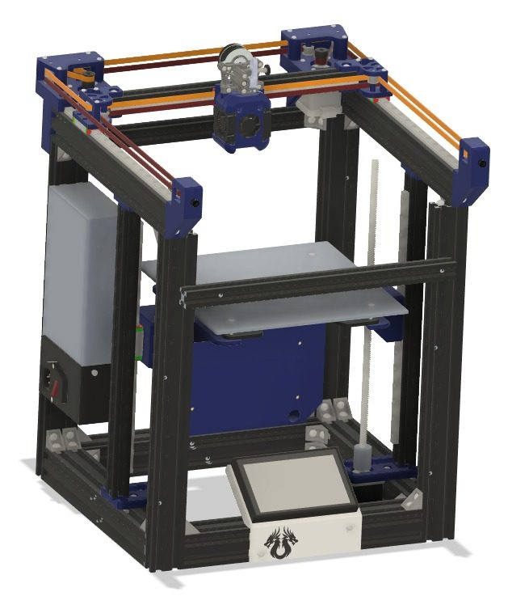
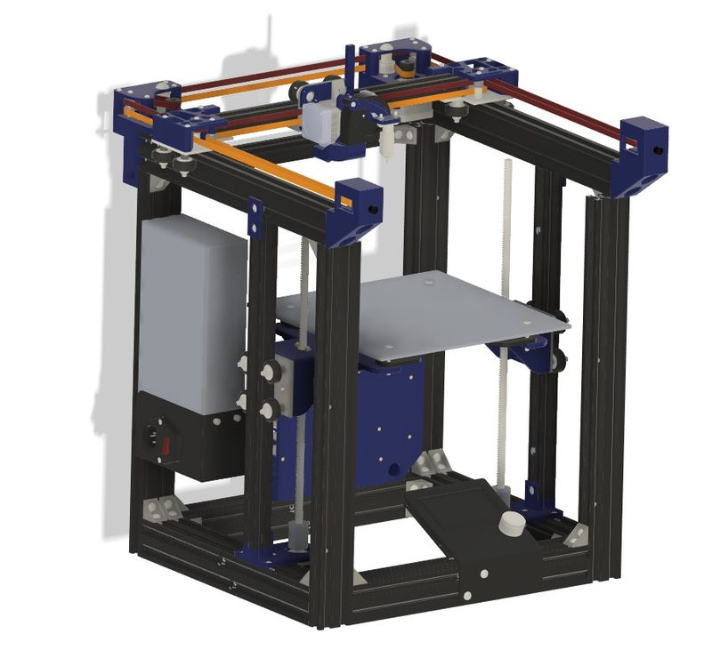
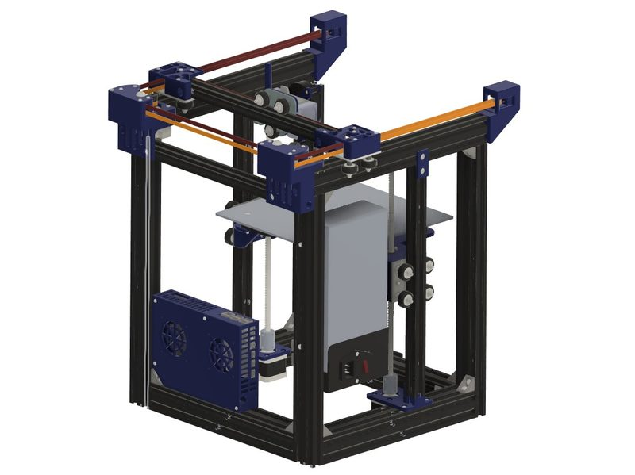
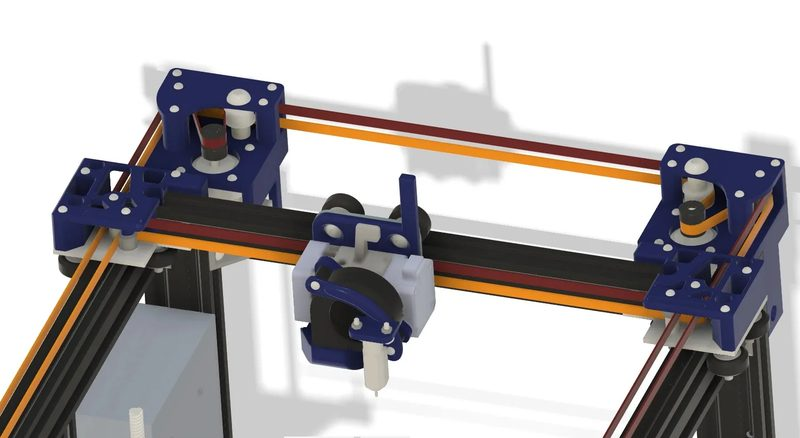
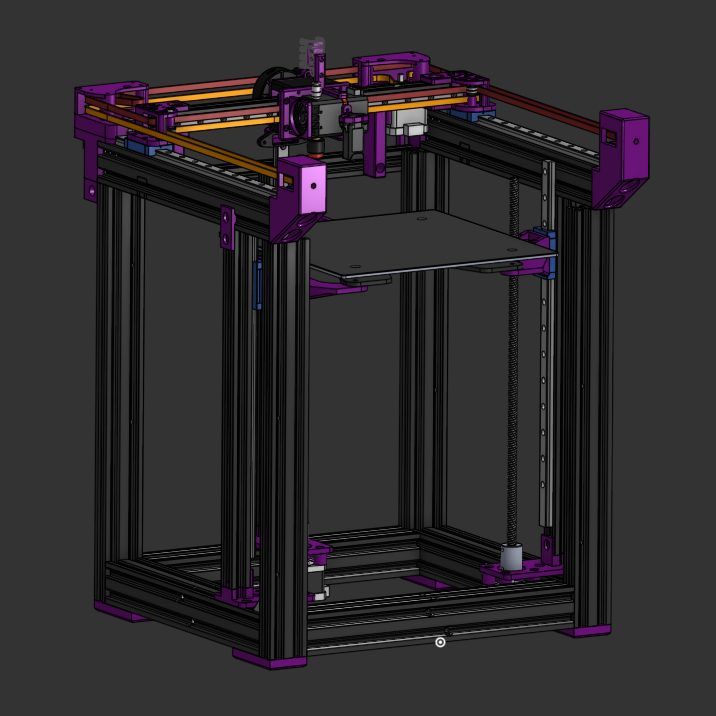
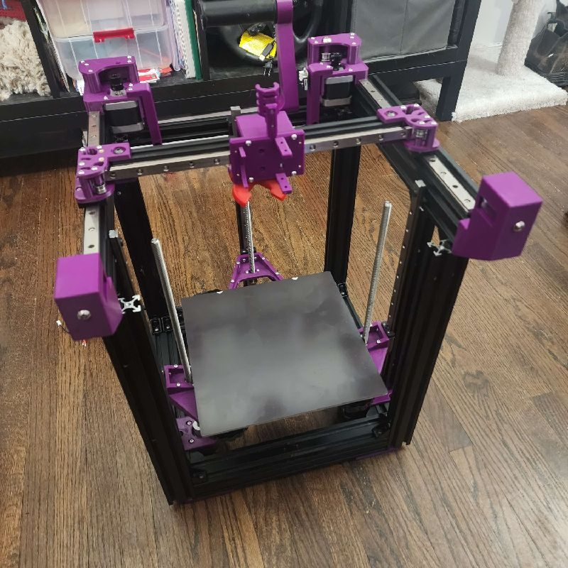
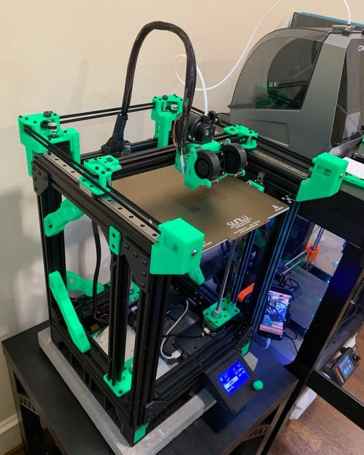
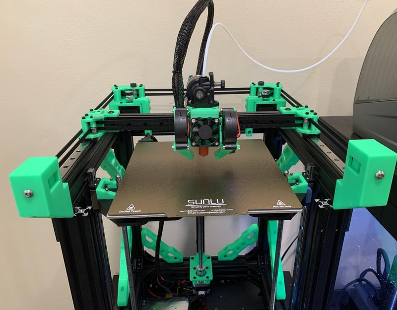

# Duender

[Catalog row](../../README.md#duender) · [Gallery](../../GALLERY.md)

| Field | Value |
| --- | --- |
| Section | Conversions |
| Project page | [https://github.com/Irbis3D/Duender](https://github.com/Irbis3D/Duender) |
| Author | Irbis3D |
| About | Turns parts from two Ender-3 printers into one CoreXY. |
| Build volume (X×Y×Z) | — |
| Exterior (W×D×H) | — |
| Latest version | STEP [2026-02](https://github.com/Irbis3D/Duender/commit/bfcfaa326620ba41ce1e14cf685c5fdfafbaf192) |
| Stars Likes Views |  [🧡⁠742](https://www.printables.com/model/1174545) [⏯️⁠72.7K](https://www.youtube.com/watch?v=zOplNhr5SfA) [❤️⁠3.3K](https://www.youtube.com/watch?v=zOplNhr5SfA) |
| Links | [STEP](https://github.com/Irbis3D/Duender/tree/HEAD/STEP%20KITS) [Manual](https://github.com/Irbis3D/Duender/tree/HEAD/Manual) |
| Groups | [Discord](https://discord.gg/ae44FHv786) EN 2.9K |

## Pictures (8)

<table>
<tr><td align="center" width="33%"> Photo: <a href="https://github.com/Irbis3D">Irbis3D</a></td><td align="center" width="33%"> Photo: <a href="https://www.printables.com/@SergeiIrbene_2885771">Sergei Irbis</a></td><td align="center" width="33%"> Photo: <a href="https://www.printables.com/@SergeiIrbene_2885771">Sergei Irbis</a></td></tr>
<tr><td align="center" width="33%"> Photo: <a href="https://www.printables.com/@SergeiIrbene_2885771">Sergei Irbis</a></td><td align="center" width="33%"> Photo: <a href="https://www.printables.com/@MacroMoray">MacroMoray</a></td><td align="center" width="33%"> Photo: <a href="https://www.printables.com/@MacroMoray">MacroMoray</a></td></tr>
<tr><td align="center" width="33%"></td><td align="center" width="33%"></td></tr>
</table>
