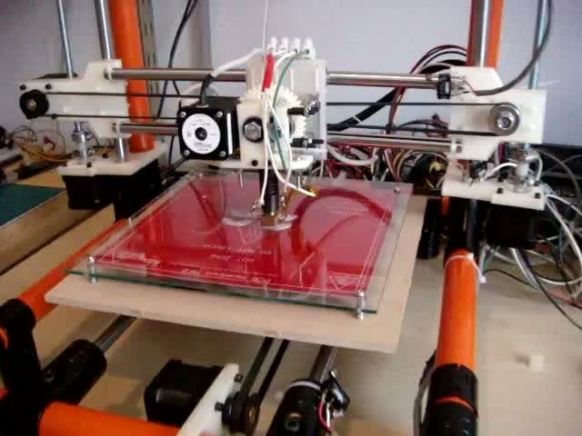
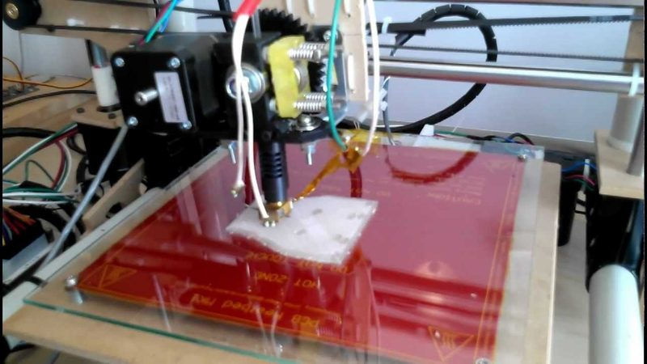
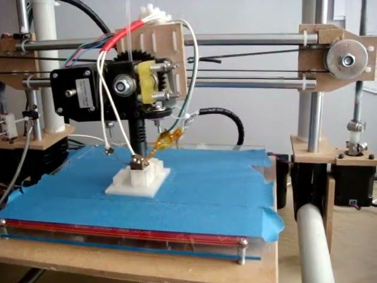
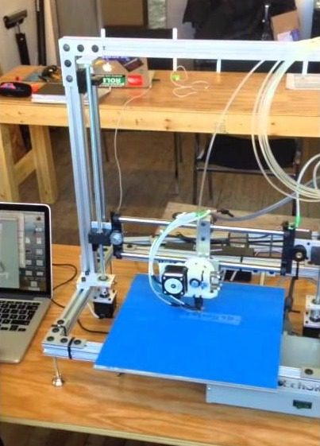

# EchoRap

[Catalog row](../../README.md#echorap) · [Gallery](../../GALLERY.md)

| Field | Value |
| --- | --- |
| Section | Legacy designs |
| Project page | [https://reprap.org/wiki/Echorap](https://reprap.org/wiki/Echorap) |
| Author | Stéphane Rousseau / Robotic Sequencing |
| About | Low-cost Mendel-derived RepRap from the ÉchoFab fab lab in Montreal. The frame is steel tubes joined with tube couplings, and longer tubes enlarge each axis. No update since 2012-10. |
| Build volume (X×Y×Z) | 220×220×200 |
| Exterior (W×D×H) | 510×585×540 |
| Latest version | Rev1 [2012-10](https://www.thingiverse.com/thing:32557) |
| Stars Likes Views | [💙⁠76](https://www.thingiverse.com/thing:32557) [⏯️⁠3.3K](https://www.youtube.com/watch?v=3Qng64k36mw) [❤️⁠1](https://www.youtube.com/watch?v=3Qng64k36mw) |
| Links | [STL](https://www.thingiverse.com/thing:32557/files) [BOM](https://reprap.org/wiki/Echorap) [FW](https://github.com/roboticseq/RSEchoRapSprinterForPrintrBoardRevD) [Video](https://www.youtube.com/watch?v=tCaJwnWEe9o) |
| Groups | — |
| License | [CC BY-NC-ND 3.0 (Thingiverse), CC BY-NC-SA (RepRap wiki), GPL (ÉchoFab repo)](https://www.thingiverse.com/thing:32557) |

## Pictures (5)

<table>
<tr><td align="center" width="33%"> Photo: <a href="https://reprap.org/wiki/User:Stephaner">Stephane Rousseau</a></td><td align="center" width="33%"> Photo: <a href="https://www.youtube.com/channel/UC2mR5NnCiaQfSzaP317M76Q">Stephane Rousseau</a></td><td align="center" width="33%"> Photo: <a href="https://www.youtube.com/channel/UC2mR5NnCiaQfSzaP317M76Q">Stephane Rousseau</a></td></tr>
<tr><td align="center" width="33%"> Photo: <a href="https://www.youtube.com/channel/UC2mR5NnCiaQfSzaP317M76Q">Stephane Rousseau</a></td><td align="center" width="33%"> Version: EchoRap ALU (2014) Photo: <a href="https://www.youtube.com/channel/UC2mR5NnCiaQfSzaP317M76Q">Stephane Rousseau</a></td></tr>
</table>
