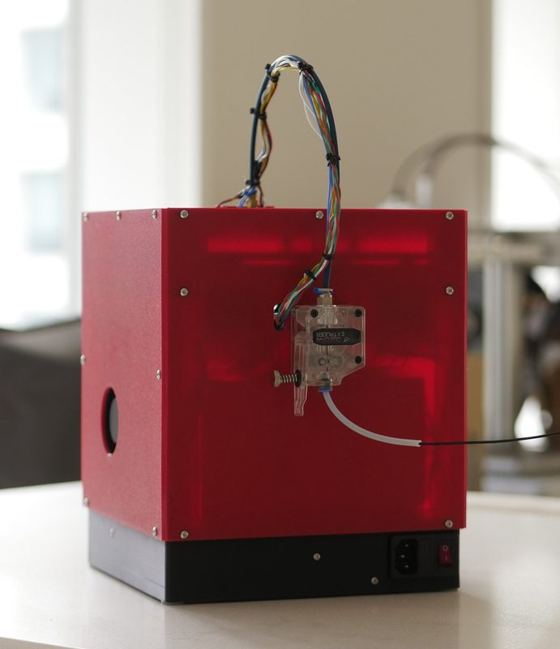
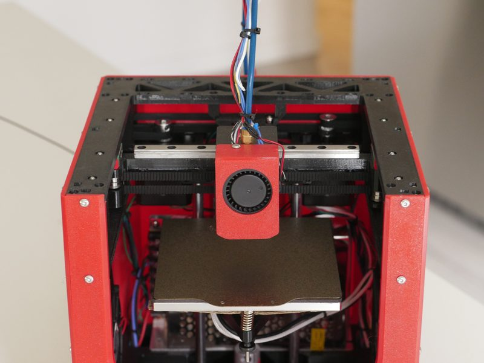
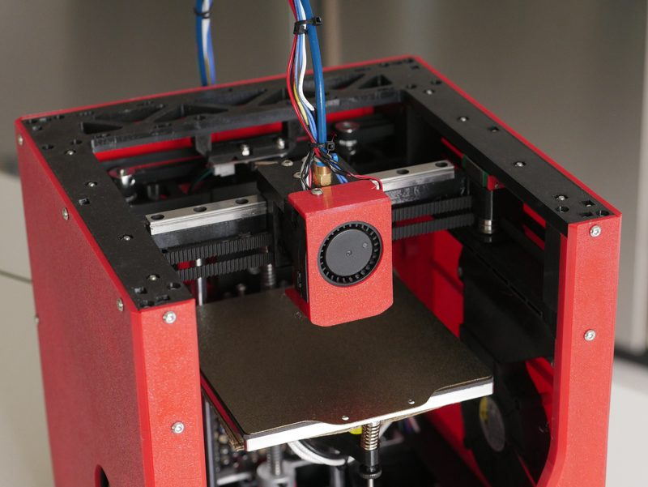
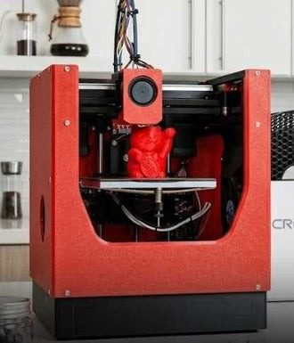

# Encore

[Catalog row](../../README.md#encore) · [Gallery](../../GALLERY.md)

| Field | Value |
| --- | --- |
| Section | CoreXY · Small (≤180 mm representative X/Y size) |
| Project page | [https://github.com/alexyu132/encore](https://github.com/alexyu132/encore) |
| Author | Alex Yu |
| About | 120 mm printed-frame CoreXY with a filament-box-sized footprint. |
| Build volume (X×Y×Z) | 120×120×120 |
| Exterior (W×D×H) | 219×221×262 |
| Latest version | CAD [2026-06](https://github.com/alexyu132/encore/commit/7d7dd0397e26942a915dca2213147e9594a3a777) |
| Stars Likes Views |  [💙⁠456](https://www.thingiverse.com/thing:7363835) [🧡⁠1.1K](https://www.printables.com/model/1743331-encore-mini-corexy-3d-printer-with-a-fully-printed) [💚⁠73](https://makerworld.com/en/models/2882748-encore-mini-corexy-3d-printer) [⏯️⁠59.8K](https://www.youtube.com/watch?v=9xukniyO6fI) [❤️⁠2.7K](https://www.youtube.com/watch?v=9xukniyO6fI) |
| Links | [STEP](https://github.com/alexyu132/encore/blob/main/encore.step) [BOM](https://github.com/alexyu132/encore/blob/main/documentation/BOM.md) [Manual](https://github.com/alexyu132/encore/blob/main/documentation/build%20guide/build%20guide.md) [Video](https://www.youtube.com/watch?v=9xukniyO6fI) |
| Groups | — |
| License | [GPL-3.0](https://github.com/alexyu132/encore/blob/main/LICENSE) |

## Pictures (5)

<table>
<tr><td align="center" width="33%"> Photo: <a href="https://github.com/alexyu132">Alex Yu</a></td><td align="center" width="33%"> Photo: <a href="https://github.com/alexyu132">Alex Yu</a></td><td align="center" width="33%"> Photo: <a href="https://github.com/alexyu132">Alex Yu</a></td></tr>
<tr><td align="center" width="33%"> Photo: <a href="https://github.com/alexyu132">Alex Yu</a></td><td align="center" width="33%"></td></tr>
</table>
