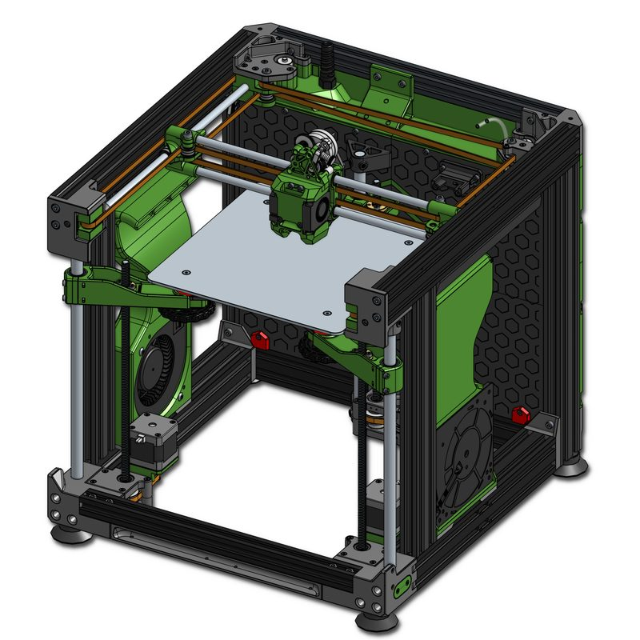
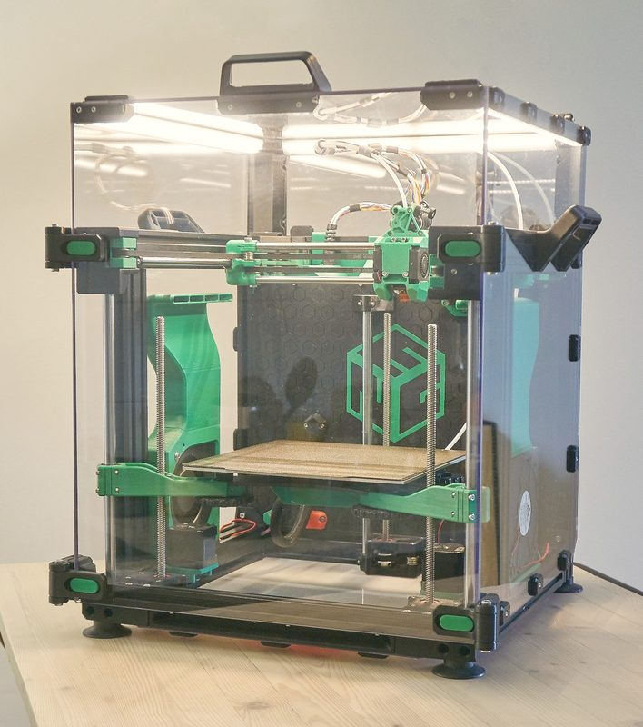
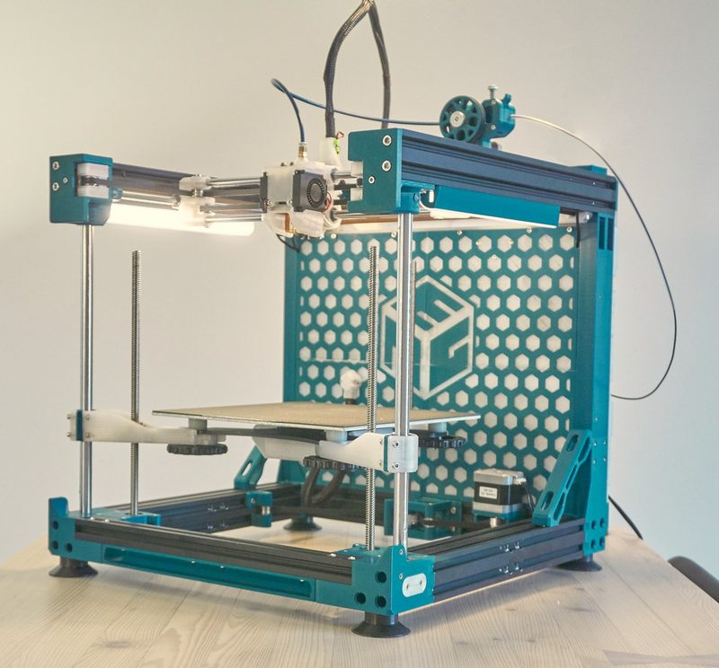

# Ender-3 NG

[Catalog row](../../README.md#ender-3-ng) · [Gallery](../../GALLERY.md)

| Field | Value |
| --- | --- |
| Section | Conversions |
| Project page | [https://www.printables.com/model/922401-ender-3-ng-v12-corexy-conversion](https://www.printables.com/model/922401-ender-3-ng-v12-corexy-conversion) |
| Author | RH3D |
| About | Ender-3 CoreXY conversion with a dedicated guide; the listed volume is from a creator beta build. |
| Build volume (X×Y×Z) | 235×235×245 |
| Exterior (W×D×H) | — |
| Latest version | v1.2 [2024-08](https://www.printables.com/model/922401-ender-3-ng-v12-corexy-conversion) |
| Stars Likes Views | [🧡⁠2.7K](https://www.printables.com/model/922401-ender-3-ng-v12-corexy-conversion) [⏯️⁠107K](https://www.youtube.com/watch?v=u4b6Ni18ap4) [❤️⁠3.3K](https://www.youtube.com/watch?v=u4b6Ni18ap4) |
| Links | [Files](https://rh3d.xyz/E3NG_v1_2/standard/files) [Manual](https://rh3d.xyz/E3NG_v1_2/standard/build_guide) |
| Groups | [Discord](https://discord.com/invite/Zkvu6uu2AR) EN 4.8K |

## Pictures (4)

<table>
<tr><td align="center" width="33%"></td><td align="center" width="33%"></td><td align="center" width="33%"></td></tr>
<tr><td align="center" width="33%"></td></tr>
</table>
