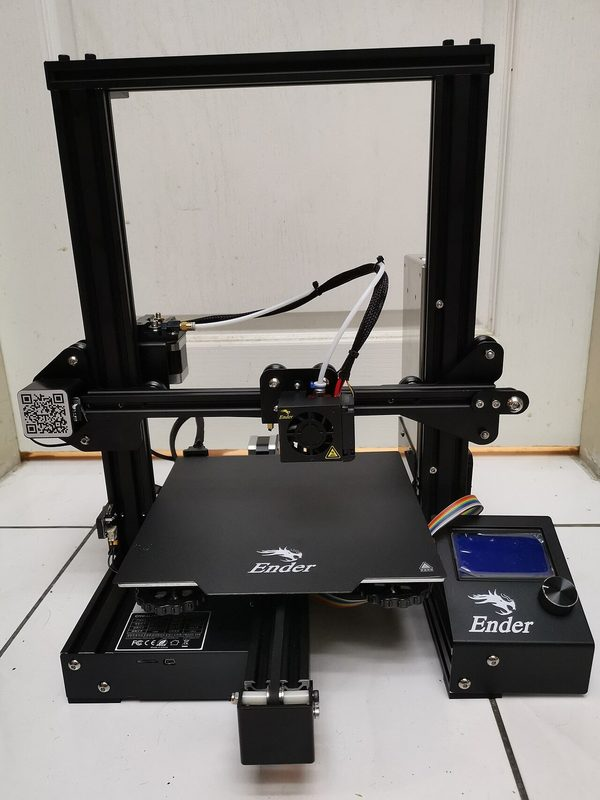
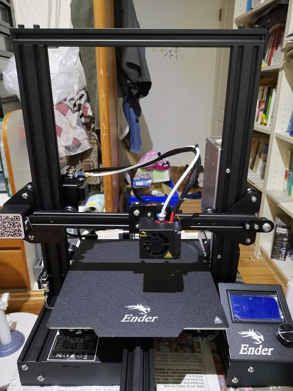
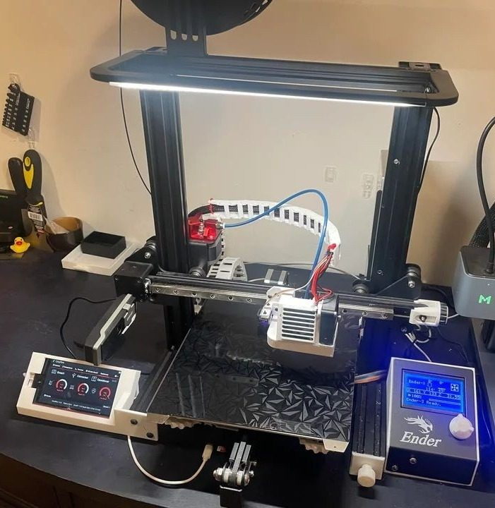
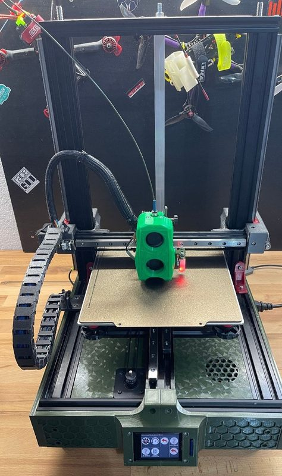
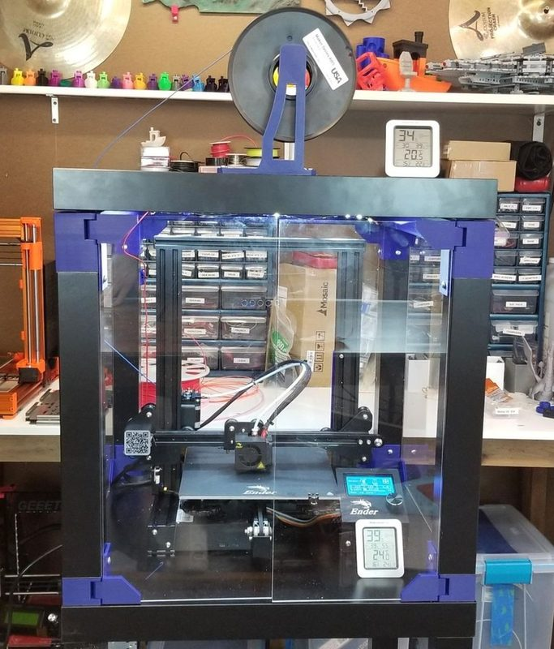

# Original Ender-3

[Catalog row](../../README.md#ender-3) · [Gallery](../../GALLERY.md)

| Field | Value |
| --- | --- |
| Section | Historical designs |
| Project page | [https://github.com/Creality3DPrinting/Ender-3](https://github.com/Creality3DPrinting/Ender-3) |
| Author | Creality |
| About | The best-selling budget printer, with an open hardware release of its mechanical and electronics files. |
| Build volume (X×Y×Z) | 220×220×250 |
| Exterior (W×D×H) | 440×410×465 |
| Latest version | CAD [2018-06](https://github.com/Creality3DPrinting/Ender-3/commit/c94ec770d9ebf4795b31d178da24e0c77cc77167) |
| Stars Likes Views |  [⏯️⁠319K](https://www.youtube.com/watch?v=yxkwERZXfaQ) [❤️⁠3.5K](https://www.youtube.com/watch?v=yxkwERZXfaQ) |
| Links | [CAD](https://github.com/Creality3DPrinting/Ender-3/tree/master/Ender-3%20Mechanical) [Firmware](https://github.com/Creality3DPrinting/Ender-3/tree/master/Ender-3%20Firmware%20%28Marlin%29) |
| Groups | [Facebook](https://www.facebook.com/groups/ender3ender3procreality) EN 113K [Discord](https://discord.com/invite/creality) EN 25K [Reddit](https://www.reddit.com/r/ender3/) EN 257K [Telegram](https://t.me/Ender3Spain) ES 5.4K [Reddit](https://www.reddit.com/r/Creality/) EN 76.4K [Telegram](https://t.me/crealitybr) PT 737 |
| License | [GPL-3.0](https://github.com/Creality3DPrinting/Ender-3/blob/master/LICENSE) |

## Pictures (13)

<table>
<tr><td align="center" width="33%"> Photo: <a href="https://www.creality.com/">Creality</a></td><td align="center" width="33%"> Photo: <a href="https://www.creality.com/">Creality</a></td><td align="center" width="33%"> Photo: <a href="https://www.creality.com/">Creality</a></td></tr>
<tr><td align="center" width="33%"> Photo: <a href="https://www.creality.com/">Creality</a></td><td align="center" width="33%"> Photo: <a href="https://www.creality.com/">Creality</a></td><td align="center" width="33%"> Photo: <a href="https://www.creality.com/">Creality</a></td></tr>
<tr><td align="center" width="33%"> Photo: <a href="https://shopgoodwill.com/">ShopGoodwill</a></td><td align="center" width="33%"></td><td align="center" width="33%"> Version: Ender-3 (sold as the Ender 3X kit) Photo: <a href="https://www.flickr.com/photos/12882975@N00/">kenming Wang</a></td></tr>
<tr><td align="center" width="33%"> Version: Ender-3 (sold as the Ender 3X kit) Photo: <a href="https://www.flickr.com/photos/12882975@N00/">kenming Wang</a></td><td align="center" width="33%"> Photo: <a href="https://www.printables.com/@Avery710">Avery</a></td><td align="center" width="33%"> Photo: <a href="https://www.printables.com/@djey_570830">djey</a></td></tr>
<tr><td align="center" width="33%"> Photo: <a href="https://www.printables.com/@ChrisRiley">Chris Riley</a></td></tr>
</table>

## Other homes of the files

- Wayback Machine: [latest snapshot](http://web.archive.org/web/20260914093850/https://github.com/Creality3DPrinting/Ender-3), 2026-09-14.

## Popular mods

- [Ender 3 Cable Chain](https://www.thingiverse.com/thing:2920060) by Jwhiskey3D: printed cable chains for the hotend and heated-bed wiring, with frame mounts. CC BY 4.0.
- [Petsfang / Bullseye duct](https://www.thingiverse.com/thing:2759439) by dpetsel: modular part-cooling duct and hotend base for the 5015 or stock blower, with BLTouch and EZABL mounts and stock, Micro Swiss, E3D V6 and Volcano hotend options. CC BY-NC-ND 4.0.
- [IKEA Lack Enclosure Creality Ender 3 Compilation](https://www.thingiverse.com/thing:3083358) by Woody1978: IKEA Lack table enclosure compiled for the Ender 3, with filament guide, spool and light parts. CC BY 4.0.
- [Ender 3 Cable Chain, no screws, no unplug cable](https://www.thingiverse.com/thing:3769941) by NG_Design: screwless cable chain for the hotend and bed wiring that installs without unplugging the cables. GPL-3.0.
- [Ender 3 Lead Screw Stabilizer](https://www.thingiverse.com/thing:3080912) by elmerohueso: 608-bearing support for the top of the Z lead screw, bolted to the top extrusion. CC BY 4.0.
- [Ender 3 Belt Tensioner](https://www.thingiverse.com/thing:2986144) by MakeChetti: screw belt tensioners for the X and Y axes, remixed from the fooyabt tensioner. CC BY-NC-SA 4.0.
- [SpeedDrive v1 direct drive mount](https://www.thingiverse.com/thing:3816051) by sashalex007: direct-drive mount that hangs the extruder motor behind the X carriage, near the extrusion's center. CC BY-NC 4.0.
- [Ender 3 all in one, universal rear electronics case](https://www.thingiverse.com/thing:3688967) by TeachingTech: rear electronics case for the mainboard, Raspberry Pi, relays and buck converter, which moves them off the frame. CC BY 4.0.
- [Ender-3 Z-motor spacer / support](https://www.thingiverse.com/thing:2925230) by Supavitax: printed spacer under the Z motor that aligns it so the lead screw does not bind. CC BY-NC 4.0.
- [Satsana Ender 3 Fan Duct](https://www.thingiverse.com/thing:4369859) by eric-anastas: supportless part-cooling duct for the stock hotend and fans, with an optional 5015 version. CC BY 4.0.
- [Ender 3 / Pro / V2 Z axis motor mount](https://www.thingiverse.com/thing:4699747) by mknet: replacement Z motor mount that aligns the motor with the lead screw to stop binding. CC BY 4.0.
- [Ender 3 Pro Belt Tensioner](https://www.thingiverse.com/thing:3268192) by Misterguru: y-axis belt tensioner that reuses stock bolts, with STEP files. CC BY 4.0.
- [Ender 3 External Electronics Case](https://www.thingiverse.com/thing:3631413) by MrClown: external case that moves the mainboard and PSU wiring out from under the bed. CC BY 4.0.
- [Quick tool change for Creality CR-10 / Ender series](https://www.thingiverse.com/thing:3369444) by ProperPrinting: quick-swap tool holder on the X carriage, first made to mount a laser engraving head. CC BY-SA 4.0.
- [CR-10 / Ender 3 Direct Drivinator](https://www.thingiverse.com/thing:3589452) by Madau3D: direct-drive bracket that puts the stock extruder on the X carriage, released with source files. GPL-3.0.
- [Ender 3 Pro and Tevo Tornado X belt tensioner](https://www.thingiverse.com/thing:3319649) by Misterguru: x-axis belt tensioner that reuses stock bolts, with STEP files. CC BY 4.0.
- [Belt Driven Ender 3](https://github.com/kevinakasam/BeltDrivenEnder3) by KevinAkaSam: replaces the Z lead screw with a Voron-style belt drive, on stock V-wheels or MGN12H rails, with a dual-Z variant. GPL-3.0.
- [Hero Me Gen7](https://www.printables.com/model/39322-hero-me-gen7-platform-release4) by MediaMan3D: modular printhead platform: part-cooling ducts plus mounts for many hotends, extruders and bed probes. CC BY-NC-SA 4.0.
- [BLTouch/3DTouch guide for Creality printers](https://www.thingiverse.com/thing:2975949) by dannyw281: BLTouch or 3DTouch probe guide with printed mounts, wiring and firmware notes. CC BY-NC-ND 4.0.
- [Ender 3 dual Z axis with optional frame braces](https://www.thingiverse.com/thing:3746653) by ProperPrinting: second Z motor and lead screw on the right side, with optional frame braces. CC BY-NC-SA 4.0.
