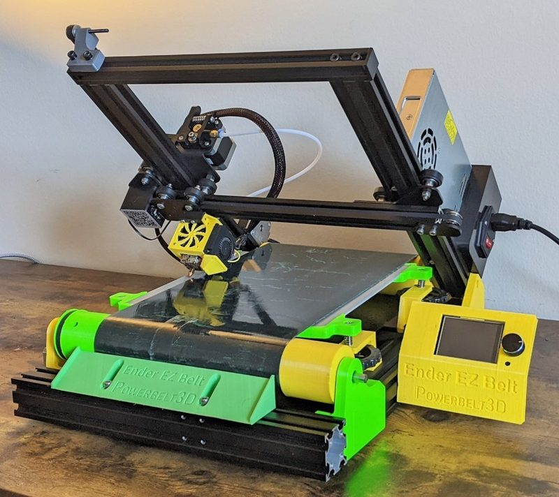
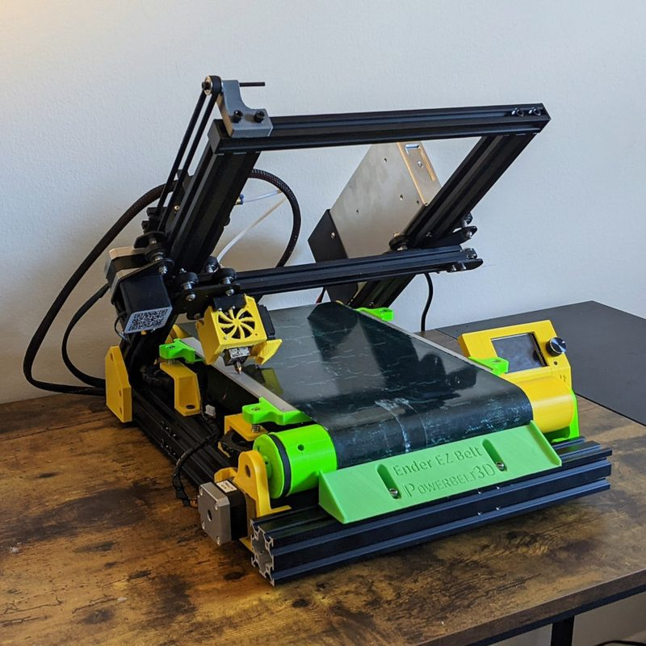
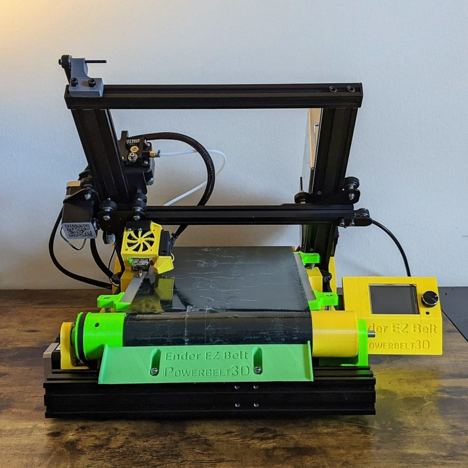
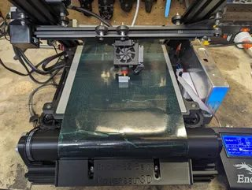
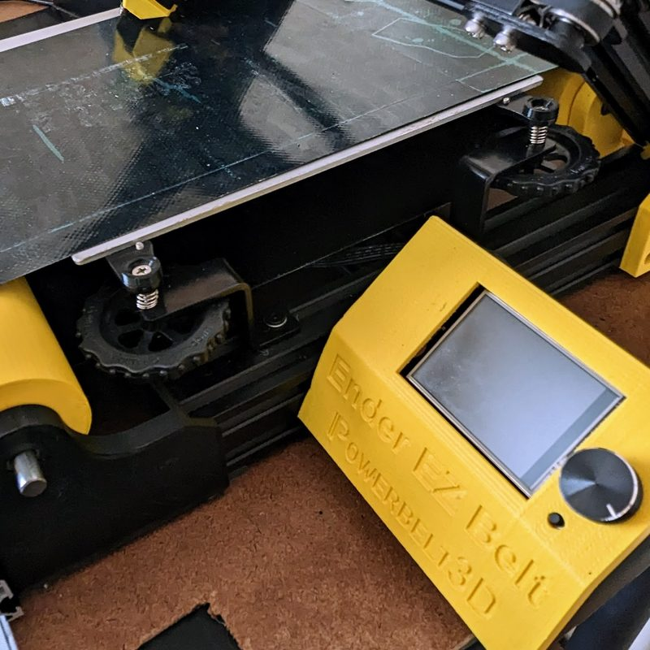

# Ender EZ Belt

[Catalog row](../../README.md#ender-ez-belt) · [Gallery](../../GALLERY.md)

| Field | Value |
| --- | --- |
| Section | Belt |
| Project page | [https://www.printables.com/model/255684-ender-ez-belt-3d-printer-conversion](https://www.printables.com/model/255684-ender-ez-belt-3d-printer-conversion) |
| Author | Powerbelt3D |
| About | Documented Ender-3 conveyor conversion; the creator calls the project open source, but its Formula32 belt is no longer sold by the closed shop. |
| Build volume (X×Y×Z) | — |
| Exterior (W×D×H) | — |
| Latest version | Update [2022-12](https://www.printables.com/model/255684-ender-ez-belt-3d-printer-conversion) |
| Stars Likes Views | [🧡⁠293](https://www.printables.com/model/255684-ender-ez-belt-3d-printer-conversion) [⏯️⁠25.1K](https://www.youtube.com/watch?v=ViQGZFbM22M) [❤️⁠554](https://www.youtube.com/watch?v=ViQGZFbM22M) |
| Links | [Files](https://www.printables.com/model/255684-ender-ez-belt-3d-printer-conversion) |
| Groups | — |
| License | [CC BY-SA](https://www.printables.com/model/255684-ender-ez-belt-3d-printer-conversion) |

## Pictures (5)

<table>
<tr><td align="center" width="33%"> Photo: <a href="https://www.printables.com/@AdamfromPowerbelt3D">Adam from Powerbelt3D</a></td><td align="center" width="33%"> Photo: <a href="https://www.printables.com/@AdamfromPowerbelt3D">Adam from Powerbelt3D</a></td><td align="center" width="33%"> Photo: <a href="https://www.printables.com/@AdamfromPowerbelt3D">Adam from Powerbelt3D</a></td></tr>
<tr><td align="center" width="33%"> Photo: <a href="https://www.printables.com/@Munkee915_429691">Munkee915</a></td><td align="center" width="33%"> Photo: <a href="https://www.printables.com/@AdamfromPowerbelt3D">Adam from Powerbelt3D</a></td></tr>
</table>

## Other homes of the files

- Wayback Machine: [latest snapshot](https://web.archive.org/web/20241129175855/https://www.printables.com/model/255684-ender-ez-belt-3d-printer-conversion), 2024-11-29.
