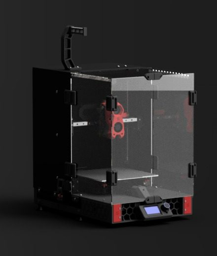
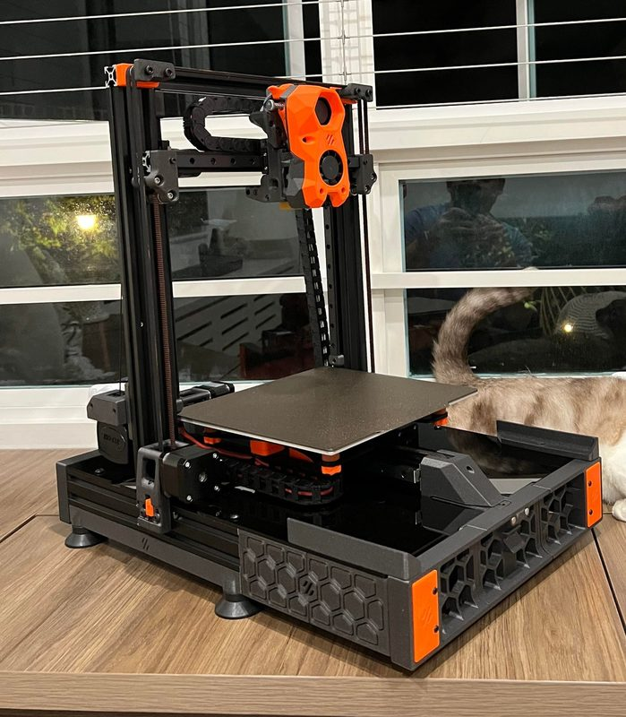
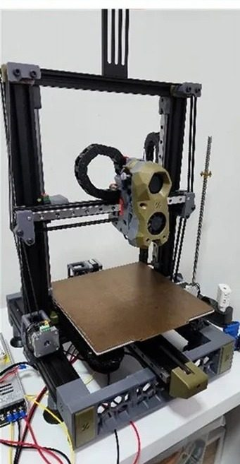
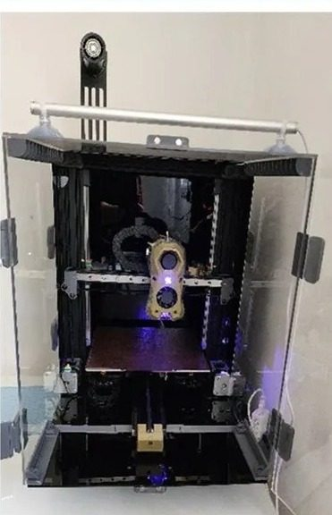

# Ender_SW

[Catalog row](../../README.md#ender-sw) · [Gallery](../../GALLERY.md)

| Field | Value |
| --- | --- |
| Section | Conversions |
| Project page | [https://github.com/boubounokefalos/Ender_SW](https://github.com/boubounokefalos/Ender_SW) |
| Author | DaRk_dOg / boubounokefalos |
| About | Unofficial Ender-3 Pro/V2 to CoreXZ conversion, redesigned from Triano’s original community Switchwire mod. |
| Build volume (X×Y×Z) | 220×220×220 |
| Exterior (W×D×H) | — |
| Latest version | v2.0 [2023-02](https://github.com/boubounokefalos/Ender_SW/releases/tag/v.2.0) |
| Stars Likes Views |  |
| Links | [Orig.](https://github.com/VoronDesign/VoronUsers/tree/main/printer_mods/Triano/Ender_3Pro_Switchwire) [CAD](https://github.com/boubounokefalos/Ender_SW/tree/main/CAD) [Wiki](https://github.com/boubounokefalos/Ender_SW/wiki) |
| Groups | [Discord](https://discord.gg/voron) EN 40.8K |
| License | [GPL-3.0](https://github.com/boubounokefalos/Ender_SW/blob/main/LICENSE) |

## Pictures (5)

<table>
<tr><td align="center" width="33%"> Photo: <a href="https://github.com/boubounokefalos">DaRk_dOg</a></td><td align="center" width="33%"> Photo: <a href="https://github.com/boubounokefalos">DaRk_dOg</a></td><td align="center" width="33%"> Photo: <a href="https://www.reddit.com/user/FizzysTech">u/FizzysTech</a></td></tr>
<tr><td align="center" width="33%"></td><td align="center" width="33%"></td></tr>
</table>

## Other homes of the files

- [GitHub](https://github.com/boubounokefalos/Ender_SW_WIKI): wiki data copy, GPL-3.0.
- Wayback Machine: [latest snapshot](https://web.archive.org/web/20260701000855/https://github.com/boubounokefalos/Ender_SW), 2026-07-01.
