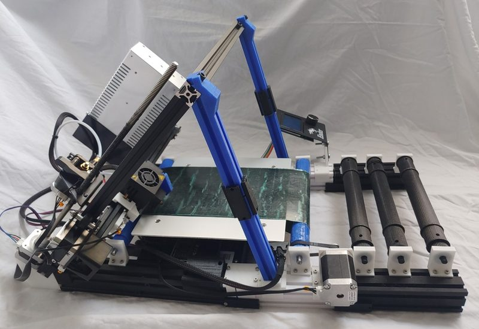
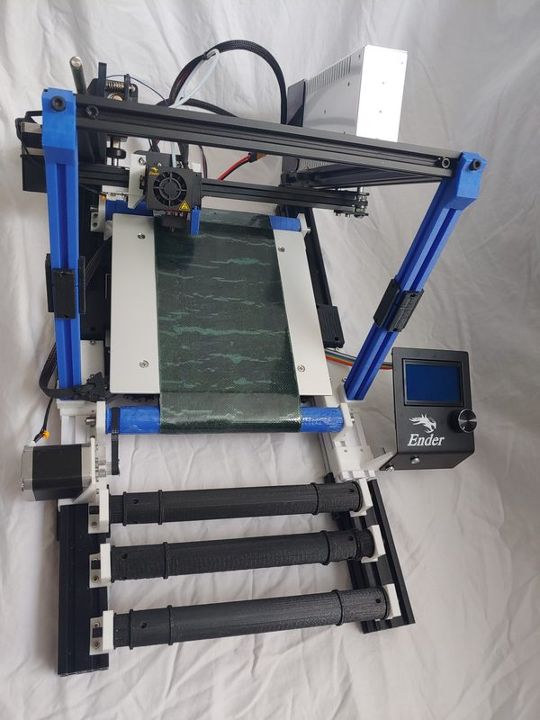
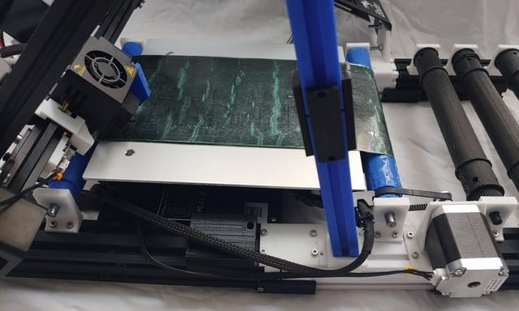

# EnderLoop

[Catalog row](../../README.md#enderloop) · [Gallery](../../GALLERY.md)

| Field | Value |
| --- | --- |
| Section | Belt |
| Project page | [https://github.com/mcsgroi/EnderLoop](https://github.com/mcsgroi/EnderLoop) |
| Author | mcsgroi |
| About | Ender-3 conveyor conversion still marked work in progress; it has build instructions, printable models, firmware source, a DIY belt option, and stable release snapshots. Files use a noncommercial license. No update since 2021 and no active group. |
| Build volume (X×Y×Z) | 110×200×∞ |
| Exterior (W×D×H) | — |
| Latest version | CAD [2021-02](https://github.com/mcsgroi/EnderLoop/commit/3a32565ad173ba2ad83c9e6f58818ab53eeddd8f) |
| Stars Likes Views |  [💙⁠545](https://www.thingiverse.com/thing:4658201) [🧡⁠42](https://www.printables.com/model/77171-enderloop) |
| Links | [STL](https://github.com/mcsgroi/EnderLoop/tree/main/Models) [Manual](https://github.com/mcsgroi/EnderLoop#readme) [Firmware](https://github.com/mcsgroi/EnderLoop/tree/main/Firmware) |
| Groups | — |
| License | [CC BY-NC 4.0 (Thingiverse, Printables), CC BY-NC-SA 4.0 (Instructables)](https://github.com/mcsgroi/EnderLoop#license) |

## Pictures (3)

<table>
<tr><td align="center" width="33%"> Photo: <a href="https://github.com/mcsgroi">mcsgroi</a></td><td align="center" width="33%"> Photo: <a href="https://github.com/mcsgroi">mcsgroi</a></td><td align="center" width="33%"> Photo: <a href="https://www.reddit.com/user/Penguinparty321">u/Penguinparty321</a></td></tr>
</table>

## Other homes of the files

- [Printables](https://www.printables.com/model/77171-enderloop): 22 STL, CC BY-NC.
- [Thingiverse](https://www.thingiverse.com/thing:4658201): 22 STL, Cura config, and Marlin firmware.
- [Instructables](https://www.instructables.com/EnderLoop/): build guide with photos, CC BY-NC-SA 4.0.
- Wayback Machine: [latest snapshot](https://web.archive.org/web/20251130194432/https://github.com/mcsgroi/EnderLoop), 2025-11-30.
