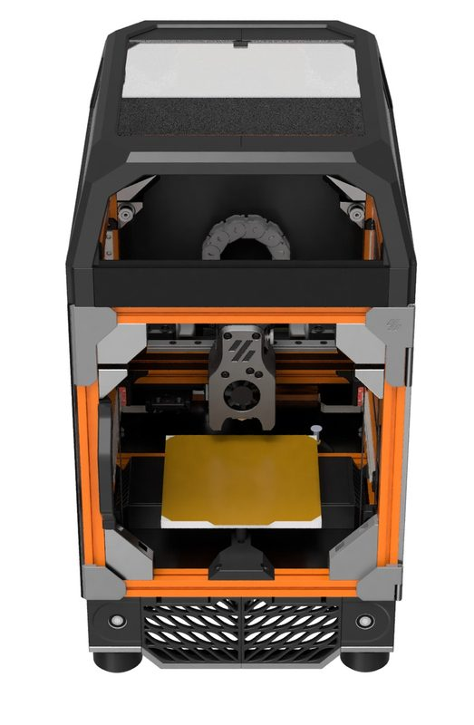
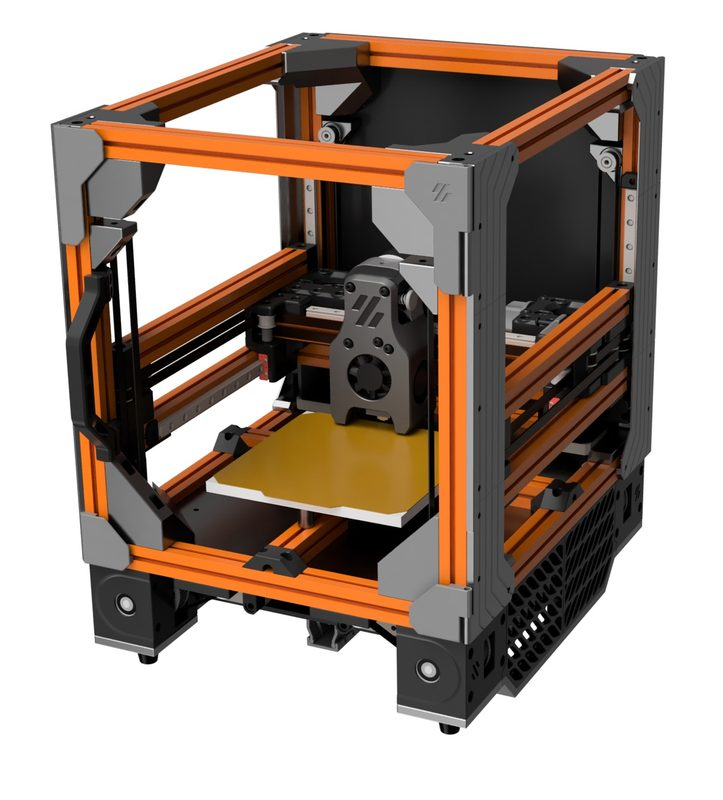
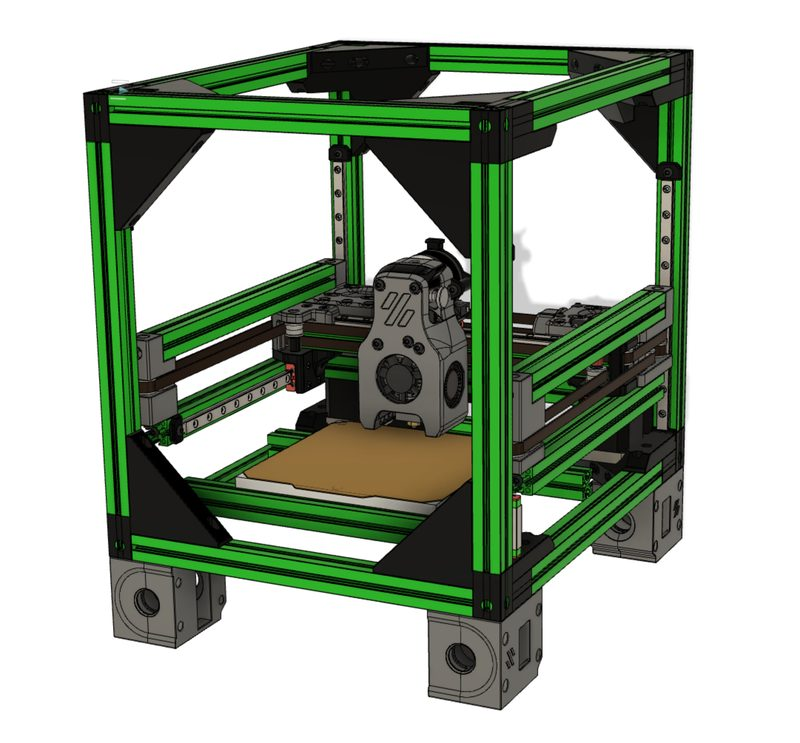

# F-Zero

[Catalog row](../../README.md#f-zero) · [Gallery](../../GALLERY.md)

| Field | Value |
| --- | --- |
| Section | Conversions |
| Project page | [https://github.com/zruncho3d/f-zero](https://github.com/zruncho3d/f-zero) |
| Author | zruncho3d |
| About | V0-component flying-gantry CoreXY that can be built fresh or as an upgrade. |
| Build volume (X×Y×Z) | 120×120×120 |
| Exterior (W×D×H) | — |
| Latest version | Update [2021-11](https://github.com/zruncho3d/f-zero#status-updates) |
| Stars Likes Views |  [⏯️⁠29.3K](https://www.youtube.com/watch?v=jLSPeJ7L9R4) [❤️⁠429](https://www.youtube.com/watch?v=jLSPeJ7L9R4) |
| Links | [CAD](https://github.com/zruncho3d/f-zero/tree/main/CAD) [Manual](https://github.com/zruncho3d/f-zero#buildlog-and-design-doc) |
| Groups | [Discord](https://discord.gg/voron) EN 40.8K [Discord](https://discord.gg/doomcube) EN 6.9K [Reddit](https://www.reddit.com/r/voroncorexy/) EN 30.3K |

## Pictures (4)

<table>
<tr><td align="center" width="33%"></td><td align="center" width="33%"></td><td align="center" width="33%"></td></tr>
<tr><td align="center" width="33%"></td></tr>
</table>
