# FoldaRap

[Catalog row](../../README.md#foldarap) · [Gallery](../../GALLERY.md)

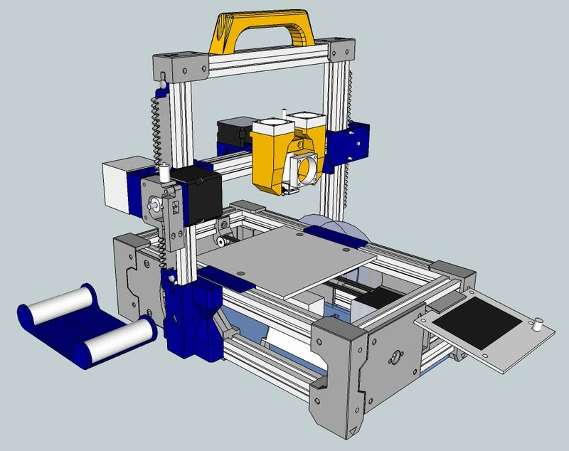

| Field | Value |
| --- | --- |
| Section | Historical designs |
| Project page | [https://github.com/EmmanuelG/Foldarap](https://github.com/EmmanuelG/Foldarap) |
| Author | Emmanuel Gilloz |
| About | Folding, portable Cartesian RepRap, and an early portable printer design. |
| Build volume (X×Y×Z) | 300×300×300 |
| Exterior (W×D×H) | — |
| Latest version | v4.0 [2017](https://github.com/EmmanuelG/Foldarap/blob/master/README.md#L18) |
| Stars Likes Views |  [💙⁠1.6K](https://www.thingiverse.com/thing:15877) [⏯️⁠12.7K](https://www.youtube.com/watch?v=XODWCUfyM1o) [❤️⁠48](https://www.youtube.com/watch?v=XODWCUfyM1o) |
| Links | [Files](https://github.com/EmmanuelG/Foldarap) |
| Groups | [Forum](https://reprap.org/forum/list.php?283) EN inactive |

## Pictures (11)

<table>
<tr><td align="center" width="33%"> Photo: <a href="https://github.com/EmmanuelG">Emmanuel Gilloz</a></td><td align="center" width="33%"><a href="1-foldarap.jpg">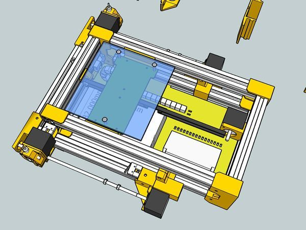</a> Photo: <a href="https://reprap.org/wiki/User:Emmanuel">Emmanuel Gilloz</a></td><td align="center" width="33%"><a href="2-foldarap.jpg">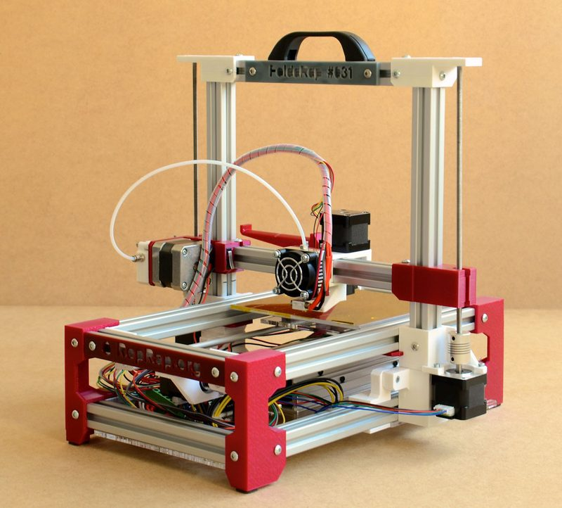</a> Photo: <a href="https://www.thingiverse.com/watsdesign">Emmanuel Gilloz</a></td></tr>
<tr><td align="center" width="33%"><a href="3-foldarap.jpg">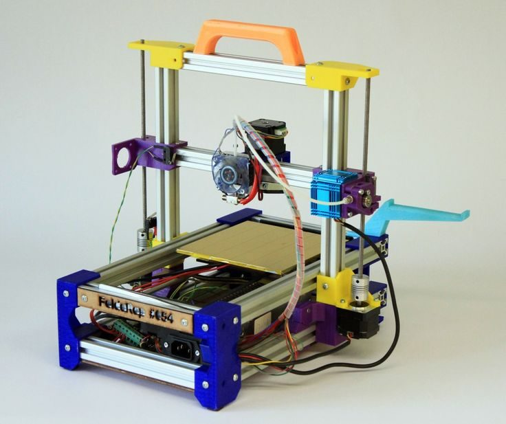</a> Photo: <a href="https://www.flickr.com/photos/watsdesign/">Emmanuel Gilloz</a></td><td align="center" width="33%"><a href="4-foldarap.jpg">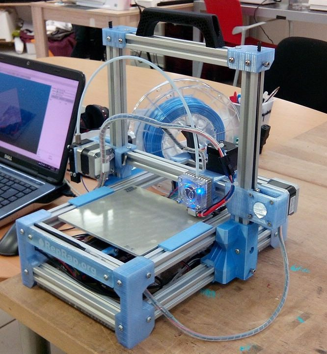</a> Photo: <a href="https://reprap.org/wiki/User:Emmanuel">Emmanuel Gilloz</a></td><td align="center" width="33%"><a href="5-foldarap.jpg">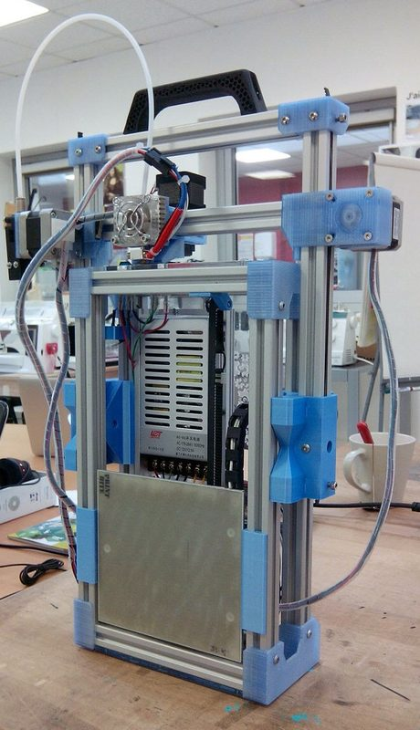</a> Photo: <a href="https://www.thingiverse.com/watsdesign">Emmanuel Gilloz</a></td></tr>
<tr><td align="center" width="33%"><a href="6-foldarap.jpg">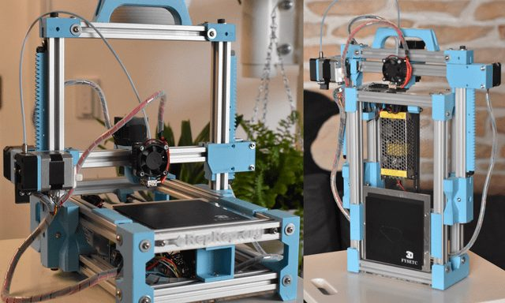</a> Photo: <a href="https://www.reddit.com/user/reefab">u/reefab</a></td><td align="center" width="33%"><a href="7-foldarap.jpg">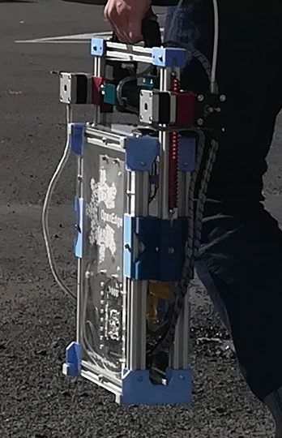</a> Photo: <a href="https://www.thingiverse.com/watsdesign">Emmanuel Gilloz</a></td><td align="center" width="33%"><a href="8-foldarap.jpg">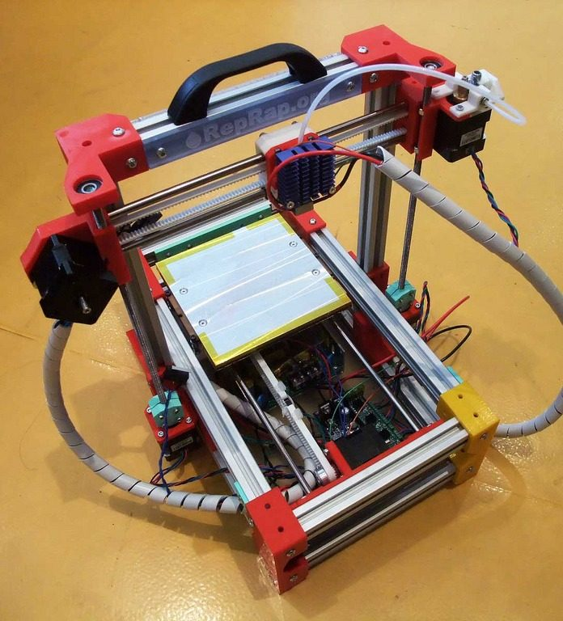</a> Photo: <a href="https://www.flickr.com/photos/watsdesign/">Emmanuel Gilloz</a></td></tr>
<tr><td align="center" width="33%"><a href="9-foldarap.jpg">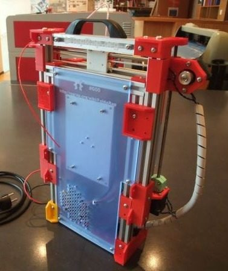</a> Photo: <a href="https://www.flickr.com/photos/watsdesign/">Emmanuel Gilloz</a></td><td align="center" width="33%"><a href="10-foldarap.jpg">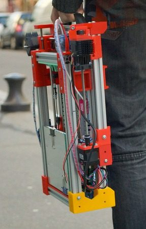</a> Photo: <a href="https://www.thingiverse.com/watsdesign">Emmanuel Gilloz</a></td></tr>
</table>
