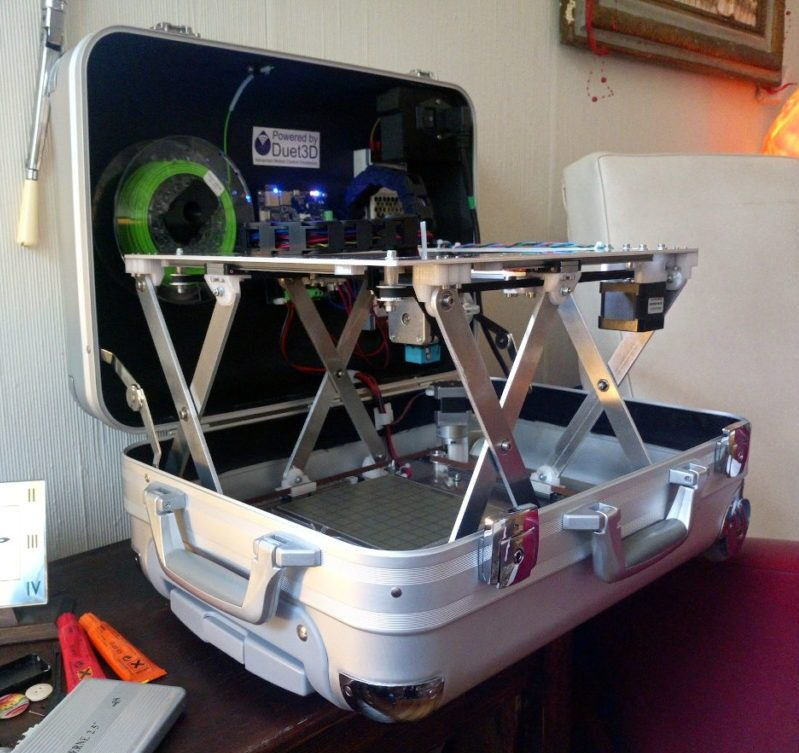
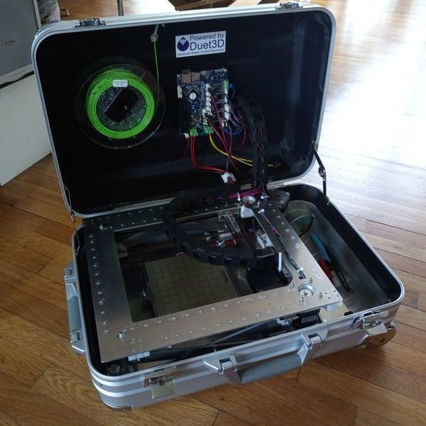
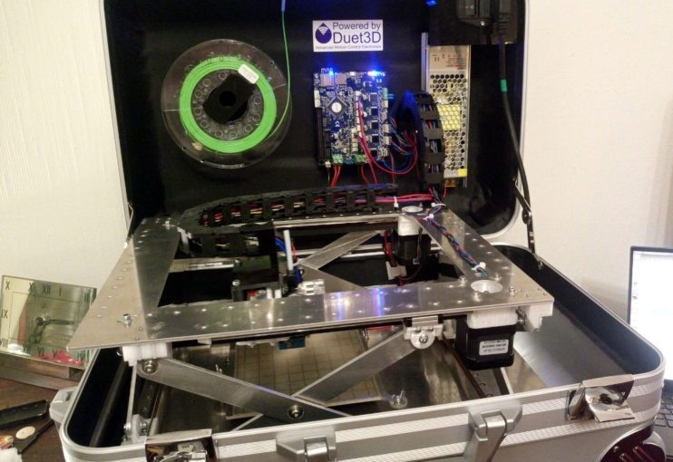
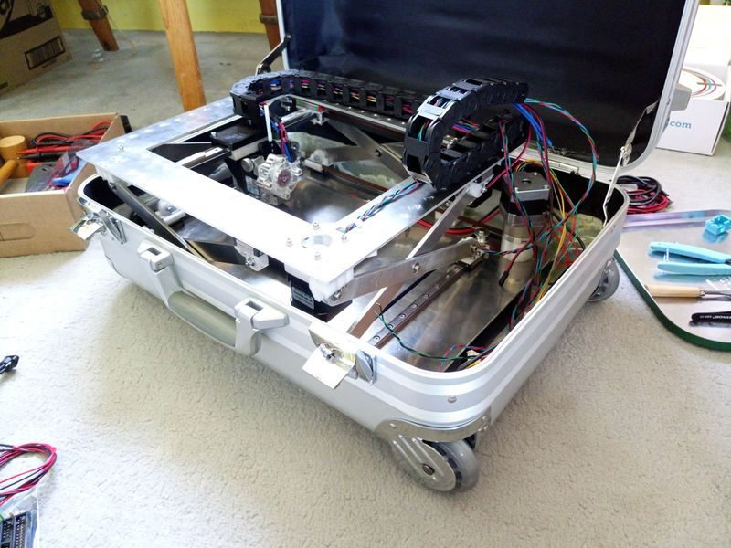
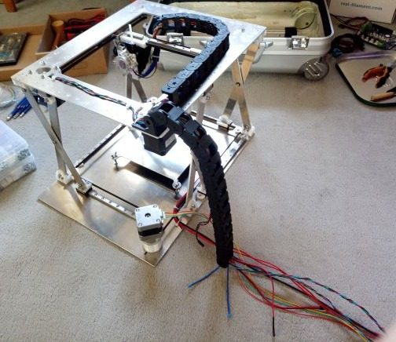

# FoldaRapX

[Catalog row](../../README.md#foldarapx) · [Gallery](../../GALLERY.md)

| Field | Value |
| --- | --- |
| Section | Historical designs |
| Project page | [https://reprap.org/wiki/FoldaRapX](https://reprap.org/wiki/FoldaRapX) |
| Author | Emmanuel Gilloz |
| About | Portable printer in a flight case. A scissor lift is the Z axis, so the machine unfolds as the print grows. The prototype stopped at version 0.1, because firmware for the non-linear Z axis was never finished. |
| Build volume (X×Y×Z) | — |
| Exterior (W×D×H) | — |
| Latest version | CAD [2020-05](https://github.com/EmmanuelG/FoldaRapX/commit/075d811cd35dd8bc92e509428f954cf5ef3d8455) |
| Stars Likes Views |  |
| Links | [Files](https://github.com/EmmanuelG/FoldaRapX) [BOM](https://github.com/EmmanuelG/FoldaRapX/blob/master/Bill%20Of%20Materials.ods) [Wiki](https://reprap.org/wiki/FoldaRapX) |
| Groups | — |
| License | [GPL-3.0](https://github.com/EmmanuelG/FoldaRapX/blob/master/LICENSE) |

## Pictures (6)

<table>
<tr><td align="center" width="33%"> Photo: <a href="https://reprap.org/wiki/User:Emmanuel">Emmanuel Gilloz</a></td><td align="center" width="33%"> Photo: <a href="https://reprap.org/wiki/User:Emmanuel">Emmanuel Gilloz</a></td><td align="center" width="33%"> Photo: <a href="https://reprap.org/wiki/User:Emmanuel">Emmanuel Gilloz</a></td></tr>
<tr><td align="center" width="33%"> Photo: <a href="https://reprap.org/wiki/User:Emmanuel">Emmanuel Gilloz</a></td><td align="center" width="33%"> Photo: <a href="https://reprap.org/wiki/User:Emmanuel">Emmanuel Gilloz</a></td><td align="center" width="33%"> Photo: <a href="https://reprap.org/wiki/User:Emmanuel">Emmanuel Gilloz</a></td></tr>
</table>
