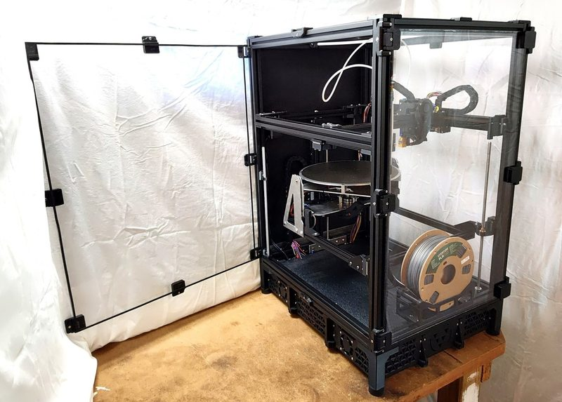
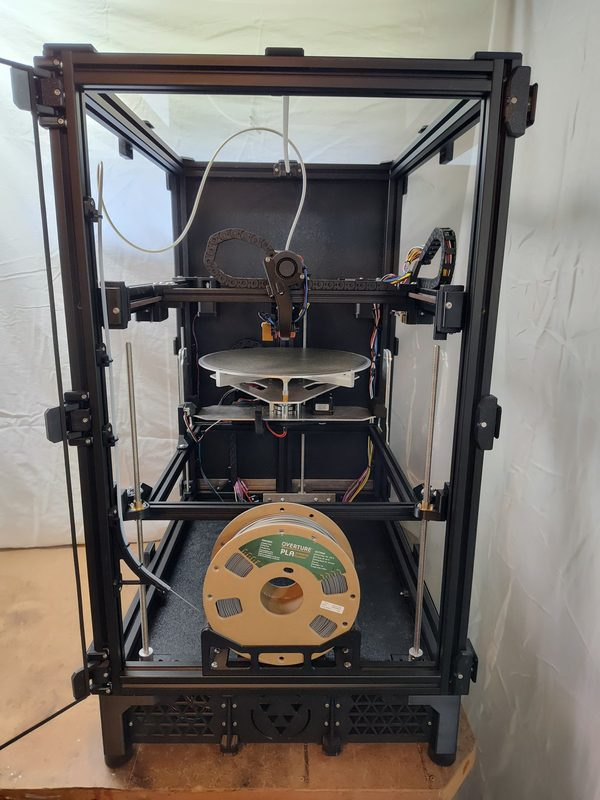
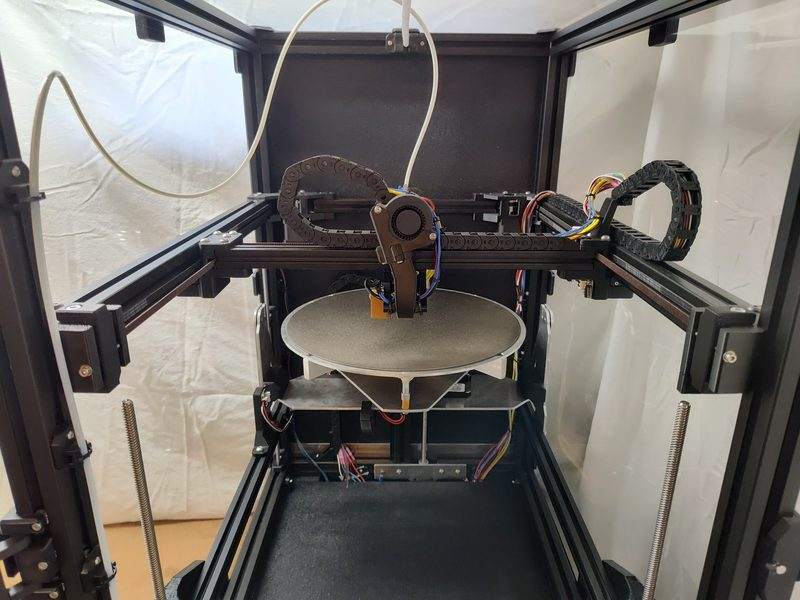
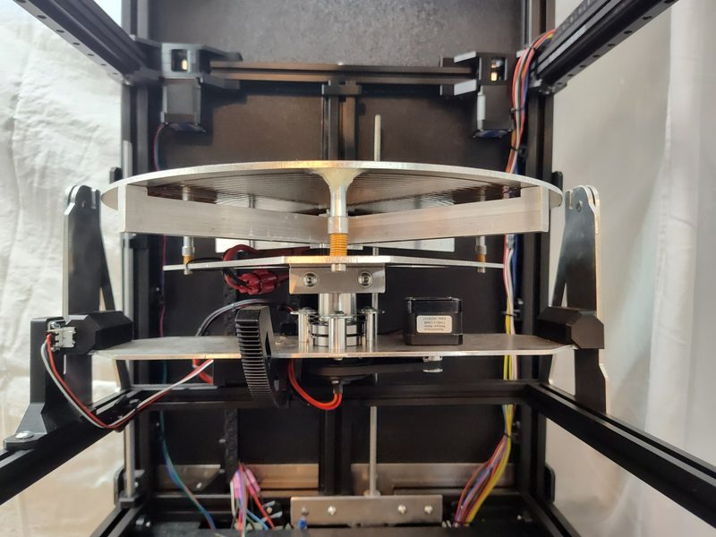

# Fractal 5 Pro

[Catalog row](../../README.md#fractal-5-pro) · [Gallery](../../GALLERY.md)

| Field | Value |
| --- | --- |
| Section | 5-axis |
| Project page | [https://github.com/fractalrobotics/Fractal-5-Pro](https://github.com/fractalrobotics/Fractal-5-Pro) |
| Author | Dan Brogan / Fractal Robotics |
| About | Enclosed CoreXY with a bed that tilts 90° and spins without limit, for multidirectional 5-axis printing. It pairs with the open [Fractal Cortex](https://github.com/fractalrobotics/Fractal-Cortex) slicer. |
| Build volume (X×Y×Z) | Ø300×250 |
| Exterior (W×D×H) | — |
| Latest version | CAD [2025-07](https://github.com/fractalrobotics/Fractal-5-Pro/commit/d49f96fd9aecdf43031ffbe9cf406f3a0c864487) |
| Stars Likes Views |  [⏯️⁠105K](https://www.youtube.com/watch?v=2_BY-7XOgWg) [❤️⁠7.1K](https://www.youtube.com/watch?v=2_BY-7XOgWg) |
| Links | [STEP](https://github.com/fractalrobotics/Fractal-5-Pro/blob/main/CAD/Fractal_5_Pro_Assembly.zip) [BOM](https://github.com/fractalrobotics/Fractal-5-Pro/blob/main/BOM/BOM.xlsx) [Config](https://github.com/fractalrobotics/Fractal-5-Pro/tree/main/Firmware) [Video](https://www.youtube.com/watch?v=2_BY-7XOgWg) |
| Groups | [Discord](https://discord.gg/PvPyGN2HSb) EN 166 |
| License | [GPL-3.0](https://github.com/fractalrobotics/Fractal-5-Pro/blob/main/LICENSE) |

## Pictures (5)

<table>
<tr><td align="center" width="33%"> Photo: <a href="https://github.com/fractalrobotics">Fractal Robotics</a></td><td align="center" width="33%"> Version: alpha unit Photo: <a href="https://github.com/fractalrobotics">Fractal Robotics</a></td><td align="center" width="33%"> Version: alpha unit Photo: <a href="https://github.com/fractalrobotics">Fractal Robotics</a></td></tr>
<tr><td align="center" width="33%"> Photo: <a href="https://github.com/fractalrobotics">Fractal Robotics</a></td><td align="center" width="33%"> Photo: <a href="https://github.com/fractalrobotics">Fractal Robotics</a></td></tr>
</table>
