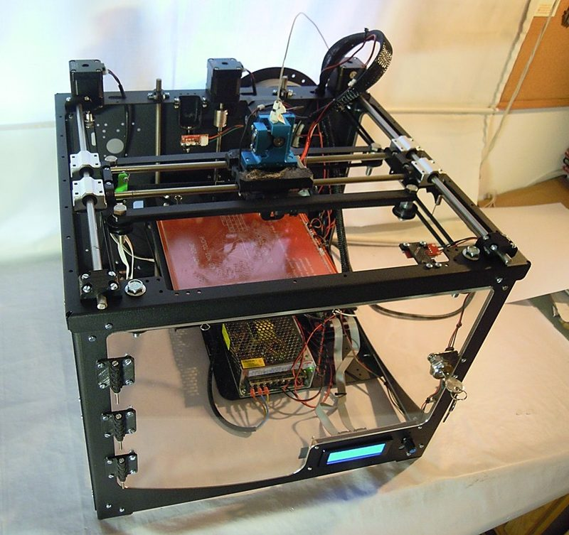
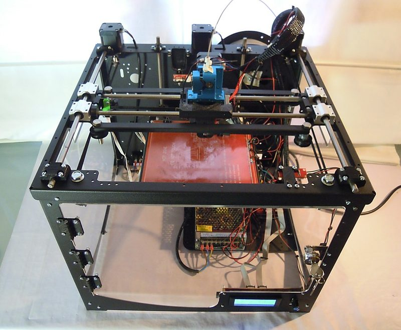
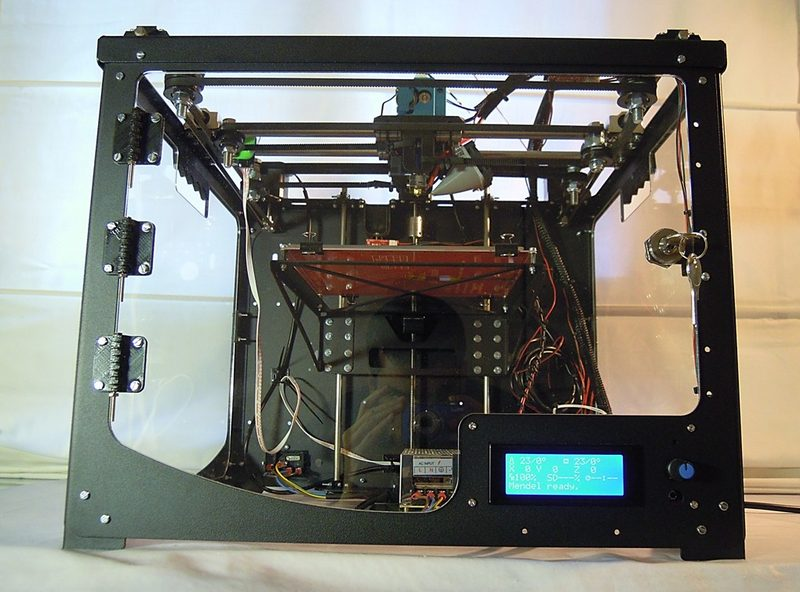
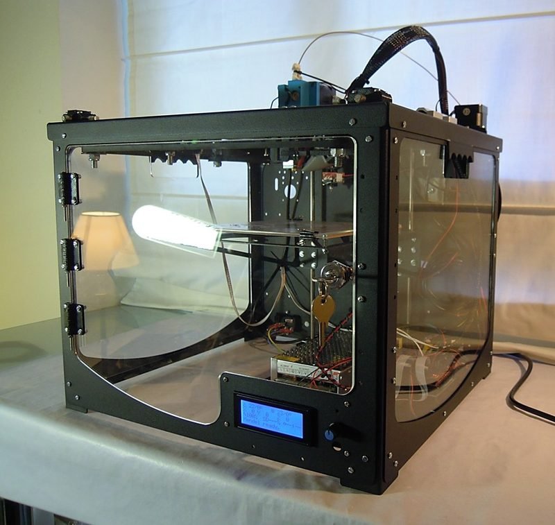
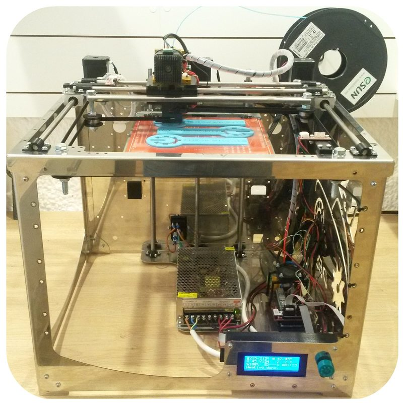
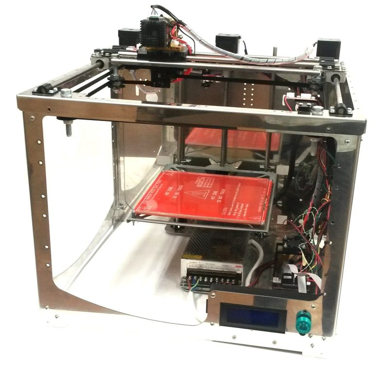

# Frax3D

[Catalog row](../../README.md#frax3d) · [Gallery](../../GALLERY.md)

| Field | Value |
| --- | --- |
| Section | Legacy designs |
| Project page | [https://github.com/frax3d/Frax3D](https://github.com/frax3d/Frax3D) |
| Author | FraxDesign / BCN Dynamics |
| About | CoreXY with a frame of folded stainless steel sheet, an acrylic door, and an E3D hotend. BCN Dynamics sold it as a kit. The repository has STEP and STL files for each printed, sheet-metal, and acrylic part. No update since 2016-04. |
| Build volume (X×Y×Z) | — |
| Exterior (W×D×H) | — |
| Latest version | STEP [2016-04](https://github.com/frax3d/Frax3D/commit/39f3a5f6a0f7c56962bbd95b6f747f53c8458072) |
| Stars Likes Views |  [💙⁠87](https://www.thingiverse.com/thing:1489094) [⏯️⁠17.4K](https://www.youtube.com/watch?v=fQFrWCCibYs) [❤️⁠572](https://www.youtube.com/watch?v=fQFrWCCibYs) |
| Links | [Files](https://github.com/frax3d/Frax3D) [STL](https://www.thingiverse.com/thing:1489094/files) |
| Groups | — |
| License | [CC BY 4.0 (Thingiverse), GPL (RepRap wiki)](https://www.thingiverse.com/thing:1489094) |

## Pictures (7)

<table>
<tr><td align="center" width="33%"> Version: v1.0 (render) Photo: <a href="https://www.thingiverse.com/joelfrax/designs">joelfrax</a></td><td align="center" width="33%"> Version: v1.0, black frame Photo: <a href="https://www.thingiverse.com/joelfrax/designs">joelfrax</a></td><td align="center" width="33%"> Version: v1.0, black frame Photo: <a href="https://www.thingiverse.com/joelfrax/designs">joelfrax</a></td></tr>
<tr><td align="center" width="33%"> Version: v1.0, black frame Photo: <a href="https://www.thingiverse.com/joelfrax/designs">joelfrax</a></td><td align="center" width="33%"> Version: v1.0, black frame Photo: <a href="https://www.thingiverse.com/joelfrax/designs">joelfrax</a></td><td align="center" width="33%"> Version: stainless-steel frame (BCN Dynamics kit) Photo: <a href="https://reprap.org/wiki/User:Bcndynamics">BCN Dynamics</a></td></tr>
<tr><td align="center" width="33%"> Version: stainless-steel frame (BCN Dynamics kit) Photo: <a href="https://reprap.org/wiki/User:Bcndynamics">BCN Dynamics</a></td></tr>
</table>
