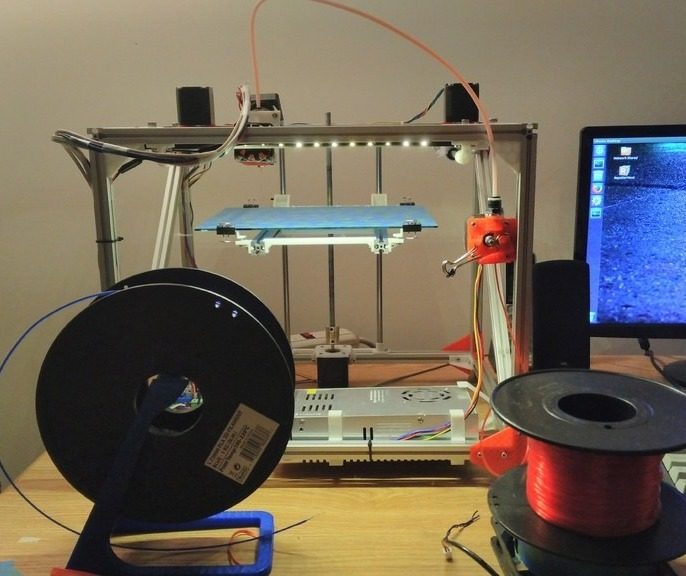
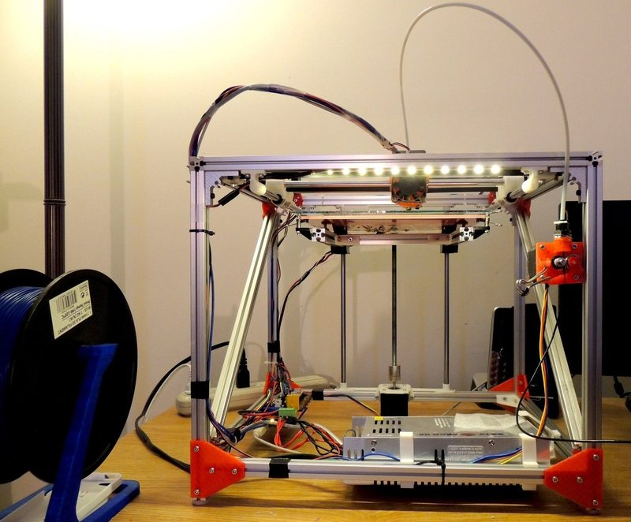
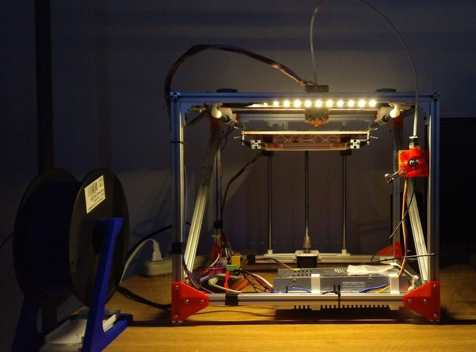
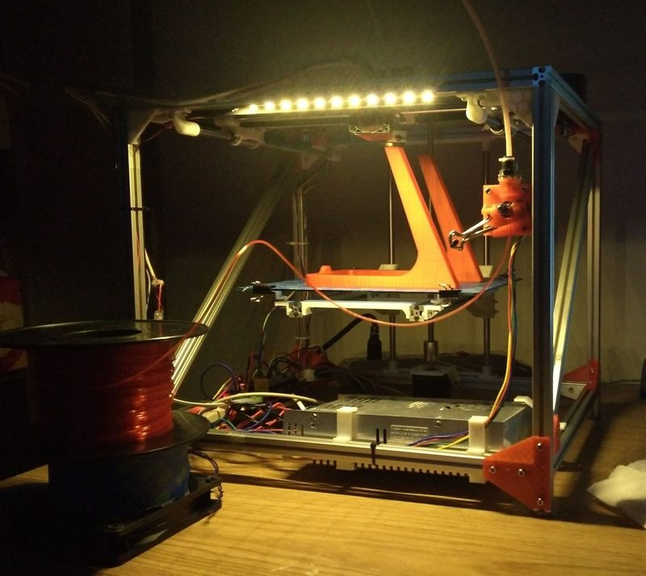
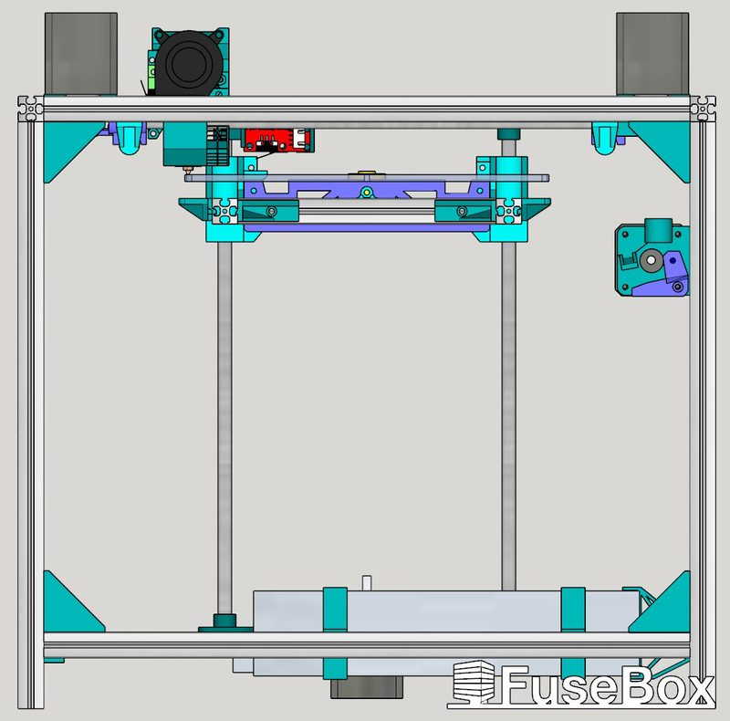

# FuseBox

[Catalog row](../../README.md#fusebox-v1) · [Gallery](../../GALLERY.md)

| Field | Value |
| --- | --- |
| Section | Historical designs |
| Project page | [https://github.com/alexyu132/fusebox](https://github.com/alexyu132/fusebox) |
| Author | Alex Yu |
| About | Low-cost CoreXY on a 1515 extrusion frame with a stacked belt path that avoids crossed belts. Versions 1.0 to 1.4 are on Thingiverse and the RepRap wiki, and version 1.5 moved to GitHub in 2017. |
| Build volume (X×Y×Z) | 200×200×200 |
| Exterior (W×D×H) | — |
| Latest version | 1.5 CAD [2019-09](https://github.com/alexyu132/fusebox/commit/e576252e7e7ff73ca86320ed0da06b6547512bc9) |
| Stars Likes Views |  [💙⁠1.1K](https://www.thingiverse.com/thing:1047193) [⏯️⁠25.1K](https://www.youtube.com/watch?v=kshVDL2V_oc) [❤️⁠66](https://www.youtube.com/watch?v=kshVDL2V_oc) |
| Links | [CAD](https://github.com/alexyu132/fusebox/blob/master/FuseBox1.5.skp) [STL](https://github.com/alexyu132/fusebox/tree/master/stl) [Files](https://www.thingiverse.com/thing:1047193/files) old 1.4 [Wiki](https://reprap.org/wiki/FuseBox) [Video](https://www.youtube.com/watch?v=kshVDL2V_oc) |
| Groups | — |
| License | [CC BY 4.0 (Thingiverse), GPL (RepRap wiki)](https://www.thingiverse.com/thing:1047193) |

## Pictures (6)

<table>
<tr><td align="center" width="33%"> Photo: <a href="https://www.thingiverse.com/_AlexY">Alex Yu</a></td><td align="center" width="33%"> Photo: <a href="https://www.thingiverse.com/_AlexY">Alex Yu</a></td><td align="center" width="33%"> Photo: <a href="https://www.thingiverse.com/_AlexY">Alex Yu</a></td></tr>
<tr><td align="center" width="33%"> Photo: <a href="https://www.thingiverse.com/_AlexY">Alex Yu</a></td><td align="center" width="33%"> Photo: <a href="https://www.thingiverse.com/_AlexY">Alex Yu</a></td><td align="center" width="33%"> Version: FuseBox 1.5 Photo: <a href="https://github.com/alexyu132">Alex Yu</a></td></tr>
</table>
