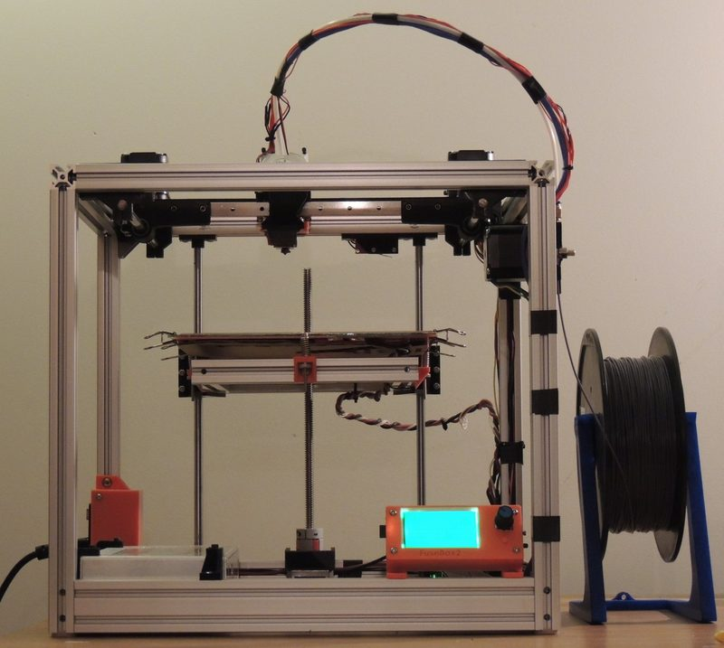
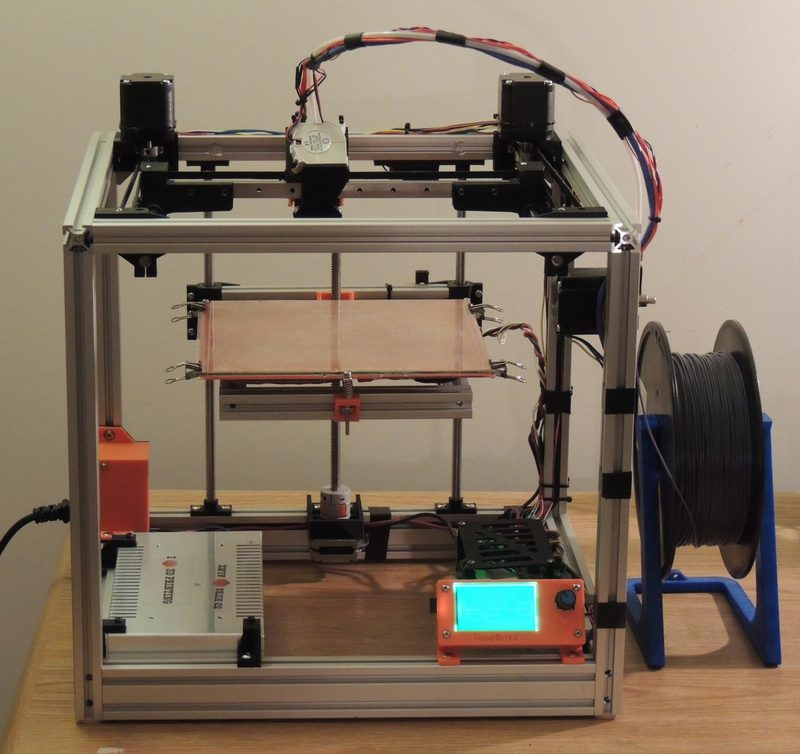
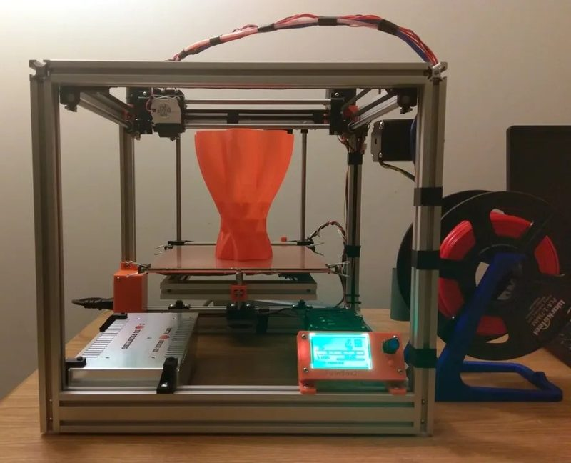
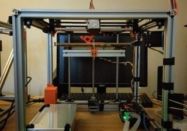
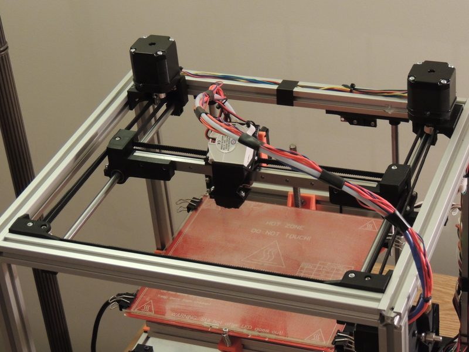

# FuseBox2 / 2R

[Catalog row](../../README.md#fusebox2) · [Gallery](../../GALLERY.md)

| Field | Value |
| --- | --- |
| Section | Legacy designs |
| Project page | [https://github.com/alexyu132/fusebox2](https://github.com/alexyu132/fusebox2) |
| Author | Alex Yu |
| About | Earlier compact CoreXY; the creator recommends the 2R rail-gantry variant for a fresh build. Replaced by the FuseBox3. |
| Build volume (X×Y×Z) | 2: 210×200×210 2R: 210×205×210 |
| Exterior (W×D×H) | 390×340×412 |
| Latest version | 2R CAD [2019-12](https://github.com/alexyu132/fusebox2/commit/67b5c9bdce200988ecd771d23534e7a76fff9275) |
| Stars Likes Views |  [💙⁠545](https://www.thingiverse.com/thing:2422839) [💚⁠16](https://makerworld.com/en/models/27001) [⏯️⁠6.3K](https://www.youtube.com/watch?v=aUQ9sjp_YzY) [❤️⁠24](https://www.youtube.com/watch?v=aUQ9sjp_YzY) |
| Links | [CAD](https://github.com/alexyu132/fusebox2/blob/master/FuseBox2R.skp) [Manual](https://github.com/alexyu132/fusebox2/blob/master/Build%20Tips.md) [BOM](https://github.com/alexyu132/fusebox2#bom) |
| Groups | — |

## Pictures (6)

<table>
<tr><td align="center" width="33%"> Photo: <a href="https://github.com/alexyu132">Alex Yu</a></td><td align="center" width="33%"> Photo: <a href="https://www.thingiverse.com/_AlexY">Alex Yu</a></td><td align="center" width="33%"> Photo: <a href="https://www.thingiverse.com/_AlexY">Alex Yu</a></td></tr>
<tr><td align="center" width="33%"> Photo: <a href="https://makerworld.com/en/@AlexY_">Alex Yu</a></td><td align="center" width="33%"> Photo: <a href="https://makerworld.com/en/@AlexY_">Alex Yu</a></td><td align="center" width="33%"> Photo: <a href="https://www.thingiverse.com/_AlexY">Alex Yu</a></td></tr>
</table>
